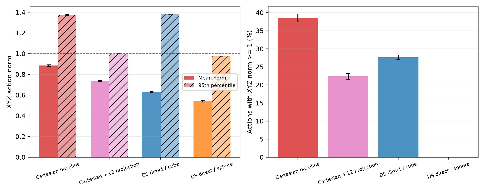

# 动作表示与参考测度：历史协议

[历史归档索引](index.md) · [文档入口](../index.md)

> 历史归档：各节保留原文的日期、实验身份和结论范围。旧文中的“当前”“推荐”“待做”不代表今天的执行状态；日常规则以 [实验](../current/experiments.md)、[运行与存储](../current/runbook.md) 为准。

## 内容

- [Fresh-seed confirmation of the direction-chart effect](#direction-chart-confirmation-protocol)
- [Direction-chart screen under a fixed semantic reference](#direction-chart-screen-protocol)
- [DS adapter critic-space counterfactual](#envq-counterfactual-protocol)
- [GAC strong-baseline protocol](#gac-baseline-protocol)
- [Reference-measure KL-budget calibration screen](#klbudget-screen-protocol)
- [Matched-forward reference-measure ablation](#matched-reference-protocol)
- [Cartesian L2 投影反事实实验](#projection-counterfactual-protocol)
- [Tangent semantic-reference direction-family screen](#tangent-semantic-protocol)

<a id="direction-chart-confirmation-protocol"></a>
## Fresh-seed confirmation of the direction-chart effect

原文位置：`docs/experiments/action_space/direction_chart_confirmation_protocol.md`。正文按原记录保留，原文件名用于历史追溯。

> Status: complete, including fixed 100-episode reevaluation.  Group:
> `direction_chart_confirmation_500k_20260925`.

<a id="direction-chart-confirmation-protocol--confirmatory-question"></a>
### Confirmatory question

The four-seed discovery screen found a +18.5 percentage-point endpoint gain
for stereographic G5 over spherical S5 under a matched semantic reference and
KL budget.  This experiment asks whether that direction-chart effect repeats
on untouched seeds 4--7.

<a id="direction-chart-confirmation-protocol--fixed-design"></a>
### Fixed design

- Environment: `cube-triple-play-singletask-task2-v0`, horizon H=1.
- Training: 500k online environment steps; evaluations every 100k steps with
  50 episodes; final fixed reevaluation with 100 episodes.
- Pairing: seeds 4, 5, 6, and 7 for both policy families; common evaluation
  seed 20260925.
- Shared settings: integrated DS, sphere radial bound, env-action critic,
  semantic-product reference, one alpha, target KL 5.3187063194210715.
- Only manipulated factor: spherical versus stereographic direction chart.

The primary outcome is the paired final success difference at 500k.  Secondary
outcomes are fixed-100 success, tail-three mean, and normalized success AUC.
Report all eight seed-level values, paired bootstrap intervals, and the exact
sign-flip p-value.  Discovery and confirmation must also be reported
separately before any pooled eight-pair estimate.

<a id="direction-chart-confirmation-protocol--decision-rule"></a>
### Decision rule

A credible replication requires a positive mean endpoint difference and at
least three of four fresh pairs favoring stereographic.  If confirmed, pool
the eight pairs only as a secondary estimate and expand to additional tasks or
horizons.  If not confirmed, report the original result as an unstable
discovery and prioritize state-/phase-conditioned exploration rather than
chart-family tuning.

<a id="direction-chart-confirmation-protocol--result"></a>
### Result

The confirmation failed its pre-specified decision rule.  At 500k steps,
spherical scored 2%, 4%, 2%, and 0% on seeds 4--7 (mean 2.0%), while
stereographic scored 0%, 6%, 0%, and 0% (mean 1.5%).  Paired differences were
-2, +2, -2, and 0 percentage points: only one of four favored stereographic,
one tied, and the mean difference was -0.5 points.  Its paired bootstrap
interval was [-2.0, +1.0] points and the exact sign-flip p-value was 1.0.
Tail-three success and AUC showed the same -0.17 and -0.05 point mean effects.

The common 100-episode reevaluation gave spherical 2%, 3%, 1%, and 0% (mean
1.5%) versus stereographic 3%, 1%, 0%, and 0% (mean 1.0%).  The paired
difference remained -0.5 points, with bootstrap interval [-1.5, +0.5] and
sign-flip p=0.75.  Thus evaluation noise at 50 episodes does not explain the
failed replication.

Pooling discovery and confirmation gives an apparently positive +9.0-point
endpoint estimate, but this is secondary and misleading without the cohort
split: all large gains occur in discovery seeds 0--3, whereas the untouched
confirmation cohort is null/slightly negative.  The direction-chart effect is
therefore classified as seed-unstable and is not a supported performance
claim.

Operational note: an initial attempt to run all eight fixed reevaluations at
once exhausted JAX compilation memory for seven processes before any episode
was recorded.  The one completed result was retained and the seven missing
evaluations were rerun in two batches with at most two processes per GPU.  All
eight final CSVs use the same checkpoint, 100 episodes, and evaluation seed.

<a id="direction-chart-screen-protocol"></a>
## Direction-chart screen under a fixed semantic reference

原文位置：`docs/experiments/action_space/direction_chart_screen_protocol.md`。正文按原记录保留，原文件名用于历史追溯。

> Status: the four-seed discovery screen and fixed-seed reevaluation are
> complete.  Group: `stereographic_semantic_500k_20260925`.  A paired
> fresh-seed confirmation on seeds 4--7 is complete and did not replicate the
> discovery effect; see `direction_chart_confirmation_protocol.md`.

<a id="direction-chart-screen-protocol--question"></a>
### Question

The matched-reference and KL-budget experiments showed that semantic
regularization changes radius and angular dispersion but does not improve
task2.  This screen asks whether the result is specific to the bounded
spherical-angle chart, which has a longitude seam and polar singularities.

<a id="direction-chart-screen-protocol--matched-comparison"></a>
### Matched comparison

- Control S5: spherical angle chart, semantic-product reference, KL target
  5.3187063, env-action critic.
- Treatment G5: stereographic chart, the same semantic-product reference and
  KL target, env-action critic.
- Task2, H=1, 500k steps, seeds 0--3, fixed training reset seed and common
  evaluation seed 20260925.

Both policies use a 5D diagonal Gaussian raw sampler, the same network and
parameter heads, the same unit-ball forward action domain, and the same
normalized direction/speed/scalar reference.  Only the direction chart changes.
The analytic identity between action-volume and semantic ratios remains
`-2 log(rho) - log(3)` and is unit-tested for both charts.

This remains an exploratory family screen.  A positive G5--S5 result would
motivate a fresh-seed confirmation and a seam-free Power Spherical comparison;
a null/negative result would make chart choice an unlikely explanation and
shift priority to state-/phase-dependent exploration or a paper scoped as a
mechanism audit.

<a id="direction-chart-screen-protocol--pre-launch-verification"></a>
### Pre-launch verification

- Six reference-measure tests pass, including the stereographic analytic ratio.
- Spherical and stereographic agents at seed 0 have 49 matching parameter
  leaves with maximum absolute initialization difference exactly zero.
- Eight sampled stereographic actions were finite, stayed inside the unit ball,
  and produced finite semantic log-density ratios.
- Four seeds were launched across two identical GPUs with two jobs per GPU.

<a id="direction-chart-screen-protocol--discovery-result"></a>
### Discovery result

At 500k steps, G5 reached per-seed success rates of 26%, 12%, 4%, and 42%
(mean 21.0% +/- 16.7%), compared with 6%, 0%, 0%, and 4% for S5
(2.5% +/- 3.0%).  The paired G5--S5 endpoint gain was +18.5 percentage
points, with a paired bootstrap interval of [+8.0, +31.5] points.  The
tail-three-checkpoint gain was +6.33 points and the normalized success AUC
gain was +1.95 points; all four paired differences were nonnegative and the
exact two-sided sign-flip p-value was 0.125, the smallest possible value with
four strictly positive pairs.

On 100 common evaluation episodes, G5 scored 28%, 9%, 3%, and 42% (mean
20.5%) versus S5's 2%, 1%, 1%, and 3% (mean 1.75%).  The paired gain was
+18.75 points with bootstrap interval [+5.0, +32.5].  Mean translational norm
was effectively matched (0.7212 for G5 versus 0.7221 for S5), as were tail
entropy (-5.311 versus -5.374) and alpha (0.0583 versus 0.0590).  Thus the
observed gain is not explained by a larger radial action scale or a looser KL
budget.

On a shared bank of 1,024 prior-data observations with 32 conditional action
samples per state, stochastic-policy radius was also matched (0.9212 for G5
versus 0.9197 for S5).  G5 had *smaller* mean angular deviation (0.262 versus
0.277 radians) and larger direction KL to the uniform semantic reference
(3.021 versus 2.938 nats).  Consequently the gain cannot be described as
broader angular exploration.  A plausible but not yet identified mechanism is
that the stereographic chart provides a more useful or more easily optimized
directional concentration pattern.

This was promising but remained a discovery result.  The pre-specified
fresh-seed confirmation subsequently produced a -0.5-point endpoint difference
and only one positive pair, so the discovery result must not be used as a
performance claim.  Tangent is deferred: after the failed replication,
state-/phase-aware exploration has higher priority than opening another global
chart comparison.

<a id="envq-counterfactual-protocol"></a>
## DS adapter critic-space counterfactual

原文位置：`docs/experiments/action_space/envq_counterfactual_protocol.md`。正文按原记录保留，原文件名用于历史追溯。

> Status: complete (8/8 new env-Q runs succeeded); experiment group
> `envq_counterfactual_500k_20260925`.

<a id="envq-counterfactual-protocol--1-question"></a>
### 1. Question

The direction--speed adapter emits a 6-dimensional policy action: three raw
direction coordinates, one speed, and two unchanged controls.  The environment,
however, receives only the 5-dimensional composed action.  Earlier runs trained
the critic on the 6-dimensional latent action.  That representation is redundant:
changing the length of the raw direction does not change the action executed by
the environment after normalization.

This experiment asks whether the adapter's apparent sample-efficiency gain remains
when the critic is evaluated only on the action that the environment actually
executes.

<a id="envq-counterfactual-protocol--2-counterfactual-design"></a>
### 2. Counterfactual design

We compare two critic interfaces for each of the `cube` and `sphere` radial bounds.
The actor, forward composition, exploration distribution, entropy target, network
width, optimizer, prior data, and evaluation protocol are held fixed.

| Condition | Actor output | Environment action | Critic input |
|---|---:|---:|---:|
| latent-Q | 6D direction--speed coordinates | composed 5D action | 6D latent action |
| env-Q | 6D direction--speed coordinates | composed 5D action | composed 5D action |

For env-Q, both the target value and actor objective use

\[
Q\bigl(s,\operatorname{compose}(z)\bigr),
\]

and replay stores the 5D executed action directly.  For latent-Q, replay actions
are mapped to a canonical 6D inverse representation while actor samples are passed
to the critic before composition.  Thus latent-Q can distinguish policy actions
that are behaviorally identical; env-Q cannot.

We deliberately keep the entropy target tied to the 6D policy output in both
conditions.  This makes the comparison a critic-space intervention only; it does
not yet test whether a different semantic entropy reference causes the gain.

<a id="envq-counterfactual-protocol--3-fixed-configuration"></a>
### 3. Fixed configuration

| Configuration | Value |
|---|---:|
| Environment | `cube-triple-play-singletask-task2-v0` |
| Algorithm | ACRLPD / SAC with prior data |
| Radial bounds | `cube`, `sphere` |
| Critic spaces | `latent`, `env` |
| Paired seeds | 0, 1, 2, 3 |
| Online environment steps | 500,000 |
| Random warm-up | 5,000 steps |
| Batch size | 256 (128 prior + 128 online) |
| UTD ratio | 1 |
| Discount | 0.99 |
| Actor / critic | 4 layers, width 512 |
| Q ensemble | 10, target aggregation by mean |
| Learning rate | 3e-4 |
| Target update `tau` | 0.005 |
| BC coefficient | 0 |
| Action horizon | 1 |
| Evaluation interval | 100,000 steps |
| Evaluation episodes | 50 |
| OGBench | 1.2.1 |
| JAX / jaxlib | 0.9.2 / 0.9.2 |
| Flax | 0.12.6 |
| MuJoCo | 3.9.0 |

The four latent-Q seeds are reused from
`projection_counterfactual_500k_20260925`; eight new env-Q runs were executed.

Implementation checks before the formal run verified that the policy head remains
6D while critic inputs are `41+6=47` for latent-Q and `41+5=46` for env-Q.  With
the same seed, every actor parameter is bit-identical (`max_abs_diff=0`); only the
critic input layer changes shape.  The direction--speed, L2 projection, tangent,
and env-Q test suite passes 15 tests and 3 parameterized subtests.

<a id="envq-counterfactual-protocol--4-predeclared-metrics-and-interpretation"></a>
### 4. Predeclared metrics and interpretation

The primary screening metric is success-rate AUC from 0 to 500k steps.  We also
report final success, the mean of the last three evaluation points, all per-seed
paired differences, a paired bootstrap interval, and an exact sign-flip test.

| Observation | Interpretation |
|---|---|
| env-Q approximately retains latent-Q performance | The gain is not explained by redundant latent critic input; explicit radial parameterization remains a plausible mechanism. |
| env-Q substantially improves over latent-Q | The latent critic was harmful, consistent with value learning on a redundant/OOD action representation. |
| env-Q substantially underperforms latent-Q | A material part of the old gain depends on the redundant latent critic and cannot support a clean semantic-exploration claim. |
| Results have unstable signs across four seeds | Treat as inconclusive screening evidence and diagnose critic errors before scaling seeds. |

With only four seed pairs, the smallest possible two-sided exact sign-flip
`p`-value is 0.125.  This experiment is therefore a mechanism screen rather than
a confirmatory significance test.

<a id="envq-counterfactual-protocol--5-reproducibility-files"></a>
### 5. Reproducibility files

- Task specification: `tasks_envq_counterfactual_500k.json`
- Compiled commands: `tasks_envq_counterfactual_500k.compiled.json`
- Analysis: `analyze_envq_counterfactual.py`
- New raw outputs: `exp/dummy/dummy/envq_counterfactual_500k_20260925/`
- Reused latent-Q outputs: `exp/dummy/dummy/projection_counterfactual_500k_20260925/`

<a id="envq-counterfactual-protocol--6-results"></a>
### 6. Results

<a id="envq-counterfactual-protocol--61-success-and-sample-efficiency"></a>
#### 6.1 Success and sample efficiency

| Condition | 300k (seeds 0/1/2/3) | 400k (seeds 0/1/2/3) | 500k (seeds 0/1/2/3) | Final mean ± SD | Tail-3 mean | AUC |
|---|---:|---:|---:|---:|---:|---:|
| DS cube / latent-Q | 0/0/0/4 | 0/38/0/36 | 30/66/40/62 | 49.5 ± 17.3 | 23.0 | 8.8 |
| **DS cube / env-Q** | **0/0/0/0** | **0/0/0/0** | **0/0/2/24** | **6.5 ± 11.7** | **2.2** | **0.7** |
| DS sphere / latent-Q | 0/28/0/6 | 22/40/0/44 | 44/64/76/82 | 66.5 ± 16.8 | 33.8 | 13.7 |
| **DS sphere / env-Q** | **0/8/0/0** | **4/42/0/0** | **14/74/0/22** | **27.5 ± 32.3** | **13.7** | **5.4** |

Success, tail-3, and AUC are shown in percentage points.  Shading in the learning
curve is ±1 standard error across four seeds.


<a id="envq-counterfactual-protocol--62-paired-intervention-effect"></a>
#### 6.2 Paired intervention effect

The predeclared intervention is `env-Q minus latent-Q` using the same seed.

| Bound | Metric | Mean paired difference | 95% paired bootstrap interval | Exact sign-flip p |
|---|---|---:|---:|---:|
| cube | Final success | -43.0 | [-59.0, -32.0] | 0.125 |
| cube | Tail-3 success | -20.8 | [-30.3, -11.3] | 0.125 |
| cube | AUC | -8.2 | [-13.0, -3.4] | 0.125 |
| sphere | Final success | -39.0 | [-68.0, -7.5] | 0.250 |
| sphere | Tail-3 success | -20.2 | [-31.5, -8.3] | 0.125 |
| sphere | AUC | -8.2 | [-13.7, -3.9] | 0.125 |

The cube final-success differences for seeds 0--3 are
`-30/-66/-38/-38` points.  The sphere differences are
`-30/+10/-76/-60` points.  The bootstrap intervals describe this four-seed
sample; they must not be read as confirmatory population-level confidence
intervals.  With four pairs, even four differences with the same sign give a
minimum two-sided exact `p=0.125`.

<a id="envq-counterfactual-protocol--63-executed-action-diagnostic"></a>
#### 6.3 Executed-action diagnostic

Action norms are computed from online steps 5,001--500,000, excluding random
warm-up.

| Condition | Mean XYZ norm | XYZ norm P95 | Fraction with norm >= 1 |
|---|---:|---:|---:|
| DS cube / latent-Q | 0.629 | 1.380 | 27.7% |
| DS cube / env-Q | 0.920 | 1.405 | 49.6% |
| DS sphere / latent-Q | 0.542 | 0.978 | 0.0% |
| DS sphere / env-Q | 0.782 | 0.988 | 0.0% |

Although the actor family and entropy target are unchanged, env-Q learns much
larger executed speeds.  This is a post-treatment diagnostic rather than an
independent causal factor: changing Q changes the learned policy.  It suggests
that the next env-Q method needs an explicit radial reference/temperature rather
than relying on a single latent-coordinate entropy target.

<a id="envq-counterfactual-protocol--64-interpretation"></a>
#### 6.4 Interpretation

The result matches the third predeclared outcome: **a material part of the old
adapter gain depends on the redundant latent critic**.  In particular, cube
env-Q ends at 6.5%, almost exactly the Cartesian baseline's 6.0%, while sphere
env-Q ends at 27.5%, close to Cartesian + L2 projection's 30.0%.  Their AUCs show
the same pattern: 0.7 versus baseline 0.7 for cube, and 5.4 versus projection 5.9
for sphere.  These cross-condition similarities are descriptive, not equivalence
tests, but they remove the previously observed 19.5- and 36.5-point advantages of
latent-Q adapters over the corresponding simple controls.

This does **not** show that env-Q is an incorrect implementation.  It shows that
the old latent-Q objective is a different algorithm: its critic can assign
different values to multiple latent coordinates that execute the same action,
and the actor can optimize those ungrounded differences.  The training return may
improve, but that improvement cannot be attributed cleanly to better behavioral
exploration.

The most defensible paper conclusion is now narrower.  Unit-ball radial control
still has evidence through the independent Cartesian projection experiment, but
the current direction--speed adapter does not yet demonstrate an advantage after
removing critic-space redundancy.  The next experiment should hold the env-Q
interface fixed and compare (i) Cartesian projection, (ii) a nonredundant radial
policy, and (iii) matched-forward semantic versus action-volume regularization.

<a id="gac-baseline-protocol"></a>
## GAC strong-baseline protocol

原文位置：`docs/experiments/action_space/gac_baseline_protocol.md`。正文按原记录保留，原文件名用于历史追溯。

> Status: design frozen while the revision-4 pilot is running; no GAC run is
> launched until that pilot is analyzed.  GAC is a required strong baseline,
> not evidence for the current perturbation-only comparison.

<a id="gac-baseline-protocol--why-this-baseline-is-mandatory"></a>
### Why this baseline is mandatory

Geometric Action Control (GAC, ICLR 2026) is the closest published threat to a
broad claim that direction--speed geometry itself is novel.  It learns a unit
action direction and a scalar concentration, mixes that direction with uniform
spherical noise, and replaces a Gaussian entropy term with a concentration
penalty.  Our paper must therefore claim a narrower contribution: a controlled
study of curved exploration support and local-covariance insufficiency in
semantically grouped robot actions, not the invention of geometric or
directional action policies.

Primary references:

- ICLR paper: <https://proceedings.iclr.cc/paper_files/paper/2026/hash/e58fa42d4b7a798eef8d0d75098f87ad-Abstract-Conference.html>
- Released implementation: <https://github.com/Lin-Zhihao98/GAC/blob/main/GAC.py>

<a id="gac-baseline-protocol--reproducibility-issue-that-must-be-explicit"></a>
### Reproducibility issue that must be explicit

Equation (2) in the paper generates

```text
a = r * normalize(w(kappa) * mu + (1 - w(kappa)) * xi).
```

The released `GAC.py` instead returns the unnormalized mixture multiplied by
`radius`.  Its mixing weight is also `sigmoid(0.5 * kappa)`, while the paper
writes `sigmoid(kappa)`.  These variants have different radial support and
must not be silently conflated.  We will label them `GAC-paper` and `GAC-code`
if both are reported.

<a id="gac-baseline-protocol--baseline-a-faithful-official-algorithm-port"></a>
### Baseline A: faithful official-algorithm port

Port the released actor and losses without combining them with our tangent
entropy objective:

- full action vector has a normalized direction head `mu(s)` and scalar
  `kappa(s)`;
- spherical noise is a normalized standard Gaussian;
- actor and target losses use the paper's `kappa - Q` and `Q - kappa` forms;
- fixed alpha/autotuning behavior, kappa transform, clipping, gradient clipping,
  and kappa regularizer match the release;
- critic/replay architecture and data regime are reported separately whenever
  exact equivalence to our offline-to-online ACRLPD pipeline is impossible.

This answers whether the published method is a competitive end-to-end
algorithm.  It is not a clean support-only counterfactual because it changes
the loss, head size, magnitude geometry, and potentially the replay regime.

<a id="gac-baseline-protocol--baseline-b-common-learner-support-matched-gac"></a>
### Baseline B: common-learner, support-matched GAC

For the causal table, retain the same critic, replay data, optimizer, update
ratio, state encoder, evaluation seeds, and scalar/speed heads as tangent DS.
Replace only the translation-direction perturbation:

```text
mu(s) = normalize(actor_xyz(s))
xi    = normalize(N(0, I3))
d     = normalize(w(kappa(s)) * mu(s) + (1 - w(kappa(s))) * xi)
xyz   = learned_speed(s, noise) * d
```

Yaw/gripper heads remain the same tanh-Gaussian heads.  Independent speed keeps
the executed translation support equal to the DS sphere/ball support rather
than forcing all five robot controls onto one sphere.  This adaptation must be
called `GAC-DS (support matched)`, not “official GAC.”

Two diagnostics are required: the empirical angular-deviation curve implied by
`kappa`, and the executed radial distribution.  Parameter counts and wall-clock
steps/second must also be reported.

<a id="gac-baseline-protocol--staged-execution"></a>
### Staged execution

1. Unit tests: normalization, uniform-noise isotropy, deterministic limits,
   gradients through `mu` and `kappa`, and paper/code discrepancy.
2. Seed-996 engineering run with no return evaluation; require finite losses,
   nonzero state-dependent centers, and noncollapsed kappa.
3. Task1 two-seed pilot with the same 300k/evaluation protocol as revision 4.
4. Only after a frozen pilot decision, expand to the main multi-task/multi-seed
   table.  Do not tune GAC using revision-4 paired returns.

<a id="klbudget-screen-protocol"></a>
## Reference-measure KL-budget calibration screen

原文位置：`docs/experiments/action_space/klbudget_screen_protocol.md`。正文按原记录保留，原文件名用于历史追溯。

> Status: complete, including fixed-seed 100-episode checkpoint reevaluation.
> Group: `matched_reference_klbudget_500k_20260925`.

<a id="klbudget-screen-protocol--motivation"></a>
### Motivation

The matched-reference experiment uses normalized ratios
`log(pi / uniform-reference)` and target entropy `-2.5`, hence targets a KL of
2.5 nats.  Historical ACRLPD instead targeted raw differential entropy `-2.5`.
For the unit 3-ball times two scalar intervals, the action-domain volume is

\[
\operatorname{Vol}(B^3\times[-1,1]^2)=\frac{16\pi}{3},
\qquad \log \operatorname{Vol}=2.8187063.
\]

Therefore the historical raw-entropy target corresponds to a normalized
action-volume entropy target

\[
-2.5-\log(16\pi/3)=-5.3187063.
\]

The original V1/S1 comparison remains the preregistered primary experiment.
This follow-up tests whether its weak performance is a KL-budget calibration
problem.  It does not replace or retroactively modify that result.

<a id="klbudget-screen-protocol--conditions-and-fixed-settings"></a>
### Conditions and fixed settings

- V5: action-volume reference, one alpha, target normalized entropy -5.3187063.
- S5: semantic-product reference, one alpha, the same target KL budget.
- Seeds 0--3, task2, H=1, 500k online steps, sphere bound, env-action critic.
- Training reset uses the run seed; 5k warm-up uses the seeded JAX stream.
- Evaluation uses common base seed 20260925, 50 episodes every 100k.

Primary diagnostic is whether both V5 and S5 recover learning relative to their
2.5-nat counterparts.  The matched reference contrast remains S5--V5.  This is
an exploratory calibration screen; any selected budget requires fresh seeds in
confirmatory experiments.

<a id="klbudget-screen-protocol--results"></a>
### Results

All values use four training seeds.  The training-time evaluation used the
common base seed 20260925 and 50 episodes per checkpoint.

| Condition | 500k success | Tail-3 success | AUC | Mean XYZ norm | Final alpha | Final normalized entropy |
|---|---:|---:|---:|---:|---:|---:|
| V5: action volume | 9.0 +/- 8.4% | 3.0% | 0.90% | 0.838 | 0.045 | -5.319 |
| S5: semantic product | 2.5 +/- 3.0% | 1.33% | 0.55% | 0.722 | 0.059 | -5.374 |

V5 final per-seed success was `[0, 20, 10, 6]%`; S5 was `[6, 0, 0, 4]%`.
The paired S5--V5 difference was -6.5 percentage points with a seed-bootstrap
95% interval [-15.5, +2.0] and exact sign-flip p=0.375.  The paired AUC
difference was -0.35 points with interval [-1.55, +1.10] and p=0.625.

The fixed 100-episode checkpoint reevaluation gave V5
`[0, 21, 8, 1]%` (mean 7.5%) and S5 `[2, 1, 1, 3]%` (mean 1.75%).  Its paired
S5--V5 difference was -5.75 points with interval [-14.5, +2.0] and p=0.5.

The calibration intervention itself worked: both final entropies were close to
the -5.3187 target, and changing the reference again reduced the executed
translation norm by 0.116.  However, relaxing the KL budget did not improve the
action-volume mean relative to V1 (9.0% versus 9.5% final success), and the
semantic reference remained worse than the matched action-volume reference.
Therefore the preregistered negative result cannot be explained solely by
having used a 2.5-nat rather than historical-equivalent 5.3187-nat KL budget.
The next experiment should change the policy family or introduce explicitly
state-/phase-dependent exploration; another entropy-target sweep is low value.

<a id="matched-reference-protocol"></a>
## Matched-forward reference-measure ablation

原文位置：`docs/experiments/action_space/matched_reference_protocol.md`。正文按原记录保留，原文件名用于历史追溯。

> Status: all 12 formal training runs, fixed-seed checkpoint reevaluations,
> and fixed-state policy diagnostics complete.
> Experiment group: `matched_reference_500k_20260925`.

<a id="matched-reference-protocol--1-research-question"></a>
### 1. Research question

The env-Q counterfactual showed that the legacy adapter's advantage largely
disappears when the critic sees only executed actions.  The next question is
therefore narrower and causal:

> With the actor, sampled environment action, critic, and initialization fixed,
> does regularizing probability relative to the direction--speed semantic product
> measure improve exploration compared with ordinary environment action volume?

The second intervention asks whether independently controlled direction, speed,
and scalar temperatures improve on a single shared temperature.

<a id="matched-reference-protocol--2-fixed-forward-policy"></a>
### 2. Fixed forward policy

All new conditions use the same integrated spherical actor.  Its raw variables
are transformed into direction \(u\in S^2\), normalized radial fraction
\(\rho\in(0,1)\), and two scalar controls.  The executed translation is

\[
a_{xyz}=\rho u,
\]

so every condition has the same unit-ball action support, 5D policy output,
5D critic input, parameter heads, sampling path, and initial weights.

Let \(p_{\mathrm{raw}}\) be the diagonal Gaussian density.  The two normalized
log-density ratios are

\[
\ell_{\mathrm{vol}}
=\log p_{\mathrm{raw}}-\log |J_{\mathrm{env}}|
+\log \operatorname{Vol}(B^3\times[-1,1]^2),
\]

and

\[
\ell_{\mathrm{sem}}
=\ell_u+\ell_\rho+\ell_c,
\]

where the reference is uniform surface measure on \(S^2\), uniform measure on
the normalized radial interval, and uniform measure on the two scalar intervals.
For the unit sphere,

\[
\ell_{\mathrm{vol}}-\ell_{\mathrm{sem}}
=-2\log\rho-\log 3.
\]

This analytic identity is covered by a unit test.

<a id="matched-reference-protocol--3-conditions"></a>
### 3. Conditions

| ID | Forward actor | Critic | Regularizer reference | Temperatures |
|---|---|---|---|---|
| V1 | integrated spherical, unit ball | env action | action volume | one |
| S1 | identical to V1 | env action | semantic product | one |
| S3 | identical to V1 | env action | semantic product | direction/speed/scalar |

The primary causal comparison is `S1 - V1`: only the reference measure changes.
The secondary comparison is `S3 - S1`: only temperature factorization changes.
Cartesian + L2 projection from `projection_counterfactual_500k_20260925` is a
contextual control, not part of the matched-forward pair.

For S3, intrinsic dimensions define the component entropy targets under the same
multiplier 0.5:

- direction: 2 degrees of freedom, target -1.0;
- normalized speed: 1 degree of freedom, target -0.5;
- two scalar controls: 2 degrees of freedom, target -1.0.

Their sum equals the single-temperature target -2.5.

<a id="matched-reference-protocol--4-fixed-training-configuration"></a>
### 4. Fixed training configuration

| Configuration | Value |
|---|---:|
| Environment | `cube-triple-play-singletask-task2-v0` |
| Algorithm | ACRLPD / SAC with prior data |
| Seeds | 0, 1, 2, 3 |
| Online steps | 500,000 |
| Warm-up | 5,000 |
| Batch | 256 (128 prior + 128 online) |
| UTD | 1 |
| Discount | 0.99 |
| Actor / critic | 4 x 512 |
| Q ensemble | 10, mean target aggregation |
| Learning rate | 3e-4 |
| Evaluation | every 100k, 50 episodes |
| Checkpoint | 500k |
| Radial bound | unit sphere |

Runtime captured at launch: OGBench 1.2.1, JAX/JAXlib 0.9.2, Flax 0.12.6,
TFP nightly 0.26.0.dev20260613, MuJoCo 3.9.0, and Gymnasium 1.3.0.
The `uv.lock` SHA-256 is
`792bc63f02af597da9ece565113ad238889d7d731d9a16265ce21bb6980356ea`.

The 50-episode evaluation is retained for direct comparability with the existing
projection control.  A later confirmatory run will use at least 100 episodes.

<a id="matched-reference-protocol--5-predeclared-metrics-and-decisions"></a>
### 5. Predeclared metrics and decisions

Primary metric: success-rate AUC from 0 to 500k.  Secondary metrics are 500k
success, last-three-checkpoint mean, action norm, component entropies and
temperatures, and per-seed paired differences.

Interpretation rules:

| Observation | Decision |
|---|---|
| S1 consistently exceeds V1 | Evidence for reference-measure mechanism; test S3 and expand the winner. |
| S1 and V1 are similar, S3 improves | Benefit comes from component control, not semantic reference alone. |
| Neither exceeds projection | Current spherical policy is not competitive; diagnose policy family before multi-task scaling. |
| Results are dominated by one seed | Keep as screening only and do not claim a mechanism. |

Four seeds are insufficient for a confirmatory significance claim.  Bootstrap
intervals and exact sign-flip tests will be reported as screening diagnostics.

<a id="matched-reference-protocol--reproducibility-caveat-discovered-after-launch"></a>
#### Reproducibility caveat discovered after launch

The launch version of `main_online.py` seeds Python, NumPy, JAX, and its JAX
warm-up action stream, but did not pass the run seed to the Gym environment's
first training reset.  OGBench cube initialization uses `self.np_random`.
Therefore equal integer seed labels match network and warm-up randomness but do
not strictly match initial environment randomness.  This does not invalidate the
runs as independent four-seed screening, but paired differences must be
described as a variance-reduction diagnostic rather than a strict
common-random-number estimator.  We did not alter code halfway through the
12-run batch.  The next-run code now explicitly seeds training resets,
evaluation resets, and evaluation policy RNG; final checkpoints from this batch
will also receive a fixed-seed reevaluation.

<a id="matched-reference-protocol--6-verification-before-launch"></a>
### 6. Verification before launch

- 21 tests plus 3 parameterized subtests pass, including deterministic
  fixed-seed evaluation coverage.
- V1, S1, and S3 have bit-identical actor and critic parameters at initialization
  for the same seed (`max_abs_diff=0`); changing alpha module names does not
  perturb network initialization.
- All three conditions complete real OGBench update smoke tests with finite losses.
- Critic input is `41 state + 5 executed action = 46` in every condition.

<a id="matched-reference-protocol--7-reproducibility-files"></a>
### 7. Reproducibility files

- Tasks: `tasks_matched_reference_500k.json`
- Compiled commands: `tasks_matched_reference_500k.compiled.json`
- Raw outputs: `exp/dummy/dummy/matched_reference_500k_20260925/`
- Curve/statistics analysis: `analyze_matched_reference.py`
- Fixed-state policy diagnostic: `analyze_reference_policy_geometry.py`

The post-hoc policy diagnostic evaluates every final checkpoint on the same
deterministic bank of 1,024 prior-data observations with 32 action samples per
observation.  It reports direction/speed/scalar KL, both total reference KLs,
conditional angular dispersion, and radial quantiles.  Because states and Monte
Carlo seeds are matched across conditions, these statistics measure changes in
the conditional policy rather than changes in visited-state composition.

<a id="matched-reference-protocol--8-results"></a>
### 8. Results

All values below use four seeds.  Success is shown as mean +/- sample standard
deviation across seeds.

| Condition | 500k success | Tail-3 success | Success AUC |
|---|---:|---:|---:|
| V1: action volume, one alpha | 9.5 +/- 12.6% | 4.0% | 1.45% |
| S1: semantic product, one alpha | 5.5 +/- 11.0% | 2.5% | 0.95% |
| S3: semantic product, separate alpha | 0.0 +/- 0.0% | 0.0% | 0.0% |

For the primary S1--V1 comparison, per-seed final-success differences were
`[0, -4, +16, -28]` percentage points.  Their mean was -4 points, the
seed-bootstrap 95% interval was [-21, +11] points, and the exact sign-flip
screening p-value was 0.75.  The AUC difference was -0.50 points with interval
[-3.4, +2.3] and p=0.625.  Therefore this screen provides no evidence that the
semantic reference improves task success when the forward policy is matched.

S3 had zero success at every scheduled checkpoint in every seed.  Relative to
S1, its final-success difference was -5.5 points and its AUC difference was
-0.95 points.  The separate temperatures did converge to different values:
direction 0.232, speed 0.168, and scalar 0.087 on average over the final ten
training logs.  Their corresponding normalized entropies were -1.014, -0.507,
and -1.002, close to the declared targets.  Thus the intervention worked
mechanistically but did not improve behavior.

The reference measure did materially change exploration geometry.  Mean
executed translation norm after warm-up was 0.779 for V1, 0.592 for S1, and
0.576 for S3; the respective 95th percentiles were 0.979, 0.968, and 0.966.
This supports the analytic prediction that action-volume regularization favors
larger radii, but the reduced radius under the semantic reference did not yield
better success in this task.

The contextual Cartesian + L2 projection control reached 30% mean final
success, above all three matched spherical conditions.  The scientifically
supported conclusion is therefore negative: reference-measure choice controls
the action-radius distribution, but at the originally specified 2.5-nat KL
budget neither semantic regularization nor component temperatures recover the
earlier direction--speed performance.  The preregistered result is not being
replaced.  An explicitly exploratory V5/S5 follow-up is testing the historical
raw-entropy-equivalent KL budget of 5.3187 nats on fresh, correctly seeded runs.
That follow-up is now complete: V5 action volume reached 9.0% final success and
S5 semantic product reached 2.5%, with fixed-100 means of 7.5% and 1.75%.
Thus KL-budget mismatch does not rescue the semantic-reference hypothesis.

<a id="matched-reference-protocol--fixed-seed-checkpoint-reevaluation"></a>
#### Fixed-seed checkpoint reevaluation

Every final checkpoint was evaluated for 100 episodes with common environment
seeds 20260925--20261024 and fixed policy RNG.  V1, S1, and S3 mean success was
6.75%, 5.50%, and 0.25%, respectively.  S3's per-seed values were
`[0, 0, 1, 0]%`, or one success in 400 total episodes.  The S3--S1 paired
difference was -5.25 points with a seed-bootstrap interval [-15, 0].  This
confirms that S3's zero scheduled-evaluation curve was not primarily a
50-episode sampling artifact.

<a id="matched-reference-protocol--fixed-state-policy-geometry"></a>
#### Fixed-state policy geometry

The shared-state diagnostic used 1,024 evenly indexed prior-data observations
and 32 samples per observation for every checkpoint.  It found:

| Condition | Semantic KL | Direction KL | Speed KL | Mean radius | Angular deviation |
|---|---:|---:|---:|---:|---:|
| V1 | 4.128 | 2.041 | 1.243 | 0.879 | 0.431 rad |
| S1 | 3.370 | 1.783 | 0.840 | 0.818 | 0.491 rad |
| S3 | 3.260 | 1.381 | 0.734 | 0.795 | 0.614 rad |

Thus both interventions moved the conditional policy in the intended semantic
direction: smaller radii and greater angular dispersion.  S3 had the broadest
directional exploration but the worst task result.  This falsifies the simple
claim that increased angular coverage alone explains sample-efficiency gains;
either the KL budget is miscalibrated, the task needs state-dependent/stage-
dependent exploration, or the current logistic spherical policy family is a
poor optimization interface.

<a id="projection-counterfactual-protocol"></a>
## Cartesian L2 投影反事实实验

原文位置：`docs/experiments/action_space/projection_counterfactual_protocol.md`。正文按原记录保留，原文件名用于历史追溯。

> 状态：已完成（16/16 runs 成功）；实验组 `projection_counterfactual_500k_20260925`。

<a id="projection-counterfactual-protocol--1-这个实验回答什么"></a>
### 1. 这个实验回答什么

上一轮筛选中，`DS Cartesian + direct speed + sphere bound` 在 500k 步达到
66% 平均成功率，而普通 Cartesian baseline 只有 2%。但这两个方法不只在
“是否分解 direction 和 speed”上不同：前者还把 XYZ 平移向量限制在单位球内。

本实验加入反事实控制：保留 baseline 的普通 Cartesian TanhNormal 策略，只在
执行前把 XYZ 投影到单位 L2 球。若这个简单控制已经复现 DS-sphere 的收益，
说明主要原因是动作范数约束，而不是 direction--speed 分解本身。

<a id="projection-counterfactual-protocol--2-四个对照条件"></a>
### 2. 四个对照条件

| 条件 | actor 输出 | XYZ 执行动作 | critic 输入 |
|---|---|---|---|
| Cartesian baseline | 5 维 TanhNormal | 原样执行 | 5 维环境动作 |
| Cartesian + L2 projection | 5 维 TanhNormal | 超出单位球时投影 | 投影后的 5 维环境动作 |
| DS direct / cube | 方向 3 维 + speed 1 维 + 其余 2 维 | 合成后可达 cube 边界 | 6 维 latent 动作 |
| DS direct / sphere | 方向 3 维 + speed 1 维 + 其余 2 维 | 合成后范数不超过 1 | 6 维 latent 动作 |

投影公式为

\[
\Pi(a_{xyz})=a_{xyz}\min\left(1,\frac{1}{\lVert a_{xyz}\rVert_2}\right).
\]

非 XYZ 维度不变。projection 条件的 target critic 和 actor loss 都使用
`Pi(action)` 查询 Q，避免让 actor 利用单位球外从未执行动作的 Q 外推误差。

注意：当前两种 DS adapter 仍使用 latent critic。因此这个实验可以判断“简单
动作约束是否足以解释收益”，但不能把 projection 与 DS 的剩余差异完全归因于
语义分解；下一步还需要 DS env-action critic。

<a id="projection-counterfactual-protocol--3-固定配置"></a>
### 3. 固定配置

| 配置项 | 值 |
|---|---:|
| 环境 | `cube-triple-play-singletask-task2-v0` |
| 算法 | ACRLPD / SAC + prior data |
| 每组随机种子 | 0, 1, 2, 3 |
| 在线环境步数 | 500,000 |
| 随机 warm-up | 5,000 steps |
| batch size | 256（prior 128 + online 128） |
| UTD ratio | 1 |
| discount | 0.99 |
| actor / critic | 4 层，每层 512 |
| Q ensemble | 10，target 聚合取 mean |
| learning rate | 3e-4 |
| target update `tau` | 0.005 |
| BC coefficient | 0 |
| action horizon | 1 |
| 评估间隔 | 每 100,000 steps |
| 每次评估 | 50 episodes |
| 配对设计 | 四个条件使用完全相同的 seeds |

所有条件的前 5,000 步都沿用原协议的 cube-uniform 随机动作；动作范数统计从
step 5,001 开始，避免 warm-up 污染 projection/sphere 的约束诊断。

<a id="projection-counterfactual-protocol--4-预注册指标与解释规则"></a>
### 4. 预注册指标与解释规则

主要筛选指标是 0--500k 的 success AUC；同时报告：

- 500k 最终成功率；
- 最后三个评估点的平均成功率，降低单点噪声；
- 每个 seed 的配对差值；
- XYZ 范数均值、50/95 分位和 `norm >= 1` 比例（projection 中该比例等于边界质量）；
- 4-seed 配对 bootstrap 区间和精确 sign-flip 检验。

4 seeds 只用于筛选机制，不作为最终显著性证据。决策规则如下：

| 观察 | 结论与下一步 |
|---|---|
| projection 约等于 DS-sphere，且都明显优于 baseline | 当前收益主要由径向约束解释；重写论文主张并测试平滑 ball bijector |
| projection 优于 baseline，但明显低于 DS-sphere | 约束解释部分收益；继续做 env-action critic 与独立方向/速度熵消融 |
| projection 不优于 baseline，而 DS-sphere 稳定领先 | direction--speed bundle 仍有信号；扩到 10 seeds 和多任务 |
| 所有方法方差很大或排序不稳定 | 不扩 seeds；先修复评估协议并增加每次评估 episodes |

<a id="projection-counterfactual-protocol--5-可复现文件"></a>
### 5. 可复现文件

- 任务配置：`tasks_projection_counterfactual_500k.json`
- 编译后的命令：`tasks_projection_counterfactual_500k.compiled.json`
- 分析脚本：`analyze_projection_counterfactual.py`
- 原始输出：`exp/dummy/dummy/projection_counterfactual_500k_20260925/`

<a id="projection-counterfactual-protocol--6-结果"></a>
### 6. 结果

<a id="projection-counterfactual-protocol--61-成功率与样本效率"></a>
#### 6.1 成功率与样本效率

| 条件 | 300k（seeds 0/1/2/3） | 400k（seeds 0/1/2/3） | 500k（seeds 0/1/2/3） | 终点均值 ± SD | AUC |
|---|---:|---:|---:|---:|---:|
| Cartesian baseline | 0/0/0/0 | 0/2/0/0 | 0/0/0/24 | 6.0 ± 12.0 | 0.7 |
| Cartesian + L2 projection | 0/0/0/4 | 0/12/4/38 | 8/50/22/40 | 30.0 ± 18.7 | 5.9 |
| DS direct / cube | 0/0/0/4 | 0/38/0/36 | 30/66/40/62 | 49.5 ± 17.3 | 8.8 |
| **DS direct / sphere** | **0/28/0/6** | **22/40/0/44** | **44/64/76/82** | **66.5 ± 16.8** | **13.7** |

AUC 和成功率都以百分比点表示。最后三个评估点的均值依次为 2.2%、14.8%、
23.0% 和 33.8%。4-seed 配对结果中，projection 相对 baseline 的终点差值为
+24.0 点，DS-cube 相对 projection 为 +19.5 点，DS-sphere 相对 projection 为
+36.5 点。由于只有四对 seeds，双侧精确 sign-flip 检验即使四对同号也只能达到
`p=0.125`；这些数字是机制筛选证据，不是显著性声明。


<a id="projection-counterfactual-protocol--62-动作范数"></a>
#### 6.2 动作范数

| 条件 | XYZ norm 均值 | norm P95 | norm >= 1 比例 |
|---|---:|---:|---:|
| Cartesian baseline | 0.885 | 1.375 | 38.6% |
| Cartesian + L2 projection | 0.737 | 1.000 | 22.4% |
| DS direct / cube | 0.629 | 1.380 | 27.7% |
| DS direct / sphere | 0.542 | 0.978 | 0.0% |

projection 的 `norm >= 1` 是被投影到球面的边界质量；其他条件中该列表示达到或
超过单位范数的频率。值得注意的是，DS-cube 虽然允许最大范数达到 \(\sqrt3\)，
其平均范数仍低于 projection。这说明显式 speed factor 学到的径向分布可能比
单纯硬裁剪更重要。



<a id="projection-counterfactual-protocol--63-当前结论"></a>
#### 6.3 当前结论

结果符合预注册决策表的第二种情况：**单位球约束解释了部分收益，但不能解释
全部收益。** 与 baseline 相比，简单 projection 把终点成功率从 6.0% 提高到
30.0%；然而 DS-cube 和 DS-sphere 仍分别达到 49.5% 和 66.5%。从 endpoint 或
AUC 的差值做纯描述性分解，projection 大约解释 baseline→DS-sphere 总提升的
40%，其余差异仍混合了显式速度参数化、额外 latent 维度、target entropy 和
critic 空间等因素，不能直接称为 direction--speed 语义探索的净因果效应。

下一步优先实现 DS 的 env-action critic，并在完全相同的 forward action family
上分别消融 radial bound、speed parameterization 和 entropy reference；在此之前
不应直接扩成大规模 10-seed 主结果。

<a id="tangent-semantic-protocol"></a>
## Tangent semantic-reference direction-family screen

原文位置：`docs/experiments/action_space/tangent_semantic_protocol.md`。正文按原记录保留，原文件名用于历史追溯。

> Status: implementation and real-environment update smoke verified; formal
> launch deferred after the stereographic discovery effect failed fresh-seed
> confirmation.  State-/phase-conditioned exploration now has higher priority.

<a id="tangent-semantic-protocol--question-and-control"></a>
### Question and control

One possible chart-family follow-up is a state-centered tangent distribution.
It samples a two-dimensional Gaussian
in the tangent plane at a learned unit direction center and maps it through the
sphere exponential map.  This removes the fixed spherical longitude seam and
does not choose a global stereographic pole.

The control is S5: spherical chart, semantic-product reference, normalized KL
target 5.3187063, env-action critic, sphere bound, task2 H=1.  T5 changes the
direction family to tangent while retaining those settings and seeds 0--3.
Unlike spherical versus stereographic, tangent needs a learned three-component
direction center in addition to its local two-dimensional scale, so this is a
policy-family comparison rather than a bit-identical parameterization test.

<a id="tangent-semantic-protocol--reference-measure-implementation"></a>
### Reference measure implementation

For local raw offset `v`, bounded geodesic angle `a`, normalized radial raw
coordinate `z`, and scalar raws `c`, the semantic Jacobian components are:

- direction: `log(sin(a) * da/d||v|| / ||v||)`;
- speed: `log(sigmoid'(z))`;
- scalars: the ordinary tanh Jacobian.

The normalized semantic volumes remain `log(4*pi)`, zero, and `2*log(2)`.
For the unit-ball action domain, the implementation passes the same analytic
identity as the other charts:

`log(pi/action-volume-reference) - log(pi/semantic-reference)
 = -2 log(rho) - log(3)`.

<a id="tangent-semantic-protocol--verification"></a>
### Verification

- Tangent and reference-measure targeted tests: 11 passed.
- A 100-step real OGBench task2 smoke completed actor/critic updates with no
  non-finite losses, gradients, entropy, alpha, or executed action norms.
- The task manifest is compiled but should not be launched concurrently with G5;
  launch only if G5 fails to provide a stable gain or if a full three-family
  comparison is explicitly retained for the paper.
