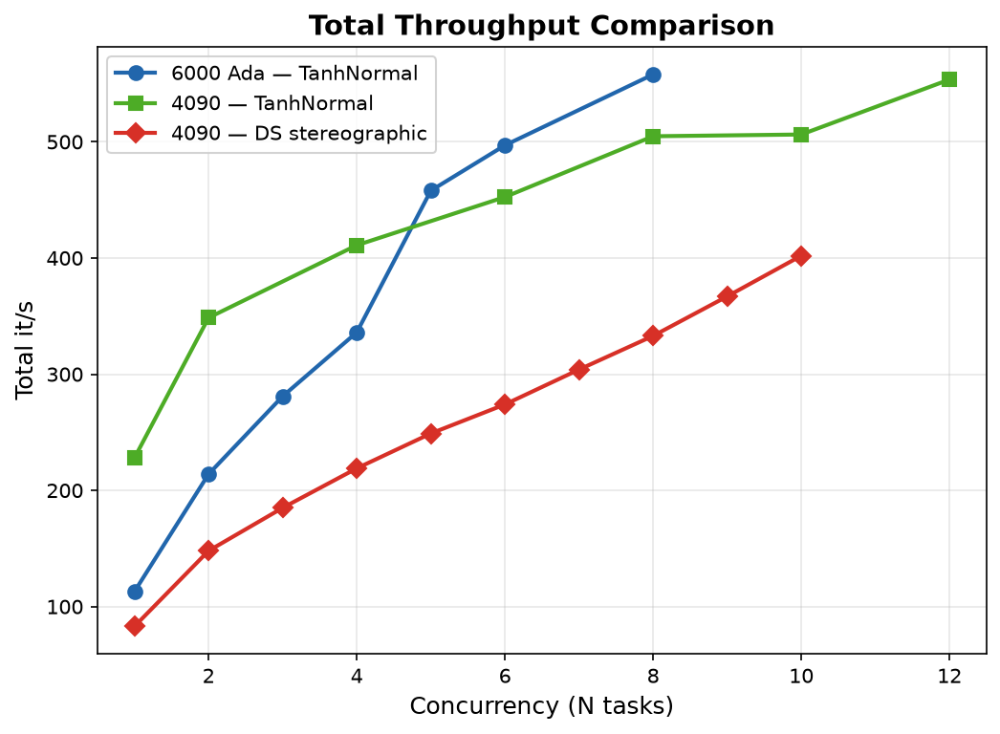
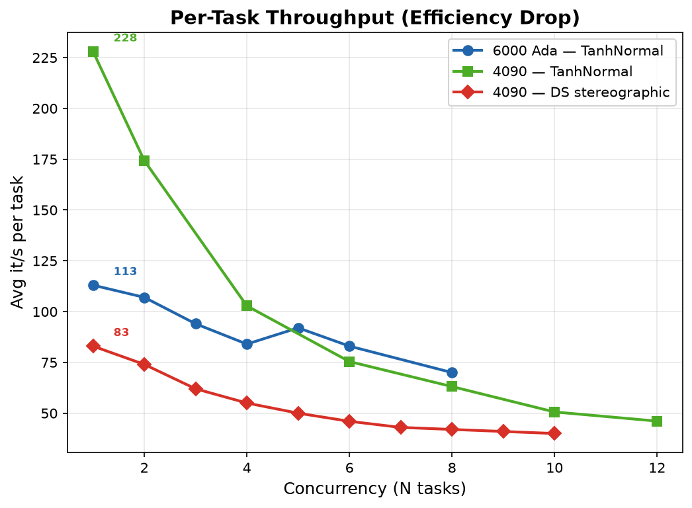
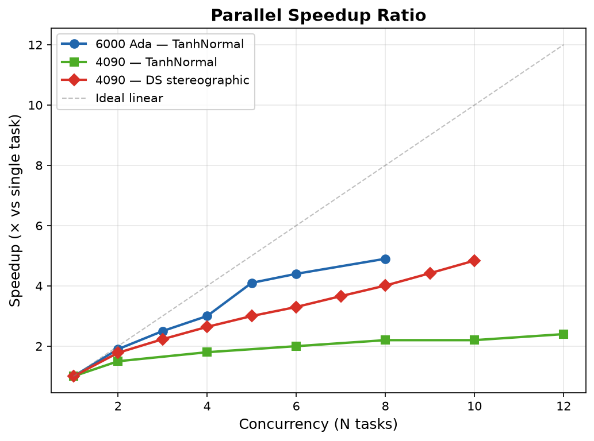

# 运行、存储和发布：历史记录

[历史归档索引](index.md) · [文档入口](../index.md)

> 历史归档：各节保留原文的日期、实验身份和结论范围。旧文中的“当前”“推荐”“待做”不代表今天的执行状态；日常规则以 [实验](../current/experiments.md)、[运行与存储](../current/runbook.md) 为准。

## 内容

- [Schedule.py — GPU 实验调度器](#schedule)
- [并行训练压力测试](#parallel-benchmark)
- [实验产物存储](#artifact-storage)
- [实验结果归档与发布](#result-archiving)
- [实验存储与发布设计 v2](#experiment-storage-design)
- [旧 SDD 证据归档](#evidence-archive)

<a id="schedule"></a>
## Schedule.py — GPU 实验调度器

原文位置：`docs/guides/schedule.md`。正文按原记录保留，原文件名用于历史追溯。

<a id="schedule--概述"></a>
### 概述

`schedule.py` 将 `tasks.json` 编译为命令列表，按 GPU slot 空闲事件驱动执行，支持断点续跑。

<a id="schedule--快速开始"></a>
### 快速开始

```bash
# 1. 编写 tasks.json（模板见 tasks.example.json）
# 2. 编译 + 审查
python schedule.py --compile --dry_run

# 3. 确认无误后，在 RTX 4090 上按项目策略启动实验
python schedule.py --gpus=0,1 --gpu_tasks=8 --stagger=30
```

<a id="schedule--工作流"></a>
### 工作流

```
tasks.json ──compile──▶ tasks.compiled.json ──run──▶ 实验
                │                        │
                │  人工审查               │  原地更新 status
                │                        │  中断重跑自动续
```

<a id="schedule--第一步编译"></a>
#### 第一步：编译

```bash
python schedule.py --compile              # 编译 tasks.json → tasks.compiled.json
python schedule.py --compile --dry_run    # 编译 + 打印完整命令列表（不执行）
```

<a id="schedule--第二步执行"></a>
#### 第二步：执行

```bash
python schedule.py --gpus=0,1 --gpu_tasks=8 --stagger=30       # RTX 4090 项目策略
python schedule.py --run=tasks.compiled.json --gpus=0,1 --gpu_tasks=8 --stagger=30
python schedule.py --run=tasks.compiled.json --dry_run         # 预览状态
```

编译文件已存在时，`python schedule.py` 默认直接执行，不会重新编译。修改 `tasks.json` 后需显式 `--compile` 重新生成。

<a id="schedule--中断恢复"></a>
### 中断恢复

Ctrl+C 或意外中断后，进度已保存在 `tasks.compiled.json`。直接重跑：

```bash
python schedule.py --gpus=0,1 --gpu_tasks=8 --stagger=30
```

| compiled.json 中 status | 恢复行为 |
|------------------------|---------|
| `"done"` | 跳过 |
| `"running"` + PID 存活 | 重连跟踪 |
| `"running"` + PID 已死 | 重排队 |
| `"pending"` | 重排队 |

Ctrl+C 时调度器会 SIGTERM 所有子进程，等 2s 后 SIGKILL 残留，不留孤儿进程。

<a id="schedule--调度逻辑"></a>
### 调度逻辑

命令队列 = tasks × seeds 展开，按 GPU slot 空闲事件驱动：

1. 首次填充：每个 GPU 逐个启动直至满员，间隔 `--stagger` 秒错开 JIT 编译
2. 进程结束 → 立即从队列取下一个分配到该 GPU，保持满载
3. 同 GPU 启动间隔 ≥ `--stagger` 秒
4. 启动/完成时原地更新 `tasks.compiled.json`

<a id="schedule--cli-参数"></a>
### CLI 参数

| Flag | 默认值 | 说明 |
|------|-------|------|
| `--tasks_config` | `tasks.json` | 任务配置文件 |
| `--run` | 自动检测 | 编译后的命令文件 |
| `--compile` | `False` | 仅编译，不执行 |
| `--gpus` | `0` | GPU ID 列表，逗号分隔 |
| `--gpu_tasks` | `1` | CLI 安全默认；本项目 RTX 4090 队列显式传 `8` |
| `--stagger` | `30` | 同 GPU 启动间隔秒数 |
| `--dry_run` | `False` | 只打印，不执行 |

<a id="schedule--tasksjson-格式"></a>
### tasks.json 格式

```jsonc
{
  "common": {                          // 所有 task 共享的默认值
    "online_steps": 1000000,
    "eval_episodes": 50,
    "video_episodes": 0,
    "sparse": false
  },
  "tasks": [
    {
      "name": "ds_rlpd_task2",         // 必填，log 文件名
      "entry": "main_online.py",       // main_online.py 或 main.py
      "env_name": "cube-triple-play-singletask-task2-v0",
      "horizon_length": 1,
      "ds_mode": "integrated",
      "ds_integrated_type": "stereographic"
    }
  ],
  "seeds": [0]
}
```

task 字段可覆写 `common`。完整字段列表见 `schedule.py` 中 `FIELD_TO_FLAG`。

Action-adapter 消融可另外设置 `ds_adapter_representation`（`cartesian` / `spherical` /
`stereographic`）、`ds_adapter_speed_squash`（`tanh` / `sigmoid`）、
`ds_adapter_speed_interpretation`（`log` / `direct`）和
`ds_speed_bound`（`sphere` / `cube`）。Integrated DS 使用
`ds_mode=integrated` 加 `ds_integrated_type=spherical|stereographic|tangent`，不经过
action-adapter compose。

<a id="schedule--支持的环境"></a>
### 支持的环境

| 来源 | 格式 | 示例 |
|------|------|------|
| OGBench | `{env}-singletask{ -taskN}-v0` | `cube-triple-play-singletask-task2-v0` |
| RoboMimic | `{task}-{type}-low_dim` | `lift-ph-low_dim`, `square-mh-low_dim` |

<a id="schedule--每卡并发数参考"></a>
### 每卡并发数参考

| GPU | `--gpu_tasks` |
|-----|--------------|
| RTX 6000 Ada (48GB) | 6 |
| RTX 4090 (24GB) | **8（本项目后续实验首先使用）** |
| 其他 | 1（保守） |

公式：`并发 ≈ 可用显存 / (1.5GB × H因子)`

4090 的短压测已验证 TanhNormal 12 并发和 DS stereographic 10 并发存活；本项目选择
8 作为总吞吐与运行风险之间的首选值。调度器负责错峰 JIT、跨卡填槽和完成后的即时回填。
若资源事故发生，保留原运行和 incident，不自动更换 seed、覆盖目录或把失败重标为成功；
降低并发只影响后续未启动队列。

<a id="schedule--运行时输出"></a>
### 运行时输出

```
────────────────────────────────────────────────────────────
  [0] [✓] ds_rlpd_task2  seed=0    ← ✓=已完成 ·=待执行
  [1] [·] ds_rlpd_task2  seed=1
────────────────────────────────────────────────────────────

[14:32:05] ▶ GPU=0  ds_rlpd_task2  seed=1  pid=12345  [2/4]  GPU0[██░░] slot_free=2
[14:35:12] ✓ GPU=0  ds_rlpd_task2  seed=0  pid=11111  OK  [1/4]
[14:35:12] GPU0:[█░░░]  GPU1:[███░]  queue=2  done=2/4  ETA: 12.3m  elapsed=3.1m

============================================================
  结束时间: 2026-06-13 14:45:00
  总耗时:   31.2m (0.52h)
  完成:     4/4
  成功:     4
============================================================
```

- `▶` 启动，`✓` 完成
- GPU 负载条 `[██░░]` = 已用/空闲 slot
- 每 60s 心跳输出进度 + ETA
- 中断 Ctrl+C 保存进度后退出

<a id="parallel-benchmark"></a>
## 并行训练压力测试

原文位置：`docs/guides/parallel_benchmark.md`。正文按原记录保留，原文件名用于历史追溯。

<a id="parallel-benchmark--硬件环境"></a>
### 硬件环境

| 项目 | 规格 |
|------|------|
| GPU | 1× NVIDIA RTX 6000 Ada Generation (48GB)，单卡测试 |
| CPU | 32 逻辑核，单 NUMA 节点 |
| OS | Linux (X11) |
| CUDA | 12.9 |
| Driver | 575.57.08 |


<a id="parallel-benchmark--方法"></a>
### 方法

每个实验跑 20,000 步，`start_training=5000`（默认，前 5000 步为 warmup 无训练更新），取 JAX 编译后的稳定速度。环境变量遵循 [CLAUDE.md](../../CLAUDE.md) 标准配置（`MUJOCO_GL=egl` + `XLA_PYTHON_CLIENT_PREALLOCATE=false` + `MEM_FRACTION=0.05`），CPU 由 OS 调度（Python GIL + JAX GPU dispatch 意味着 CPU 不是瓶颈）。命令：

```bash
env CUDA_VISIBLE_DEVICES=0 MUJOCO_GL=egl \
    XLA_PYTHON_CLIENT_PREALLOCATE=false XLA_PYTHON_CLIENT_MEM_FRACTION=0.05 \
    python -u main_online.py --env_name=cube-triple-play-singletask-task2-v0 \
    --horizon_length=1 --eval_interval=0 \
    --online_steps=20000 --start_training=5000 \
    > exp_logs/bench_ada.log 2>&1 &
```

> **历史说明**：下方「核/进程」/「总核数」/「倍率」数据基于旧版手动 CPU 亲和性消融实验测得，用于研究不同 CPU 分配下的并发扩展性。当前生产配置见 [CLAUDE.md](../../CLAUDE.md)（6000 Ada 推荐 `--gpu_tasks=6`），CPU 由 OS 调度。

<a id="parallel-benchmark--结果"></a>
### 结果

<a id="parallel-benchmark--rlpd-tanhnormal"></a>
#### RLPD (TanhNormal)

| 并发数 | 核/进程 | 总核数 | 总 it/s | 倍率 | 每进程 it/s | GPU 利用率 |
|:---:|:---:|:---:|:------:|:---:|:---:|:---:|
| 1 | 8 | 8 | 113 | 1.0× | 113 | ~33% |
| 2 | 8 | 16 | 214 | 1.9× | 107 | ~45% |
| 3 | 8 | 24 | 281 | 2.5× | 94 | ~55% |
| 4 | 4 | 16 | 336 | 3.0× | 84 | ~65% |
| 5 | 6 | 30 | 458 | 4.1× | 92 | ~75% |
| 6 | 5 | 30 | 497 | 4.4× | 83 | ~80% |
| **8** | **4** | **32** | **558** | **4.9×** | 70 | ~90% |
| 10 | 2 | 20 | ❌ | — | — | — |

<a id="parallel-benchmark--结论"></a>
### 结论

- **最佳配置：8 并发 × 4 核，单卡总吞吐 558 it/s，是单进程的 4.9 倍**
- 10 并发崩溃，6/10 静默失败，推测 CUDA context 或 JAX 编译并发冲突
- 每实验实际显存 ~1.5GB，预分配 5–10% 足够，48GB 单卡显存非瓶颈
- 单进程 GPU 利用率仅 33%，CPU 数据管线是唯一瓶颈；并行化通过 GPU 分时复用解决，8 并发 GPU 利用率 ~90%

---

<a id="parallel-benchmark--rtx-4090-压力测试"></a>
### RTX 4090 压力测试

<a id="parallel-benchmark--硬件环境"></a>
#### 硬件环境

| 项目 | 规格 |
|------|------|
| GPU | 1× NVIDIA GeForce RTX 4090 (24GB) |
| CPU | 32 逻辑核，单 NUMA 节点 |
| CUDA | 12.8 |
| Driver | 570.181 |

<a id="parallel-benchmark--方法"></a>
#### 方法

每个实验跑 5,000 步，`start_training=1000`（前 1000 步为 warmup 无训练更新），取 JIT 编译后的稳定速度。环境变量遵循 [CLAUDE.md](../../CLAUDE.md) 标准配置（`MUJOCO_GL=egl` + `XLA_PYTHON_CLIENT_PREALLOCATE=false` + `MEM_FRACTION=0.05`），CPU 由 OS 调度。命令：

```bash
env CUDA_VISIBLE_DEVICES=0 MUJOCO_GL=egl \
    XLA_PYTHON_CLIENT_PREALLOCATE=false XLA_PYTHON_CLIENT_MEM_FRACTION=0.05 \
    python -u main_online.py --env_name=cube-triple-play-singletask-task2-v0 \
    --horizon_length=1 --eval_interval=0 \
    --online_steps=5000 --start_training=1000 \
    > exp_logs/bench_4090.log 2>&1 &
```

> 与 6000 Ada 段差异：步数 5K 而非 20K（缩短测试时间）。下方「核/进程」数据为旧版手动 CPU 亲和性的历史消融实验结果，CPU 列已无现实指导意义，仅作扩展性参考。

<a id="parallel-benchmark--结果"></a>
#### 结果

| 并发数 | 核/进程 | 总 it/s | 倍率 | 每进程 | GPU util | 显存 | 状态 |
|:--:|:--:|------|:--:|:--:|:--:|:--:|:--:|
| 1 | 32 | 228 | 1.0× | 228 | 33% | 2GB | ✅ |
| 2 | 16 | 349 | 1.5× | 175 | 68% | 2GB | ✅ |
| 4 | 8 | 411 | 1.8× | 103 | 96% | 4GB | ✅ |
| 6 | 5 | 453 | 2.0× | 75 | 100% | 6GB | ✅ |
| 8 | 4 | 505 | 2.2× | 63 | 100% | 8GB | ✅ |
| 10 | 3 | 506 | 2.2× | 51 | 100% | 10GB | ✅ |
| **12** | **2** | **554** | **2.4×** | 46 | 100% | 12GB | ✅ |

> N=12 全部存活，总吞吐 554 it/s。N=8 时 GPU 已达 100% 利用率，继续增加并发通过更细粒度的 GPU 分时复用仍可小幅提升吞吐。

<a id="parallel-benchmark--测试参数对比"></a>
#### 测试参数对比

| | RTX 4090 | RTX 6000 Ada |
|--|:--:|:--:|
| online_steps | 5,000 | 20,000 |
| start_training (warmup) | 1,000 | 5,000 |
| 有效训练步数 | 4,000 | 15,000 |
| eval_interval | 0 | 0 |
| horizon_length | 1 | 1 |

> `start_training` 期间无训练更新（纯 env 交互），测得的 it/s 偏高。理想设置应为 `start_training=0`，留待后续修正。

<a id="parallel-benchmark--双卡对比"></a>
#### 双卡对比

| | RTX 4090 (24GB) | RTX 6000 Ada (48GB) |
|--|:--:|:--:|
| 单进程基线 | **228 it/s** | 113 it/s |
| 最佳并发 | **12** (全存活) | 8 (N=10 崩溃) |
| 最佳吞吐 | 554 it/s | **558 it/s** |
| 倍率 | 2.4× | **4.9×** |
| 瓶颈 | GPU 100% + CPU | CPU 数据管线 |
| 最大显存 | 12GB / 24GB | 12GB / 48GB |

<a id="parallel-benchmark--汇总对比图"></a>
#### 汇总对比图







<a id="parallel-benchmark--结论"></a>
#### 结论

- **RTX 4090 最佳配置：8–12 并发，总吞吐 505–554 it/s**
- 4090 单进程 228 it/s 是 6000 Ada 113 it/s 的 **2×**，但并行倍率低（2.4× vs 4.9×）——因为 4090 GPU 更快，单进程已用 33% GPU，并行提升空间更小
- 12 并发全部存活（6000 Ada 在 N=10 已崩溃），显存仅用 12GB/24GB——24GB 显存非瓶颈
- 与 6000 Ada 一致：每实验实际显存 ~1.5GB，`MEM_FRACTION=0.05` 足够

---

<a id="parallel-benchmark--rtx-4090--ds-rlpd-压力测试stereographic-无-warmup"></a>
### RTX 4090 — DS-RLPD 压力测试（stereographic, 无 warmup）

<a id="parallel-benchmark--动机"></a>
#### 动机

前述测试均使用 TanhNormal（无 DS），且包含 warmup（`start_training=1000/5000`）。本次测试使用**最重的 DS 实现**（stereographic Jacobian bijector），**无 warmup**（JIT 编译计入测量），并改用 `schedule.py` 统一调度，贴近生产环境。

<a id="parallel-benchmark--方法"></a>
#### 方法

- **入口**: `main_online.py`
- **环境**: `cube-triple-play-singletask-task2-v0`
- **DS 模式**: `integrated`，`ds_integrated_type=stereographic`（包含 Jacobian 计算，显存和计算压力最大）
- **步数**: 10,000（前 5,000 步 `start_training` warmup 无训练更新，后 5,000 步有效训练）
- **H=1**（无 action chunking 开销）
- **无 eval**（`eval_interval=0`, `eval_episodes=0`）
- **无 checkpoint**（`save_interval=-1`）
- **WANDB_MODE=disabled**
- **显存**: `XLA_PYTHON_CLIENT_PREALLOCATE=false`, `MEM_FRACTION=0.05`
- **调度**: `schedule.py --gpu_tasks=N --stagger=0`，每并发级独立编译执行
- **测量**: 解析 schedule.py 日志，从首个启动到末个完成的时间差计算墙钟

```bash
# 等效命令（schedule.py 封装）
CUDA_VISIBLE_DEVICES=0 MUJOCO_GL=egl \
  XLA_PYTHON_CLIENT_PREALLOCATE=false XLA_PYTHON_CLIENT_MEM_FRACTION=0.05 \
  WANDB_MODE=disabled \
  python -u schedule.py --run=tasks.compiled.json --gpus=0 --gpu_tasks=N --stagger=0
```

<a id="parallel-benchmark--结果"></a>
#### 结果

| 并发 N | 墙钟 (s) | 总算力 (it/s) | 单任务 (it/s) | 效率 | vs N=1 |
|:---:|:---:|:---:|:---:|:---:|:---:|
| 1 | 121 | 83 | 83 | 100% | 1.00× |
| 2 | 135 | 148 | 74 | 89% | 1.78× |
| 3 | 162 | 185 | 62 | 75% | 2.23× |
| **4** | **183** | **219** | **55** | **66%** | **2.64×** |
| 5 | 201 | 249 | 50 | 60% | 3.00× |
| 6 | 219 | 274 | 46 | 55% | 3.30× |
| 7 | 230 | 304 | 43 | 52% | 3.66× |
| 8 | 240 | 333 | 42 | 51% | 4.01× |
| 9 | 245 | 367 | 41 | 49% | 4.42× |
| 10 | 249 | 402 | 40 | 48% | 4.84× |

> 详细曲线见上方汇总对比图。

> 数据：[`RTX4090_24GB/results_ds_stereographic.json`](../data/parallel_benchmark/RTX4090_24GB/results_ds_stereographic.json)

<a id="parallel-benchmark--与-tanhnormal-测试对比"></a>
#### 与 TanhNormal 测试对比

| | DS stereographic | TanhNormal (旧) |
|--|:--:|:--:|
| 单进程基线 | 83 it/s | 228 it/s |
| 最大并发 | 10 (全存活) | 12 (全存活) |
| 最大总算力 | 402 it/s | 554 it/s |
| 倍率 | 4.84× | 2.4× |
| 瓶颈 | GPU + JIT | GPU 100% + CPU |
| warmup | 5,000 步 | 1,000 步 |
| 调度 | schedule.py | main_online.py 直接调用 |

<a id="parallel-benchmark--结论"></a>
#### 结论

- **DS stereographic 单进程比 TanhNormal 慢 2.7×**（83 vs 228 it/s），Jacobian bijector 计算开销显著
- 虽然单进程更慢，**并行倍率更高**（4.84× vs 2.4×）——慢任务 GPU 利用率更低，并行提升空间更大
- **截至 N=10 无 OOM**，显存非瓶颈，总算力未饱和（仍在增长）
- **推荐生产 --gpu_tasks=4**：均衡点，单任务 55 it/s 保持 66% 效率，总算力 2.64×
- 追求总算力可开到 10+，但单任务效率降至 ~48%

<a id="parallel-benchmark--2026-10-13-qc-4090-队列策略"></a>
#### 2026-10-13 QC 4090 队列策略

上面的 `4` 是基于单任务效率的历史均衡点；项目后续实验改为优先追求固定算力租期内的
聚合吞吐。因此 RTX 4090 队列首先显式使用
`schedule.py --gpu_tasks=8 --stagger=30`。这不改写原始压测条件，也不声称 5K/10K、无评估、
无 checkpoint 的压力测试已经等价覆盖 500K 正式实验。出现有证据的资源事故或聚合吞吐倒退时，
只降低后续未启动队列的并发，保留既有运行、seed 和 incident。

<a id="artifact-storage"></a>
## 实验产物存储

原文位置：`docs/storage/artifact_storage.md`。正文按原记录保留，原文件名用于历史追溯。

更新日期：2026-10-19。

<a id="artifact-storage--当前布局"></a>
### 当前布局

代码与协议位于主仓库，原始及生成的实验产物位于数据盘，精简归档通过 submodule 发布：

| 项目路径 | 物理路径 | 内容 |
|---|---|---|
| `exp/`、`exp_logs/` | 已移除 | 不再维护兼容入口 |
| `results/` | `/data/chainpray/qc/results/` | 当前候选和正式实验结果 |
| `archive/` | `/data/chainpray/qc/archive/` | 已完成且静态的实验、checkpoint 与项目证据 |
| `tmp/` | `/data/chainpray/qc/tmp/` | 可删除的运行临时文件，不是证据根 |
| 报告和图表 | `/data/chainpray/qc/reports/` | 分析产物，通用脚本默认写 `reports/analysis/` |
| `docs/images/` | 主仓库 | 文档所需的精选图片，保留并跟踪版本 |
| `docs/data/` | Hugging Face Git 子模块 | 历史数据和 `summaries/<date>/` 精简归档 |

`exp`/`exp_logs` 及 38 个内部兼容链接已按用户要求移除；实际归档数据完整保留。
训练默认输出根为 `/data/chainpray/qc/results/`，可通过 `QC_DATA_ROOT` 选择其他主机的挂载根。
新实验在 `control/` 登记；不要为了迁移而重写原有运行身份或来源哈希。
归档规则见 [`result_archiving.md`](#result-archiving)。下文的兼容链接描述为历史验收记录。
`a8c2bcd` 曾删除的 18 张已跟踪图片已恢复；其余文档结果图也已重新收录 `docs/images/`。
图片副本用于直接阅读，不代替本地原始证据或 HF 数据归档。
后续 cohort 索引、HDD/HF 分层与保留策略设计见
[`experiment_storage_design.md`](#experiment-storage-design)，不要求迁动已有路径绑定证据。

<a id="artifact-storage--2026-10-16-迁移验收"></a>
### 2026-10-16 迁移验收

- `exp`：36,002 个普通文件、24 个内部软链接；
- `exp_logs`：342 个普通文件；
- `exp` 逻辑文件总量为 140,100,854,483 字节，目标盘实际占用约 93 GiB（稀疏文件按实际块计）；
- `exp_logs` 逻辑文件总量为 865,344,345 字节，实际占用约 827 MiB；
- 初次复制使用保留权限、时间、硬链接、ACL、扩展属性和稀疏文件的 `rsync`；
- 结构/元数据 dry-run 无差异；
- 全文件 checksum dry-run 无差异；
- 切换软链接后再次做结构/元数据对比，无差异；
- 随机读取归档 JSON 成功；
- 切换时没有项目训练或调度进程写入源目录。

最终验收时，源 NVMe 可用空间由约 254 GiB 增至 386 GiB；目标数据盘约剩余 403 GiB、
使用率约 93%。启动大规模实验前必须重新检查实时可用空间；
不要假设八卡高并发队列的全部 checkpoint 都能长期保留。

<a id="artifact-storage--使用规则"></a>
### 使用规则

1. 新实验写 `/data/chainpray/qc/results/<cohort>/...`，控制面写 `control/<cohort>/...`；
2. 新调度器文本日志写 `/data/chainpray/qc/logs/`；不再使用 `exp_logs/`；
3. checkpoint 保留策略在启动前冻结，避免每个评估点永久保存完整权重；
4. 迁移、归档或清理前先检查活动写入者；
5. 删除源副本前必须完成内容校验，不能只比较目录大小；
6. `docs/data/` 是 Git 子模块，不能用软链接整体替换；
7. 数据盘空间不足时停止新队列并报告，不自动删除失败运行、incident 或正式实验权重。

<a id="artifact-storage--2026-10-18-旧实验根整理"></a>
### 2026-10-18 旧实验根整理

早期实验曾直接写入 `/data/ym/qc`。该根中的 2026-09-27 至 2026-10-05
产物现已统一整理到：

```text
/data/chainpray/qc/archive/legacy-experiments-20260927-20261005/
├── robomimic/              # 指向路径绑定的 RoboMimic 规范原始根
├── scientific-evidence/    # 去除旧 checkpoint 后的真实/先导实验指标、配置和日志
├── engineering-evidence/   # 去除模型载荷后的准入、内核和容量验证证据
└── manifests/              # 迁移前后清单、删除清单和 SHA-256
```

整理前旧根实际占用约 9.7 GiB；整理后的科学/工程归档约 209 MiB，另在
规范旧路径保留约 2.7 GiB 的 RoboMimic 路径绑定证据，合计约 2.9 GiB，
释放约 6.8 GiB。共记录 3,308 个迁移前条目，对 1,146 个被删除文件保存了路径、
大小和 SHA-256。删除范围仅包含可重建的 synthetic/unit/fixture/diagnostic
目录，以及已由指标、配置和日志覆盖的旧 OGBench/RLPD checkpoint。

RoboMimic 的 226 个普通文件完整保留，并在整理后逐文件通过 SHA-256 验证。
这批证据的验证器会解析绝对路径并将其纳入运行身份，因此原路径继续作为
规范数据根，统一归档中只放置反向索引链接：

```text
/data/chainpray/qc/archive/legacy-experiments-20260927-20261005/robomimic/robomimic_cross_domain_20260927
  -> /data/ym/qc/robomimic_cross_domain_20260927
```

本次整理没有移动或删除 `/data/chainpray/qc/results` 下的当前实验。机器可读的
分类和删除记录见归档的 `manifests/`；执行逻辑保存在
`scripts/cleanup_legacy_experiments_20261018.sh`，该脚本设置了目标已存在即拒绝
再次执行的保护门。

<a id="artifact-storage--2026-10-18-静态实验与临时文件整理"></a>
### 2026-10-18 静态实验与临时文件整理

第二阶段将四类静态树统一迁移到：

```text
/data/chainpray/qc/archive/consolidated-legacy-storage-20261018/
├── checkpoints/worktree-weights-20261005/              # 9.9 GiB，完整保留
├── historical-runs/dummy/                               # 2.8 GiB，去除旧权重
├── project-evidence/evidence/                           # 17 GiB，完整保留
├── scientific-runs/cross_family_noise_screen_20261016/ # 18 GiB，完整保留
└── manifests/                                           # 17 MiB，迁移和删除清单
```

本阶段完成时原 `exp/` 路径曾保留绝对软链接；这些兼容链接随后已取消。
同盘重命名保留了 inode、时间戳和文件内容；没有复制第二份大文件。

本阶段删除两类可重建载荷：

1. `/data/chainpray/qc/tmp` 下 972 个已关闭的 W&B offline/TMPDIR 文件，逻辑大小
   46,822,243,338 字节、实际约 44 GiB；目录本身保留供后续 launcher 使用；
2. 旧 `exp/dummy` 中 247 个 `.pkl` checkpoint，逻辑大小 51,104,736,506 字节，
   实际分配 34,953,064,448 字节。删除前逐文件记录了 SHA-256，CSV、JSON、日志、
   视频和其他结果均保留。

删除的临时文件和 checkpoint 不能从清单直接恢复；临时 W&B 文件可由运行重新生成，
旧模型需要按保留配置重新训练。对应实验的指标与论文图所需数据仍然存在。

机器可读记录位于：

```text
/data/chainpray/qc/archive/consolidated-legacy-storage-20261018/manifests/
```

执行脚本为 `scripts/consolidate_legacy_storage_20261018.sh`。脚本会拒绝处理被活动
进程、打开文件描述符或进程环境引用的目录，并且目标归档存在时拒绝再次运行。

<a id="artifact-storage--剩余-exp-与-exp_logs"></a>
#### 剩余 `exp` 与 `exp_logs`

同日第三阶段将 `exp/` 中剩余的 34 个物理历史实验目录迁入：

```text
/data/chainpray/qc/archive/consolidated-legacy-storage-20261018/legacy-exp-runs/
```

迁移前对其中 784 个旧 checkpoint 逐文件计算 SHA-256，随后删除模型载荷；删除文件
逻辑大小 43,391,266,786 字节，实际分配 31,441,133,568 字节。精简后的 34 个实验
约 500 MiB，仍保留 CSV、JSON、日志以及其他非模型证据。静态 `exp_logs` 原样迁入：

```text
/data/chainpray/qc/archive/consolidated-legacy-storage-20261018/scheduler-logs/exp_logs/
```

本阶段完成时 `exp/` 顶层只有 38 个兼容链接，`exp_logs` 也指向统一归档；这些链接随后已取消。
完整保留、没有删除 checkpoint 的两类重要证据是：

- `checkpoints/worktree-weights-20261005/`：75 个 checkpoint；
- `scientific-runs/cross_family_noise_screen_20261016/`：88 个 checkpoint。

第三阶段清单使用 `remaining-exp-*` 文件名前缀，执行脚本为
`scripts/consolidate_remaining_exp_20261018.sh`。

全部三阶段结束时，`/data/chainpray/qc` 实际占用约 101 GiB，其中当前 `results`
约 53 GiB、统一 `archive` 约 48 GiB；`tmp` 约 24 KiB。文件系统报告约 1.7 TiB
可用空间，但该数值相对迁移前的增量大于本项目可解释的删除量，不能全部归因于本次
整理，可能同时存在同一数据盘上的其他清理活动。

<a id="result-archiving"></a>
## 实验结果归档与发布

原文位置：`docs/storage/result_archiving.md`。正文按原记录保留，原文件名用于历史追溯。

更新日期：2026-10-19。

本文记录当前已实现布局和本次历史归档。后续通用方案见
[`experiment_storage_design.md`](#experiment-storage-design)；该设计尚未全部接入运行工具，
不要将其中未来接口或生命周期门视为当前已生效的功能。

原始实验和生成的分析产物统一写入数据盘，默认根是 `/data/chainpray/qc`。
其他机器通过 `QC_DATA_ROOT` 选择挂载位置；训练日志和分析输出写数据盘。
文档需要展示的精选图片另外保留在主仓库 `docs/images/`，版本化后直接引用。

| 内容 | 本地位置 | 版本管理 |
|---|---|---|
| 运行、评估、权重 | `results/<cohort>/` | 数据盘，保留运行身份和 incident |
| 冻结配置、状态与验收 | `control/<cohort>/` | 数据盘；精简配置可随结果导出 |
| 调度日志 | `logs/` | 数据盘 |
| 分析表、论文图、报告 | `reports/`，通用分析默认 `reports/analysis/` | 数据盘；选定摘要发布到 submodule |
| 文档展示图片 | `docs/images/` | 主仓库，文档引用所需图片必须保留 |
| 历史原始证据 | `archive/` | 数据盘只读归档 |
| 精简、可分享结果 | `docs/data/summaries/<date>/` | Hugging Face 数据集 submodule |
| 算法、测试、协议和结论 | 主仓库 | Git 提交 |

<a id="result-archiving--发布内容"></a>
### 发布内容

精简归档包含评估曲线、配置、运行状态、运行 manifest、耗时、小型统计表、关键图、
协议快照和文件 SHA-256。权重、轨迹、逐步 `env.csv`/`online_agent.csv`、云端认证和
运维日志留在数据盘。未归档的大型分析表记录原始路径及哈希。

有效证据包括负结果、零成功率、失败和删失；不得按性能选择种子或方法。历史分析产物
标记为历史解释范围，不能因为上传成功就改称正式验收通过。

归档工具独立标明三层判断：

1. 归档字节与源文件一致；
2. 精简运行的生命周期、预算、评估网格、有限值和 incident 检查；
3. 原分析报告中的工程门、统计结论与科学边界。

第 1/2 层不代替 checkpoint、退出码、完整 source/data identity 等正式验证。
运行原始 `run_manifest.json` 决定其来源；归档时抓取的源码快照不能追认旧运行的源码身份。

<a id="result-archiving--本次归档"></a>
### 本次归档

`docs/data/summaries/2026-10-19/` 包含历史分析结果、2026-10-18 的研究报告，以及三组
RLPD 筛选的精简逐运行数据：semantic-subspace uncertainty、critic-flat semantic exploration、
state-conditional controllability。前两组保留既有 artifact verification 和未通过科学扩展门的结论；
最后一组以实际运行检查为准，导出工具不自动判定新方法成立。

本次三个 cohort 各 48 次运行，共 144 次，通过上述精简完整性检查 144/144。
归档清单包含 1,522 个复制文件，39,778,189 字节；另有 README、运行检查、来源索引、manifest
和校验清单。5 个超过 1 MiB 的历史长表留在数据盘并记录 SHA-256。
主仓库整理的测试结果为 86 passed、3 subtests passed；锁文件离线检查、调度器编译和
dry-run、Shell 语法及 Python 编译检查通过。归档另执行逐文件 SHA-256 校验。

主目录和 `cross-task-gac-evidence` 执行工作树的代码不同。归档分别记录两者的 commit/status，
并保留执行工作树当前源码快照；没有把主目录整理提交伪称为训练时使用的版本。

复用工具时使用新的日期/版本目录：

```bash
python scripts/archive_experiment_summaries.py \
  --repo "$PWD" --data-root /data/chainpray/qc \
  --source-worktree "$PWD/.worktrees/cross-task-gac-evidence" \
  --destination "$PWD/docs/data/summaries/2026-10-19"
```

工具拒绝覆盖字节不同的已归档文件。上传前在归档目录运行 `sha256sum -c SHA256SUMS`，
在 `docs/data` 内提交并推送到 `SZUEAILab/ds-experiments`，再在主仓库提交 submodule 指针。

<a id="result-archiving--2026-10-19-源码目录产物迁移"></a>
### 2026-10-19 源码目录产物迁移

- 原 `docs/images/` 的全部内容迁至 `/data/chainpray/qc/reports/analysis/`；
- 原 `docs/results/` 的全部内容迁至 `/data/chainpray/qc/reports/repository-import-20261019/results/`；
- 整理前未提交代码和未跟踪文件快照位于
  `/data/chainpray/qc/archive/repository-state-before-integration-20261019/`；
- `exp`/`exp_logs` 兼容链接已取消，不再恢复。

后续修正：以上为当时的迁移记录。文档图片已经恢复到 `docs/images/` 并重新纳入主仓库；
数据盘与已发布 HF 归档中的副本保留。图片迁出不再作为源码目录整理的目标。

<a id="experiment-storage-design"></a>
## 实验存储与发布设计 v2

原文位置：`docs/storage/experiment_storage_design.md`。正文按原记录保留，原文件名用于历史追溯。

设计日期：2026-10-19。状态：设计稿；目录规则、命令接口与容量门尚未全部实现。

目标是在现有 `/data/chainpray/qc` 与 `docs/data` submodule 上逐步接入，继续使用既有运行数据。
本设计不要求批量移动旧实验、改变旧身份、重写 Hugging Face 历史或重建 `exp` 兼容链接。

<a id="experiment-storage-design--1-根据当前实际情况做的选择"></a>
### 1. 根据当前实际情况做的选择

2026-10-19 本机检查：`/data` 位于 ROTA=1 的机械盘，项目约占 109 GiB，
其中 `results` 约 61 GiB、`archive` 约 48 GiB。`results` 中有 318 个 checkpoint，
逻辑大小合计 58,548,307,914 字节；不能仅凭这个数字认定哪些模型冗余。
同一文件系统尚有约 1.7 TiB 可用空间，包含其他项目的占用。

源码盘上的 `docs/data` 工作目录约 5.2 GiB，包含约 2.5 GB 旧权重和 2.9 GB CSV；
`.git/modules/docs/data` 约 2.7 GiB，其中 LFS 缓存约 2.5 GiB。
实际物理重复量会受硬链接、文件系统和 Git/LFS 实现影响；这里是目录测量值，不直接相加为释放量。

现有导出器针对特定日期与三个 cohort 编写，还会复制执行工作树源码、按日期扫描报告、
按 1 MiB 阈值选择部分历史文件。它适合保存一次历史快照，不应直接当作未来的通用发布器。

设计选择：

- 保留 `results/control/logs/reports/archive` 的分层；cohort ID 关联它们。
- 每次实验的原始结果只有一个规范根，封存后不因状态变化再次搬家。
- 新发布按 cohort 和 release version 组织，日期只用于发布记录。
- HF 保存可解释、可核验的精简证据；机械盘保存完整运行及保留的模型。
- 全局索引从实验 manifest 重建，不新增一个必须常驻的服务或人工维护的独立数据库。
- 训练过程不提交 Git；终态事件触发普通程序封存，只有需要解释和决策时才调用智能体。

<a id="experiment-storage-design--2-三层职责"></a>
### 2. 三层职责

| 层 | 存放内容 | 权威来源与边界 |
|---|---|---|
| 主代码仓库（SSD） | 算法、测试、分析器、分组协议、文档图片、配置模板、HF submodule 指针 | 决定如何运行和分析；`docs/images/` 保留支撑文档阅读的精选图 |
| `/data/chainpray/qc`（HDD） | 运行原件、冻结配置、模型、诊断、报告、发布候选和回执 | 本机实验事实来源；不把目录名或 PID 当作成功证明 |
| `docs/data` → Hugging Face | cohort 摘要、逐 seed 指标、评估曲线、统计、精简 manifest、关键图 | 经固定 revision 引用的共享证据；不代替完整本地备份 |

`docs/data` 仍是真正的 Git submodule，不整体替换成软链接。
默认下载策略应使日常代码工作只取小型索引和指定 release。
文档入口是 `docs/index.md`，主题目录各有 `index.md`。所有正文引用的图片保留在
`docs/images/`；数据盘、文档图片和 HF 数据包可以各保留用途明确的副本。

<a id="experiment-storage-design--3-本地布局按-cohort-关联按数据类别存放"></a>
### 3. 本地布局：按 cohort 关联，按数据类别存放

```text
/data/chainpray/qc/
├── results/<cohort>/
│   └── <task>/<method>/seed-75901/attempt-001/
│       ├── eval.csv
│       ├── flags.json
│       ├── run_manifest.json
│       ├── run_status.json
│       ├── runtime_metrics.json
│       ├── incidents.jsonl
│       ├── checkpoints/                 # 新运行使用；旧 params_*.pkl 原位登记
│       └── diagnostics/                 # 逐步数据、几何诊断等，按需创建
├── control/<cohort>/
│   ├── cohort.json                      # 冻结设计、计划 identities、文件选择规则
│   ├── execution.json                   # 机器/GPU/并发/部署路径，独立于科学设计
│   ├── tasks.compiled.json              # 调度器可更新的队列状态
│   ├── attempts.jsonl                   # attempt 的分配/谱系记录，单写者
│   └── seal-v001.json                   # 终态核对与原始文件哈希
├── logs/<cohort>/<run-id>/
├── reports/<cohort>/analysis-v001/
│   ├── analysis_manifest.json           # 输入 seal、分析器和统计参数的哈希
│   ├── per_seed.csv
│   ├── paired.csv
│   ├── summary.csv
│   ├── decision.json
│   └── figures/
├── catalog/                             # 派生索引，可从 manifest 重建
│   ├── cohorts.jsonl
│   ├── attempts.jsonl
│   └── releases.jsonl
├── sources/<code-digest>/                # 参与运行的代码快照，按内容共享
├── releases/<cohort>/v001/               # 本地可复现的发布包，发布后只读
├── receipts/<cohort>/v001.json           # 上传 revision、校验、时间，不改写发布包
├── staging/<cohort>/<operation-id>/      # 未完成拷贝/发布；不会被分析器自动当成结果
├── cache/{hf,lfs}/                      # 可再下载的缓存，不能作为唯一原始证据
├── archive/                             # 现有历史根及路径绑定证据，继续保留
└── tmp/<cohort>/<attempt>/               # 有归属和寿命的临时载荷
```

新运行采用 task/method/seed/attempt 目录；现有 W&B 等布局由登记器适配，不能原地强制改名。
`control/<cohort>/cohort.json` 保存 run ID 到原始目录的映射。跨机器只调整 execution/location 字段。
`catalog` 只保存索引，不复制配置全文、指标全文或权重；写入采用锁和同盘原子替换。

<a id="experiment-storage-design--4-身份和状态解决这是哪次实验能否比较"></a>
### 4. 身份和状态：解决“这是哪次实验、能否比较”

cohort 示例：`20261019-rlpd-state-controllability-screen-v1`。人类可读名字用于查找，
不能代替内容身份。同任务同方法不同 seed 是不同 planned run，恢复同一科学设计则分配新的 attempt。

| ID | 定义 |
|---|---|
| `cohort_id` | 一个冻结的任务×方法×seed×预算矩阵及其比较设计 |
| `planned_run_id` | cohort + task + method + seed + budget + 有效算法/评估配置摘要 |
| `attempt_id` | planned run + attempt 序号；不复用失败 attempt 的原始目录 |
| `code_digest` | 实际参与运行的源文件字节及其路径清单摘要 |
| `analysis_id` | 输入 seal + 分析器源码 + 指标/统计设置摘要 |
| `release_id` | cohort + v001/v002；每个已发布版本不可改写 |

科学身份记录源码、数据指纹、有效配置、预算、seed 和评估设置。GPU、并发数、主机路径是部署
信息，默认独立记录；若它们改变精度、并行 RNG、更新规则或其他科学行为，必须反映到有效配置。
新规则不追溯性重算旧 run ID；旧绝对路径哈希约束保留，通过 location 映射接入索引。

来源应记录 code commit、参与源码清单及摘要、依赖 lock、实际依赖版本、数据指纹、运行命令。
允许 dirty source 时，在启动前冻结 tracked 修改和参与运行的 untracked 源文件；`git diff` 本身
不包含 untracked 文件。归档时才抓取的源码仍标注为“归档时快照”，不能证明训练时来源。

不把多个含义塞进一个 `complete`：

| 字段 | 示例值 | 含义 |
|---|---|---|
| `execution_status` | pending/running/complete/failed/interrupted | 执行是否完成 |
| `validation_status` | pending/passed/failed/needs_review | 身份、预算、评估、数值、incident 等验收 |
| `scientific_conclusion` | not_assessed/supported/not_supported/inconclusive | 假设和统计结果 |
| `publication_status` | local/staged/published/corrected | 是否可从固定远端版本引用 |

failed/interrupted 运行同样进入索引和汇总，排除分析时保留具体原因；零成功率不是数据无效。
retry/resume 都保留父 attempt、恢复 checkpoint 哈希和恢复步。新 attempt 不自动获得启动许可。

<a id="experiment-storage-design--5-hf-布局按-cohort-发布按论文引用"></a>
### 5. HF 布局：按 cohort 发布，按论文引用

继续使用 `SZUEAILab/ds-experiments`，不要求新增数据集仓库。

```text
docs/data/
├── README.md
├── catalog/
│   ├── cohorts.jsonl                    # 每 cohort 一行，含 stage、任务、算法、结论边界
│   └── releases.jsonl                   # cohort/version/相对路径/清单摘要
├── cohorts/<cohort>/v001/
│   ├── README.md                        # 问题、方法、预算、seed、结论与限制
│   ├── cohort.json                      # 冻结设计与预期矩阵
│   ├── runs.jsonl                       # 每 attempt 一行：含失败、缺失与排除理由
│   ├── evaluations.csv.gz               # 逐 run、逐评估步；更大时按 schema 转 Parquet
│   ├── configs.jsonl.gz                 # 有效配置，引用 code/data digest
│   ├── per_seed.csv
│   ├── paired.csv
│   ├── summary.csv
│   ├── decision.json
│   ├── provenance.json                  # 源数据/分析/代码摘要与可用性
│   ├── manifest.json                    # 归档文件大小与 SHA-256，路径均为相对路径
│   ├── SHA256SUMS
│   └── figures/                         # 少量主图，默认 PNG；PDF 按投稿需求附带
├── sources/<code-digest>/                # 必需源码/补丁或可验证代码位置，只存一次
├── papers/<paper-id>/v001/
│   ├── evidence_map.json                # claim/图表 → cohort、release、contrast、analysis
│   └── README.md
├── summaries/2026-10-19/                 # 已发布的历史快照，保留原样
└── ds_experiments/、reproduce/…           # 原有数据，保留既有 revision
```

每个 cohort 自包含其精简分析证据，通过 code digest 共享源码。论文版本引用具体 cohort
release 与实际 HF commit；不以浮动 `main` 或“今天的全部结果”作为论文证据身份。
时间快照可保留一个索引集合，不再次拷贝所有 cohort 和源码。

`catalog/releases.jsonl` 用相对 release 路径和 manifest 摘要关联。新提交的 HF commit 无法
预先写进自己的内容；确切 revision 写在本地发布回执、主仓库 submodule 指针，以及后续论文
evidence map 中，避免自引用哈希。

<a id="experiment-storage-design--6-精简规则由实验阶段决定不由文件名或结果好坏决定"></a>
### 6. 精简规则：由实验阶段决定，不由文件名或结果好坏决定

发布器使用 cohort 的显式 artifact allowlist，禁止扫描整个 `reports` 并按日期猜归属。
每个文件登记 role、schema、source hash、必需性、可见范围和保留策略。运行状态包与性能结果包分开。

| 内容 | 本地 HDD | HF 摘要 |
|---|---|---|
| 冻结矩阵、有效配置、代码/数据身份 | 保留原件 | 必须有可验证的精简版本 |
| 每 run 评估曲线、评估协议 | 保留原件 | outcome 可见阶段必须完整保留，不仅保留均值 |
| seed/block 指标、配对效应、CI、排除原因 | 保留 | 必须保留，统计单位明确 |
| 失败 attempt、incident | 原件保留 | 发布状态、原因、关键事件与原件哈希；先去除凭据 |
| checkpoint | 按冻结策略保留 | 默认仅列步数、哈希、大小、是否可获取 |
| env/online_agent 逐步日志、轨迹 | 按实验需要保留/封存压缩 | 只导出预注册的必要诊断及其 schema |
| 全量源码 | 按 code digest 保存 | 优先引用可获取的 commit；否则发布必需源码快照，避免每批复制 |
| 云端认证、token、账号运维日志 | 安全运行目录 | 不发布 |

本项目有 reward-blind calibration/engineering 阶段。其 schema 将 `outcomes_visibility`
标作 `blind`，导出时不读取/推导 reward、success 或性能排名；先生成状态/几何包。
进入预定 outcome-visible 阶段后才能另发性能包。旧证据不可因上传而解除盲法。

不能依赖“文件超过 1 MiB 就略过”。必要数据优先合并、gzip 或分片；确实缺失时记录
missing/withheld/local_only 及原因。对不同 schema 的 CSV 不盲目拼接。
建议新发布包每 cohort 通常不超过 20 MiB、100 个文件；超过 50 MiB 时显示逐类大小和理由。
这些是本项目拟定的默认预算，不是 HF 的配额或官方上限，也不允许因此删掉必要 seed 数据。

恢复能力需单独标记：`figure_reproduction`（可重画）、`evaluation_reproduction`
（有权重、环境、数据与协议可复评）、`training_reproduction`（训练材料完整）。
“能读汇总表”不能标记为“可完整复现实验”；仅登记 checkpoint 哈希也不等于已有备份。

<a id="experiment-storage-design--7-hdd-与-ssd-的分工"></a>
### 7. HDD 与 SSD 的分工

机械盘适合顺序读写与封存，不适合许多并发任务频繁写海量小文件。
训练标量先缓冲，按配置的日志间隔落盘；eval/incident/退出记录需要及时刷新，不能为了吞吐丢证据。
checkpoint 在目标文件系统内写临时文件、完成刷新后原子重命名；发布器只读取终态或已封存输入。
大型 CSV/JSONL 的封存压缩在训练后执行，并记录压缩前后摘要；路径/字节绑定的旧证据不原位改写。

默认先保持当前 HDD 训练输出。只有实测 I/O 导致吞吐受限时才引入显式 `QC_SCRATCH_ROOT`
指向 SSD 临时区；原始退出/incident/最终结果必须同步回 HDD 并校验，SSD 上“结束”不等于已归档。
不在 SSD 留完整实验的长期第二份副本；不把网络云盘当作同步 checkpoint 目标。

新开发环境可先跳过 LFS 自动下载，并按需拉取：

```bash
# 适用于新环境；不直接释放现有 checkout 已下载的文件。
GIT_LFS_SKIP_SMUDGE=1 git submodule update --init docs/data
git -C docs/data lfs pull --include="cohorts/<cohort>/v001/**" --exclude=""
```

跳过 LFS 只影响 LFS 文件；现有约 2.9 GB 普通 Git CSV 仍需通过 sparse checkout 等方式
避免展开，Git 对象本身也有开销。只需新摘要的机器可在确认 Git 版本后 sparse checkout
`README.md`、`catalog/` 和指定 `cohorts/`。正式分析固定 submodule commit，不能自动 pull latest。

HF SDK 缓存和 LFS 缓存可配置到 HDD `cache/`；已有缓存迁移需要单独校验及回退安排。
更改缓存位置不会自动迁走现有副本，也不能释放被旧 Git revision 引用的历史大文件。
首阶段保持已有 HF 历史，按需 checkout 即可；历史清理会影响旧引用，需要另立迁移计划。

<a id="experiment-storage-design--8-从运行到发布的流程"></a>
### 8. 从运行到发布的流程

1. **登记**：冻结 cohort、seed、预算、分析方法、checkpoint 保留策略、发布 schema 和盲法范围。
2. **运行**：调度器写 execution/status，数据写独立 attempt；状态记录只有一个写者。
3. **封存**：终态事件触发核对退出码、预算、评估、身份、incident 和必需模型，生成 seal。
   失败或删失也封存，不能从计划矩阵中消失。
4. **分析**：固定 seal 和 analyzer，输出版本化 reports；修改统计方法创建新的 analysis version。
5. **构建 release**：显式收集 allowlist，检查盲法、必要字段、数据完整性、凭据和哈希，
   在 staging 构建；全部通过后同盘改名为 `releases/<cohort>/v001/`。
6. **发布**：由唯一发布进程同步精简包到干净 submodule、提交、push，确认远端 revision，
   下载检查清单和关键二进制样本；失败保留 staged/publishing 状态与错误，不能标记 published。
7. **绑定**：本地 receipt 保存远端 revision，主仓库提交 submodule 指针和文档引用。
   推送成功但主仓库提交失败时，receipt 支持重试绑定，不重复上传新 release。
8. **保留审查**：seal 与发布完成后才生成清理候选，不直接按目录年龄删除。

推送遇到超时先查询远端，避免实际成功后重复发布；同一 release 内容相同则幂等返回，
内容不同要求 v002。两个本地进程通过锁串行写 submodule；跨机器推送冲突须重新核对 remote，
不 force-push、不自动改写已发布 v001。HF 发布不触发新训练。

新索引可在终态与发布后由脚本更新，无需 LLM 轮询。不接入新的常驻看门狗或多层监督链。
原始训练状态、封存验收、派生 catalog 各自职责明确；catalog 丢失能重建。

<a id="experiment-storage-design--9-checkpoint-与清理"></a>
### 9. checkpoint 与清理

先保持已有文件。未来每个新 cohort 冻结自己的策略，建议如下：

| 运行类别 | 运行时 | 完成和审查后 |
|---|---|---|
| 工程/接线测试 | 保存必要恢复点和最终验证模型 | 验收与复评结束后生成候选；建议观察 14 天 |
| pilot/screen | 每 run 最终模型 + 必需恢复点 | 建议观察 30 天；保留哪些 seed 模型在发布中披露 |
| confirmatory/论文主结果 | 固定保存网格，不按最好结果挑模型 | 保留所有参与论文评估的必需模型，至少覆盖投稿和复审 |
| failed/interrupted | 保留最后可用恢复点、incident 和失败上下文 | unresolved incident 或恢复计划未结束时 pin，年龄不触发删除 |

天数是拟议项目策略，不能替代 frozen contract。任何依赖方、复评计划、论文引用或未解决 incident
仍引用某模型时，该模型保持 pin。评估和几何小型证据默认长期保留，包括负结果。
清理流程是 plan → 引用检查 → 明确目标 → 执行 → 删除回执；不把 Git 忽略文件视为可删除文件。
空间低时暂停启动新队列，不自动删除模型。建议预留 `max(200 GiB, 未来24小时预计新增量×1.5)`，
低于预留量时报告；本策略需要调度器接入后才能真正执行。

对已释放载荷记录原路径、大小、hash、原因和时间。哈希只能证明身份，无法恢复被删除的模型。
不同盘之间不用硬链接；同盘去重也不能让训练可写文件与发布只读文件共享可修改的 inode。

<a id="experiment-storage-design--10-备份与云端回传"></a>
### 10. 备份与云端回传

HDD 与 HF 精简包覆盖的范围不同；单块 HDD 不构成完整备份。确实需要灾后恢复的论文模型、
不可再获取数据和冻结源码，应指定第二个独立存储位置。没有第二份时在 catalog 标为
`full_backup_status=missing`，不将“HF 摘要已上传”误写为“全部实验已备份”。

云端先回传精简 eval/config/status/incident/manifest 和关键图，再按需求下载模型。
按对象哈希比较、只传新增文件、支持部分文件重传；云端作业 ID 是 location，不替代 run ID。
带宽较小时不复制整个工作树、数据集缓存或所有中间权重。
回传原件先进入 `staging`，校验并登记后才变成规范 location；机器离线时保持 pending/unknown，
不自动重训来填补文件缺口。

<a id="experiment-storage-design--11-实施顺序及验收"></a>
### 11. 实施顺序及验收

| 阶段 | 实现项 | 验收条件 |
|---|---|---|
| P0 | cohort manifest、旧布局适配、只读 catalog 生成器 | 现有结果零移动；可按算法/任务/seed/状态查找，预期矩阵含缺失项 |
| P1 | manifest 驱动的 seal/export/verify；按 cohort release；新配置接入 attempt | 同包重试无额外版本；不利结果不丢失；盲阶段不读取 outcomes；报告溯源可验证 |
| P2 | 唯一发布进程、push/remote 核对、receipt、submodule 绑定 | 可恢复上传/绑定中断；无 force-push；publication 状态不越级 |
| P3 | submodule 按需 checkout、HDD 缓存、保留候选规划 | 可恢复指定旧 revision；清理计划尊重 pins；无自动历史改写或训练重启 |

初期只需少量 Python/CLI 工具与 JSON/JSONL manifest，不引入 MLflow/DVC 数据库或自建对象存储。
命令接口可规划为 `register/status/seal/analyze/export/verify/publish/retention-plan`；
当前仓库尚不存在这些统一子命令，不能把文档示意当作可执行命令。
现有 `archive_experiment_summaries.py` 保留为 2026-10-19 历史快照导出器。

首个 P0 应先只登记一个已完成的 state-conditional cohort，检查其预期 48 次运行及归档来源，
再扩展其余 cohorts；文件完整性验收与科学结果分析仍独立进行。

<a id="experiment-storage-design--12-参考依据"></a>
### 12. 参考依据

- [Hugging Face 存储与仓库组织建议](https://huggingface.co/docs/hub/storage-limits)：
  建议避免过多小文件，可合并为 JSONL/Parquet；Git 仓库不适合高频状态数据库用途。
- [Git LFS FAQ](https://github.com/git-lfs/git-lfs/blob/main/docs/man/git-lfs-faq.adoc)：
  `GIT_LFS_SKIP_SMUDGE` 可跳过自动内容下载。
- [Git LFS pull](https://github.com/git-lfs/git-lfs/blob/main/docs/man/git-lfs-pull.adoc)：
  `--include`/`--exclude` 控制需要获取的 LFS 路径。

上文的包大小、checkpoint 观察期和容量预留均为本项目设计建议，不是平台官方限制。

<a id="evidence-archive"></a>
## 旧 SDD 证据归档

原文位置：`docs/storage/evidence_archive.md`。正文按原记录保留，原文件名用于历史追溯。

迁移日期：2026-10-13。

Superpowers 已从项目工作流退役。原 `.superpowers/sdd/` 内容原样迁移到：

```text
/data/chainpray/qc/archive/consolidated-legacy-storage-20261018/project-evidence/evidence/legacy-sdd-20261013/root-sdd/
```

两个旧工作树中的 Superpowers 内容按原内部结构迁移到：

```text
/data/chainpray/qc/archive/consolidated-legacy-storage-20261018/project-evidence/evidence/legacy-sdd-20261013/worktrees/cross-task-gac-evidence/sdd/
/data/chainpray/qc/archive/consolidated-legacy-storage-20261018/project-evidence/evidence/legacy-sdd-20261013/worktrees/fql-direction-speed-engineering/plans/
```

原 `docs/superpowers/` 中的计划和规格迁移到：

```text
/data/chainpray/qc/archive/consolidated-legacy-storage-20261018/project-evidence/evidence/legacy-sdd-20261013/former-docs-superpowers/
```

十个旧 Git worktree 中仍存在的 `docs/superpowers/` 快照也已逐工作树复制到：

```text
/data/chainpray/qc/archive/consolidated-legacy-storage-20261018/project-evidence/evidence/legacy-sdd-20261013/worktree-doc-snapshots/<worktree>/superpowers/
```

这部分共 90 个文件、11 个不同的内容哈希。原 worktree 内副本没有移动，以免仅为整理文档而
改脏十个独立工作树；它们是历史 Git 快照，不是当前项目入口。

这些路径是历史证据，不再作为工作文档，也不应继续新增文件。日常入口见
[`docs/README.md`](../README.md)。

<a id="evidence-archive--迁移范围"></a>
### 迁移范围

根 SDD 迁移前共有 21,449 个文件、约 24 GB；其中大部分空间来自 294 个 `.pkl`、153 个
`.msgpack` 和 17,432 个 `.json`。292 个 Markdown/text 文档中的主要研究结论已整合到：

- [`research_program.md`](research_history.md#research-program)；
- [`current_results.md`](results.md#current-results)；
- [`experiment_protocol.md`](research_history.md#experiment-protocol)；
- [`schedule.md`](#schedule)；
- [`parallel_benchmark.md`](#parallel-benchmark)。

<a id="evidence-archive--根-sdd-顶层清单"></a>
### 根 SDD 顶层清单

| 原目录 | 文件数 | 文本文档数 | 大小 |
|---|---:|---:|---:|
| `2026-09-26-cross-task-gac-evidence` | 41 | 23 | 2.6 MiB |
| `2026-10-03-rlpd-cartesian-conditional-reference` | 8 | 3 | 8.5 MiB |
| `2026-10-03-rlpd-checkpoint-conditional-coupling` | 8 | 3 | 13.4 MiB |
| `2026-10-03-rlpd-conditional-beta-prototype` | 98 | 6 | 38.9 MiB |
| `2026-10-03-rlpd-conditional-gaussian-feasibility` | 17 | 3 | 67.2 MiB |
| `2026-10-03-rlpd-executed-decoupling-analysis` | 8 | 3 | 0.5 MiB |
| `2026-10-03-rlpd-executed-mean-calibration` | 17 | 3 | 82.9 MiB |
| `2026-10-04-direction-speed-research-protocol` | 5 | 0 | 0.1 MiB |
| `2026-10-04-ogbench-common-trunk-factorial` | 1,093 | 0 | 13,645.7 MiB |
| `2026-10-04-ogbench-first-learning-pilot` | 52 | 0 | 0.5 MiB |
| `2026-10-04-ogbench-mainline-entry` | 12 | 0 | 0.2 MiB |
| `2026-10-04-ogbench-reference-native-entry` | 390 | 0 | 997.3 MiB |
| `2026-10-04-ogbench-temporal-core` | 115 | 0 | 282.7 MiB |
| `2026-10-04-ogbench-two-gpu-launch` | 136 | 0 | 1.6 MiB |
| `2026-10-04-rlpd-actor-branch-attribution` | 21 | 4 | 2.0 MiB |
| `2026-10-04-rlpd-beta-optimizer-stress` | 18 | 4 | 17.3 MiB |
| `2026-10-04-rlpd-beta-smooth-feasibility` | 65 | 4 | 43.1 MiB |
| `2026-10-04-rlpd-feasible-initialization-control` | 11 | 3 | 12.0 MiB |
| `2026-10-04-rlpd-first-real-learning-pilot` | 9 | 2 | 0.1 MiB |
| `2026-10-04-rlpd-initial-executed-moment-control` | 30 | 4 | 2.0 MiB |
| `2026-10-04-rlpd-paired-outcome-analysis` | 14 | 3 | 0.1 MiB |
| `2026-10-04-rlpd-real-task-reset-entry` | 53 | 2 | 0.8 MiB |
| `2026-10-04-rlpd-task-entry-connectivity` | 59 | 4 | 0.7 MiB |
| `2026-10-04-rlpd-upstream-parity` | 29 | 0 | 0.3 MiB |
| `2026-10-05-archive-cleanup` | 7 | 0 | 20.2 MiB |
| `2026-10-05-ogbench-controlled-n0` | 10 | 0 | 1.9 MiB |
| `2026-10-05-ogbench-controlled-n0-v2` | 18 | 0 | 2.0 MiB |
| `2026-10-05-ogbench-direction-radial-pilot` | 46 | 0 | 4.8 MiB |
| `2026-10-05-ogbench-forward-noise-kernel` | 17 | 0 | 0.1 MiB |
| `2026-10-05-ogbench-gaussian-semantic-noise` | 55 | 0 | 0.4 MiB |
| `2026-10-05-ogbench-held-direction-executed-v1` | 1,461 | 3 | 1,009.4 MiB |
| `2026-10-05-qc-weight-cleanup` | 8 | 0 | 5.3 MiB |
| `2026-10-05-worktree-cleanup` | 20 | 0 | 27.0 MiB |
| `2026-10-05-worktree-rebuild` | 4 | 0 | 0.1 MiB |
| `2026-10-05-worktree-weight-extraction` | 8 | 0 | 2.0 MiB |
| `2026-10-09-eight-gpu-orchestration` | 17,507 | 214 | 8,370.3 MiB |
| `robot_variance_matched_task1_300k_protocol` | 2 | 1 | <0.1 MiB |

<a id="evidence-archive--关键锚点哈希"></a>
### 关键锚点哈希

| 内容 | SHA-256 |
|---|---|
| 研究协议 proposal | `6382c6668d6d6dbdc88bb9d1e8d12fcb65b3c9bb317f9c93d3f236d0bbb76336` |
| 8 卡机器可读汇总 | `6c2baac3efaf5af7200793c20a153e9ea1c44b2f7d79fd5b9cebba9a80f0c87c` |
| 8 卡汇总图 | `1d5b24d2d30f2efee1612feee73a36e4fca862f965ca631170235d37dde2917b` |
| 固定滞后命令相关性图 | `662803931bbe9f0923fedd5737645ae98636ef9de20feb6f2241482db4be71e9` |
| 跨任务/GAC 设计 | `cec76f6a9ea38e621590668d6c4c98399156ee05f03482f8e023885c055f310f` |
| 8 卡运行设计 | `dc7842a68316ab73d1069b01c435ba6636e56dd36e5799f3d629b9d6a054d135` |
| 跨任务实施计划 | `3bea7621a50ac7020d76879da09231c2bdedd2d668fe74b2b0a5cd3e9396c7e` |

旧文件中的绝对路径记录仍保留原值，这是证据本身的一部分，不做批量改写。新的项目文档只引用
迁移后的归档根或 `docs/results`/`docs/images` 中的小型副本。
