# 历史结果报告

[历史归档索引](index.md) · [文档入口](../index.md)

> 历史归档：各节保留原文的日期、实验身份和结论范围。旧文中的“当前”“推荐”“待做”不代表今天的执行状态；日常规则以 [实验](../current/experiments.md)、[运行与存储](../current/runbook.md) 为准。

## 内容

- [当前实验结果](#current-results)
- [DS-RLPD 实验报告](#experiments)
- [Direction–amplitude research: actual status and prospective P2 screen](#ds-temporal-action-noise-research-status-20261010)

## 当前实验结果

原文位置：`docs/results/current_results.md`。正文按原记录保留，原文件名用于历史追溯。

已分析结论截至 2026-10-16；归档入口更新于 2026-10-19。本文只列已经核验的结论；历史机器可读结果见
[`docs/data/summaries/2026-10-19/legacy-analysis/results/eight-gpu-interim-summary.json`](../data/summaries/2026-10-19/legacy-analysis/results/eight-gpu-interim-summary.json)。

2026-10-18 的后续机制研究、两组已有 artifact verification 的 RLPD 筛选，以及已完成的
state-conditional controllability 筛选已纳入
[2026-10-19 精简归档](../data/summaries/2026-10-19/README.md)。原始报告决定其科学解释范围；
本次存储整理不重新判定显著性，也不将训练完成改写成方法成立。

### 当前结论

固定 `K=5` 的 direction-only hold 没有提高当前两个 OGBench 任务上的 RLPD 样本效率。同 block
配对的六个主要早期 AUC 对比全部为负。所有时间方法最终在 500k 达到约 98–100%，差异主要是
学得多快，而不是最终能否学会。

这只否定固定方向保持的简单实现，不否定方向–速度分解或自适应时间控制。

另有一组此前未并入本页的 Cube-Triple 噪声整形证据：固定温度、扰动匹配 tangent DS 在
task1–task3 的归一化回报 AUC 上均为正向估计，其中 task2 的成功率指标也明显改善。这支持
“执行空间中的流形对齐噪声在受控条件下可能提高样本效率”，但还不是 Cube Double/Scene、FQL
或跨域通用性结论。

2026-10-16 完成的 Cube Double/Scene 两-seed 筛选没有复现该收益：matched tangent 相对
Cartesian 的 success-AUC 差分别为 `−0.01875/−0.02500`，因此预设扩展门失败。该结果同时暴露出
一个具体机制缺口：现有控制器准确匹配 radius SD 与 angle，但未控制的 radius mean 仍低约
`0.046–0.051`。后续三矩匹配能把 mean/std/angle 误差都压入门内，但 latent-space residual
会在训练中坍缩：最终 `center_speed_std≈1e-7`。把状态 residual 改到实际速度比例空间的
12-run reward-blind 诊断也没有通过：较小 scale 仍坍缩，`0.10` 虽在部分运行保留容量，却使
radius-mean 误差扩大到约 `0.048–0.053`。因此不扩大该三矩控制器的性能实验。

随后完成的“条件 speed head + 全局 fraction offset”反事实恢复了容量：gain `0.5/1.0` 的四运行
最小最终 `center_speed_std` 分别为 `0.02367/0.02154`；其中 gain `1.0` 的 mean 最大误差只有
`0.00876`。但对应 radius-SD 最大误差仍为 `0.04123`，而 gain `2.0` 过冲并再次饱和。因此没有
配置通过完整几何门。现有证据把失败原因进一步定位为“边界附近的 mean correction 与径向噪声
耦合”，下一步不再扫闭环 gain，而改为直接匹配条件执行扰动分布。

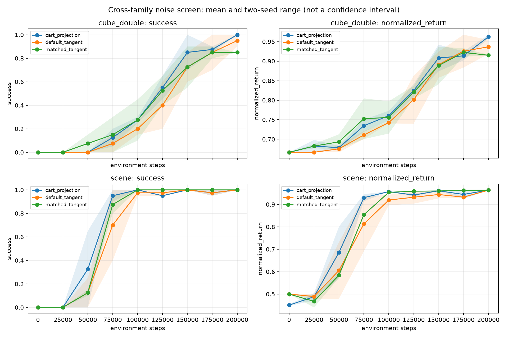

### Cube-Triple：固定温度扰动匹配 tangent DS

该组实验先用 reward-blind Cartesian 状态面板估计 within-state radius SD 与 angular deviation，
再用闭环控制器让 tangent DS 匹配这两个执行空间扰动量。Radius mean 和完整分布没有被匹配。

| 任务 | 预算 / seeds | Matched − Cartesian return AUC | Matched − Cartesian success AUC | 最终成功率差 |
|---|---|---:|---:|---:|
| task1 | 300k / 6 | +0.10075 | +0.19361 | +45.33 pp |
| task2 | 500k / 6 | +0.02703 | +0.06700 | +32.67 pp |
| task3 | 1M / 6 | +0.02895 | +0.00733 | +4.00 pp |

task2 的 return AUC、success AUC、最终回报和最终成功率 paired-bootstrap 区间均为正；六对 seed
下相应 exact sign-flip p 多为 `0.0625`，因此证据有方向性但样本量仍小。task3 的四个
Matched−Cartesian 区间均跨零；它更支持 dense-return 改善趋势，而不是明确的任务完成率收益。
task2/task3 等任务权重汇总的 return-AUC 差为 `+0.02799`，95% 分层 bootstrap 区间
`[+0.00915,+0.04634]`。这两项仍属于同一 Cube-Triple 任务族。

task1 的五方法强基线竞争中，return AUC 为 Cartesian `0.62167`、matched tangent `0.72242`、
GAC-code `0.65938`、GAC-paper `0.69846`、GAC-DS `0.71695`。Matched 与 GAC-DS 的差异未解决；
十个主比较经 Holm 校正后均未达到 0.05。因官方代码与论文公式的动作归一化实现不同，必须继续
分开标作 GAC-code 与 GAC-paper。

### 证据规模

- P1 action/noise pilot：6 个右删失运行、1,500 个评估 episodes；
- P2 temporal cloud panel：24 个完整云端运行；
- P2 评估轴：264/264；
- P2 primary：13,200 episodes；
- P2 secondary：5,280 episodes；
- P2 合计：18,480 episodes，`UNKNOWN=0`；
- original40：32/40；缺失 frozen fourth8 八个案例。

### P2：stochastic-primary

早期窗口：Cube 为 0–300k，Scene 为 0–100k；Full AUC 为 0–500k。每个 arm 当前只有三个云端
block，且缺失的 block 不同，因此下表是描述性均值。

| 任务 | 方法 | 当前 blocks | Early AUC | Full AUC | 500k success |
|---|---|---|---:|---:|---:|
| Cube Double | R reactive K=1 | 2,3,4 | 57.56% | 73.87% | 100.00% |
| Cube Double | D direction hold K=5 | 1,2,3 | 45.22% | 66.30% | 99.33% |
| Cube Double | T translation repeat K=5 | 1,2,4 | 60.17% | 75.80% | 98.67% |
| Cube Double | F full repeat K=5 | 1,3,4 | **68.11%** | **80.63%** | 99.33% |
| Scene | R reactive K=1 | 2,3,4 | **31.83%** | **85.63%** | 99.33% |
| Scene | D direction hold K=5 | 1,2,3 | 20.50% | 82.33% | 100.00% |
| Scene | T translation repeat K=5 | 1,2,4 | 25.00% | 84.53% | 100.00% |
| Scene | F full repeat K=5 | 1,3,4 | 24.33% | 84.20% | 100.00% |

只使用 D 与比较方法共同 block 的 early-AUC 差值：

| 任务 | D−T | D−R | D−F |
|---|---:|---:|---:|
| Cube Double | −10.67 pp | −16.08 pp | −21.92 pp |
| Scene | −2.00 pp | −15.00 pp | −6.25 pp |

每个对比只有两个共同 block，所以不报告 CI 或 p 值；但方向一致地不利于 D。

### P2：latent-location secondary

| 任务 | 方法 | Early AUC | Full AUC | 500k success |
|---|---|---:|---:|---:|
| Cube Double | R | 51.81% | 70.00% | 100.00% |
| Cube Double | D | 44.58% | 66.25% | 98.33% |
| Cube Double | T | 57.08% | 73.83% | 100.00% |
| Cube Double | F | **62.50%** | **77.33%** | 100.00% |
| Scene | R | **29.58%** | **85.33%** | 100.00% |
| Scene | D | 21.25% | 83.00% | 100.00% |
| Scene | T | 23.33% | 83.83% | 100.00% |
| Scene | F | 21.25% | 83.50% | 100.00% |

次级同 block 结果除 Scene 的 D−T 为 0 外，其余仍为负，说明主结果不像是随机动作采样的偶然
产物。

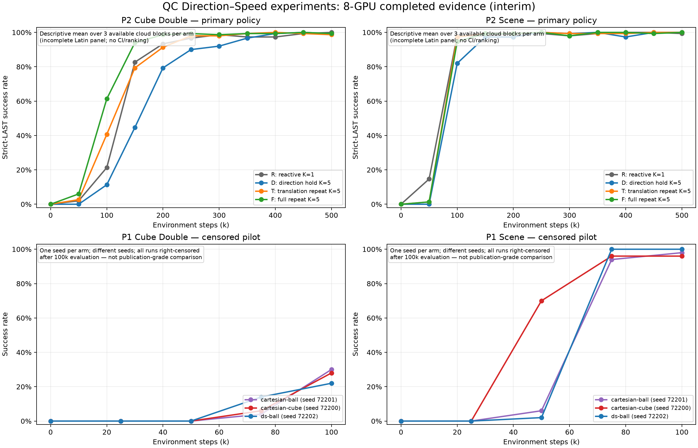

### P1：action/noise pilot

每个方法/任务只有一个且不同的 seed；六个运行最终均为失败或右删失，不能构成公平因果比较。

| 任务 | 方法 | 50k | 75k | 100k | 终止 |
|---|---|---:|---:|---:|---|
| Cube Double | Cartesian cube | 0% | 6% | 28% | 131,858，owned stop |
| Cube Double | Cartesian ball | 0% | 4% | 30% | 130,889，owned stop |
| Cube Double | DS ball | 0% | 14% | 22% | 125,539，quantized endpoint |
| Scene | Cartesian cube | 70% | 96% | 96% | 111,246，owned stop |
| Scene | Cartesian ball | 6% | 94% | 98% | 111,701，owned stop |
| Scene | DS ball | 2% | 100% | 100% | 100,417，owned stop |

Ball projection 没有一致优势；Cube DS-ball 有真实数值端点失败。后续如重做，应建立新的预注册
matched-seed cohort，不能覆盖或重标这些运行。

### 已建立的机制性结论

历史机制实验支持以下较窄结论：

- 潜变量中的方向/径向独立不等于执行后欧氏方向/幅值独立；
- 全局矩接近会掩盖明显的状态条件差异；
- 只调径向噪声存在由方向几何产生的半径方差下限；
- 全协方差 Gaussian 能减小一部分差异，但不自动形成完整匹配控制；
- 硬参数上限可能使径向学习梯度失效；平滑参数化恢复部分可训练性，但严格机制门仍有失败；
- 匹配初始执行动作矩是必要强控制，但不等于匹配完整分布或证明任务收益；
- 工程接线、checkpoint 恢复、真实环境 reset 和分析器通过都不是性能证据。

这些结论解释了为什么简单换坐标或固定保持方向未必带来成功率提升。

### 当前不能声称

- original40 的正式方法排名；
- 五 seed 的置信区间或显著性；
- direction–speed 普遍提高成功率；
- 对 FQL 或 Robomimic 的迁移；
- 4090 并发压测本身带来算法加速；
- 工程门通过等于顶会贡献成立。

### 下一步

1. Cube Double task2 与 Scene task2 的独立 reward-blind Cartesian 校准已完成，两个任务的
   task-specific 噪声目标已经冻结；
2. 两个任务的 50k 独立 engineering seed 均通过几何匹配与容量门；
3. 200k/两-seed、两任务、三方法的 12-run 跨任务族筛选已经完成并失败，不启动原计划的
   500k/五-seed 两矩匹配扩展；
4. 阶段 D–G 已定位两层失败：绝对全局 mean 会抹掉条件 speed head，而保留 head 的全局 offset
   又与边界附近的 radius-SD 控制耦合。当前版本不再增加 residual/gain 扫描或性能 seed；下一
   机制实验改用执行空间条件分布距离（如固定状态面板上的 sliced-Wasserstein/MMD 教师匹配），
   并先通过 reward-blind 门；
5. 独立地在真 8×4090 上补齐 frozen fourth8；随后实现 adaptive temporal control，再扩展到 FQL
   与 Robomimic 跨域验证。

## DS-RLPD 实验报告

原文位置：`docs/results/experiments.md`。正文按原记录保留，原文件名用于历史追溯。

环境: `cube-triple-play-singletask` (task1–5) | Agent: ACRLPD | 观察维度: 46 | 动作维度: 5

---

### 一、复现结果

环境: `cube-triple-play-singletask-task2-v0` | seed: 0 | 观察维度: 46 | 动作维度: 5

#### 正式复现结果 (1M 步)

| 方法 | 入口 | H | 关键参数 | 训练方式 | 最终 | 论文 | CI |
|------|------|---|---------|---------|------|------|-----|
| **QC** | main.py | 5 | best-of-n=32 | 离线1M→在线1M | **96%** | 89% | 81.5-93.5% |
| **RLPD** | main_online.py | 1 | — | 纯在线 | **74%** | 60% | 22.5-87% |
| **RLPD-AC** | main_online.py | 5 | 无BC约束 | 纯在线 | **2%** | 2% | 0-3% |

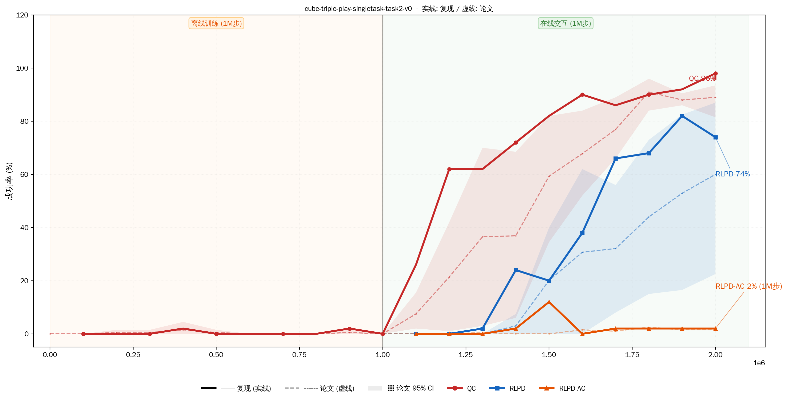

#### 长序训练实验 (10M 步)

| 方法 | H | BC约束 | 最终 | 最佳 | 突破点 |
|------|---|--------|------|------|--------|
| **RLPD-AC** | 5 | 无 | **88%** | 98% @7.6M | ~1.5M |
| **QC-RLPD** | 5 | bc_alpha=0.01 | **90%** | 100% @9.3M | ~2.5M |

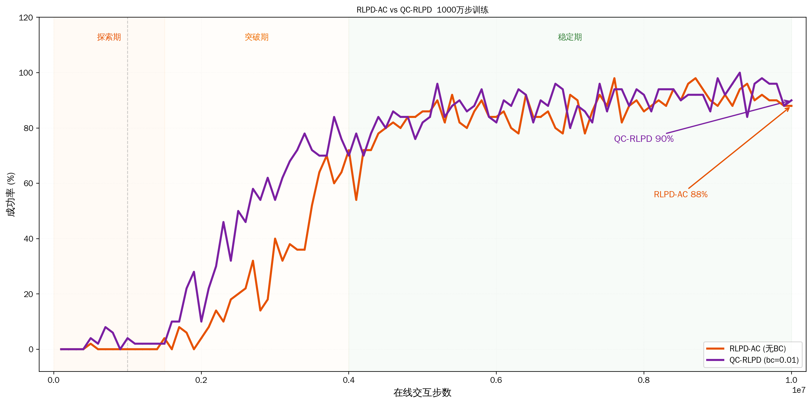

**关键发现**: H=5 纯在线需要更多样本但最终可达 90%；bc_alpha=0.01 在长序训练中有效；1M 步不足以判断 H=5 方法的优劣。

#### 关键技术细节

- **控制频率**: 20 Hz
- **动作空间**: H=5 时 25 维
- **GPU**: RTX 4090 ×1
- **并行**: `taskset` CPU 绑核, `XLA_PYTHON_CLIENT_PREALLOCATE=false`

---

### 二、小批次验证 — DS 消融 (task2, 4 seeds)

验证 [approach.md](../reference/method.md) 中 Action-adapter DS（D+1 非可逆）、Integrated DS / stereographic、Integrated DS / spherical 三种实现，在 H=1（无 chunk）和 H=5（有 chunk）下的表现。

#### 实验配置

- 环境: `cube-triple-play-singletask-task2-v0`
- 步数: 1,000,000
- Agent: ACRLPD
- 双卡并行: GPU 0 + GPU 1，4 并发/卡，4 seed/组
- 脚本: `run_ds_h5_1m.sh`, `run_ds_h1_1m.sh`
- 日志: `logs/ds_h5_1m/`, `logs/ds_h1_1m/`

#### 结果

| 组 | H=5+chunk | ±std | H=1(无chunk) | ±std |
|---|:---:|:---:|:---:|:---:|
| **Action-adapter** | 31.5% | 21.8% | 89.0% | 11.9% |
| **Stereographic** | 18.5% | 16.1% | **91.0%** | 4.6% |
| **Spherical** | 7.0% | 3.3% | 63.5% | 14.8% |
| **Baseline** (TanhNormal) | 3.0% | 1.7% | 58.5% | 20.3% |

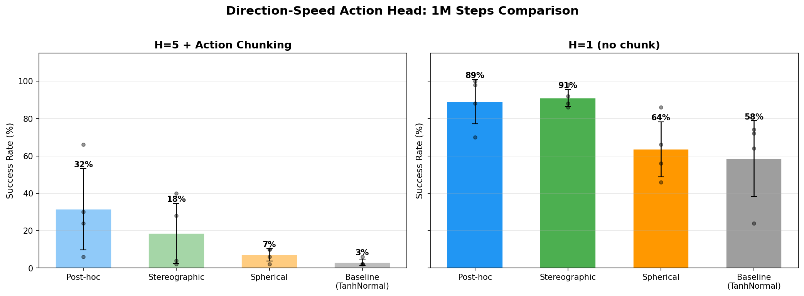

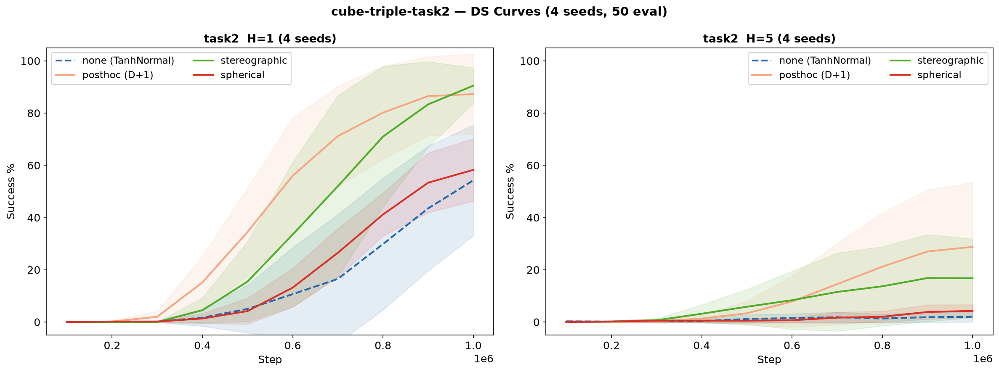

#### 每 seed 详细数据

##### H=5 + Action Chunking

| 组 | s0 | s1 | s2 | s3 | 均值 |
|---|:---:|:---:|:---:|:---:|:---:|
| adapter | 24% | 66% | 6% | 30% | 31.5% |
| stereographic | 40% | 4% | 2% | 28% | 18.5% |
| spherical | 10% | 6% | 10% | 2% | 7.0% |
| baseline | 6% | 2% | 2% | 2% | 3.0% |

##### H=1 (无 chunk)

| 组 | s0 | s1 | s2 | s3 | 均值 |
|---|:---:|:---:|:---:|:---:|:---:|
| adapter | 100% | 88% | 70% | 98% | 89.0% |
| stereographic | 86% | 92% | 98% | 88% | 91.0% |
| spherical | 56% | 46% | 66% | 86% | 63.5% |
| baseline | 74% | 64% | 24% | 72% | 58.5% |

#### Task1 4-seed 泛化验证

在 task1 上重复相同配置（4 seeds, 50 eval）验证 DS 泛化。task1 仅在 1 个 cube 需移动，其余 2 个原位不动，预期比 task2 简单。

| 组 | H=1 | ±std | H=5 | ±std |
|---|:---:|:---:|:---:|:---:|
| **Action-adapter** | **100%** | 0% | 94% | 9% |
| **Baseline** | 83% | 34% | 53% | 55% |
| **Stereographic** | 51% | 32% | 72% | 43% |
| **Spherical** | 40% | 37% | 48% | 38% |

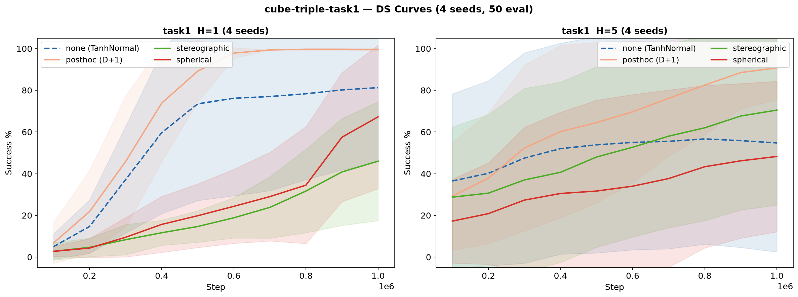
- **4 seed / 50 eval 方差极大**（±55% 级别），10 seed 升级版见第三节。

#### FQL + Action-adapter DS (2M 步)

验证 DS 在 flow-based FQL 上的效果。入口：`main.py`（离线 1M → 在线 1M）。FQL 仅支持 adapter。

| ds_mode | s0 | s1 | s2 | **均值** | **中位数** |
|---------|:---:|:---:|:---:|:---:|:---:|
| none | 96% | 84% | 90% | **90%** | 90% |
| adapter | 100% | 98% | 4% | **67%** | 98% |

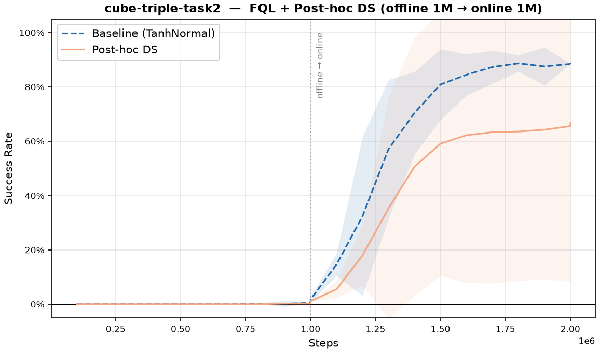

- FQL baseline 极强（90%），离线预训练是关键
- adapter s0/s1 近乎完美，s2 异常（4%）可能是 seed 崩溃
- 排除 s2：adapter 99% > baseline 90%，DS 在 FQL 上仍有收益
- **数据**：[`cube-triple-play-singletask/task2/h5/fql/`](../data/ds_experiments/cube-triple-play-singletask/task2/h5/fql)

---

### 三、大规模 OGBench 跨任务验证 (task1–5)

cube-triple 5 个子任务的完整 DS 消融（4 DS modes × H1/H5 × 1M 纯在线）。

#### 跨任务总览

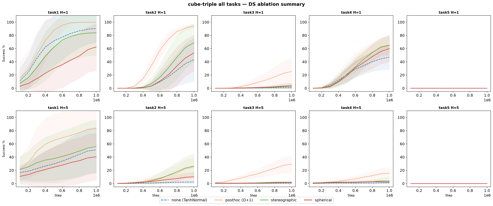

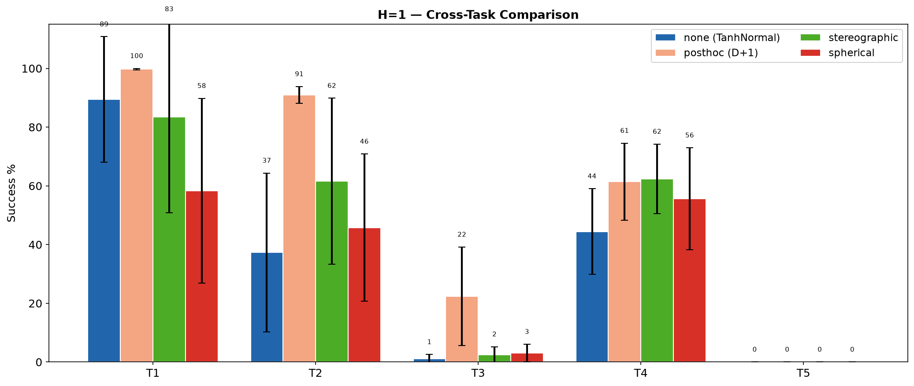

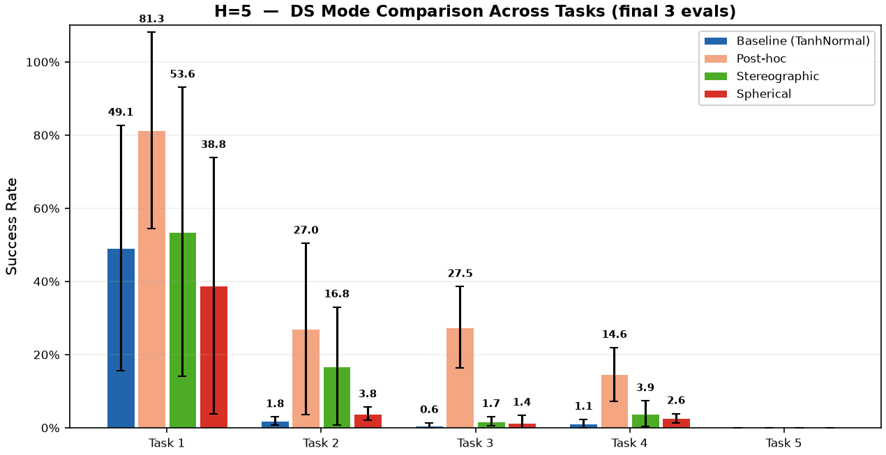

---

#### cube-triple-task1

> 4-seed 小批次验证见 [二、小批次验证](#experiments--二小批次验证--ds-消融-task2-4-seeds)。以下为 10-seed 升级版。

##### Task1 H=1 升级版 (10 seeds, 100 eval)

| 方法 | 1M 成功率 | ±std |
|------|:---:|:---:|
| **DS-RLPD (adapter)** | **99.7%** | 0.2% |
| RLPD (baseline) | 89.4% | 21.4% |
| DS-RLPD (stereographic) | 83.4% | 32.5% |
| DS-RLPD (spherical) | 58.3% | 31.5% |

| 方法 | s0 | s1 | s2 | s3 | s4 | s5 | s6 | s7 | s8 | s9 |
|------|:--:|:--:|:--:|:--:|:--:|:--:|:--:|:--:|:--:|:--:|
| adapter | 100 | 100 | 100 | 100 | 99 | 100 | 100 | 100 | 99 | 99 |
| none | 100 | 46 | 100 | 98 | 100 | 100 | 56 | 99 | 98 | 97 |
| stereographic | 99 | 100 | 99 | 100 | 0 | 100 | 0 | 100 | 100 | 100 |
| spherical | 52 | 47 | 47 | 45 | 98 | 48 | 100 | 48 | 52 | 46 |

- **adapter 99.7% 近乎满分**：±0.2%，10 seed 全部 ≥99%，确认 task1 H=1 的最优配置
- **baseline 89.4% 强于预期**：少数 seed 跑出满分，但方差大（46–100%）
- **stereo/spherical 方差极大**：各有 2 个 seed 归零，其余接近满分，说明 seed 敏感
- **与旧 4-seed 对比**：baseline 83%→89%，stereo 51%→83%，10 seed 更稳定但仍受 seed 影响大
- **数据**：[`cube-triple-play-singletask/task1/h1/rlpd/`](../data/ds_experiments/cube-triple-play-singletask/task1/h1/rlpd)

##### Task1 H=5 升级版 (10 seeds, 100 eval)

**升级实验**：seeds 0–9 (10 seeds)，100 eval episodes，1M online steps。H=5 + action chunking。

| 方法 | 1M 成功率 | ±std | 范围 |
|------|:---:|:---:|:---:|
| **DS-RLPD (adapter)** | **84.9%** | 22.7% | 42–100% |
| **DS-RLPD (stereographic)** | 59.0% | 38.2% | 6–100% |
| **RLPD (baseline)** | 54.1% | 32.7% | 3–99% |
| **DS-RLPD (spherical)** | 43.3% | 33.9% | 8–100% |

- **adapter 84.9% 大幅领先**：但方差较大（42–100%），部分 seed 跑出满分
- **stereographic (59%) ≈ baseline (54.1%)**：stereo 在 H=5 下优势不明显
- **spherical 最弱 (43.3%)**：与 task2 一致，球坐标 Jacobian 退化
- **10 seeds 给出更可信的 CI**：旧实验 4 seeds 的 ±std 高达 55%，新实验 10 seeds 下 CI 更紧
- **数据**：[`cube-triple-play-singletask/task1/h5/rlpd/`](../data/ds_experiments/cube-triple-play-singletask/task1/h5/rlpd)

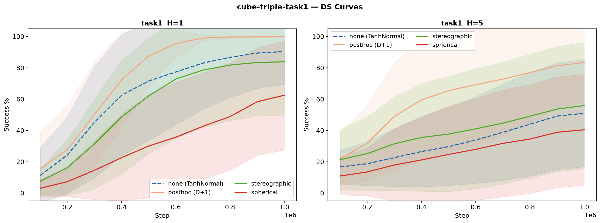

---

#### cube-triple-task2

> 4-seed 小批次验证见 [二](#experiments--二小批次验证--ds-消融-task2-4-seeds)。以下为 10-seed 100 eval 升级版。

| 方法 | H=1 | ±std | H=5 | ±std |
|------|:---:|:---:|:---:|:---:|
| **Action-adapter** | **91.0%** | 2.9% | 22.0% | 12.4% |
| **Stereographic** | 61.6% | 28.3% | **23.5%** | 15.5% |
| Spherical | 45.8% | 25.1% | 9.4% | 5.8% |
| Baseline (TanhNormal) | 37.3% | 27.0% | 2.0% | 1.7% |

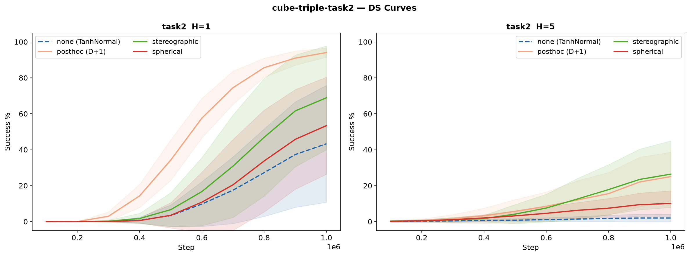

**与旧 4-seed 对比：**
- H=1 stereo 从 91% 跌至 62%：旧 4 seed 恰中利好 seed
- H=1 adapter 稳定 91% ±2.9%，确认为 task2 最优 H=1 配置
- H=5 stereo 首次反超 adapter（23.5% vs 22.0%）：bijector Jacobian 在 chunking 下不再劣势
- **数据**：[task2/h1/rlpd/](../data/ds_experiments/cube-triple-play-singletask/task2/h1/rlpd) / [task2/h5/rlpd/](../data/ds_experiments/cube-triple-play-singletask/task2/h5/rlpd)

---

#### cube-triple-task3 (10 seeds, H1+H5)

完整消融实验：cube-triple-play-singletask-task3-v0，1M 纯在线，H1+H5，4 DS × 10 seeds × 100 eval（MuJoCo `mj_narrowphase` 碰撞 bug 已修复）

##### Task3 结果

| 方法 | H=1 | ±std | H=5 | ±std |
|------|:---:|:---:|:---:|:---:|
| **adapter** | **28.4%** | 22.2% | **31.7%** | 14.4% |
| spherical | 4.3% | 4.8% | 1.5% | 2.1% |
| stereographic | 4.0% | 4.6% | 1.7% | 1.9% |
| none (baseline) | 1.1% | 1.9% | 0.7% | 1.0% |

每 seed 数据见下方。关键发现：
- **adapter 独大**：H1 28.4%、H5 31.7%，远超过其他方法（stereo/spherical 均 ≤5%）
- **H5 adapter 略优于 H1**（31.7% vs 28.4%）— 与 task2 类似，但绝对值低得多
- **stereo/spherical 在 task3 上完全失败**：与 task4（H1 下 stereo 67%）形成鲜明对比

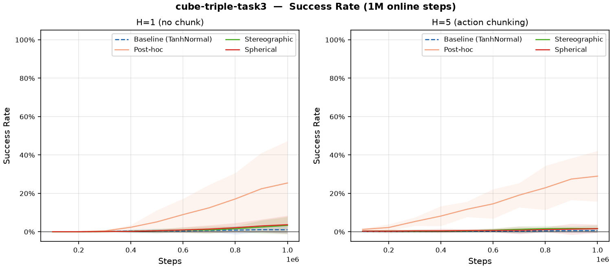

- 数据：[`cube-triple-play-singletask/task3/`](../data/ds_experiments/cube-triple-play-singletask/task3)

##### H=1 每 seed

| 方法 | s0 | s1 | s2 | s3 | s4 | s5 | s6 | s7 | s8 | s9 | 均值 |
|------|:--:|:--:|:--:|:--:|:--:|:--:|:--:|:--:|:--:|:--:|:---:|
| adapter | 28 | 35 | 65 | 47 | 2 | 10 | 31 | 52 | 13 | 1 | 28.4 |
| spherical | 4 | 16 | 2 | 2 | 2 | 4 | 1 | 1 | 9 | 2 | 4.3 |
| stereographic | 14 | 7 | 0 | 0 | 5 | 4 | 7 | 0 | 3 | 0 | 4.0 |
| baseline | 4 | 1 | 0 | 0 | 0 | 5 | 0 | 0 | 1 | 0 | 1.1 |

##### H=5 每 seed

| 方法 | s0 | s1 | s2 | s3 | s4 | s5 | s6 | s7 | s8 | s9 | 均值 |
|------|:--:|:--:|:--:|:--:|:--:|:--:|:--:|:--:|:--:|:--:|:---:|
| adapter | 31 | 30 | 32 | 33 | 53 | 46 | 14 | 14 | 20 | 44 | 31.7 |
| stereographic | 1 | 4 | 0 | 3 | 0 | 5 | 0 | 2 | 0 | 2 | 1.7 |
| spherical | 1 | 0 | 2 | 3 | 0 | 7 | 1 | 0 | 0 | 1 | 1.5 |
| baseline | 1 | 1 | 0 | 3 | 0 | 2 | 0 | 0 | 0 | 0 | 0.7 |

---

#### cube-triple-task4 (10 seeds, H1+H5)

完整消融实验：cube-triple-play-singletask-task4-v0，1M 纯在线，H1+H5，4 DS × 10 seeds × 100 eval

##### Task4 结果

| 方法 | H=1 | ±std | H=5 | ±std |
|------|:---:|:---:|:---:|:---:|
| **stereographic** | **67.9%** | 14.8% | 4.8% | 5.2% |
| adapter | 66.5% | 15.1% | **17.6%** | 9.2% |
| spherical | 64.8% | 18.6% | 2.0% | 1.6% |
| none (baseline) | 49.4% | 19.8% | 1.6% | 1.8% |

##### H=1 每 seed

| 方法 | s0 | s1 | s2 | s3 | s4 | s5 | s6 | s7 | s8 | s9 | 均值 |
|------|:--:|:--:|:--:|:--:|:--:|:--:|:--:|:--:|:--:|:--:|:---:|
| stereographic | 66 | 51 | 72 | 35 | 76 | 70 | 48 | 67 | 69 | 70 | 62.4 |
| adapter | 51 | 58 | 67 | 44 | 61 | 88 | 69 | 68 | 53 | 55 | 61.4 |
| spherical | 17 | 75 | 55 | 46 | 72 | 47 | 54 | 72 | 41 | 77 | 55.6 |
| none | 46 | 50 | 41 | 19 | 63 | 54 | 59 | 27 | 20 | 65 | 44.4 |

##### H=5 每 seed

| 方法 | s0 | s1 | s2 | s3 | s4 | s5 | s6 | s7 | s8 | s9 | 均值 |
|------|:--:|:--:|:--:|:--:|:--:|:--:|:--:|:--:|:--:|:--:|:---:|
| adapter | 13 | 9 | 18 | 12 | 20 | 29 | 20 | 11 | 3 | 11 | 14.6 |
| stereographic | 10 | 3 | 1 | 5 | 12 | 3 | 1 | 2 | 1 | 1 | 3.9 |
| spherical | 2 | 4 | 1 | 3 | 5 | 2 | 3 | 2 | 1 | 3 | 2.6 |
| none | 1 | 0 | 2 | 0 | 3 | 2 | 1 | 0 | 1 | 1 | 1.1 |

- **H=1: stereo/spherical 首次发威**，追平 adapter，三者均远超 baseline
- **H=5: 仅 adapter 勉强可用 (17.6%)**，其余 ≤5%

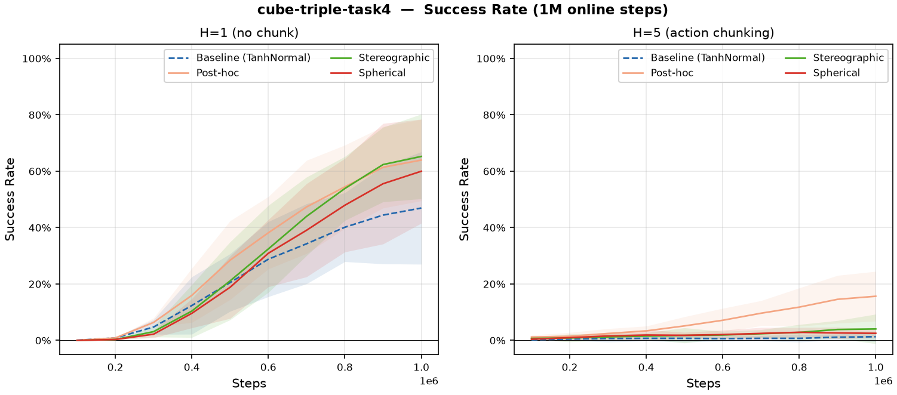

- 数据：[`cube-triple-play-singletask/task4/`](../data/ds_experiments/cube-triple-play-singletask/task4)

---

#### cube-triple-task5 (10 seeds, H1+H5)

完整消融实验：cube-triple-play-singletask-task5-v0，配置同 task4。

**全部 80 runs (H1+H5, 4 DS × 10 seeds) 成功率均为 0%。** task5 是目前最难的 cube-triple 任务，1M 步内任何方法均无信号。

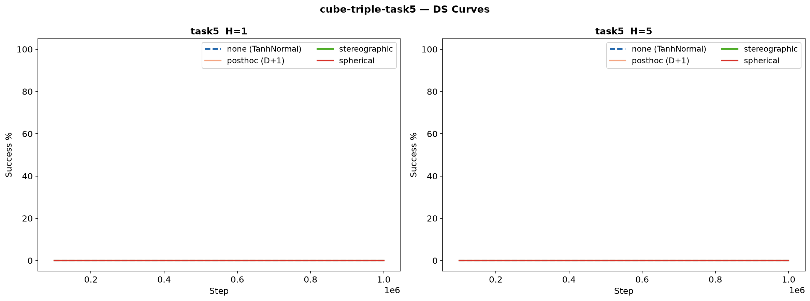

---

#### 跨任务难度对比

| Task | H1 baseline | H1 best DS | H5 baseline | H5 best DS |
|------|:---:|:---:|:---:|:---:|
| task1 | 89% | 100% (adapter) | 54% | 85% (adapter) |
| task2 | 37% | 91% (adapter) | 2% | 24% (stereo) |
| task3 | 1% | 28% (adapter) | 0.7% | 32% (adapter) |
| task4 | 49% | 68% (stereo) | 1.6% | 18% (adapter) |
| **task5** | **0%** | **0%** | **0%** | **0%** |

> task1/2 H1 为 10 seeds 100 eval；task1/2 H5 含 4-seed 遗留数据

- 难度：task1 < task2 < task4 < task3 < task5
- DS 相对收益在中等难度 (task4) 最显著
- 数据：[`cube-triple-play-singletask/task5/`](../data/ds_experiments/cube-triple-play-singletask/task5)

#### 结论

1. **adapter 在多数场景最优**：H=1 和 H=5 下均稳居前二，D+1 自由度简单有效
2. **H=1 的 stereo 在中等难度有效**（task4 68%，task1 83%），但在过简单/过难任务上不稳定
3. **H=5 stereo 首次反超 adapter**（task2 23.5% vs 22.0%）：Jacobian bijector 在 chunking 下不再劣势，但需要 10 seed 才能检出
4. **spherical 全局最弱**：球坐标 Jacobian 退化，不推荐
5. **10 seed 对结论可靠性至关重要**：旧 4 seed 的 task2 stereo 91%→62%，baseline 59%→37%
6. **task5 为当前最难任务**：1M 步完全失败，需更长训练或 offline pretrain

#### 已知局限

| 问题 | 影响 | 建议 | 状态 |
|------|------|------|:--:|
| ~~task2 H1+H5 仅 4 seeds, 50 eval~~ | — | — | ✅ 已补全 10 seeds |
| ~~task1 H1 仅 4 seeds, 50 eval~~ | — | — | ✅ 已补全 10 seeds |
| task1 H5 存在两套数据 (`rlpd-4s` vs `rlpd`) | `rlpd-4s` 无 checkpoint；`rlpd` 的 `run_group=Debug` | 确认 canonical 版本 | ⚠️ |
| task5 全 0% | 无 DS 对比信号 | 需更长训练或 offline pretrain | ⚠️ |

> 更新：已有 task1 H1 的 10 seed 结果建议统一整理（当前仍有两套命名不一致的数据在同一目录）。

#### 更新日志

| 日期 | 更新 |
|------|------|
| 2026-06-15 | task1 H1 + task2 H1+H5 补全 10 seeds 100 eval，全部柱状图加误差线 |
| 2026-06-14 | 统一重绘全部旧图（配色图例一致）+ 跨任务汇总图 + 已知局限 |
| 2026-06-14 | cube-triple-task5 (80 runs, 全 0%) + task4 (80 runs) |
| 2026-06-14 | docs/data 重组为 `env/task/horizon/method/ds_mode/seed` 层级 |
| 2026-06-13 | cube-triple-task1 H=5: 10 seeds, 100 eval |
| 2026-06-11 | 初始实验（task2 H1/H5, task1 4 seeds, FQL） |

#### 数据

原始实验数据: [SZUEAILab/ds-experiments](https://huggingface.co/datasets/SZUEAILab/ds-experiments) (`datasets.load_dataset("SZUEAILab/ds-experiments")`)。

## Direction–amplitude research: actual status and prospective P2 screen

原文位置：`docs/results/ds_temporal_action_noise_research_status_20261010.md`。正文按原记录保留，原文件名用于历史追溯。

> 历史快照：本文保留 2026-10-10 当时的详细推理和预注册上下文。当前结论与下一步以
> [`current_results.md`](#current-results) 和 [`research_program.md`](research_history.md#research-program) 为准。

Status date: 2026-10-10, Asia/Shanghai. This is a research progress record,
not a claim of publication readiness, universal improvement, or completion.

### Scientific question

For manipulation commands, separate the translation direction from its command
amplitude, and test three distinct mechanisms: action support/parameterization,
exploration-noise geometry, and selective temporal persistence. A commanded
amplitude is not the measured physical velocity of the end effector. Use
"direction–amplitude" in mathematical definitions and explain the informal
"direction–speed" terminology, rather than claiming a velocity measurement.

The temporal hypothesis is that a useful translation direction may change more
slowly than the amplitude, rotation, and gripper decisions. Keeping direction
for five primitive steps while adapting the other decisions could reduce
directional jitter without the loss of responsiveness caused by repeating the
whole action. This is a hypothesis awaiting the registered performance screen,
not an established explanation of prior results.

#### Related-work boundary, checked against primary sources on 2026-10-10

Action repetition is not a new contribution: [FiGAR](https://arxiv.org/abs/1702.06054)
learns an action and repetition timescale, [TempoRL](https://proceedings.mlr.press/v139/biedenkapp21a.html)
learns when to take a new action, and [TAAC](https://arxiv.org/abs/2104.06521)
uses a closed-loop act-or-repeat decision. [TLA](https://arxiv.org/html/2305.18701v3)
already combines slow and fast policies with switching. [gSDE](https://arxiv.org/abs/2005.05719)
already studies state-dependent, periodically resampled exploration. These
sources rule out describing generic temporal abstraction, persistence, or
smooth exploration as our invention; this is our research-positioning inference,
not an exhaustive proof of priority.

The recent [Direction-Conditioned Policies paper](https://arxiv.org/html/2610.05087v1)
conditions an online CRL actor on a target's direction and distance in learned
goal-representation space. Its collection waypoint is held while the relative
direction is recomputed. Our proposed control instead factorizes a physical
translation command and holds that command's direction while adapting its
amplitude. Goal-input geometry and action-output geometry must not be conflated.
The paper is relevant prior art, not evidence that our method is novel or better.
No external reported task scores are imported into our experiment results.

The candidate claim is therefore **selective persistence in action factors**,
not direction normalization alone: which command factors should remain slow,
which require fast feedback, and under what task conditions does that choice
improve learning? Current D-versus-T measures a controller/active-head/entropy/
memory package; it is not a pure intervention on one scalar or a mediation test.

A stronger prospective mechanism study would complete a direction-clock ×
amplitude-clock 2×2 design, keeping nuisance decisions fast: R=(1,1),
D=(5,1), A=(1,5), T=(5,5). The missing A arm refreshes direction but retains
amplitude. The interaction contrast `(D−T)−(R−A)` asks whether fast amplitude
feedback is especially useful when direction is held. Shared factorization,
capacity, command support, primitive discounting and entropy-rate controls are
needed; the factorial identity alone does not remove learning-objective or
execution-order confounding. Frozen907 also uses different arm-specific memory
encodings and actor/critic coupling; the contrast is a package interaction,
not uniquely identified feedback-clock causality. This is not a registered additional run, current
protocol change, or permission to launch a result-driven seed/period sweep.

The completed CPU integrator checks also constrain the explanation. Under iid
nonnegative amplitudes and independent zero-mean unit directions, block MSD
obeys T≥D≥R; MSD is not coverage or success probability. In the one bounded
feedback toy, D=R and first hits occur at3 primitives versus7 for T, but all
three hit within40 and T can be faster in another analytic setting. A continued
post-goal oscillation is not an episode failure when the task stops on goal.
These calculations support falsifiable tests, not a universal superiority
theorem or empirical RL result.

### Completed noise screen

The completed cohort contains two OGBench tasks, three behavior-noise modes,
four training seeds, and 500,000 environment steps per case: 24 cases / 12M
environment steps. Twelve cases ran on local GPUs and twelve on cloud RTX4090s.
The cloud twelve have actual clean training-child and queue-owner exit records;
historical local owner/runtime evidence has separately disclosed limitations.

The prespecified descriptive aligned-minus-reflected early-window effects were:

| Task | Window | Four paired differences, percentage points | Mean |
|---|---|---|---|
| Cube Double | 0–300k | -1.0833, -2.2500, -9.5833, -6.0833 | -4.7500 |
| Scene | 0–100k | 8.7500, 0.7500, -0.5000, 9.5000 | 4.6250 |

These results do not support a universal advantage of aligned noise. Final
success near 99–100% for all three modes also does not establish improved
sample efficiency. The two-local/two-cloud seed allocation confounds seed block
with host; four-seed descriptive comparisons are not a causal hardware study.
Do not select new gain/epsilon settings or extra seeds to rescue a failed claim.

Authoritative analysis:
`/data/chainpray/qc/archive/consolidated-legacy-storage-20261018/project-evidence/evidence/legacy-sdd-20261013/root-sdd/2026-10-09-eight-gpu-orchestration/noise-whole24-admission/actual-admitted-noise24-outcomes-v1.json`
SHA256 `59bb729ec5d2635bc21bc6f3c2561900f71f502e33a88d9643934d578a953764`.

### P1: action-space inductive bias, actual queue exit1 under diagnosis

Registered matrix: Cube Double / Scene × Cartesian-cube / Cartesian-ball /
direction–amplitude ball × seeds 72200–72202 × 500k, totaling 18 cases / 9M
planned environment steps. Six cloud RTX4090 lanes each run the three arms
sequentially on the same task/seed GPU. All arms retain the same full-cube
uniform 5,000-step warmup. The two ball methods have matched initial physical
action law and capacity; the cube-versus-ball contrast changes support and is
not a pure parameterization contrast. Differences in density/disabled-BC
evaluation kernels are retained and disclosed rather than described as
byte-identical implementations.

Actual queue SHA256:
`25efcd687a17f489abaf3152e4d212ebaec10ff487677b9fb765c4d28d3e7984`.
Foreground actual SSH wait handle 48195 belongs to the sole cloud operator.
The first saved learning milestone proves only Cube Double / Cartesian-ball /
seed72201 reached 5,000 environment steps and one formal update; it does not
prove all six lanes reached that count or the whole cohort completed.

Subsequently that original foreground wait returned actual exit1 (terminal
chunk8005d0, cell204 completed). Scheduler owner11052 also returned actual
wait exit1 after2410.399894617498seconds. This is a real unsuccessful queue
termination, not an observation timeout and not a completed18-case cohort.
Source/queue/science hashes were reported unchanged. Exact per-case cause,
partial clocks, queue tree closure, and lease state are being collected from
actual terminal metadata; they are not inferred from this one exit code. No
automatic retry, seed replacement, incident deletion, or outcome opening is
authorized by this status record.

Root subsequently audited the22-file terminal packet (actual exit0,
chunk868ee4, diagnosis SHA
`b04e1a6325a4a378f515da62dc826a1886a41286bbff70d25b0efdbc1a42e4dc`).
The initiating case is CubeDouble/DS-ball/72202 at step125539, with120539
previous completed updates: the read-only actor/target256-sample audit rejects
`radii<1 AND abs(nuisance)<1`. Which part failed is still unresolved. The other
five cases were owned-stop interruptions; six trees were drained and leases
released at the terminal observation. Twelve original cases were unstarted.
Do not interpret the missing final target-command artifact as the initiating
cause, or these incomplete cases as an admitted performance cohort.

### P2: selective direction persistence

Prospective full matrix: two tasks × four control arms × seeds72300/72301 ×
500k = 16 cases / 8M planned environment steps. Local block seed72300 has eight
actual registered plans and eight actual frozen-scheduler dry runs. Cloud block
seed72301 remains host-specific preparation; local validation does not grant
cloud execution admission.

| Arm | Direction | Translation amplitude | Rotation/gripper |
|---|---|---|---|
| Reactive, K=1 | Rechosen every step | Rechosen every step | Rechosen every step |
| Direction hold, K=5 | Kept within five-step block | Rechosen every step | Rechosen every step |
| Translation repeat, K=5 | Translation command repeated | Translation command repeated | Rechosen every step |
| Full repeat, K=5 | Complete action repeated | Complete action repeated | Complete action repeated |

All use the same frozen QC-adapted RLPD learner: four 512-unit hidden layers,
ten critic heads with mean aggregation, critic layer normalization, 128 offline
plus 128 online samples per formal update, UTD1, learning rate3e-4, gamma0.99,
tau0.005, disabled BC, and the registered per-event entropy convention. This
does not claim an exact unmodified upstream RLPD reproduction. Temporal control
memory is included in the policy/replay context; primitive-step discounting is
retained rather than silently substituting option-length discounting. Offline
world-action data are unchanged; their hypothetical control contexts are not
claimed to be observed options.

The first 5,000 collected steps are uniform world commands. The fresh learned
controller starts at the registered boundary; updates occur at steps5000–500000
inclusive, giving495001 formal updates per run. Initial evaluation precedes
collection, and each subsequent 50k boundary pauses training synchronously.

Evaluation comprises **11 total axes**, 0 plus50k,100k,…,500k, with50 stochastic
primary episodes and20 sequential-location secondary episodes per axis:770
original slots per run,12320 slots for the full prospective cohort. The primary
success is the official **LAST** episode outcome. Historical noise/P1 cohorts
use their frozen **EVER** convention, so raw cross-family success rates must
not be ranked as if they were the same estimand. Report primary and secondary
results separately, preserve UNKNOWN rather than treating it as False, and
audit cohort availability before computing paired effects.

All four arms within a task/seed share one physical GPU. Local ordering is
reactive,direction_hold,translation_repeat,full_repeat; cloud ordering is its
reverse. This balances order positions but does not remove host/seed
confounding or yield reliable two-seed inference. A positive first screen would
need independent confirmation and broader tasks before a paper-level claim.

Actual local registration:
`/data/chainpray/qc/archive/consolidated-legacy-storage-20261018/project-evidence/evidence/legacy-sdd-20261013/root-sdd/2026-10-09-eight-gpu-orchestration/temporal-performance-root-registration/local-p2-20261010-v1/root-registration-v1.json`
SHA256 `06793fd56ba0fab019c1ec807a39d19e664d63eadd65136a3138c7fc96d4cafe`.

Actual CPU-only native-plan admission of all eight local plans:
`root-native-admission-v1.json`, SHA256
`6447424427b58c6522e16632dd2c6c7730d29e5ecc42d931fc5e51b09b5b0af6`.
This validates current host source/runtime/roster/alias fields, not performance.

First local CubeR/SceneR queues were actually dispatched at
2026-10-09T23:59:10UTC (2026-10-10 07:59:10China time). Their owned actual
wait handles are69994 and35949, respectively. Initial metadata observation
`79a45ac0833b10f1604438c46252e75cf42af4ed30708b95de8651606d73f664`
verified both real owner and worker processes and axis0 snapshots; neither
first run was complete, and formal updates were still zero at that observation.

Later actual Cube metadata (chunk9f8f35) reached16000 environment steps and11001
formal updates. Its axis0 private evaluation owner returned actual0 with a
drained tree; the training invariance proof passed with no extra updates.
This establishes real learning progress for Cube, not Scene or all eight cases,
and still does not establish a performance advantage.

Cloud source preparation subsequently completed with actual SSH exit0
(chunk6f0c32): profile SHA
`518a630dc70b20d88ae33beeca2365cd77958b3545b286e08e68e6f30c9cadb1`.
Only192585bytes of initial source/helper/manifest transport were needed.
The actual relocated158-source closure, four opaque archives and two physics
headers matched; the cloud Python build is separately bound, not asserted
identical to the local build. This profile made no Env, Model or GPU calls.
A separate actorless cloud physical-component release7191469e has now been
issued for two one-zero-action CPU probes, but their actual reports and cloud
scientific registration remain pending.

Those two cloud probes subsequently returned actual0 (SSH32668,
terminal812606). Both constructed/reset/zero-stepped/closed exactly once,
showed stable no-op state capture and0.05s control increments, with no Agent,
update, GPU work or opened outcome. Root limited admission
`a190de07fc12a852c8ff6f9e39bdd9e29c06fd33624630804280b3fe05e1e58a`
was actually produced atd46866. This is not scientific training registration.
Actual cgroup quota is112CPU cores and896GiB RAM; host192CPUs and shared-filesystem
capacity are not the container quota. Cloud8 plan construction is the next step.

Later local observation41a97c confirms actual Cube49000steps/44001formalupdates
and Scene39000steps/34001formalupdates, both with initial axis0 completed and
real owner/worker processes alive. These are progress counters, not successful
performance results or terminal exits.

The actual local cards are RTX6000Ada48GB ×2, not the informal earlier A6000
description. Cube train CPUs24/25, private evaluation28/29; Scene train26/27,
private evaluation30/31. CPU evaluation is declared evaluation work, not a
fallback for GPU training. The21,600-second per70-episode barrier deadline is a
prospective resource limit, not measured throughput or an end-to-end ETA.

### Remaining evidence needed

#### Subsequent actual execution observations, 2026-10-10

The cloud block was subsequently registered and root-audited on the actual
cloud filesystem. All eight native plan checks and all eight scheduler dry
runs returned zero; the root admission SHA is
`4f1f689e2e11180f21be2bf4fb5399620ffdb9d6321616ea1ed65480454e366b`.
This supersedes the earlier preparation-only observations above, not the
distinction between registration, training, and performance admission.

The two cloud full-repeat queues, Cube and Scene / seed72301, actually launched
at 00:33:03UTC (08:33:03China), with owners14045/14046 on two distinct RTX4090s.
Their true foreground wait is45616, retained by the sole SSH operator. The
00:34:10UTC snapshot verified PID/startticks/boot and two GPU allocations,
axis0 input/snapshot files but no completed axis summary or learning counter.
It is a historical startup observation, not proof of their current stage or
of any completed cloud optimizer updates. The other six registered arms had
not been dispatched by that snapshot; eight cloud GPUs were not all busy.

At approximately00:50UTC, direct local progress metadata showed Cube105000
environment calls /100001 formal updates and Scene99000 /94001. Cube had
completed evaluation axes0,50000,100000; Scene0,50000. Actual command handles
69994/35949 remained live, and both registered owner PID/startticks/boot matched
`/proc`. No reward/success values were read, and no terminal or performance
completion is claimed.

The P1 failure diagnostic has a separately issued root packet:
plan SHA `54f23b638059ff53d08dfddb2d8fc3bbf9ec5e7149dcc6a41ab182bdebcfc2a3`.
It permits one bounded600-second read-only model restore/draw measurement on
the original physical GPU, without training, optimizer, Env or result access.
It is not a restart of the failed case. The original before/current model,
stored RNG, batch input hashes, initial model identity and frozen kernel are
bound; only observation fields may be decoded. Actual execution and branch
findings remain unproven until the true terminal receipt and witness exist.

Additional independent temporal seeds and order-balanced cloud lanes are under
prospective SOURCE design. This does not mutate the original16-case matrix or
grant execution authority, and is not an outcome-driven rescue of the already
analyzed noise experiment. The metadata auditor is separately being extended
to consume the real cloud launcher schema/remote argv, rather than pretending
cloud records are local receipts. Neither SOURCE task is an actual result.

At00:52:25UTC (08:52:25China), a new actual one-shot cloud snapshot showed
Cube15000 environment steps /10001 formal updates and Scene7000 /2001, each
with axis0 completed and original owner PID/startticks/boot verified live.
Thus both cloud tasks had entered learning, superseding the startup-only
observation. Snapshot SHA:
`782764e0d3e0a8a68545168dfe1db3ad1b66085aa82899cdad2916928056ad1f`.
It includes no success/reward values and proves neither final completion nor
algorithmic advantage.

The P1 readonly witness then returned actual owner/child exit0 in34.3313s,
with tree drained and its separate GPU lease released. Root independently
audited the original packet bytes and512 float32 command bit patterns/counts
at chunk1f8c3c, audit SHA
`7e341e2569c9c2ab2776b341c06fcfdd6f6fb6b8d425c89e16fc802e782b3c3e`.
The same frozen pre-update model/RNG/observations reproduced exactly one
strict-guard failure: target branch online row250, fifth nuisance coordinate
`3f800000` (float32 +1). Its translation norm is0.853177607 in float32 and
0.853177610 in float64, so this draw is not a translation-ball boundary or
the norm-rounding false-positive mechanism. Actor256/256 rows passed the
original guard and256 actor preimage scores were finite. Target scores remain
unavailable from the frozen sampling API; no finite target-score claim is made.

This successful diagnostic measurement does not make the original failed
training successful. Historical compiled draw bytes were not saved, so exact
historical output identity is not claimed. The narrow next question is whether
an explicitly declared prospective finite-precision executor may accept a
closed nuisance endpoint while retaining the sampled-preimage score convention;
the endpoint itself does not have an ordinary invertible continuous density.
Do not apply `arctanh(+1)`, pretend it is a discrete probability mass, resample,
clip to fabricate an interior sample, or silently relax the original protocol.
No production fix or training restart has occurred.

#### Full scientific scope still outstanding

##### Actual eight-cloud-lane expansion, not just a design

The independent three-seed replication has subsequently passed its full SOURCE
review (df41de37) and been actually registered on the cloud. New seeds72302,
72303,72304 /blocks2,3,4 add24 cases while retaining the original16. Actual
SSH7047 returned0; the real report485e7fb9 records24 native-plan validations,
24 frozen-scheduler readonly dry-runs,955 bounded namespace entries with no
target-seed conflicts, and unchanged source158/runtime/four opaque archives.
Root auditc2e862 rechecked the exact77 mirrored JSON files/59 publications,
full plans/770 rosters/queues/aliases and issued admission89ff887a for only
six first cases. Registration does not establish a performance result.

At01:14:19UTC (09:14:19China), the six additional queues actually started:

| Cloud seed | Tasks | First control arm | Subsequent fixed order |
|---|---|---|---|
| 72301, original | Cube/Scene | Full repeat, already running | T,D,R |
| 72302, new | Cube/Scene | Translation repeat | D,R,F |
| 72303, new | Cube/Scene | Direction hold | R,F,T |
| 72304, new | Cube/Scene | Reactive | F,T,D |

New first-six foreground SSH45753/eventstream313 and original first-two
SSH45616/eventstream271 retain real blocking owner waits. New owner PIDs are
27820..27825; original owners14045/14046 remain. No successor is automatically
started: each later arm requires its predecessor's real wait0, drained tree,
and separately reviewed metadata/model closure. A failed case is not retried.

One bounded startup window,01:15:26..01:16:27UTC, verified all eight registered
owner boot/PID/startticks, all eight running queues and eight distinct assigned
physical GPUs. Root independently cross-bound the original live records and
snapshot atf4e7a6; snapshot SHA
`f1d8b152b75ff025b0b1c1bd7d0564c912317c3b5b0ef360dae0db7fe6cd7899`.
This is not an atomic simultaneous sample or terminal completion. The six new
cases had initial-axis snapshots/inputs but no completed initial summaries or
optimizer progress. The original two each last recorded49000 environment
calls/44001 updates, with50k evaluation snapshot/inputs present but that
summary still pending. Path counts are not success counts; no outcome values
were read. All eight GPU allocations do not mean100% continuous GPU compute:
the registered CPU evaluation barriers intentionally pause GPU learning.

Local queues remain live; their later actual progress metadata reached149000
calls/144001 updates each, with0,50k,100k evaluation axes completed. This is
another learning observation, not full local or cloud cohort admission.

At the subsequent root observation around02:23UTC (10:23China), the real local
owner waits69994/35949 were still nonterminal (chunks6d831e/f7080c), and both
original owner and worker PIDs were present (2d439c). The Cube progress row
reached376000 calls/371001 updates (a47057); Scene reached353000/348001
(c26294). Both retained completed axes0,50k,100k,150k,200k,250k,300k,350k.
Only technical progress metadata was read, not reward/success/outcome values.
Disk free space was51GiB (36397a); this does not justify cleanup or guarantee
future free-space availability. Neither500k run has been admitted as complete.

At02:26:02..03UTC (10:26China), one authorized nonperiodic cloud observation
actually returned SSH82729exit0 and small-report SCP62481exit0. Root cross-binding
e6be21 checked the immutable report SHA
`e05dcee8327afe96df4713a26e6676c2877b5fd5bd7bf727b2ccc7cff1d5941d`
against both original owner-start records: all8 stable boot/PID/startticks,
original queue SHA, distinct full GPU UUIDs, running singleton queues and no
incident paths matched. This advances the six new cases from initial-evaluation
observations to actual numerical learning observations, not final admission.

| Cloud task / seed / arm | Environment calls | Formal updates | Completed evaluation axes |
|---|---:|---:|---|
| Cube /72301/F | 154000 | 149001 | 0,50k,100k,150k |
| Scene /72301/F | 149000 | 144001 | 0,50k,100k |
| Cube /72302/T | 98000 | 93001 | 0,50k |
| Scene /72302/T | 78000 | 73001 | 0,50k |
| Cube /72303/D | 98000 | 93001 | 0,50k |
| Scene /72303/D | 70000 | 65001 | 0,50k |
| Cube /72304/R | 89000 | 84001 | 0,50k |
| Scene /72304/R | 65000 | 60001 | 0,50k |

Scene/F had its150k snapshot/inputs and20 ledger paths but no summary yet;
its123.9-second progress age is an observed synchronous evaluation window,
not evidence that the training process stopped. Ledger path counts are not
success counts. GPU0% during an evaluation is not an exit. Shared-filesystem
reported free bytes are not this container's exclusive storage quota. No
outcome values were opened, no additional server was started and both genuine
foreground terminal-event waits remain preserved.

Only a782885-byte prospective configuration/source packet and small actual
registration/startup reports crossed the WAN; no model, replay, dataset or
virtual environment was transferred. The existing8-GPU server was reused,
with no additional paid instance or GPU reservation.

The closed-nuisance numerical guard is now an isolated prospective SOURCE
candidate with three actual root NumPy fixture tests passed (861498); old
runtime/actor/sample values and incidents remain unchanged. It is not yet
production integration or P1 training recovery. The separate linear-integrator
mechanism analysis now includes actual CPU checks and a bounded-amplitude /
first-hit supplement with explicit counterexamples; it does not replace
these40 real RL cases or establish any success-rate gain.

The final-model structural consumer is now SOURCE-reviewed independently by
root: `temporal-performance-final-structure/final_structure.py`, SHA
`a208e95266a5e59fef8c7e08d2bdbb2732e96fce52ed46c73ba169746bc62408`.
Four root synthetic CPU tests actually passed in3.449seconds/exit0 (82807b),
checking full paths/shapes/dtypes/finiteness/configuration rather than leaf count
alone, stored495002 model step/495001 Adam count, tuple optimizer proof and
final500k byte bindings. No actual final artifact was inspected. Missing static
model/controller/replay/otherRNG fields and unverified seed-to-key progression
remain disclosed; this consumer cannot replace the actual lifecycle/history
audit. A transparent prospective single-successor interface is still being
developed separately; no later case is authorized by these SOURCE tests.

#### Subsequent isolated P1 integration, not old-run recovery

The P1 closed-nuisance executor has now been integrated into a separate local
SOURCE candidate `action-performance-native-v2/`. Its new family is
`p1-action-inductive-bias-v2`; its new plan schema and required
`finite_precision_executor=p1-finite-precision-closed-nuisance-executor-v2`
must match and are explicitly bound in the scientific release body. Old plans
or release scopes cannot validate as this version. Initial/complete identities
and the cold-only schema/scope also identify v2. No new plan or seed namespace
has been registered and no training or cold execution was dispatched.

The only learned-ball execution-domain change is `abs(nuisance)<1` to `<=1`
in scalar and batch checks. Both original float32 norm arithmetic paths retain
strict translation `<1`, and DS retains `>0`; no sample modification, clipping,
resampling, tolerance, target score or endpoint inverse is introduced. Existing
continuous sampled-preimage scores remain auxiliary continuous regularizers,
not discrete probability masses. Root three synthetic regressions actually
passed (a67adf/exit0/.078s), and five independent reviewer methods passed
(8e4d30/exit0/.092s). AST checks preserve agent construction, draw/update/
replay/evaluation logic; the training function changes only two protocol
identity metadata keywords. These are not real GPU sampling or performance
results. All original source hashes and failed attempts remain unchanged.

Independent SOURCE review:
`action-performance-native-v2-review/independent-source-review-v1.json`, SHA
`24c85c2323fec6457489ccf17125ee2c4e78a93f717b9dba4df01d3b08b9cfe9`.

Root additionally reconstructed all512 command rows from the immutable actual
readonly GPU witness4d30b5f6 (not from a model or failure batch) and verified
their full command-byte hashes. Actual CPU check49aa95 exited0: all256 actor
and256 target rows satisfy the new scalar and batch execution domains with
unchanged bytes; only target row250 failed the old batch predicate. Existing
actor-score finiteness is retained as the original witness proof, not newly
recomputed or replaced with synthetic scores; target scores remain unavailable.
Report `action-performance-native-v2/recorded-command-domain-evidence-v1.json`
SHA `32f7dc47e9e69cd8aa19a5509933b21ce1a2cbbde6eda18be6c516ffbf510cca`.
This closes the observed executor rejection for those recorded recomputation
draws only. It does not prove historical fused byte identity, future training
stability, or performance; the old failure remains failed.

The transparent single-successor cloud consumer now has an independently
reviewed final helper, after a reproduced relative-path boundary flaw was
rejected by the narrow repair. Root's five final synthetic tests passed
(d3190f/.145s/exit0); the independent reviewer also passed five focused tests
and three original full cloud fixtures against the final version. Source
reviewf71127fc is not a launch grant or actual experiment audit. The real
dispatcher still must obtain per-case root scope, use atomic one-use claims,
and recheck actual resource/lease/source/runtime before any fixed successor.

The next actual local progress observation advanced Cube to432000/427001 updates
(4bbcee) and Scene to408000/403001 (5fa09f), with all axes through400k completed.
Original actual wait handles69994/35949 were still live at this turn's start
(076862/5d00bf). No new SSH status query was requested this turn; the last
cloud observation remains the explicitly timestamped02:26 window above,
with foreground true terminal waits preserved by the sole cloud operator.

#### Actual first local terminal and offline command time-scale evidence

The original local Cube Reactive queue's true tool handle69994 returned
exit0 (4beab2), with owner wait11420.158seconds. Root separately issued a
read-only collection scope and ran collector985a on CPUs18/19. Its actual
handle52540 returned0 (1abc36), rather than relying on its own output as a
future wait claim. The real metadata report c0a333a1 covers all11 axes and
770 structurally completed slots, with0 UNKNOWN. The separate full structural
report d4c6c194 binds the actual final model to the500k snapshot, validates151
numerical leaves and stored495002 model step/495001 Adam count. Static recipe,
seed-to-key reconstruction and model-only history limitations remain false.
The root external execution record is a4f92ac6 and binds all1674 consumed input
paths. Success/reward and strict-LAST reduction values remain unopened, so
this is technical closure, not method-performance admission. Scene handle35949
subsequently also returned actual0 (8af7b4), elapsed11790.434seconds. Its
separate collector handle36472 returned actual0 (98508f): metadata316bb939
covers770 complete/0 UNKNOWN slots, structural report2d91dd16 validates the
same registered495001-update budget, and root external execution d8a2aacd
binds its1674 original inputs. Both first R cases are technically closed;
neither success/LAST outcomes nor a method comparison is admitted. No original
attempt or incident was overwritten, and no successor was launched by these
collector calls. Local fresh disk observation824ac4 reports53929607168 free
bytes; no cleanup was performed.

Independent review found two defects in the prospective local successor
source e4c0: a nonempty unrelated collector command could pass the proof gate,
and a repeated stop during cleanup could leave an owned child unreaped.
Neither was observed in actual training; the reproductions use fake children
and invented proofs. No successor grant or launch occurred. The old source is
preserved while a separate v2 binds the exact original collector CLI and
hardens owned-child cleanup. This does not alter active native learning code.

That v2 was subsequently independently accepted (review dba0bedf), and root
ran its six tests plus the three independent adapted probes with actual exit0
(7264da, beab06). Root issued separate literal original per-case grants c41886ae
and58bac391, binding real R closures and exact collector CLI/input/output.
Both original D queues actually dispatched around03:30UTC (11:30China),
retaining seed72300, 500k, original GPU/CPU and all scientific source bytes.
Actual wait handles are29016 for Cube and17106 for Scene; neither is a retry
or baseline restart. Scheduler owners2536518/2536520 and native workers
2536525/2536528 were source/claim/association/queue/GPU cross-bound in actual
startup observation3b8ac5 at04:01UTC. Both axis0 summaries existed, neither
incident path existed, and the two960MiB GPU allocations matched worker PIDs.
Sunshine9862 was preserved. Startup report SHA c1b39e9c; allocation alone is
not a learning or terminal completion claim.

At04:02:03UTC (12:02China), direct progress metadata2ca996 then verified real
learning: Cube D60000 environment calls/55001 updates with axes0/50k complete;
Scene D49000/44001 with axis0 complete. Both actual owner tool waits remained
live (98960d/ca147c). No outcomes were read, no source/seed/K/recipe changed,
and no further arm was automatically started. A separately reviewed full8
generic collector and future D→T/T→F launcher are being prepared in new SOURCE
directories so the original entire local lane can finish; those candidates do
not themselves grant execution or imply T/F have already started.

Root also executed the fixed offline-play time-scale analysis, with actual
handle71333/exit0 (1d33a1). All four original archive hashes were checked before
extracting only `actions` and raw `terminals`. The source excludes terminal
placeholder commands and cross-episode pairs. Fixed lags are1,2,5,10,20 and
the fixed active translation threshold is1e-6; direction uses paired-set
centered normalized unit-vector covariance, while amplitude uses Pearson on
the same pairs. There is no reward/success/observation/model reading. The
report covers2.2M primitive commands across2200 complete prior-play episodes.

| Archive | Direction coefficient at lag5 | Amplitude coefficient at lag5 | Valid lag5 pairs |
|---|---:|---:|---:|
| Cube train | 0.503802 | 0.424617 | 995000 |
| Cube validation | 0.506252 | 0.422664 | 99500 |
| Scene train | 0.433929 | 0.241619 | 995000 |
| Scene validation | 0.430604 | 0.231613 | 99500 |

This supports a *descriptive, short-horizon* factor distinction, not a causal
benefit or proof K5 is optimal. It is not universal: Cube amplitude is more
correlated than direction at lags1/2; both primary coefficients are near zero
at lag10 and negative at lag20. Yaw/gripper may persist more than direction,
so direction is not the only slow factor. Pooled centering is not episode
fixed effects; overlapping pairs and train/validation archives are not
independent training seeds. No active seed, K or hyperparameter was changed
after these data were examined. Original report SHA:
`65c7a656bc8d647ade42a1c1560a25d086128c1f340f22a132ed0403bfc57481`,
`temporal-offline-action-timescales-source/actual-four-archive-timescales-v1.json`.

The static scientific figure plots every prespecified lag for both primary
factors and both splits, without invented error bands or independent-pair CI:

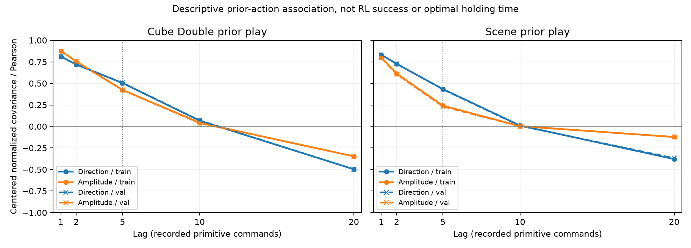

The plot was actually generated at36b768/exit0 and visually checked; image SHA
`662803931bbe9f0923fedd5737645ae98636ef9de20feb6f2241482db4be71e9`.
Direction is a normalized vector statistic, amplitude a scalar Pearson;
comparison is descriptive rather than an equality of scalar stochastic
processes. The lag5 line marks the existing fixed hypothesis, not a newly
selected optimum. Retain all lags and the reversal/negative-association evidence.

#### Post-observation within-episode sensitivity and objective accounting

Root separately ran the fixed within-episode descriptive sensitivity on the
same original four archives, actions/rawterminals only. Actual handle6409
returned0 (13e337), report SHA
`ade1b59a36ec28b0755b47e7a0c72aacaaf43f75d4a75d52cfe70c088c31fbb7`.
Each episode's paired means were removed before summing centered cross/variance
terms; there is no between-episode mean correction or mean of episode rhos.
All lag pair counts exactly match the original pooled report (root f3e877).
The analysis is explicitly **post-observation sensitivity**, not retroactive
preregistration or an independent confirmatory study. The original report,
active K and training seeds remain unchanged.

| Archive | Within-episode direction at lag5 | Within-episode amplitude at lag5 |
|---|---:|---:|
| Cube train | 0.503435 | 0.422175 |
| Cube validation | 0.505861 | 0.419642 |
| Scene train | 0.433236 | 0.235093 |
| Scene validation | 0.429822 | 0.225305 |

The finite-horizon relation survives this particular removal of episode means;
it is not wholly an artifact of different episode mean preferences. Cube's
lag1/2 amplitude-over-direction reversal, nearzero lag10 and negative lag20
remain. This does not prove useful control persistence, optimal K, RL success
causality or broad task generalization. All2200 source episodes contribute
nonconstant direction/amplitude at the inspected lags; overlapping pairs are
not independent RL training seeds.

Root also enumerated the **actual frozen activity function AST**, using NumPy
arithmetic only, across every phase of one complete period. This is not an
import of the neural learner, JAX execution or actual replay phase-frequency
measurement. Actual generator f6678b exited0 and two independent closed-form
tests53b35b passed. Source907e and all active parameters remain unchanged.

| Current K1/K5 arm | Mean active semantic dimensions, per-event | Mean temperature target | Actor/alpha-selected phase fraction |
|---|---:|---:|---:|
| R | 5.0 | -2.5 | 1.0 |
| D | 3.4 | -1.7 | 1.0 |
| T | 2.6 | -1.3 | 1.0 |
| F | 1.0 | -0.5 | 0.2 |

These equal-phase complete-period means are not measured learned entropies,
actual replay averages, gradient norms or NN call counts. They make the
objective boundary concrete: the current D-versus-T intervention changes
temporal feedback **and** active-head/regularization accounting. A future
period-compensated control multiplies a slow head's score and target-dimension
weight byK; the deterministic mean dimensions then become5 for all arms.
That does not equalize learned entropy, RMS physical exploration or the sparse
F actor-row selection, so it is one control rather than a proof of causal
isolation. The missing scalar-hold factorial arm A=(1,5) remains prospective.
Neither additional arm/rate is registered or launched in the current40 cases.
Report: `temporal-mechanism-analysis-v1/actual-activity-objective-accounting-v1.json`,
SHA `ed9815136dd0d841d062be941224606a30e5288ace06a0e3188ac5bafb2d2125`.

#### Latest execution and independent review, 04:31UTC

At04:31:28UTC (12:31China), a direct, outcome-free progress observation
a35ec0 verified Cube D146000 environment calls/141001 updates and Scene
D123000/118001, both with completed axes0/50k/100k. Original owner boot/PID/
startticks matched; neither actual owner-wait nor incident path existed.
The real tool handles29016/17106 were also re-polled and remained running
(b235cc/18f454). The sole cloud operator revalidated the original OS-stream
cells271/313 as running; no extra SSH status query was made. The most recent
full cloud progress snapshot remains the explicitly timestamped02:26 report,
not a claimed04:31 measurement of cloud optimizer steps.

The generic original-all8 local terminal collector7d99 is now SOURCE-approved,
with root4 synthetic tests plus3 independent probes and separate independent
review04abbc54. The remaining D-to-T/T-to-F launcher7f38 is independently
accepted by reviewdfb0eb58 and root's four corrected mock tests76369a. Root
found and independently reproduced a task-variable-shadowing error in the
preserved old fixture1d0b: its nominal four paths covered only Scene. That
old coverage is not credited as two-task coverage; original files/reports and
RED433190/bbaec1 are retained. New probes actually cover four distinct
Cube/Scene × T/F IDs. This is a fixture defect, not a demonstrated defect in
the unchanged production7f38 source or active training.

Root published the immutable literal launcher SOURCE allowlistd20ecb43 and
new generic predecessor-proof SOURCE approval141e84ad, then revalidated both
capabilities through the actual pure helper720ab6. Sourcea586 may only launch
D; source7f38 may only launch T/F under a separate genuine adjacent-case
grant. No new T/F execution grant, reservation or launch was issued: actual
D completion, real770 metadata/151-leaf structural collection and a separate
true external collector wait must come first. SOURCE/mock acceptance is not
actual terminal or performance evidence.

The within-episode sourcee75c also has independent semantic reviewf6fb00bf.
The reviewer ran3 original and3 new synthetic probes; root independently ran
the new3 probes73c852/exit0/.008s. Exact SS-weighted covariance, one-sided
constant variances, raw lag/episode boundaries and two-key/end-hash integrity
were checked. The reviewer did not rerun the actual four archives or consume
the actual result; the existing root measurement remains one real analysis,
not two independent replications. Episode demeaning is not a causal adjustment.

The prospective mechanism design is now a concrete, unregistered protocol:
`temporal-mechanism-confirmation-design/protocol-v1.json`, SHA
`f8a202c5592fa73ff3d204d0a26d3158006c71e1e68f1ed1a7ad23f77c883b93`.
Root reran3 stdlib synthetic/source tests (a7c0a6/exit0/.023s) and the checker
CLI (b8c9bf/exit0). It retains nuisance-fast R/D/A/T, separate per-event and
period-compensated rates, strict-LAST/UNKNOWN and the original early windows.
The deterministic mean-dimension interaction is exactly
`(3.4−2.6)−(5−4.2)=0`; this does not equalize actual phase/replay frequencies,
learned entropy/alpha/gradients or the memory representation. D stores u, A
stores rho, T exposes cached actual xyz, R zero factor caches; shared10 width
is not shared information or critic coupling. The protocol therefore admits
only package-interaction interpretations. A shared canonical-context clock
version remains a separate unimplemented design, not a silent change to907.

Future seed/count, registered period, candidate mechanism and execution source
remain unset. The existing40 must first finish and be honestly analyzed,
including negative/inconclusive findings, before a separately frozen
confirmation decision. No new A/rate run or paid capacity was issued here.
The initial protocol/context-churn evidence remains preserved; the mutable
research status document is a historical observation, not a frozen scientific
dependency that would block subsequent progress updates.

#### Prospective FQL port: execute the same action in collection and learning

[FQL's primary algorithm description](https://seohong.me/projects/fql/)
uses a behavior-cloned flow teacher and a one-step student trained with Q
maximization plus distillation. It is not simply SAC with a different actor.
The current QC implementation is `agents/acfql.py`, a modified action-chunking
variant (source11ef7e71), not an established unmodified upstream FQL baseline.
Its actor Q loss evaluates the clipped student proposal, and its critic target
uses sampled next actions; chunking additionally changes the horizon discount.

Our execution map must therefore be part of the learner, not just an outer
environment wrapper. With held-direction memory m and proposed command b,
collection executes a=B_m(b), actor value should evaluate Q(s,m,B_m(b)), and
next-action targets must use the next memory and corresponding execution map.
Memory and executed action belong in replay. The BC teacher/data geometry and
distillation metric require an explicit design; interpolating directions in
Euclidean space is not automatically a spherical flow. Primitive H1 and action
chunking should be distinguished, not silently mixed with held-direction K5.

A fixed2D numerical counterexample actually ran on CPU (no Env/NN/RL):
Q(a)=a_x−2a_y, held direction=(1,0), proposal=(0,.5), a=B(b)=(||b||,0).
A .01 step along the flat proposal gradient(1,−2) raises proposal Q by .05
but lowers executed-command Q by .019895845. The chain-rule gradient at that
point is(0,1), not(1,−2). This demonstrates why naive post-wrapping can give
inconsistent optimization; it does not demonstrate an FQL success gain.
The actual artifact is
`temporal-mechanism-analysis-v1/root-fixed-gradient-toy-evidence-v1.json`.
No FQL/Robomimic training has been launched or active RLPD code modified by
this analysis.

1. Complete the registered P2 training. For P1, finish independent review and
   integration of the finite-precision executor into a new, explicitly versioned
   protocol before any separately admitted experiment; the original failed
   cohort remains failed/incomplete, not retroactively repaired. Preserve failed
   attempts and original episode rosters; do not automatically retry or
   substitute seeds.
2. Independently bind actual owner/wrapper exits, tree drain, original argv /
   raw plan/release hashes, canonical history, all evaluation axes, immutable
   training-state proofs, and final model artifacts before unsealing outcomes.
3. Analyze registered paired early-window efficiency, final success, missingness,
   control refresh/amplitude behavior, and actual compute cost. Distinguish
   training, CPU evaluation, state-check I/O, and total walltime.
4. If supported, freeze a method and confirm on independent seeds and broader
   OGBench tasks. Do not rewrite the mechanistic hypothesis around favorable
   task subsets after looking at outcomes.
5. Transfer the stable method to Robomimic for cross-domain evidence and to FQL
   or another distinct RL algorithm for cross-algorithm evidence. Neither has
   been completed by the present P1/P2 screen.
6. Build the paper around measured mechanism, fair controls, limitations, and
   reproducibility. A decomposition identity alone is not a demonstrated
   top-conference contribution; acceptance cannot be guaranteed.

### Actual terminal closure and original T dispatch — 2026-10-10 14:43 UTC

The original cloud first eight jobs did execute; all eight source-bound owner
waits returned integer0, and both original foreground SSH owners returned0.
Their last terminal timestamp is07:23:28 UTC. Root newly inspected the raw
first-two and first-six aggregate mirrors and matched their byte digests.
This proves actual execution/owner termination, not full model/evaluation
acceptance or an algorithm performance improvement. The actual22:29 China
SSH usage report shows the existing8×4090 instance running but all GPUs idle
and no compute applications. The historical20:39 proxy timeout is not a
current server-stopped conclusion. Original cloud successors are not started.

The two original local D jobs now have actual outcome-blind terminal
collection: real collector3236729/startticks19095194 ran on CPU18/19 and
returned0 (handle58177, chunk8637f3). Each case contains all770 structural
evaluation slots, UNKNOWN0, plus the full151-numerical-leaf model/Adam shape,
finiteness/configuration and four-input closure. Final Adam count495001 and
model step495002 agree with the original500k source clock. No success/reward
values were decoded. This single real collection process is not falsely
represented as two independent library child executions. Its external
execution record binds original3330 consumed inputs and the actual PID.
The historical outer D tool handles are unavailable in the newer context:
their CLI exit is not fabricated. The durable original typed owner wait0,
incidentnull, raw child0/tree receipt and finished queue evidence are the
terminal prerequisites actually validated by the reviewed collector/launcher.

Root then issued two **separate** original D→T single-case grants and actually
launched both T jobs, seed72300/500k, on their original local GPU/CPU lanes.
Foreground handles71005 and27028 are genuinely nonterminal; ownerPIDs3275540
and3275535 and workerPIDs3275558/3275556 are recorded in the actual live/state
files. Fresh source/runtime/archive/resource checks and original singleton
dryruns precede execution; no automatic F follow-on, retry or new seed is
authorized. Actual local GPU inventory is RTX6000Ada48GB×2, not an inferred
A6000 label. A generic test discovery also reproduces the **preserved known
old fixture task-shadow error**, not a new production failure; the separately
corrected fixture passes all four independent methods and distinct task/arm
IDs (chunk512eec). Original production7f38 is unchanged.

Cloud successor v2 f41c6a4 fixes the original literal-digest and pre-artifact
proof-metadata ordering findings. A current independent review accepted that
narrow SOURCE scope, and root reran nine tests with actual exit0 (1bc0f9).
This is not remote deployment, a live proof or one-case execution admission.
Cloud first-eight technical closure is being collected by one sole SSH
operator; real metadata and structural proofs must finish before adjacent
original successor dispatch. No frozen training source, plan, outcome or
incident was changed by these operations.

The sole SSH observer subsequently collected real on-site original first-eight
state/receipt/copy/lease/source/config/final500k technical evidence at14:42 UTC
(SSH5912, true exit0, chunkb4775b). All eight state/child/tree/lease and original
source/config/final-artifact checks pass. The initial small observer report
had one unobserved original-launcher path binding, not a training failure.
A separate bounded14:46 UTC query found both historical scripts under the
original release's `cloud8-registration-transport-v1` and
`cloud24-independent-registration-transport-v1`, with exact original112fe20
andc1f202 hashes (SSH55548, true exit0, fcbfe0). The raw21/22-check report is
preserved and this supplementary observation closes the lookup gap; no source
copy was created to impersonate history. Full770-slot metadata and151-leaf
cloud model proofs still have not run. No cloud successor is yet dispatched.

#### Actual complete cloud first-eight proofs — 15:07 UTC

The read-only control package actually deployed without altering native
source158 or the original training release. Upload size389120 bytes. The
foreground proof owner4227 returned0 at15:07:48 UTC (6b2433), elapsed294.614
seconds and stderr0. It ran eight actual e88 metadata processes followed by
eight different a208 model processes, all genuine child waits0 and groups
drained. Root independently hashed actual index/report/locator/execution/
direct-wait refs and checked16 distinct stable boot/PID/startticks, exact
argv/input/output/source and four model inputs (202bc3/exit0). Each metadata
report has770/770 complete structural slots and UNKNOWN0:6160 total. Each
model has151 numerical leaves, model step495002 and Adam count495001, with
RNG/optimizer proof binding. The history/key-progression/static-recipe limits
remain false. This establishes technical closure, **not algorithm performance**;
outcome values remain unopened.

Only113 technical JSON files returned: raw14979537 bytes, lossless tar.gz
2474334 bytes. No weights, data, venv or episode source files crossed the WAN.
All raw hashes are preserved in `actual-cloud-first8-proof-reports/`. Historical
wait and SOURCE reports remain unchanged; the newer evidence supersedes
their prospective status without rewriting those records.

Original next-eight dispatcher f41 was separately staged and byte-checked
on site. The first real local next-eight **check-only** then failed before any
grant or training (263618): the builder unconditionally assumed a descriptor
field `predecessor_queue_id`. Actual cloud8 cases omit it; cloud24 cases do
contain it. This schema/preparation defect was missed by SOURCE mocks, not
failed training or corrupt completed results. Old3ced source, accepted reviews
and RED are preserved. An isolated minimalv2 uses the original common lane,
typed positions1/2 and fixed order, rather than changing original descriptors.
No cloud next-eight execution is yet claimed. Local original T jobs genuinely
learn: last inspected Cube40k/35001updates and Scene27k/22001, with real
foreground handles71005/27028 nonterminal at that observation.

### Scientific consumers and next mechanism design — SOURCE, not new results

The forty-run panel math consumer b46f2e4 is independently reviewed and root
reran three additional synthetic semantic probes (fb75dd, exit0). It retains
the registered task-specific early trapezoidal AUC, including the measured
axis0 point: its per-pair axis0 weight is1/12 for Cube and1/4 for Scene. It does
not silently substitute prior-adjusted AUC. D−T is primary; D−R andD−F are
secondary. Task/policy panels remain separate, invalid/missing planned runs
are not dropped to manufacture complete-case averages, and local1/cloud4
strata are reported descriptively without homogeneous-host CI or host-causal
claims. This is tested arithmetic on invented summaries, not genuine LAST
episode outcome loading or a real performance result.

A separately inspected future canonical-context design uses the same
pre-decision10-field memory encoder across R/D/A/T, with an explicit joint
critic packet containing world action5 plus selected direction3/amplitude1.
A positive float32 construction demonstrates that identical executed world
action bytes can correspond to distinct persistent direction tokens and
different future D actions. Thus world action alone need not determine the
augmented-memory transition. This is a mathematical construction, not a
measured GPU sampler event, learned advantage or proof that the current
907 coordinate convention is invalid. Current stored selected-decision
features admit a lifted/post-decision interpretation. The common new critic
would add40960 online+target ensemble parameters versus907, so matching
memory width alone does not match architecture or information access.
Capacity/information-matched references remain necessary before attributing
a future factorial interaction solely to control refresh timing.

The proposed raw-cube amplitude-norm lift is **not a diagnosed current wire
bug**: actual prior-context generation samples direction and rho∈(0,1)
independently, rather than recovering rho from the held cube-world norm.
Rotating a hypothetical rho=√3 cube-corner cache could violate cube bounds,
but that is a warning for an alternative future lift, not an observed failure
of the active40. Original native sources, seed matrix, K, rates and outcome
seal remain unchanged. No A/rate/FQL/Robomimic new experiment has been launched.

### Original second-eight cloud startup — 15:34 UTC, budget check 15:43 UTC

The earlier next-eight preparation failure was repaired in an isolated v2,
not in the frozen training sources or original descriptors. Root's 11 tests,
the full actual check-only and actual materialization each returned zero.
The actual preparation index is `6f2479dc…`; the independent v2 review is
`b066b465…`. Old SOURCE, accepted reviews and the original KeyError RED remain
preserved. A 112640-byte package was published once (SSH47323, bd2b63, exit0):
one existing same-hash source was only verified, and 19 fresh JSON files were
created without replacement.

At 15:34:24 UTC (23:34 China), a real bounded SSH observation verified all eight
original position2 startups, with nine owner/native/plan/grant/GPU/claim/state
checks per case and no incident files. The mapping is block1 T/seed72301,
block2 D/seed72302, block3 R/seed72303 and block4 F/seed72304, each on both tasks.
All eight original foreground handles are preserved. No position3/4 case was
dispatched, and no retry, seed change, model/data transfer or extra paid GPU
was introduced. Startup raw SHA is `0241cc40…`; the actual handoff is
`c218ac4e…` in `cloud-original-eight-successor-preparation-v2/actual-publication-and-launch-v2/`.

A newer actual SSH observation at 15:43:44 UTC returned zero (61440/947c86)
and confirmed original stable identities, 500k budgets and no incidents.
However, none of the eight `numerical-progress.jsonl` files yet contains a
complete record. Thus **startup is confirmed, formal-update progress is not**.
The native producer runs a synchronous axis0 evaluation first, logs its first
collection counter at1000 and starts updates at5000. An outcome-blind check of
axis0 slot filenames and process CPU advancement is being performed; lack of
a numeric line alone is not a training failure or authorization to restart.

Local T jobs are genuinely updating: Cube149000 environment calls/144001
updates and Scene120000/115001 in the current inspected numeric records.
Both actual foreground polls remain nonterminal and scheduler/native PIDs
are live. Local disk reserve is 50706890752 bytes at this observation. Rewards
and strict-LAST values remain unopened.

The existing panel math is only an arithmetic consumer, not a genuine native
episode loader. A separate CPU payload adapter is now being implemented and
tested exclusively on invented native-shaped records. It must preserve all
planned slots, distinguish LAST from EVER, keep failed/missing slots UNKNOWN,
reject Boolean/integer aliases and cross-identity records, and keep primary
and secondary policies separate. SOURCE tests cannot grant real performance
admission or replace the full original40 outcome analysis.

#### Axis0 CPU progress confirmed — 15:47 UTC

The bounded follow-up SSH returned zero (49321/66cc22). Between15:47:06 and
15:47:36 UTC, all eight report **filename** counts advanced: in the same
second-eight order,66→67,57→58,62→63,54→55,60→62,51→52,68→70,60→62.
Seven original stable evaluation workers each consumed29.44–30.09 CPU seconds
over30.292 wall seconds. The remaining case, block4/Cube/F, closed its axis0
owner with a true typed wait0, clean tree and no incident, then its original
native PID resumed. All incident filename counts were zero. These observations
establish active CPU evaluation work, not outcome values or formal-update
counts. They do not justify a restart or a claim of GPU training utilization.
No episode/axis-summary/complete-metric contents or captured streams were read.
Raw diagnostic SHA is `da298ec8…`; root read the technical comparisons af7f1d.

The existing Chinese paper draft now includes a separately marked current
temporal-methods section. It describes conditional rather than independent
factor sampling, ball command support rather than the historical full-box
mapping, the QC-adapted learner, original40 design, strict-LAST semantics,
early AUC windows, local/cloud stratification and the unproved future factorial
and transfer claims. Its old body is retained as historical draft material,
not promoted into newly audited results. No new P2 performance number was added.

#### Strict-LAST payload parser completed, not real outcome unsealing

The separate231-line CPU adapter is frozen at `7b8963f2…` and independently
accepted for SOURCE/payload semantics (`84530ac2…`). Root reran author8,
independent8 and own full40 integration2 methods together:18 passed in7.860
seconds, real terminal d066cf/exit0. The root integration constructs every
original task/arm/block coordinate and770 invented native-shaped payloads
per member, then feeds their cells into the frozen panel math. It checks LAST
despite earlier true flags, seed pairing, point units, descriptive host strata
and policy separation. A missing primary slot suppresses the full primary
mean rather than creating a survivor-only cohort or borrowing secondary data.

Root inspection found and resolved a pre-freeze failed-reset compatibility
issue: a kernel failure before sensor representation can have a returned reset
but no reset hash or observed transition. That legitimate incident remains
UNKNOWN; completed/hash-chain/LAST checks were not relaxed. All existing native
and oracle sources remain unchanged. These tests contain only invented input
values and are not new success/AUC observations. The parser does not scan real
files or prove raw-byte/process/model/host provenance; actual outcome loading
and whole40 result admission remain separate unfinished work. Evidence is in
`temporal-performance-last-adapter-root-integration/root-source-test-evidence.json`.

#### All eight cloud jobs entered formal updates — 15:58 UTC

A final bounded read returned zero (16897/8aa8e0) at15:58:10 UTC,23:58 China.
Unlike the older initial-evaluation observation, every original position2 case
now has a genuine complete numerical progress record with positive learner
updates. Root inspected all eight source/queue/budget/stable identity/no-incident
bindings and the outcome-free records (486aea). In the fixed case order, the
environment calls/updates are26k/21001,16k/11001,22k/17001,13k/8001,
20k/15001,9k/4001,27k/22001,19k/14001. Each has completed axis0; all eight
foreground polls remain nonterminal. Raw report SHA is `a26982a8…`, actual
SSH wait is `8aaf03bf…`, in `final-budget-observation/` beneath the position2
launch directory. These1000-axis-emitted records are lower bounds between
emissions, not exact current counters or success metrics. The earlier missing
records remain UNKNOWN rather than a made-up zero baseline.

Later local inspected records are Cube166k/161001updates and Scene149k/144001.
The present handoff is therefore eight actual cloud learners plus two local
learners, not eight open-but-unused GPU servers. No additional case, retry,
seed change, budget change or large transfer occurred. All formal P2 outcomes
remain sealed; the original40 screen, broader mechanism confirmation,
Robomimic/algorithm transfer and publication preparation remain unfinished.

### Execution-efficiency branch — 2026-10-11, not a changed learning method

#### Current GPU utilization: post-completion idle, China13:05

An actual33.064-second read-only cloud SSH observer returned0. Its24.126-second
sampling window (25 points/GPU) showed all8 GPU mean/median/max utilization0%,
memory1MiB/card, no original training/evaluation process CPU targets, and
host CPU busy0.545%. All8 original second-wave scheduler states were finished:
500k calls,495001 updates,11 axes, bound persistent native/owner waits0 and
clean tree closure, released/reaped leases, no incident paths. Missing old
outer tool handles were not treated as fabricated wait0. Complete metrics,
model bytes, episodes and scientific performance admission remain unopened.

Root also actually polled both original local F foreground handles to exit0
and checked500k/495001/11axes plus clean scheduler wait/tree receipts. Those
original PIDs are absent; unrelated local processes were left untouched.
Current idle cloud8 is a dispatch gap after completion, distinct from the
historical35.397-second active-training window's13.347% mean GPU duty and
near-saturated CPU main threads. Restore original queue continuity first;
separate physical throughput tests remain needed before claiming a replay
optimization or per-card2/4/6 concurrency gain. No jobs were restarted, new
cases launched, configurations changed or servers stopped by this diagnosis.

Evidence: `gpu-utilization-followup-20261011T1301-v1/root-observations.md` and
`cloud-runtime-handoff-20261011T1301-v1/refresh-observation.json` (raw SHA256
411d9e982cef770543e0b7d3547c55766454f29f1ad51a1810badff12f8dd996).

#### Original third cloud8 genuinely dispatched; startup GPU idle explained — China13:48

##### Subsequent actual GPU correctness and fresh cloud utilization — China14:50–14:58

###### Subsequent real old/array phase timings — China15:17–15:24

###### Actual conditional array1→array2 throughput — China2026-10-12 18:12–18:18

Root handle79879 (8e2cd9→ba7b6a) really exited0; three owned workers
3457408/3464155/3464156 each exited0, reaped/absent, no timeout/kill/retry.
Each actual native907/T/Cube task2/K5/seed0/per_event/full512x4/10Q/
128prior128online/UTD1 run had15200 interface primitives,10201finite updates,
10000steadyupdates,31explicitresets,model10202/Adam10201 and Envclosed,
142459 rawtiming events with0drop/fail. Array1 then array2 is fixed order;
rank0 CPU22,23/rank1 CPU24,25 on localGPU1 shared with protected graphics,
not cloud4090 or exclusive clearance. GPU0 foreigncompute666808 untouched.
Source64752121/runnerc92d9bb0 were independently SOURCE/AST-reviewed
4a0216c0/49a35bea before root actual specs/preflights.

Commonsteady1:103.863625s,10000endpoints→96.28009788updates/s.
Commonsteady2:110.764770s,9914+9988endpoints→179.67806882updates/s,
ratio1.86620156; individual2 whole-steady rates89.674145/90.173573.
Counts derive from actual update_complete end timestamps in the sameboot
interval(maxstarts,minends), not addition of unrelated rates. Rootcompletion
cc8513a2d87d134184f5d47d9e10b33fb13db94022479162f9ba846905f47662;
reports358a51a5/aa46b4c2/1d637b58 in fixedcase directories under
`temporal-shared-throughput-current/`; cohortsummariesd933365d/7cb68086.
Independent actual artifact review69844242 recomputed complete event counts,
allbinds/162SOURCEhashes/6datasource refs and derived-resource math with
stdlibactual5a690b/ab048a both0, no repeated NN/GPU/data/SSH or archives.

Resource-derivedfa1f41d9 (author585424 exit0) has89/96selectedrecordpoints,
wholecard GPU arithmetic mean43.1011/61.75percent (graphics+allwork), total
GPUusedmax8584/9291MiB, ownedprocessCPUcores1.06736→1.04892+1.03909.
Records are anchored AFTER GPU subprocess queries and CPU proc reads,
not before or exactquery times. Anchor gaps do not prove every query strictly
insidecommonsteady; GPUmeans are not owned-only/timeweighted. Original
resource files/source/rawtimings unchanged. A failed purederivationa1f8ee
identity-dict assertion was corrected to pid/boot/ticks before output existed;
this was not a retried physical case. All184lines28095B of eachstderr read:
25Fusion/25Computation+2Boxwarnings, normalizedmultisetsmatch, trigger/
harmlessness/numericdeterminism not established. No scientific/exclusive/
cloud capacity or RL gain admission, no automatic4/6, no old40 mutation.

Cloud currentstate UNKNOWN on2026-10-12, not yesterday's live evidence:
old8handles allUnknownprocess, originaltask SSH first255/DNS at10:06:53;
after user-confirmed VPNrestore freshDNS/tun0/TCP30027 pass, one newSSH
255/SOCKSv5Hostunreachable at10:16:24.968. Unique reportsbd6547e2 and
3089fbf8 in `cloud-third8-terminal-audit-20261012-v1` and
`cloud-third8-terminal-audit-20261012-after-vpn-v1` preserve both failures.
Controltab metadata appeared but page content binding timed out, so no
new console runtime state was obtained. User asked for exact instance status/
LinuxSSH target; no repeatedSSH, guessedIP/newserver, seed/budget change,
restart/incident/lease cleanup, fourthwave or outcome read. Goal remainsactive.

###### Later fresh cloud observation — China15:49

###### Subsequent real same-input dualReplay check — China15:56–15:59

Root actual handle90144 (a9065d→e73041) returned0. Independent source
aeea87dc and reviewb4f9880b preceded one real GPU1 child3725928,
boot898db6f3/startticks25334980,07:56:04.380616–07:59:55.817799UTC,
external231.437210s, actualwait0/no timeout/kill/childabsent. FullBase907
T/Cube task2/K5/seed0/full512x4/10Q/128prior128online/UTD1, single real
Env/prior/Agent/Bridge, actual same row/tag into both original samplers.
All10201 independently drawn batch pairs passed direct typed dtype/shape/
byte comparison, fullprovenance/RNG/count comparisons before sole oldbatch
learner update; no replacement draws.15200primitives=5000uniform+10200
learned;10201finiteupdates/comparisons,step10202/Adam10201,31explicit
resets and returnedEnvclosed. Both initial prior/chronology/binding and
final samplerRNG hashes match; first_difference null. Initial/final common
model/ob/strictphysics hashes and paired prefix chains are retained.
Report d2f220634fb974ceadf9fde49f15b244c550fe3f369c61a7f7df1c34abfe4820,
wait7e34e64a63509a5b3c554b7f4eb6672561804ca817a746241b17fbe687102453,
rootcompletion398202d3fa659c82e2deba75d7eb40086bd53c5a9af73a3d98d8211f5f526a6a
in `temporal-replay-same-input-current/actual-root-once-v1/`.
Fresh root preflight07:56:04 boundGPU1no computeapp/42634MiBfree/released
QClease and read-only shared lockprobe, preserving graphics/unrelatedGPU0.
Not an atomic reservation/exclusive benchmark. Sharedgraphics plus dual
sampler/direct comparisons disqualify elapsedtime as speed/capacity evidence.
This is actual common-input correctness only: no independent array learner,
old-pair divergence explanation, whole500k/scientific gain or deployment
admission. Stderr28095B contains Box warnings and xtile fusion diagnostics,
not clean; no automatic retry or values/weights/evaluation written.
Independent read-only actual-report audit accepted7fb6b460: source/spec/
spawn/wait/report/counts/hashchains consistent,167code-SOURCE+6data-SOURCE
hashes recomputed, purestdlib checksce7448/24014f exit0. Rawbatch sequence
was not replayed;2archives only refs. This is not a reproduced sampling
run or a second numerical equivalence experiment. Full184line stderr read
retains25Fusion/Computation pairs+2Boxwarnings, trigger unlocated;
explicitmismatch/fatal/CPUfallback absent is not a harmlessness proof.
Original8 foreground handles genuinely live08:00:10UTC, handoff13223fa3;
no newSSH/resource/progressread followed, so no later counters inferred.

Original8 foreground handles were genuinely polled live at07:49:01UTC.
One reused read-only diagnostic then actually exited0 (SSH74272,
38945d→e7c53b,30.458s,stderr0). Its07:49:28.466319–07:49:54.600281UTC
window lasted26.134s/26points perGPU. Six whole-window learning cases
averaged13.653846percent GPU duty; two cases hit150k CPU evaluation,
one resumed learning within the window. All-eight mean10.480769percent
therefore mixes learning and evaluation, not a new homogeneous learning
rate. Per-card means in original order:14.19,1.92,13.19,0,14.12,14.00,
13.12,13.31percent; memory930–934MiB. Stable native/scheduler/evaluation
identities, no new native incidents. Latest complete markers149k–180k;
the149k marker for the whole-window evaluator is expected barrier-delayed
publication, not a frozen physical call counter or failed training.
CPUquota112 had no throttling, memory/I/Opressure zero; active learning
main threads consumed23.51–25.07 CPU seconds in26.134s. This supports
host serial-feed diagnosis, not specific function attribution.
Report `cloud-third8-gpu-resource-observation-20261011T074901Z-v1/technical-summary.json`
SHA cb25513070c17a671507f9aabc9e978295ef3219ed5c17cc5a4a7f5165e49e43,
actualwait213b1005f3acf0abff263d340fe4bbc62b959c857af174a495068dfb473f5731.
No source/runtime/current40 mutation, restart, fourthwave or outcome read.
Earlier06:50 and07:32 observations below remain historical, not latest.

Primary FQL code/proceedings checked separately in
`fql-primary-source-addendum-20261011.md` (e2127bb1). Official current
agent's normalization flag is implemented, unlike localfork's actor loss;
official task-specific Cube/Scene alpha300 is neither default10 nor local100.
Reference recipe and matched adaptation must be identified independently.
No FQL implementation, training, parameter tuning or official release freeze
follows from this research addendum.

Root executed the independent native907 shared-graphics diagnostic entry,
not the canonical-D5012 profile and not the exclusive capacity owner.
Handle59793 (`8d6956` to `f2fb5a`) actually returned0. Old child3267443
returned0/212.235s; array child3310962 returned0/167.886s, both absent after
real waits. Each used Base907/T/Cube task2/seed0/full512x4/tenQ/128+128/UTD1,
15200 interface primitives,5000uniform+10200learned,10201finite updates,
model10202/Adam10201,31 explicit resets and returned-Env close. Each steady
window had10000updates and exceeded60s:145.668s old,100.274s array. No model
files or evaluation were written; original40 and old exclusive guards stay
unchanged. Source db2ed30b and SOURCE review753966df preceded root execution.

Steady inclusive primitive mean was14.555ms old versus10.016ms array;
checked sample4.647/1.013ms, update complete5.447/4.790ms, actor ready
2.189/2.070ms, Env.step1.584/1.523ms. Old sampling accounts31.93percent
and Env10.88percent in this local window. GPU update's inner dispatch/finite
stages are nested and not extra addends or isolated physical kernel time.
Each report retains142459 raw technical events with0drops; root summary
math and whole-event statistics were independently checked (dc2952 exit0).
Derived summary SHA6a0dc3d0db57fef466ab55443c587675991afab2816b7e7992a50eaccee6f361
is in `temporal-hotpath-real-diagnostic-current/actual-root-pair-v1/`.

These are graphics-shared, sequential single-case diagnostic measurements,
not cloud4090 phase attribution, intrinsic speedup, capacity or RL success.
Model and final-batch hashes differ between independent runs, despite equal
data-binding descriptors. Cause remains unresolved; do not claim identical
actual trajectories. Actual singletask registration haspermute_blocks=False:
the default constructorTrue branch is NOT a valid explanation here. Reset
internally samples action-space noise without an explicit seed in the read
path; whether that influenced these states is unproven. Logged XLA fusion
configuration multisets match, which does not prove final kernel choice or
numerical determinism. Both stderr files28095bytes have25E-level fusion/
computation pairs and2Box warnings, with no explicit mismatch/fatal/fallback;
neither is clean. Next equivalence work should share actual input rows across
both samplers and bind initialprior/model/physics, not retry timing or addseed.

FQL transfer preparation now identifies five local real-code integration seams
and required algorithm/recipe controls in `fql-transfer-integration-notes-current.md`
(dbb634d5; root full-readb70b97). It is SOURCE preparation, not implementation
or cross-algorithm results. Original8 cloud handles were genuinely polled live
07:32:41UTC (fresh-handoff-after-hotpath-pair0424e9e1); no new SSH or progress
read followed, so no later training steps are inferred.

The separate canonical localGPU1 correctness profile actually completed:
root handle29674 (`63b747` to `6f8b1e`) returned0; child3019377 returned0
after96.260255s, UTC06:57:04–06:58:40. Report7866ba3e and actual-wait88d2cc7d
are in `canonical-real-closed-loop-gpu-engineering-current/actual-root-once-v1/`.
Actual Cube task2 semantic D/K5/seed0/full512x4/tenQ/128prior+128online/UTD1
ran5012 physics calls (5000uniform+12learned),13 updates, sampled5learned+
1659warmup rows without forced insertion, model14/Adam13, fourteen proof
roles, finite updates and returned-Env close. No weights or evaluation were
written. Root preflight bound the actual GPU1 UUID, no compute app on that
card,42,880MiB free and naturally released original QC lease plus read-only
nonblocking lock observation; existing graphics and unrelated GPU0 users
were preserved. Independent SOURCE review4a2fdf23 preceded actual execution.

This is shared-graphics CUDA correctness, not exclusive capacity, steady
throughput, CPU/GPU numerical equivalence, formal500k native admission or
scientific results. First update25.384s includes cold work; its13-update
timing cannot establish warm performance. Stderr28248bytes contains Gym Box
float32 warnings and xtile fusion/computation diagnostics; no explicit
numerical mismatch, fatal termination or CPU-fallback message was found,
but the diagnostic trigger is unresolved. It is not a clean-stderr claim.

Fresh cloud observation at06:50:05–06:50:31UTC had25.782s/26points perGPU,
all8 mean13.0048%, all-point7–20%,930–934MiB used. All8 original native/
scheduler identities were stable, no incidents/evaluation workers were
seen; latest complete markers61k–96k. Seven crossed a1000-step marker, one
did not; marker granularity is not an exact step-rate counter. Main threads
used0.90–0.96cores; quota112 had no throttling and memory/I/O pressure was
zero. CPU pressure some around3.6% is distinct from quota throttling.
Evidence `cloud-third8-gpu-resource-observation-20261011T0648-v1/compact-summary.json`
SHA bcb4d026030c2563b133f47aa0704eef2ee0a8da69d0333c1c314530980240a2.
This supersedes the earlier dispatch-idle explanation for the current phase.

An additive stdlib-only hotpath timing helper and real-measurement design now
exist in `temporal-hotpath-profiling-current/` (SOURCE only, no benchmark run).
They separate cold/settling/steady intervals and retain the original
batch256/UTD1/finite/provenance operations. Prospective measurement specifies
10000 post-settling learned updates and at least60s, with inclusive group
wall-time, not dispatch-only GPU timing. Original40 sources/seeds/budgets/
order and benchmark exclusivity guards remain unchanged; no new capacity
gate, extra paid GPU, monitor, retried seed or success claim was created.

Later current-turn progress: candidate canonical D genuinely executed a
separately named CPU22,23/thread1 engineering loop (69672/71fe53 exit0;
child2615433 exit0,54.464s,06:23:22–06:24:17UTC). Actual5012 primitives
comprised5000 uniform and12 learned calls;13 full512x4/tenQ/batch256 balanced
updates sampled5 learned and1659warmup online rows without forcing draws.
Model/Adam clocks14/13, replay5012/13, all updates finite,14 initial/final
state-proof roles and returned-Env close succeeded. Report81e54629 and true
childwait20a15dfa are in `canonical-real-closed-loop-engineering-current`.
No tiny fixture, model export, evaluation, GPU computation or formal500k
admission. Used300+15 external/270soft envelope, not README285+15 recommendation;
actual54s reached neither; additive actual-note8d7bf442 preserves used bytes.

Original8 cloud handles were freshly polled live06:33:15UTC without new SSH
or GPU sampling (handoff58fa7554); latest read numerical progress remains
the timestamped06:11 v5 snapshot, not inferred later steps. At that earlier
observation, the localGPU1 correctness-only profile SOURCE feabc32e was prepared,
not yet executed; the subsequent actual record above supersedes that status.
Shared graphics requires fresh no-foreign-compute/no-activeQC-lease/free15GiB
root checks and separate review. It does not weaken exclusive capacity tests.
Main paper now names the project ACRLPD fork accurately: original author's
min-subset target/post-updateEMA/update scheduling differs from our current
mean/pre-updateEMA/UTD1. Upstream recipe comparison remains required; source
inspection is not an official-baseline empirical replication.

The dispatch gap above has now been addressed without restarting any science:
eight original never-started third-position cases were dispatched at05:41:31UTC
(China13:41), keeping original source, seeds72301..72304,500k budgets, task/arm
order and GPU/train/evaluation CPU bindings. These are D/R/F/T respectively,
each on both original tasks; they are not eight extra seeds or a concurrency
capacity experiment. Previous local two-F terminal collection genuinely
returned0 with770 structurally complete/0 UNKNOWN slots and151 model leaves
per case. The second cloud8's16 actual metadata/model proof processes and
outer proof owner genuinely returned0, with770/0 and151 leaves per case.
All reward/success outcomes remain sealed; this is technical closure only.

One fresh bounded read-only startup observer returned0 at05:48:01UTC,4.044s,
stderr0. All eight native/scheduler/dispatcher boot/PID/start identities,
exclusive claims and running leases, frozen source/queue/seed/budget/lane
bindings passed all14 checks; no incident files were found. All eight were
inside active CPU-only synchronous axis0 evaluation barriers, without a
complete numerical1000 marker yet. This verifies native startup, not formal
learning or zero updates. The instantaneous GPU inventory was0% and662MiB
per card, consistent with waiting for this CPU evaluation stage. It does not
measure subsequent learner-phase utilization or prove an efficiency gain.

The first observer's300000-byte JSON cap incorrectly rejected the immutable
409280-byte plan. That failure is preserved separately; only the read-only
cap was raised to1MiB and a fresh observation made. No training restart or
scientific source/configuration modification occurred. Evidence is
`cloud-third-eight-successor-preparation-current/actual-third8-startup-observation-v2/`,
summary SHA f5fd4e66b4f86891f58b89a37b8ad623984147af77f353485d3c21c776a99b99.
The observer's optional filename counters used the wrong nested slot path;
their zeros are not admitted as episode counts. Phase and binding checks
derive from actual stable evaluation-role processes/axis0/CPU guards instead.

The historical active-learning13.35% duty cycle remains an independent issue.
Host-side replay/vectorization, reduced host-device synchronization and safe
per-card1/2/4/6-worker physical throughput tests belong to a separately
admitted resource profile, not a hot patch to these active original cases.
Sampling-only4.148x speedup is not whole-training speedup. The final original
fourth8 is not launched by this startup observation.

#### Canonical finite-kernel falsification complete; physical semantics remain conditional — China13:53

At06:11:16UTC original cloud third8 all had actual update markers:
calls/updates35k/30001,24k/19001,30k/25001,19k/14001,37k/32001,
28k/23001,34k/29001,24k/19001, axes_completed=[0] each. All original8
foreground handles were genuinely polled live06:11:01; all14 bindings true,
no incident, no active eval roles in that snapshot. The instantaneous GPU
10..15% remains a low-duty snapshot, not average improvement. v5 summary
03a8c687 and actualwait517ebf2e are in the third8 preparation directory.

SOURCE-only baseline audit aa712bb5 (`canonical-baseline-source-review-current/BASELINE.md`)
was fully read by root64ba1d. Original pinned RLPD requires explicit horizon1
to be a5D TanhNormal cube/Q5 reactive baseline: main's default horizon5
and chunking are25D/multi-step, and disabling chunking alone still leaves
multi-step targets. Original40 R is DS, not Cartesian. Canonical DS-R/ARCart-R
have ball support plus pre10/prefix4/jointpacket9 and different regularizer/
initialization/log-scale floors. These must be independently named baseline
and control comparisons, not interchangeable or pure temporal attribution.
No original baseline NN/data run or new scientific registration was performed
by this source audit. A separate real5012 CPU closed-loop engineering profile
is being developed with unchanged5000 warmup/full512/10Q/batch256, not a
relabeled500k NativeSession or tiny fixture.

Actual independent8 groundtruth tests returned0 in39.964s (84479/a1bfd9),
separate from author's8 tests39.932s (65542/86d5b1). Frozen ebc/6be/0ba/ed2
were not changed. These use real tiny Agents, B/G, Collector/Replay128+128
and the production target; only critic values are explicit analytic finite-
horizon oracles. The independent reference has no learner import. A pre-only
three-reward test is sensitive to correct held-Y continuation versus wrong
before-X or premature phase refresh; terminal-mask Q7 and timeout pre-reset
next-observation controls are separate. This closes one minimal kernel-
coupling falsification request, not whole scientific readiness or OGBench
performance/convergence/coverage. Reference8375d538 and tests25bbeab2 remain
in `canonical-temporal-groundtruth-current` with explicit scope limits.

Root inspected actual installed official step/reward/relabel/observation
SOURCE. Both task2 environments compute success/reward/termination before
the physical step. Cube keeps official count-based reward; Scene maps nonzero
to-1 consistently in offline/online inspected loader. Goal absorption is
distinct from TimeLimit and unknown raw dataset physical endpoints. The
official relabel loader itself resets the environment to set the task; a
future loader probe must disclose that rather than claim zero Env resets.
Cube/Scene observations omit complete cube velocities and simulator state;
controller memory augmentation is not a physical Markov-sufficiency proof.
Input-loader to immutable canonical OwnedPrior integration is the next actual
engineering check. No new family launch or sealed outcome read is authorized
by these toy results.

That input check was subsequently genuinely executed once at06:05:49–06:06:03UTC:
root outer14547/55afd8 and the real data child2402749 both returned0; the latter
took14.089s. Original cube-double and scene each contain1,000,000 valid
transitions from1,001,000 raw observation rows, dimensions37/40/action5.
All six raw-prior fields and all three chronology fields retained exact dtype/
shape/bytes hashes through original ea7 loader to actual0ba own_prior. Owned
buffers rejected writable flags and caller alias; a disposable caller-array
mutation was restored and could not change owned bytes. Four original archives
and167 code/asset inputs were bound before/after. Both returned Env close calls
returned; official internal relabel resets were explicitly permitted, probe
extra reset/step0. Stderr502 bytes consisted solely of two Gymnasium float32-
bound casting warnings. Unknown physical termination/truncation remain labeled
False placeholders, not inferred from goal masks. Reportd5719a95 and actual
wait0cf07370 are in `canonical-temporal-real-prior-probe-current/actual-root-once-v1`
(the report is the directory's parent). No NN/update/GPU/NativeSession run,
dataset mutation/transfer, outcome peek or science/performance admission.

The original third8 were freshly polled live at05:51UTC and a bounded v3
observer returned0. Correct filename-only ledger/slots report counts were
49,40,43,33,53,49,50,42, with8 stable active eval workers and increasing CPU
ticks. These are not success counts or closed-ledger admissions. All14 source/
identity/resource checks remained true; no formal learning marker yet.
Evidence summary4e963548 is in `actual-third8-startup-observation-v3`.

At06:01:58UTC a later actual v4 observer returned0 (1609/9d7256,4.060s).
Original-order calls/learned calls/formal updates were13k/8k/8001,
4k/0/0,9k/4k/4001,unknown,15k/10k/10001,8k/3k/3001,13k/8k/8001,
5k/0/1. Thus six genuine update markers exist; one real warmup marker and one
still-active axis0 worker remain. The latter has66 reports/67 starts, not
outcomes. All eight foreground handles were actually live at06:01:43, all14
bindings remained true and no incident appeared. Summary1572ce1b is in v4;
GPU0..17% is only that instantaneous inventory, not average improvement.

#### Canonical native SOURCE finalized, China04:27

The separate canonical family now has complete prospective NativeSession
collection/replay/full-update, evaluation/controller, snapshot/proof and
500k-flow SOURCE. Root completely read all four modules and final review,
accepting SOURCE only. Independent final10 methods passed (39334→895a17,
exit0,15.598s):6 real tiny-NN/callback/strictLAST and4 real temporary-file
retention edges. The latter explicitly mock authority/Popen/receipt/physics/
reduction and are NOT real external wait or physical admission. Author final8
also passed (50156→4e00f0,18.565s). Frozen learner/replay and original40 remain
unchanged; no new registration/Env/data/GPU run was authorized by these tests.

Root actual fullwidth D37 probe65213→a3bba5 exited0 in20.457CPU seconds:
512x4/ten-Q/17254943 parameters, one genuine Adam update, fresh and trained
207064658-byte state restored exactly through the actual new restore_state
helper. Both evaluation controllers drew two actual fullwidth commands while
all model/optimizer/private learner-RNG bytes remained unchanged. This is
in-memory serialization/helper/callback testing, not the registered envelope/
authority/physical kernel route, and no model file/WAN transfer was used.

Root found an operational gap in old9dd3 draft: clean external wait could
still coexist with UNKNOWN slots, yet its weights were unconditionally deleted.
Finaled2d preserves those same-axis weights and explicit retention reason;
only original70 COMPLETE IDs with exact typed policy50/20 counts and clean
tree/invariance/raw bytes permit deletion. No retry, imputed False, denominator
reduction or training-continuation change. Old pass/RED/PENDING history retained.

A true04:06:52 cloud premise audit (93094→d52699,exit0,3.525sSSH) found NVIDIA
PID3104481..8 do not map to container native393913..20 in current/proc; all
driver PID lookups ENOENT, native boot/ticks stable, PID1 inspection denied.
No host/container map or foreign-compute absence is proven. These are
unattributed processes, not confirmed foreign processes or training failures.
The LOCAL_SAME_PID_NAMESPACE_ONLY benchmark owner cannot be directly copied
to cloud. Namespace-safe ownership is under primary-document/source review,
with no further SSH/probe/launch in that task. Physical concurrency/speedup,
real canonical training and original40 learning results remain outstanding.
Root native evidence SHA f319d416…; independent final review1f68233d….

#### Fullwidth updates and finite-noise control limit, China04:02

Previous goal turn was concrete SOURCE/init progress; this turn adds true
full-width CPU optimizer evidence and a diagnostic affecting scientific claims.
Root completely read independent review4e281da3…, accepting only the frozen
ebc/6be canonical SOURCE family. Root actual process30395 (6d05c6→02ee91,
exit0) completed one Adam update for DS-D/dim37 and one for Cartesian-R/dim40,
each512x4/ten-Q/batch256. Both returned modelstep2/Adam1, changed critic/mean/
alpha, advanced RNG, passed complete finite/sampler-domain checks and exact
pre-update target EMA. This uses invented callback/replay transitions, not
actual OGBench/Env/GPU training. Its CPU init+compile+one-update timings do not
measure GPU throughput. Evidence SHA a16c6c3b… is in root canonical directory.

Root process13784 (8f4eea→1a3172,exit0,10.399CPU seconds) sampled262144 initial
R-K5 stochastic commands from each frozen actual sampler. Final mean/logstd
head kernels are zero, so the initial head law is state-constant and the same
as its full-width initialization, not an equivalence after learning.
DS/Cartesian meanX=.388260/.391027 and finite VarX=.008231/.009144 despite
equal location center(.4,0,0,0,0) and equal local JΣJᵀ. The mean difference
-.002766 has independent Monte Carlo SE.000257, not RL seed uncertainty.
Mean rho=.403786/.407763 also differs. Continuous normalized-semantic surrogate
entropy=-5.045274/-4.998571; this is not Shannon entropy of physical/quantized
commands. Therefore global initial law/expectation/entropy equality is not
claimed. Paper draft now explicitly separates future canonical implementation
and these initialization diagnostics from original40 and actual performance.
No bias/scale/source was fitted to rescue matching. Evidence SHA913f912b….

Fresh cloud check03:53:43 has all8 actual foreground handles running/preserved,
with original source/budget500k/queue/bootPIDticks/leases and no-incident checks
passing. Last markers349k–395k; seven have completed350k evaluation and Scene R
is at its350k CPU barrier. Local F actual markers149k/144001updates and
124k/119001updates; real polls also remain nonterminal. Source/seed/order/binding
and sealed outcomes were not changed/read. New native callback/training/eval/
proof draft is being implemented independently and is not yet frozen/accepted.
Physical GPU1/2/4/6-worker capacity and whole-training speedup remain unmeasured.

#### Latest technical check and isolated SOURCE progress, China03:27–03:51

At03:27:39 the original eight cloud second-wave handles were still running.
All actual identity/source500k-budget/queue/lease checks passed and there were
zero incident files. Last complete markers ranged302k–349k; all had completed
300k evaluation and two were in350k CPU evaluation. Marker counts are lower
bounds, not instantaneous counters or success rates. Both original local F
foreground handles also remained nonterminal. No original SOURCE/config/
seed/order/CPU-GPU binding was changed.

A separate common-prestate10/jointpacket9 learner now has real JAX/Flax
actor/ten-Q/alpha/Adam updates, immutable replay and direct collector→replay
interface. Actor uses immutable pre10+prefix4, not overwritten history.
It is a **new scientific family**, not a retrofit/equivalence of current907.
Author7 tiny CPU NN tests passed (38.698s); independent7 tests were reported
passed (40.878s), with the final review artifact pending when this entry was
created. Root actually initialized six full-width512x4/ten-Q CPU models:
pinned907, new D and autoregressive Cartesian-R at both37/40 dimensions.
Root proof exited0, with43008 extra model parameters and86016 extra Adam
elements/344064bytes compared with907. True JAX Jacobians and actual location
draws matched +X/.4 mean-location and first-order covariance only; finite-noise
laws/effective capacity/global entropy are not asserted equal. No full-width
optimizer update, real data, Env, GPU or native launch was used by this proof.
The initial root proof mistakenly requested reactive period5 and was strictly
rejected; corrected proof uses pinned907 reactive period1, with RED preserved.

This new scientific development is not a GPU-efficiency fix. Original40
outcomes remain unopened, and neither a physical1/2/4/6-workers-per-card
capacity experiment nor end-to-end speedup/utilization gain has yet passed.
Root decision/proof evidence is in `canonical-temporal-root-decision-current/`.

The user-observed GPU utilization issue was checked with a real35.397-second
window: eight GPU mean13.35percent, per-job CPU main thread about0.91–0.96core,
container usage8.86cores of112quota, no throttling/physical I/O or memory pressure.
All cases were learning, with no evaluation barrier in that particular window.
Thus low learner-phase GPU duty cycle is real; specific Python-function costs
were not profiled and cannot be assigned percentages from source inspection.

A separate contiguous-column CPU replay and immutable owned prior/chronology
branch is now independently reviewed. Source `75acb2a0…` and its original AST
reference `d9160449…` retain the original128prior+128online selection, context
law, all batch/provenance/field-hash checks and RNG order. Global chronology
validation is amortized only after copying to bytes-backed non-writable arrays;
it is not silently removed from mutable input. Byte limits reject before copy.
Tests compare every batch field's dtype/shape/bytes, full provenance and both
RNG states across all four current arms and37/40dims. Early and late failures
retain rollback; warmup-origin boundary4999/5000 and caller mutation isolation
are covered. Root reran seven author tests; the reviewer ran seven independent
tests. Both actual processes returned0.
Review SHA is `256e84be…`; full source158/native4/v3/907 hashes remain unchanged.

This is a changed ownership interface, not a hot drop-in: fixed capacity,
construction-thread operations and no original mutable `rows` list. Native
state-proof/checkpoint code and real-source integration remain unfinished.
Supported SOURCE scope is the current four arms/period1 or5, not a claimed
implementation of all future period2/scalar-hold ablations.

Local CPU microbenchmarks use invented1M prior rows and20k online rows, not
actual outcomes. With interleaved original/new calls and full equality checks:

| Observer | Timed pairs | Original sample median | New median | Sample-only ratio |
|---|---:|---:|---:|---:|
| Author |150|4.161ms|0.842ms|4.94×|
| Root repeat |150|3.380ms|0.815ms|4.15×|
| Independent |60|3.370ms|0.826ms|4.08×|

New ownership initialization costs about0.685–0.691seconds and20k additions
are slightly slower. Including these costs, the150-sample cold-start scenario
can be slower than the original. The measured ratios concern only sampling;
no cloud whole-training speedup, GPU utilization gain or RL performance
improvement is established. All raw root timings and true terminal tool exit0
are in `temporal-performance-replay-optimization-root-evidence/`.

At00:15:35 China, the real cloud handoff still had all eight original handles
nonterminal with stable identities/no incident. Seven were performing the50k
CPU evaluation, with last completed marker49k/44001updates; remaining Scene R
was45k/40001. Progress emits after a barrier, so the49k marker is not stopped
or failed training. Eval slot filename counts are not successes. Local T last
inspected records are Cube222k/217001 andScene199k/194001; both real foreground
polls remain running. Formal outcomes are still sealed.

The generic scheduler already supports multiple jobs per GPU inside one owner
with a measured capacity gate, but the current32 registered queues and f41
dispatcher are exclusive singletons with fixed external successor gates. No
GPU lock, pending case, CPU binding or case order was bypassed. A future shared
queue/resource revision needs explicit registration and capacity testing;
the CPU microbenchmark is not such an admission. No new seed, hyperparameter,
budget, evaluation protocol, training restart or paid GPU was introduced.

#### Replay barrier compatibility and live progress — 00:54 China

A compact explicit integration helper (`83b93af4…`) now supplies owned prior,
live row count, sampling and a fresh streaming replay-state digest. Its digest
matches the original list-of-dicts `leaf_hash` byte encoding: every live field,
ordered provenance tag and sample count is covered; unused capacity is not
read. It does not masquerade as a mutable `rows` list, add prior/RNG metadata
to the old digest, or cache mutable online state. The independent review
(`336798e9…`) accepted SOURCE compatibility, without production admission.
Root ran the final author's six and independent reviewer's eight CPU tests
together:14 passed in4.904seconds, actual terminal `cc248f`, exit0. The
additional independent test explicitly separates prior ownership and RNG
proofs from the original replay digest. The original native4/core/v3 hashes remain
unchanged. Constructor, history, formal-update and state-proof call-site
differences are documented in the helper README, but the full NativeSession
branch, real source registration and deployment are still unfinished. This
is compatibility evidence, not an increase in current GPU utilization.

The actual cloud observation at00:45:57 confirms all eight original position2
owners/handles remain live, source/budget/lease identities agree and there are
no incident files. Recorded calls/updates in fixed lane order are99k/94001,
80k/75001,98k/93001,77k/72001,92k/87001,73k/68001,99k/94001,87k/82001.
Two cases are at the100k CPU barrier; every case has completed0/50k evaluation.
Local original T inspected markers are311k/306001 and299k/294001, and both
actual foreground polls remain nonterminal. These are technical progress,
not success-rate observations.

Matching the00:15 and00:45 reports by stable native identity and data hash,
each job's environment-call delta divided by its own emitted elapsed-time
delta gives14.69–23.62steps/second across an interval containing the50k
evaluation. Observer timestamps are not substituted for the record clock;
these are neither simultaneous whole-machine throughput nor an isolated
evaluation cost. The earlier35–39steps/second short learning-only windows and
these evaluation-inclusive intervals describe different measurement windows.

A targeted existing-tool check found no usable `py-spy` in cloud PATH or the
authorized venv location, so no stack sampling, installation, process pause or
locals/outcome read occurred. Function-level replay/Env/validation/JAX waiting
fractions remain unmeasured. Existing `capacity_probe.py` and mutation probes
are CPU-mocked scheduler tests, not real1/2/4/6-per-card capacity results.
Concurrency testing remains pending; no active lease was bypassed. A local
sample-only4× ratio must not be read as a4× whole-training forecast.

#### Complete replay training candidate — 01:24 China

The next branch is now a complete isolated four-file native candidate, not
another unattached replay helper. Its constructor owns the original prior,
uses fixed-capacity array replay and releases redundant loader containers;
history/complete consume explicit live size, formal updates call the new
sampler, and the replay part of the full12-field state proof uses the reviewed
legacy-equal streaming digest. Post-load constructor failure closes the loaded
environment once and preserves the primary exception, since the outer entry
has not assigned its session yet. Original core model/loss/update/draw,500k
clock,5000 warmup,495001 updates,770 evaluation slots, strict-LAST, barrier,
owner and authorizer behavior remain unchanged. Evaluation SOURCE is exactly
the original bytes. Original sources and current40 runs were not modified.

Independent review `d8847dd7…` accepted SOURCE only. Root combined the final
author8, independent7 and prior helper14 tests:29 passed in8.146seconds,
actual terminal `6c06ef`, exit0. Session tests execute the real class/method AST
with explicitly fake loader/Env/learner/physics/serialization edges, not real
training. An invalid Scene label in the author's fake fixture was corrected to
the actual frozen scene-task2/H750; this was not an actual experiment task
mismatch, and previous fixture evidence remains preserved.

Beyond fake-edge tests, root imported all four actual candidate modules in a
fresh CPU-only process. Its163-entry source map (`8bbd583f…`) rejects an actual
old plan despite equal actual runtime/data-source bindings; changing only its
source map in memory passes configuration validation. Nothing was registered
or written as a new physical plan. A distinct source-bound release remains
required, so the old authorization cannot silently execute this candidate.

Root also genuinely initialized the full-width Cube Double/T CPU model and
ran the real agent validator, without an optimizer update or environment/data/
checkpoint opening. All149 network numerical leaves match the frozen core
initializer in dtype/shape/bytes; learner RNG matches, the whole agent has151
leaves, step1/Adam0. An initial byte assertion failed because it compared the
placed candidate against an unplaced core object: seven dictionary insertion
orders differ, but no numerical leaves differ. With equal device placement,
network serialization is byte-identical. That first exit1 is preserved as a
comparison-premise failure, not hidden or relabeled as a training defect. The
diagnostic returned0 (`b43b5a`),5.787seconds, peak RSS1938600KiB. Its206548462
serialized network bytes were only compared in memory, never written or sent
over the network. This one real initialization profile is not an all-arm
physical training test. Full root evidence SHA is `49f46508…`.

At01:02:07 the real cloud eight handles were still live with all original
source/queue/budget/lease identity checks and no incident. Their recorded
calls/updates in fixed order are110k/105001,99k/94001,100k/95001,99k/94001,
99k/94001,99k/94001,115k/110001,99k/94001. Five were at100k CPU evaluation;
the other three had completed100k. Root later inspected local T markers
Cube404k/399001 andScene393k/388001, and both actual foreground polls remain
running. These remain progress lower bounds, not performance outcomes.

Next work is actual GPU smoke and resource-capacity measurement after an
existing owner naturally releases its card, with a separate bounded resource
registration. No current case was restarted/hot-swapped, no new seed or
scientific configuration was inserted, and no extra paid GPU was allocated.
No whole-training speedup, new GPU utilization gain or method benefit has yet
been measured. Original40 results, mechanism confirmation, Cartesian/control
comparators, domain/algorithm transfer and paper completion remain unfinished.

#### Bounded resource pilot and CUDA preflight repair — 02:20 China

An executable, separately reviewed local resource benchmark was implemented:
fixed old-list replay/1 worker, then array replay/1,2,4,6 workers; one physical
GPU owner, explicit disjoint two-core train/two-core CPU-evaluation slots,
original Cube Double task2/T period5/Base907 model and collector, engineering
seed0/private1,2,3,4 streams. Each worker has10k primitives,5k uniform warmup,
5001 updates and one saved151-leaf snapshot, followed by50 stochastic and20
location strict-LAST CPU episodes. Technical reports omit outcome/NN values.
All UNKNOWN slots remain evidence but reject clean status; only a clean
group's own temporary model can be removed after actual waits/tree closure.
GPU1Hz/owned CPU/RSS, save time and whole-group wall time are reported;
concurrent aggregate updates/s uses a common time envelope, not a sum of
per-worker rates. The5001..10000 window includes first-policy JIT at5001,
although it excludes the first learner compilation/update at5000. Fixed
group order and short10k replay are preliminary, not full500k memory,
eight-card capacity, scientific performance or a cloud4090 throughput claim.

Independent final v1 SOURCE review2099b44e accepted only local SOURCE/mock
readiness. Root18 tests passed in16.06s (ec76f7), and a real CPU-only import
bound159 source entries plus actual configuration/runtime/data-source
metadata (01bbfd), without an NN, Env, dataset or GPU call. Cube local T then
really ended at500k/495001 updates/all11 evaluation axes: original foreground
71005 returned0 (3bc76c), scheduler receipt d41e5d70 confirms wait0/clean tree,
original processes were absent and the GPU lease was naturally released.
Opaque complete/model bytes match their receipt hashes; no outcome/metric
or full trained-model/history admission was opened. Sunshine9862 was
preserved with stable boot/start/executable SHA, even though NVIDIA labels
its card0 allocation as compute, not merely graphics.

Root separately registered local resource spec776ea764, passed true dry-run
dd18bc, and launched owner13423 exactly once (3ee9fd). The first old1 worker
returned2 before its started marker/TrainingSession; actual owner returned1
(4d23b6), stopped all later groups and reaped its tree. Thus no resource
training/Env/data/NN/update or70-episode evaluation occurred and there is no
throughput or utilization improvement result. The failure, old SOURCE/spec,
incident and running durable lease remain preserved; no automatic restart
or lease reset was done. This new pilot failure is separate from the healthy
original CUDA experiments and does not explain their previously measured
low duty cycle.

A genuine readonly backend-only reproduction using the same GPU selection
failed with JAX_PLATFORMS=gpu (bead83): JAX0.9.2 expands that alias into cuda
and rocm, and the unavailable rocm backend raises RuntimeError. Explicit
JAX_PLATFORMS=cuda returned0 (b68bfd), backend gpu, exactly one cuda:0 device.
Neither diagnostic creates an NN/Env/update. The original native queue
already selected cuda,cpu. The resource worker's original incident stored
only RuntimeError type; its exact backend message was independently
reproduced, not retroactively added to that log.

Both sources were copied into a separate current-v2 directory; their only
production changes are the train backend literal gpu→cuda. Default-backend
gpu verification, private CPU evaluation and all science/lifecycle guards
remain. Owner d2ee97cd and worker dbb31f03 are frozen; old v1 bytes remain.
Root's19 original-fixture CPU tests passed15.94s (6e1a7f). An independent
CPU22,23 run exposed a nonportable new mock fixture: it mocked setting the
declared18,19 affinity but read the real22,23 mask, so the production guard
correctly rejected it. That17.917s red record is preserved; only the fixture
was amended to mock its declared mask, without relaxing production checks.
No v2 physical spec/launch has been issued. The remaining work is final
portable-fixture review and failed resource-owner recovery scope, then a
fresh separately registered actual resource probe. Original40 source,
seeds/budgets/order and raw outcomes were not changed; no extra paid card,
monitoring daemon or large WAN transfer was added.

Final02:23 update: independent v2 review de78a077 accepted SOURCE only with
no blocking finding; the corrected portable fixture plus owner suite actually
ran19 tests onCPU22,23, threads1,17.522s, exit0 (72c5d3). Initial RED remains.
No physical v2 run or failed-v1 lease recovery followed that review. Scene
local T also genuinely ended: original handle27028 returned0 (c61d70), state
finished/execution-clean, marker500k/495001/all11 axes; its state reports
receipt14a093c5. Full terminal artifact collection and performance admission
remain pending. Both original local T cases ended, rather than being killed
to make room for the resource probe; no new original F case was auto-started.

#### Actual T collection, resource closure and original F launch — 02:53 China

The two local T cases now have an actual terminal collection, not only
scheduler status. Collector83534 returned0 (aca27d); index ec3d40b0 binds3330
input files, and root execution record37284943 binds its actual exit/input
map. Each case has770/770 structurally complete slots, UNKNOWN0 and all11
evaluation axes. Both151-leaf model structures have step495002/Adam495001
with bound serialized optimizer/RNG metadata. Outcome values remain sealed.
Model bytes alone do not prove the entire training history or controller
RNG progression; this is not performance or success-rate admission.

At02:27:55.998 the genuine cloud check found all8 original second-wave
handles live with identity/source/queue/500k-budget/lease bound, no incident.
Their calls/updates in fixed order were249k/244001,235k/230001,243k/238001,
234k/229001,236k/231001,220k/215001,249k/244001,243k/238001. All completed
axes0..200k; two were at250k CPU evaluation. This is a timestamped progress
check, not later instantaneous utilization. Read-only SSH actually returned0
and stopped; no monitoring daemon was added.

The failed short resource-pilot v1 remains failed and was not retried. Root
freshly verified its old owner/child absent, preserved exact prior lease
bytes and source/spec/failure/incident hashes, acquired the exact owned
flock, and reconciled only that closed engineering lease to released.
Actual verification returned0 (7d6e1d), result614e96e8. Sunshine9862 and
scientific attempts/leases were preserved. This is resource closure, not
a generic reset or new training authority.

Two originally registered never-started F cases then received individual
grants against actual same-lane T proofs. Read-only prepare32953 returned0
(2c0a47), each3339 inputs/resources/fresh namespace verified. Two previous
checks correctly rejected root controller affinity18,19 and an empty CUDA
mask; neither spawned training or consumed an attempt. Corrected control
invocation exposes0..31 and leaves CUDA mask unset; original child CPU/GPU
bindings and cuda,cpu backend remain unchanged. Original v3 launcher7f388126
ran once per case, handles99295/51390, scheduler PIDs2689064/2689065. Actual
reservation/association/live/native axis0 CPU-evaluation records exist;
foreground polls remain nonterminal. This does not yet admit axis0 complete
or GPU learner updates. Seed72300,500k, order/source/configuration stay fixed.
Root evidence: local-F-launch-preparation-current/root-actual-F-start-v1.json.
Independent startup review f84cdb38, observed02:55:34, confirms empty
registered queue scalar diff, exact native/axis0 plan/source and live parent
chains. Actual train processes select cuda,cpu/original UUID/train CPU pairs;
evaluation selects cpu/empty CUDA/original eval CPU pairs. Both queue failures
are null, native axis0 snapshots are updates0/Adam0/model1, all terminal
receipts/waits remain absent. Root read the report; startup accepted is not
terminal or performance admission.

The low-duty diagnosis remains a short cloud snapshot:8-card mean13.35%,
per-native roughly1.04..1.10 CPU cores, no demonstrated throttle/I/O pressure,
serial host collection/sampling/update barriers. This supports host-fed
short-kernel waiting, not a function-level causal profile or guaranteed
recoverable GPU capacity. Array replay's sampling-only gain is not whole-
training speedup. Physical array/1,2,4,6-worker capacity measurement and a
cloud4090 confirmation remain pending. v2 SOURCE/mock approval is not proof
they ran. Preserve the active original40 while measuring later resource work.

#### Both local F learners updating; real-file analysis consumer in development — 03:07 China

Previous goal turn was progress: genuine T collection and original F launches.
The new genuine cloud check at02:59:20.877 returned0 (10418/018ea3), then
SSH stopped. All eight original foreground polls remain running with stable
source/queue/500k-budget/native/scheduler/lease identities and no incidents.
Fixed-order calls/updates are299k/294001,283k/278001,293k/288001,282k/277001,
283k/278001,264k/259001,299k/294001,290k/285001. All completed0..250k axes;
b1t0T andb4t0F are at300k CPU evaluation. Filename counts are not outcomes.
The technical snapshot is cloud-runtime-handoff-20261011T0300-v1, SHA9b4995ba.

Local F foregrounds99295/51390 are genuinely nonterminal. At03:01:45 Cube
recorded5000 primitive calls/1 update/model2 and completed axis0. At03:07:27
Scene recorded14000 calls/9001 updates/model9002/9000 learned calls with axis0
complete; its actual read is a579c1. Both therefore entered formal learning,
not merely initial evaluation. No outcome was opened. Earlier f6177a was a
root diagnostic KeyError on an optional absent state.failure field, corrected
by an explicit presence projection; it was not a native training incident.

The next scientific consumer is being implemented separately: explicit raw
native-file read scope, original plan/release and raw-versus-canonical snapshot
bindings, strictLAST kernel extraction, missing/failed UNKNOWN, full770 slots
and original40 panel assembly. Existing adapter7b8963 and mathb46f definitions
are reused; primary D−T/window0 and separate50/20 policies/host strata stay
fixed. Tests use invented native-layout files in temporary directories only.
Independent review currently covers layout/probe preparation, not acceptance
of an executable file loader. Real file-API whole40 testing, source review
and later actual outcome admission remain pending. This development is not
an early unseal or an algorithm-performance result; the full goal is active.

#### Real native-file LAST reader accepted for SOURCE — 03:23 China

The reader is now implemented at temporal-performance-last-file-loader-current,
final SOURCE fc3350c0. It consumes explicitly pinned original-filesystem JSON
through the unchanged adapter7b8963 and panel_mathb46f, not axis-summary or
complete.metrics shortcuts. Each readscope contains2399 deterministic paths
with expected raw SHA or explicit absence; full plan/release/roster, raw snapshot
versus canonical ledger, source/config/history, owner identities, typed waits,
invariants and slot reports are crossbound. Missing/failed/unclosed remains
UNKNOWN. It never reads model/archive/reward files or authenticates physical
training by itself. Caller readscope is not a cryptographic execution grant.

Root genuinely called the file API on40 temporary invented native-layout
members, all30,800 planned episodes, plus a missing-primary/39-unread-member
case. Every run's0/500k snapshots used noncanonical pretty JSON with correctly
rebound raw inputs/owner SHA, giving80 positive raw-versus-canonical cases.
Default primary reports have FIRST=true/LAST=false and secondary LAST=true;
only invented D's axis0 primary LAST=true, so the original Cube/Scene windows
produce exact1/12 and1/4 fraction contrasts, not discarded-axis0 results.
These numbers are deliberately invented test oracles, not experimental gains.
Root final source run69743 returned0 (be1016),2 methods/32.839s onCPU22,23,
threads1. It checked770 slots/member, separate50/20 policies, all11 axes,
five paired seeds, descriptive local1/cloud4 and no survivor-cohort means.

Independent review exposed a real SOURCE boundary bug on244ff6: when inputs
was absent, a present invariant could be rebound to foreign model proof and
silently become UNKNOWN. The actual RED1609d0/exit1 is retained. Finalfc3350
binds invariant.before to any present snapshot proof, and passedTrue requires
before/after equality; malformed present evidence cannot hide behind absence.
Old244ff whole40 normal-path tests also passed, but do not erase this RED or
claim coverage of that boundary. Final independent10 real-tempfile tests
passed6.679s, actual10265/e9b815, reviewa7ca4b59 accepted SOURCE only. Author7
passed6.995s; root additionally reran all17 together,37071/e1dce1 exit0/12.731s.
Root evidencebccdd3d6 includes exact commands/true waits/hashes and attribution.

A fresh standalone source-only closure was staged locally:9 pinned Python
files/143,958 bytes, manifestcad49fd6; builder63e67d returned0 and a fresh CPU
import46ebbd verified all hashes and no JAX/Flax/OGBench/native policy imports.
No models/data/fixtures/episodes are included. It has not been deployed to
cloud or invoked on actual outcome paths and creates no read permission.
Future cloud analysis must run on its original filesystem, not repaint an
absolute cloud plan as a local mirror. Active original40 source/seed/budget/
order/CPU/GPU bindings remain unchanged; success/AUC/ranking, resource speedup,
mechanism confirmation and domain/algorithm transfer remain unproved.

#### P1v2 real-GPU finite-precision stability closure — 18:44 China, 2026-10-12

The previous P1 shared-support cohort remains a genuine failed execution, not
a result that can be repaired in place. Its initiating case is still
`p1-action-inductive-bias-v1__cube-double__ds-ball__seed72202--attempt-1`,
which stopped at primitive125539/update120539 with `Quantized ball batch
endpoint rejected`; the other five started cases remain owned-stop interrupted,
the remaining12 remain unstarted, and all incidents/large remote diagnostics
are preserved. No old case was retried, resumed, reclassified, or replaced by
an added seed.

The separately reviewed prospective v2 source changes only the two learned-
ball nuisance predicates from strict `abs(x)<1` to the exactly representable
closed `abs(x)<=1`; float32 XYZ remains in the strict open L2 ball and DS zero
radius remains rejected. There is no tolerance, clipping, nextafter,
projection, resampling, endpoint inverse or target-score repair. To exercise
that exact source beyond synthetic CPU fixtures, root froze a new engineering-
only profile at e713e4cf and ran it once on local GPU1 with CPU22,23/thread1.
The fixed recipe was Cube Double task2, ds-ball, engineering seed0, full
512x4 actor/critic, ten mean-Q heads, batch256=128 prior+128 online, UTD1,
BC0, K1. It issued5000 shared cube-uniform warmup commands and10200 learned
commands for15200 true Env steps and10201 genuine updates/model clock10202.

Before every update the reviewed v2 fused audit recomputed256 actor and256
target commands. Therefore2,611,456 actor and2,611,456 target commands passed
the closed-nuisance/open-translation-ball domain, all returned model/optimizer/
diagnostic leaves were finite,31 explicit resets were observed, the Env closed,
and no model file was written. Actual handle37763 returned0 in141.818s
(c4f394→f6f9c5); report b4cccf46, wait8b720b7a and root read-only verification
60194579 are mutually byte-bound. The verifier rechecked all32 source entries,
both raw archive hashes, exact counts, terminal stdout, absent owned process
and released lease lock.

This is not a clean-log claim. Stderr is144 lines/21,363 bytes: one expected
headless GLFW warning, two Gym Box precision warnings, and18 Fusion plus18
Computation E-prefixed XLA dumps. There was no traceback, NaN/nonfinite, OOM,
CUDA failure or quantized-rejection signature, but the E-dump trigger and
CPU/GPU numeric equivalence were not diagnosed. The result admits only this
bounded real NN+Env+GPU ds-ball engineering path. It does not establish
cartesian-ball real-GPU coverage,500k stability, success/AUC, cloud capacity,
or permission to reuse old722xx cases as a v2 retry. A future v2 scientific
cohort requires a distinct prospective namespace, full paired three-arm
registration, same task/seed/GPU blocking, fresh execution release and cold
closure; it must be reported separately from the failed v1 cohort.

#### P1v2 cartesian-ball companion real-GPU closure — 18:52 China, 2026-10-12

Root next filled the one explicitly missing learned-ball engineering branch
without changing the frozen ds-ball profile or its evidence. A thin companion
wrapper (180e75a4) pins the old profile e713e4cf, changes only the registered
arm to `cartesian-ball` before inventory/runtime creation, and binds its own
bytes as the33rd source entry. Its source inventory was checked directly, the
unchanged three profile tests passed, and a once-only root runner (91cf4332)
required the same GPU1 UUID, CPU22,23/thread1, float32 JAX settings, released
QC lease, exclusive nonblocking lock, no target compute process and at least
15GiB free. GPU0 foreign PIDs9862/666808 were not modified.

The actual companion used the same Cube Double task2, engineering seed0,
full512x4/ten-Q/batch256/UTD1/BC0/K1 recipe,5000 shared cube-uniform warmup,
10200 learned calls and10201 updates through15200 true Env steps. Actual outer
session14213 returned0 exactly once with no timeout or retry. All10201 states
and diagnostics were finite;2,611,456 actor and2,611,456 target commands passed
the learned cartesian-ball domain audit; model clock was10202,31 explicit
resets occurred and the Env closed. The report is6b20e04f, waita22de511 and
independent root read-only acceptance31ee7898. No evaluation episode, scientific
seed, model weight or performance output was created.

Wall time was130.616s (load3.843, initialize3.365, collect30.000,
sample+audit16.561, update76.786). The prior ds-ball companion took141.818s,
so the single bounded cartesian-ball run was7.90percent shorter; this is only a
descriptive same-machine engineering observation, not a replicated throughput,
capacity or method-performance result. Stderr is142 lines/21,127 bytes: two
Box precision warnings plus18 Fusion and18 Computation XLA dumps, with no
traceback, ValueError, quantized rejection, NaN/nonfinite, CUDA error, OOM or
failed signature. It is not called clean because the dump trigger/harmlessness
and numeric equivalence remain unproved.

Together these two once-only probes establish bounded real NN+Env+GPU coverage
for both learned-ball actor parameterizations under the prospective v2 guard.
They still do not establish the `cartesian-cube` control through this exact
companion,500k stability, success/AUC, cloud capacity or scientific admission.
The failed v1 cohort remains untouched. A v2 performance cohort still requires
a new non-rescue prospective namespace, full paired three-arm registration and
cold closure; it cannot be described as continuing or repairing old722xx cases.
