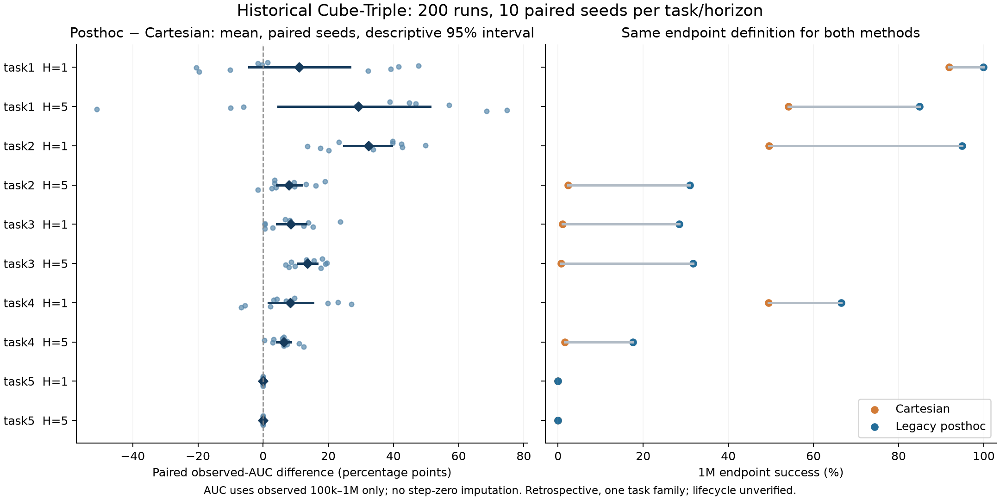
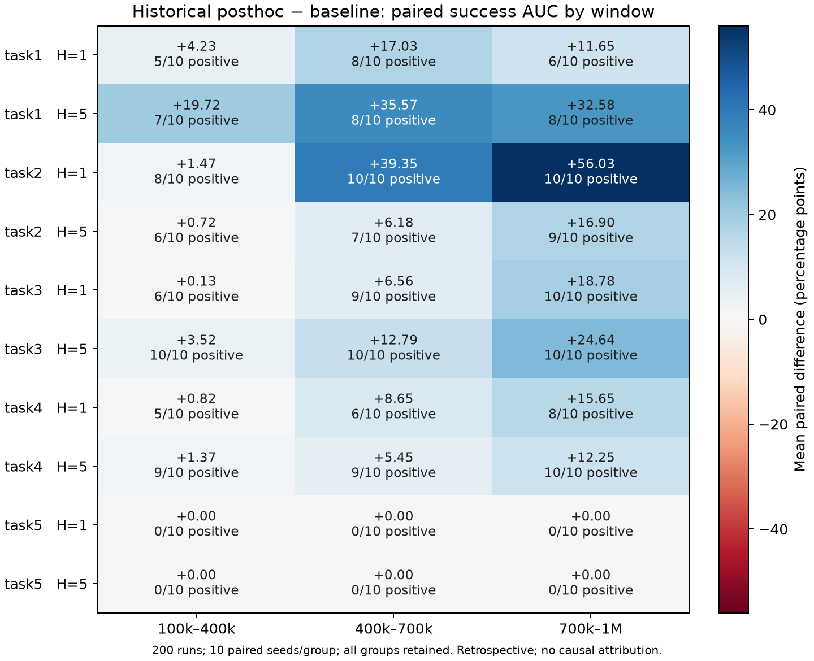

# 结果：已知结论和待解释实验

[文档入口](../index.md)

更新：2026-10-19。本页汇总已有记录，不作为实时训练监控。性能解释主要来自此前已分析报告，
新归档中的运行完整性检查不自动升级为科学结论。

## 原版 posthoc 的统一重算（2026-10-19）

从当前固定 HF revision `a16bfe8` 重新读取 200 次 Cube-Triple 原版运行：五任务、H1/H5、
两个方法、各十个 seed。全部 400 个 flags/eval 文件与此前保存索引的 SHA-256 相同；
独立重算逐运行指标也与旧索引一致。索引原有 revision `e3785e2` 单独保留，没有改写其来源。
每个任务内按训练 seed 配对，未混入四 seed 小批次、FQL 或后来的 direct-speed 配方。

表中两个成功率列均为 baseline / posthoc，单位是百分比。Endpoint 固定为 1M 单点；
tail3 固定为 800k/900k/1M 三点均值。AUC 只使用真实观测的 100k–1M 区间并除以 900k，
不补造 step 0，不能与新批次的 0–1M AUC 直接混算。区间是十个配对 seed 的回顾性描述
bootstrap，未作确认性多比较结论。

此处配对指文件中相同的训练 seed 标签；旧文件未证明所有环境与评估随机源都按相同规则
隔离，因此不把它描述为完整的 common-random-number 控制。

| 任务 | H | Endpoint baseline / posthoc | Tail3 baseline / posthoc | Observed-AUC 配对差及 95% 描述区间（百分点） | AUC 正配对 |
|---|---:|---:|---:|---:|---:|
| task1 | 1 | 91.90 / 99.90 | 89.40 / 99.73 | +10.97 [−4.32, +26.67] | 5/10 |
| task1 | 5 | 54.10 / 84.90 | 49.13 / 81.30 | +29.29 [+4.70, +51.30] | 7/10 |
| task2 | 1 | 49.60 / 94.90 | 37.30 / 90.97 | +32.28 [+24.84, +39.51] | 10/10 |
| task2 | 5 | 2.30 / 31.00 | 2.00 / 22.03 | +7.93 [+4.15, +11.95] | 9/10 |
| task3 | 1 | 1.10 / 28.40 | 1.10 / 22.41 | +8.49 [+4.16, +13.16] | 10/10 |
| task3 | 5 | 0.70 / 31.70 | 0.60 / 27.49 | +13.65 [+10.70, +16.55] | 10/10 |
| task4 | 1 | 49.40 / 66.50 | 44.43 / 61.40 | +8.37 [+1.71, +15.34] | 8/10 |
| task4 | 5 | 1.60 / 17.60 | 1.13 / 14.57 | +6.36 [+4.22, +8.51] | 10/10 |
| task5 | 1 | 0.00 / 0.00 | 0.00 / 0.00 | +0.00 [+0.00, +0.00] | 0/10 |
| task5 | 5 | 0.00 / 0.00 | 0.00 / 0.00 | +0.00 [+0.00, +0.00] | 0/10 |

该重算保留了原方法值得优先复现的正向信号，同时保留 task1 H1 的跨零描述区间和 task5 的
两组全零。旧文件不能认证进程退出码、执行源码身份或独立评估 RNG；100 episodes 是 flags
中的配置值，尚无逐 episode 原始记录的独立核验。这是同一任务族的历史证据，不是新的确认实验。
复算工具为 [`research.action_adapter_legacy`](../../research/action_adapter_legacy.py)，10 项测试通过；
原始曲线、逐 seed 差值及文件身份记录在数据盘
`reports/action_adapter_validation_20261019/legacy-outcome-reverification.json`。

2026-09-25 的 [critic-space 协议](../data/summaries/2026-10-19/protocols/envq_counterfactual_protocol.md)
复用 [projection 协议](../data/summaries/2026-10-19/protocols/projection_counterfactual_protocol.md)
中的 sigmoid/direct latent 运行，属于另一配方。其 env-Q 降幅不能解释六月 tanh/log 原版
优势的来源，也不构成放弃完整原方法的证据。新筛选因而分别保留 legacy、direct 及各自的
latent/env/canonical 对照，完整方法复现和机制解释分开判断。

### 历史优势在学习过程中的位置

对上述相同 200 个历史运行再作回顾性分段分析，将真实观测区间等分为
100k–400k、400k–700k、700k–1M；每段用梯形积分除以 300k，先逐 seed 配对再汇总。
三个窗口在本次次分析执行前固定，但执行者已知旧的全程结果，不将其描述为科学预注册。
全部十组和 task5 的零结果均保留，未读取正在执行的批次成绩，也没有追加训练。

| 任务 | H | 100k–400k 差 | 400k–700k 差 | 700k–1M 差 |
|---|---:|---:|---:|---:|
| task1 | 1 | +4.23 | +17.03 | +11.65 |
| task1 | 5 | +19.72 | +35.57 | +32.58 |
| task2 | 1 | +1.47 | +39.35 | +56.03 |
| task2 | 5 | +0.72 | +6.18 | +16.90 |
| task3 | 1 | +0.13 | +6.56 | +18.78 |
| task3 | 5 | +3.52 | +12.79 | +24.64 |
| task4 | 1 | +0.82 | +8.65 | +15.65 |
| task4 | 5 | +1.37 | +5.45 | +12.25 |
| task5 | 1 | +0.00 | +0.00 | +0.00 |
| task5 | 5 | +0.00 | +0.00 | +0.00 |

单位为 posthoc−baseline 的平均配对成功率 AUC 百分点；不是最终单点评估的差。
task1–4 八组的后段优势全部大于前段，六组逐窗口递增，task1 两组在中段达到最大差。
这支持“收益在学习过程中拉开”的描述，不能仅从成功曲线认定访问状态扩大、Q 更易拟合、
优化更稳定或小动作减少是因果来源；早期探索也可能到后段才反映为成功率。
评估仍是随机策略，训练和测试时动作分布的贡献也尚未分离。

独立重读全部 400 个原始文件并核对 SHA；逐运行曲线、三项全程指标和旧十组比较与既有
报告完全一致。对每个运行，三个等长窗口 AUC 的平均都恢复原 100k–1M AUC（绝对容差
2e-16）。该校验检验数值分解，不提升历史进程身份、episode 计数或 RNG 的证据等级。
计划与一次性工具在数据盘 `control/posthoc_reason_temporal_20261019/`，输入身份、逐 seed
分段值、正负/零配对数与图在 `reports/posthoc_reason_temporal_20261019/`。

## 原版 posthoc 的前向机制诊断

以冻结 legacy mapper 和 SHA 固定的两个验证先验进行 CPU 只读诊断；没有训练新模型。
固定零均值共同 Gaussian 探针中，SD=0.2/0.5/1/2 的 baseline XYZ 范数中位数为
0.302/0.689/1.076/1.394，posthoc 均约为 1；SD=1 的平均范数反而为 baseline 1.053、
posthoc 0.995。相同输入在裁剪前的方向一致，posthoc 真正逐轴裁剪比例约 39.29%。
这更具体地指向幅值分配与执行映射差异，不足以认定实际训练中哪一项造成收益。

Cube-Triple / Cube Double 验证先验分别有 21.59% / 21.35% 的动作经 canonical 编码后
log-speed<−1；这与 tanh 策略速度坐标不一致。近零方向分支仍可执行小动作，不能把
此编码差异写成全局执行支持排除。两份先验均未包含该近零分支，六月快照与当前 mapper
在全部先验 decompose 上一致；零动作编码的边界差异仍单独保留。
解析 Jacobian 与实际 mapper 自动微分的最大差约 1.30e-7，9 项诊断测试通过。
这些导数没有认证 latent critic 的实际 actor 梯度，Gaussian 探针也不代表训练后的策略。
数据、解释边界和对应训练消融见[方法参考](../reference/method.md#511-原版-posthoc-优势的可检验解释)。

### 评估采样路径核查

六月 Git 快照 `54d7c6d` 与当前冻结 `ccab449` 的 `evaluation.py` 都声明了
`eval_temperature=0`，但函数体没有读取它，也没有传给 actor。ACRLPD 的实际路径为
`dist.sample(seed=rng)`，执行 wrapper 随后 compose；不因这个默认参数而切换到均值策略。

对已有相同参数 SHA 的八个 CPU 初始化 actor（native/posthoc、seeds 10–13），分别运行
两份 evaluator：共 16 个调用路径案例、32 次单 episode 的合成观测回放、512 个回放步骤。
每例的 temperature 0/1 动作逐项相同，且与对应随机键的直接 actor 采样逐项相同；同状态
改用不同键会改变动作。84 个冻结 Python 文件、actor 参数、learner RNG 和初始计数均未变。

该检查没有物理步进、训练更新或任务收益读数；六月 evaluator 使用的是当前冻结初始化
actor，不是恢复历史 checkpoint。因此它排查的是当前可见代码中的确定性评估假说，
不认证历史进程的执行身份或独立评估随机源。没有修改正在运行的协议。
工具与日志在数据盘 `control/action_adapter_validation_20261019/audit_evaluation_sampling.py`
和 `evaluation-sampling-audit-attempt1.log`，完整报告为
`reports/action_adapter_validation_20261019/posthoc-evaluation-sampling-audit.json`。

### 原版 posthoc 的神经网络初始化检查

在 CPU 上按冻结源码和正式有效配置重建 native/posthoc 两种网络、四个初始化 seed，
使用 128 个固定验证先验状态、每状态 64 个共同噪声样本；没有训练、环境交互或性能读取。
原始噪声倍率下，native/posthoc 的平均 XYZ 范数为 1.083/0.965，平均状态内范数 SD 为
0.267/0.446，平均状态内 XYZ 协方差 trace 为 1.225/1.111。幅值波动增加与平均动作
变小、总条件方差略小同时出现，因此不能用“动作更大”或“总噪声更小”概括。

同一个 posthoc actor 保留所有 Gaussian heads 与样本、只改为 Cartesian 执行 XYZ 时，
平均范数/状态内范数 SD 为 1.068/0.267；scalar 控制逐样本保持相同。
该映射反事实是初始化诊断，不是训练基线或性能消融。位置参数非零时，posthoc 的
pooled median 也不固定为 1；CPU 重建不认证远程 GPU 初始化逐位一致。
6 项测试与八个完整模型路径通过。详见[方法参考](../reference/method.md#511-原版-posthoc-优势的可检验解释)，
数据盘报告为 `reports/action_adapter_validation_20261019/posthoc-initial-policy-probes.json`。

### 原版 posthoc 的小动作概率检查

对上一节相同八个初始化 actor、同状态与共同噪声复核，所有参数 SHA、面板和噪声身份
一致。原始噪声倍率下，XYZ 范数小于 0.3 的 native / 同 posthoc heads Cartesian
执行经验比例为 0.583% / 0.616%；posthoc 在每 seed 8192 个 draw 中均未采到。
由连续独立 Gaussian 与理想实数映射直接求得的 posthoc 概率上界约为 `2.59e-19`；
该上界不是从零次采样推断，也不是有限 RNG/float32 概率律的认证。

将固定噪声乘数设为 0.2，native 的经验比例为 30.951%，同 heads Cartesian 为 28.015%，
posthoc 的理想上界仍约 `1.49e-17`。因此平均动作稍小与几乎没有小幅动作可以同时出现，
更具体地支持幅值分配/噪声响应的候选解释，不提供训练后或性能因果结论。
Cube Triple/Double 的序列化验证先验分别有 18.46%/18.36% 动作范数小于 0.3。

10 项概率界、均值汇总、实际 mapper 分支和小动作可达性测试通过；未追加训练。
证明、全部四档与图见[方法参考](../reference/method.md#511-原版-posthoc-优势的可检验解释)。
数据盘报告为 `reports/action_adapter_validation_20261019/posthoc-small-action-probes.json`。

### 冻结策略的单步物理运动检查

相同八个初始化 actor 在 16 个 fixed reset 状态、每状态八个共同 draw、噪声乘数 0.2/1
下完成 5120 次显式物理步进，分析进程退出 0。各条件完整起始积分状态与观测一致，
1024 次相同 posthoc 动作重放的完整末状态精确相同；未更新模型，未分析 reward/success。
控制周期是 50 ms，额外零 XYZ 条件保持相同 yaw/夹爪。
另由固定 actor、状态和噪声重建完整控制量，与全部原始 XYZ 请求逐项核对；独立的
纯物理回放进程对 4096 条原始记录的完整起点和末状态均精确复现。这 4096 次验证步
单独计数，不混入原探针的 5120 步；控制量标记为重建，未改写为当时直接记录。

相对零 XYZ 对照的位移向量范数，posthoc / 同 heads Cartesian 在噪声 0.2 下为
17.159 / 7.893 mm，配对差 +9.266 mm、四个初始化 seed 全为正；噪声 1 下为
17.809 / 19.915 mm，差 −2.106 mm、四个 seed 全为负。范围是初始化描述，非性能置信区间。
它支持噪声到物理运动响应不同，不能解释为“总是移动更多”或已证实提高训练成功率。

本地/云端环境的 45 个 OGBench Python 文件和三项核心版本核对一致；11 项分析测试通过。
完整状态恢复的必要性、控制器链路和限制见[机制参考](../reference/method.md#511-原版-posthoc-优势的可检验解释)。
两次工程 reset 检查发现部分控制/求解器缓存未由 seed 单独固定，其长程影响尚未测量。
原始单步记录、状态/模型快照和报告位于数据盘
`reports/action_adapter_validation_20261019/posthoc-physical-motion-probes.*`。
独立回放验收为 `control/action_adapter_validation_20261019/physical-motion/saved-control-replay.json`。
启动路径和工程序列化的两项错误均保存在 `control/action_adapter_validation_20261019/physical-motion/`；
它们发生在正式物理探针开始前，没有重跑训练或筛选不利案例。

### 训练后策略诊断的验收与等待状态

训练后固定状态工具通过 17 项测试，并以冻结 `ccab449` 源码完整恢复已有的真实
legacy-canonical 64 步工程 checkpoint，分析进程退出 0。计数仍为 33 次联合更新、
TrainState=34，checkpoint 与配置哈希未变，没有重跑训练。
该短程检查只验收恢复、共同噪声采样和分析链路，不提供训练后机制或性能结论。

最终分析计划固定原筛选的 40 个 native/原版 checkpoint，见[次分析设计](experiments.md#训练后策略的固定状态次分析)。
已有动作几何监控已接续该 CPU 分析，仍等待原训练批次结束；正式 40 个 checkpoint 尚未分析。
工程报告为数据盘 `reports/action_adapter_validation_20261019/posthoc-checkpoint-policy-engineering-v2.json`。

### 完整消融汇总的验收与等待状态

终态配对汇总工具通过 20 项测试，覆盖原主比较家族、共同配置、真实 step 0、曲线指标复算、
失败与缺失 seed、错误源码/退出码、删失时间、全零结果、输入哈希和拒绝覆盖。
另用真实冻结的 72 身份配置、分析计划和控制器完成全缺失的合成验收：28 项比较均保留为
不完整，没有生成部分组均值；六项原主比较身份保留，重复执行被拒绝。
该合成验收只验证汇总链路，不描述正在运行的 72 条真实实验。

独立本地监控已启动，等待首轮上游验收与终态报告；正式消融汇总尚未生成。
计划和验收记录位于数据盘 `control/action_adapter_validation_20261019/screen-comparisons/`
及 `comparison-contract-engineering/`；最终报告将写到
`reports/action_adapter_validation_20261019/posthoc-screen-comparisons.json` 和同名 Markdown。

### FQL native/posthoc 的数值与真实接线验收

源码 `8e2e850` 的独立 H1 driver、native 与潜动作 posthoc 参考类，已与固定官方
`e8cd16e` 的未修改模块完成十类 CPU 数值核对：五类 native 和五类包含 canonical
编码 replay 的 posthoc，覆盖 mean/min、Q 归一化开关、flow/alpha 设置与完整 512×4。
初始化、采样、flow 积分与连续三次更新的参数、优化器、计数器、RNG 和 loss 均一致，
最大状态差为 0；44 项行为/契约测试通过。数值报告位于数据盘
`reports/fql_posthoc_reference_20261019/fql-posthoc-reference-equivalence.json`。
完整 512×4 网络在本地 GPU 0 完成 native/posthoc × uniform/balanced 的四次真实短测，
均退出 0，每次 4 离线 + 64 在线更新，实际 Adam count=68、TrainState=69，四个评估点
实际各 1 episode。独立 CPU 从新模板恢复全部模型，逐 checkpoint 171 个字段精确一致；
256 条采集动作执行映射及首个离线/在线 batch 编码通过。首次检查的字典键顺序误判与
全部 GPU 原日志保留，详见 [FQL 验收边界](../reference/fql_baseline.md#新适配的数值与真实环境验收2026-10-19)。
这些是工程证据，尚无 FQL 长程收益或跨算法性能结论，也未改动现有云端矩阵。

FQL 的独立 16 运行开发批次现已冻结并接续同一实例，等待既有 RLPD posthoc 及其上游
训练/分析技术终态；没有性能方向门槛。训练源仍为 `8e2e850` 的 117 文件快照，新的
独立验收与分析工具另行绑定。实际部署包解包后的 82 项核心/运行检查通过，16 个配置与
四卡顺序核对一致；新验收器还复核了已有四个真实工程模型与日志，没有重跑训练。
该批次尚未启动正式训练；计划、包证明和实时控制器状态在数据盘
`control/fql_posthoc_transfer_20261019/`，未来报告为
`reports/fql_posthoc_transfer_20261019/fql-transfer-report.json`。

## Action-adapter 当前执行状态（2026-10-19）

本分支已冻结 action-adapter 对比与消融的首轮筛选：九方法、两个任务、四配对 seed、
每运行 1M 步，共 72 个运行。具体范围见[实验](experiments.md#action-adapter-冻结筛选)。
执行源码的精确 commit 与逐文件 SHA-256 固定在批次的 `source-commit.txt` 和
`release-manifest.json`；后续日常文档更新不改变运行中的发布包。

29 项相关测试和 3 个参数化子项通过；本地真实 GPU 的 legacy-canonical H1 512 步、
direct-canonical H5 128 步，以及 native 64 步完整运行验收均退出 0。检查了真实 step 0、
训练更新、精确终点评估、解析配置、动作边界和可读有限 checkpoint。
配置序列化与本地缓存路径的两次工程失败已保留，修复后的运行使用独立 attempt。
入场前额外发现零方向处的范数梯度为 NaN；现已保留原前向值并定义有限零点次梯度，
非零方向导数与 env/canonical、log/direct 四种零点回归均通过。所有长程运行使用修复后的冻结源码。

用户因八卡等待过久改为 4×4090。原任务 `a21561187422171136807711` 已确认 Stopped，
停止前处于 Queuing、startedTime=0。替换任务 `a21566001929515008267857` 已由平台接受，
现已分配并进入 Running，四张 RTX 4090 的真实 SSH/GPU 探针已通过。
平台返回配置为 4×4090、56 CPU、448 GiB 内存、标价 4 算力点/小时，不限时长。
该页面不是实时监控。部署、critic、基线和动作几何四个监控进程已恢复。
远程工程验收全部通过，72 组正式筛选已启动；首次进程核验看到 8 条活动训练，
分别位于四张卡，每卡两条。当前尚无这 72 个长程运行的完整性能结果。

配置、原始工程尝试、源码/数据 SHA-256、等待进程状态及后续验收记录统一放在数据盘
`control/action_adapter_validation_20261019/`；生成报告放在 `reports/action_adapter_validation_20261019/`。

部署控制包 revision 3 在首次 JAX 导入之前关闭 GPU 显存预分配，避免验收父进程占用
子进程需要的显存。此次资源切换更新至 revision 4：GPU 验收和调度设备改为 0–3，
监控改指向四卡替换任务。旧部署包、计划和进程记录保存在 `before-4gpu-switch/`；
训练源码、数据、72/16 运行任务配置及首轮科学预注册保持不变，资源修订单独登记。
两份发布包的 84/90 个 Python 源文件和外层包成员均已逐一核验哈希，控制器语法检查通过。

资源分配后第一次自动连接失败：API 的 `sshUrl` 是裸容器 IP，旧控制器错误地等待完整
`user@host` 命令。核对当前控制台前端后，改为集群 `sshProxyPath` 对应 SOCKS 代理下的
`root@jobId`，按 `sshState=1` 就绪状态连接；真实连接与 6 项回归检查通过。首次超时和
退出的监控记录保存在 `before-ssh-endpoint-recovery/`。该故障发生在上传和训练之前。
远程已核对持久化挂载、Python 3.12.13、JAX 0.9.2、Flax 0.12.6、NumPy 2.4.4 及四卡可见性。
补齐锁文件指定的 pytest 9.1.1、iniconfig 2.3.0、pluggy 1.6.0；没有升级 learner/CUDA 依赖。
145 项安装包版本清单已保存在本地批次记录和远程持久化控制目录。远程训练发布包的哈希保持不变。

远程 CPU 测试通过 23 项与 3 个参数化子项。legacy-canonical、direct-canonical、native、
projection 的四项真实 GPU 工程运行均完成 64 步、退出 0，通过 step 0/64 评估、全部动作
边界、有限值与 checkpoint 验收；每项实际联合更新 33 次，TrainState=34。随后启动
四卡、每卡最多 8 并发的 72 组正式筛选，实际 supervisor、调度器与四卡训练子进程均已核验。
工程与启动摘要为数据盘 `reports/action_adapter_validation_20261019/remote-launch-verification.json`。
初始 GPU 占用与活动进程只证明启动，不是稳定吞吐或方法性能证据。

四卡尚未分配时，首轮控制包进一步更新至 revision 5，仅加强产物验收：核对全部显式
命令覆盖项、实际 learner 配方、每步完整动作分量、精确 joint/Adam 更新次数及有限优化器状态。
该 learner 的 TrainState 从 1 开始，Adam 从 0 开始；1M 步、start_training=5000、UTD=1
应为 995001 次联合更新，TrainState 计数为 995002。22 项验收测试通过，已有 native 和
legacy-canonical 的两个真实 64 步 checkpoint 均复核为 33 次更新、TrainState=34，哈希未变，
未重跑训练。旧包保存在 `before-screen-validator-v5/`，外层包仅 `remote_runner.py` 改变。
首轮冻结驱动没有记录实际返回的评估 episode 数，验收输出明确标为“仅能核对配置”；
后续独立基线仍按真实返回的 episode/success 计数验收。

### Critic 等效动作检查

独立离线诊断新增 9 项测试通过。真实 checkpoint 的配对工程检查使用相同训练 seed 9004、
64 个环境步（33 次 optimizer 更新，计数器从 1 变为 34）、相同源码和同一批
64 个 validation-prior 状态；
解析配置唯一差异为 latent/canonical critic。共同动作探针不依赖已学 actor，方向缩放 0.5
后两组的最大实际执行动作差均为 0。

| 工程检查 | Latent critic | Canonical critic |
|---|---:|---:|
| 等效动作 Q 绝对差均值 | 0.0072749 | 0 |
| `u · ∇u Q` 的 RMS | 0.0183553 | 1.04e-9 |
| 方向坐标 Q 梯度的平均绝对径向投影占比 | 0.524853 | 3.00e-8 |

该结果证明当前诊断能检测到等效动作的价值差异，且 canonical 约束在训练后 checkpoint 上
按定义工作。它没有证明成功率、样本效率或总 actor 梯度改善；此处不包含熵梯度，64 步结果
不用于筛选优胜方法。原始报告与配对身份核对保存在数据盘
`reports/action_adapter_validation_20261019/engineering-critic-invariance-v2.json` 和
`engineering-invariance-comparison.json`。72 次长程筛选的性能结果仍待平台执行。

### 原论文 RLPD 配方的独立验收

新增原论文 RLPD learner 配方的 H1 OGBench 入口，与首轮冻结筛选分开；
来源和不同 RLPD 实现的区别见[基线参考](../reference/rlpd_baselines.md)。
固定上游 commit 的六类数值对照全部通过，参数、优化器状态与 RNG 最大差为 0；
另外 10 项更新顺序、接口和恢复测试通过。

本地 GPU 0 完成真实 Cube-Triple task2 的 64 步工程运行，使用默认 256×256 网络、
10-Q 随机 2-Q min target、entropy backup 与 UTD=20，训练退出 0。
step 0/64 评估和训练日志完整，参数有限，实际执行 660 次 critic、33 次 actor 和 33 次
温度更新；checkpoint 能通过该 learner API 恢复并产生有限、合法动作。
验收控制器首次误用系统 Anaconda Python，读取 checkpoint 时触发 JAX/NumPy 兼容错误；
原记录保留，随后在项目虚拟环境复核同一 checkpoint 通过，未重跑训练。

数值报告为数据盘 `reports/action_adapter_validation_20261019/rlpd-reference-equivalence.json`，
GPU 复核记录为 `control/action_adapter_validation_20261019/local-rlpd-reference-engineering-revalidation.json`。
这只验证移植与工程链路；尚无该外部配方的长程 OGBench 性能结果。
两个任务 × 四配对 seed × UTD=1/20 的 16 运行配置及独立执行包已冻结，放在
`control/action_adapter_reference_20261019/`。接续监控已启动：原 72 运行完整验收、原环境
仍为 Running 且独立远程工程检查通过后，复用同一 4 卡实例执行；每卡先运行一个任务。
当前基线长程训练尚未开始，未加入原 72 运行，也未申请额外实例。

独立控制器通过 13 项测试，覆盖真实 episode/success 计数、缺失网格、有效配方、全部动作
边界、精确 optimizer 更新数、非有限 optimizer 状态、重复输出、失败退出码、禁止自动重跑及
缺失配对。还读取了已有真实 GPU checkpoint 复核计数，未再次训练。
新的评估观察器只读取原评估返回的 trajectories，为每个评估点写出实际 episode 数和成功次数；
不增加评估调用，不改变策略、训练更新或 RNG。已有短测缺少该新字段，明确标为旧工程格式，
不冒充正式基线已经满足 episode 记录要求；正式运行必须通过严格计数验收。

### 原版 posthoc 的同 RLPD 配方接入验收

新增 H1 原版 tanh/log/sphere latent posthoc 的原论文 RLPD 配方入口，用于准备同 learner
内的 native/posthoc 比较；来源与限制见[基线参考](../reference/rlpd_baselines.md#原版-posthoc-在同一-rlpd-配方中的适配)。
重新核对六类 native 和六类 posthoc 潜动作案例，参数、优化器、计数器、RNG 与 loss 均通过，
最大状态差为 0。posthoc 案例包括完整 256×256 / UTD20；另有 native 10 项、posthoc 16 项测试通过。
首次合并进程的 LLVM 编译分配失败已保留，随后同样十二例改为独立 CPU 进程通过，未缩小案例。

冻结源码 `e20834c` 的 106 文件快照在本地 GPU 0 完成真实 Cube-Triple task2 64 步运行，
退出 0；完整 256×256、10-Q 随机 2-Q min target、entropy backup、UTD=20。
实际执行 660 次 critic、33 次 actor、33 次温度更新，Adam 计数一致；step 0/64 实际评估
episode 数为 1/1。全部动作和参数/优化器状态有限、边界合法；checkpoint 成功恢复，
16 个验证状态的采样探针通过且 learner RNG 不变。

该运行是工程验收，没有长程比较或成功率收益结论。记录在数据盘
`control/posthoc_reference_20261019/`。原 72/16 运行发布包保持冻结，新适配没有插入原批次；
同配方正式 posthoc 比较已另行冻结，仍待原批次和分析终态。

新批次为两个任务 × 四个相同训练 seed × UTD1/20，共 16 次原版 posthoc，复用独立基线的
16 个 native。四项配方内方法比较及四项描述性交互预先固定，不能当作十个 fresh seed
的确认阶段。已有真实 64 步 checkpoint 用新正式验收器重新读取，通过实际 episode、
TrainState/Adam、全部动作与冻结源码 API 恢复检查，没有重跑训练。
控制器与分析门槛通过 30 项测试；完整包解开后，26 项核心测试和 30 项运行测试合计
56 项通过，106 个源码、14 个控制文件及全部外层成员哈希核对通过。
接续监控已启动，等待原 72/16 运行及四类分析完成；16 次新正式训练尚未开始，
尚无该同配方 posthoc 的长程性能结果。部署证明在数据盘
`control/posthoc_reference_20261019/deployment-execution-proof.json`。

### 动作与运行时间分析的准备

首轮已登记的动作范数、协方差、边界占比和 wall time 由独立流式分析器补齐，定义与限制见
[实验说明](experiments.md#已登记的动作与时间次指标)。22 项测试通过，覆盖与 batch covariance
的一致性、近常数动作数值稳定性、warm-up 分离、三种边界量、缺步/重复/非法动作、缺失 seed、
错误源码和退出码，以及拒绝从只有 norm 的旧日志伪造坐标协方差。

已有两份 64 步真实工程日志完成双 CPU worker 的 CLI 验收，每份严格识别出 32 条
post-warmup 动作；其协方差与均值另用直接 batch 计算核对一致。修改 seed 合约的负控被
冻结配置哈希拒绝，未生成结果，也没有新增训练。工程报告在数据盘
`reports/action_adapter_validation_20261019/engineering-action-geometry.json`。
正式 72+16 个运行的几何统计仍待训练完成；这些工程检查不提供新的性能或机制结论。

## 当前可以说什么

| 研究项 | 已有判断 | 边界 |
|---|---|---|
| 固定 `K=5` 方向保持 | 当前 Cube Double/Scene 配对结果不支持提高样本效率 | 不能推广为所有方向–速度或自适应时间方法无效 |
| Cube-Triple 扰动匹配 tangent DS | 部分任务存在正向估计 | 尚无跨任务族、跨算法的一致收益结论 |
| Cube Double/Scene 两 seed 噪声筛选 | 未通过原扩展门 | 不扩展原两矩控制器来追求显著性 |
| 三矩控制器与 residual/offset 变体 | 暴露容量坍缩或边界附近矩匹配耦合 | 几何接线通过不代表性能收益 |

具体数值、统计条件、失败和旧实验规模见[历史结果报告](../archive/results.md)。
这些窄结论不支持“DS 普遍优于 Cartesian”或“已经完成 FQL/RoboMimic 通用性验证”。

## 最近归档的三组 RLPD 筛选

| 批次 | 精简归档 | 科学解释状态 |
|---|---|---|
| Semantic-subspace uncertainty | 48 次运行 | 保留原报告中的未通过假设/确认判断 |
| Critic-flat semantic exploration | 48 次运行 | 保留原报告中的未通过假设/确认判断 |
| State-conditional controllability | 48 次运行 | 执行完成，不能仅据归档检查认定方法成立 |

三组共 144 次运行通过了专用导出器的精简预算、网格、有限值和 incident 检查。
该检查不覆盖所有退出码、checkpoint 和 source/data 身份要求。
证据入口：[归档说明](../data/summaries/2026-10-19/README.md)、
[逐运行检查](../data/summaries/2026-10-19/run_checks.json)、
[原分析报告](../data/summaries/2026-10-19/reports/)。

## GAC 旧材料与官方来源核验

固定官方代码 `374ae2c` 后，旧工作源码与官方采样/浓度正则/固定输入 loss 的 17 项
数值检查通过；零方向、单样本方差和 kappa=0.1 边界次梯度的三个差异单独记录。
首次边界梯度对照失败日志保留，后续检查未将其改写为无条件等价。
核查了旧 task1 的 30 份 flags，其中 18 份为三个 GAC 变体，各六 seed。
这些材料指向项目学习器内的策略适配，不能认证官方完整算法复现，也不是当前
完整 action-adapter 的 GAC 性能比较。旧目录缺有效配置，源码快照也不构成执行来源证明。
来源、动作支持和后续比较边界见 [GAC 基线](../reference/gac_baseline.md)。本次未训练。

完整 GAC learner 已通过 CPU/CUDA 各三类原始 AST 更新对照，模型、Adam、训练 RNG 和
loss 最大误差均为 0；原项目 87 项回归与 CUDA 专项 17 项检查通过。真实单环境 CPU/CUDA
64 步工程与学习器恢复证据、首次数值入口/依赖导入失败及修正均保留在数据盘
`control/gac_reference_20261019/`，范围见 [GAC 基线](../reference/gac_baseline.md)。

源码 `29536cb` 的来源绑定训练入口已完成 `online_only` 和 `prior_balanced` 两种协议，
125 文件快照、19 项入口契约测试及本地 GPU 0 的两次 64 步真实运行通过；每次实测
critic/actor/target=31/30/31、step 0/64 各实际 1 episode。两种协议的五个模型和训练 RNG
初始化哈希一致，数据来源抽取计数分别为 0/7936 与 3968/3968（prior/online，含放回）。

独立新进程从新模板恢复每份学习器 checkpoint 的 179 个状态字段，精确一致；首批数据
分别与原始先验索引、在线 replay 快照逐字段一致，64 条动作与各 16 个策略探针通过。
日志保留 actor loss 实际所属的 global step；没有重跑训练。证据为数据盘
`control/gac_driver_20261019/engineering-receipt.json` 与 `independent-validation.json`。
该入口采用单环境本地数据/评估适配；GAC+prior 是明确的附加先验协议，不能把它标成
原版纯在线 GAC 或 RLPD 内单一几何消融。云端 Torch 仍为 CPU 版，GAC 长程比较尚未
启动，也没有 posthoc 超过 GAC 的性能结论。

### GAC 较大 radius 的执行边界验收

针对作者 MuJoCo 示例使用 radius=2.5、原 Cube driver 只允许 1 的覆盖缺口，新源码
`371fe5b` 增加显式 clip 执行，完整官方 learner 保持不变；replay/Q 保留原始请求坐标，
环境接收裁剪动作。三项本地 CUDA 64 步工程均退出 0：identity/online-only、
clip/online-only、clip/prior-balanced，各实测 31/30/31 次 critic/actor/target 更新。
两个 clip 案例的训练裁剪步骤为 25/28，执行输入逐轴有界；独立检查确认首批在线 replay
仍保留绝对值 1.777 的请求，而非被静默替换成执行动作。

CPU 39 项／跳过 1 项、CUDA 40 项检查通过；radius=2.5 的额外官方 AST 完整 learner
数值案例最大状态误差为 0。三个 checkpoint 各 179 个字段精确恢复，原始批次/索引、
实际评估 episode、计数与 16 个策略探针通过。三次评估共额外 6000 步，单独于 192 个
训练步；这些证据不提供 GAC 或 posthoc 性能判断。完整范围与适配限制见
[GAC 参考](../reference/gac_baseline.md#较大-radius-与执行边界的独立验收)，证据在数据盘
`control/gac_radius_20261019/readiness.json`。云端 CUDA 安装与镜像仍待完成；独立 32 运行
比较设计已冻结，但尚未启动，见[实验](experiments.md#gac-完整基线的冻结开发比较)。

独立分析 `45a0998` 的可复用 GAC 终态工具通过 39 项专项检查，并从导出包通过相同测试。
重新读取三次原 CUDA 工程，实际评估、完整动作轴、原始 batch/索引、31/30/31 更新和
各 179 个 checkpoint 字段均通过，训练更新为 0。对独立副本构造的负索引、擦除原始请求、
错误 Adam 计数三种破坏均被拒绝，原文件哈希保持不变。详细限制见
[验收工具](../reference/gac_baseline.md#可复用的长程验收工具)，报告在数据盘
`control/gac_validation_20261019/readiness.json`；它不证明百万步稳定性或新增性能收益。

62 个带哈希 wheel 已在本地新 GAC 环境完成离线安装，`pip check` 通过且没有继承系统包。
现有云端 OGBench 声明闭包 33 个包中 32 个版本匹配，setuptools 因 Torch 要求从云端
70.2.0 改为最低兼容 77.0.3，例外明确保留。新环境通过 40+39 项检查、三次真实 CUDA
64 步入口与独立恢复、四类官方 AST 数值对照（最大误差 0）。这些工程没有安装到运行中
的云端环境，也不提供性能结论。安装与核验记录见
[环境范围](../reference/gac_baseline.md#云端独立-cuda-环境准备)，数据盘证据为
`control/gac_clean_runtime_20261019/readiness.json`。

部署归档的实际解包证明通过：固定依赖逐文件验哈希，runtime v2 的 125 个训练 Python
文件、32 个科学配置和上游浅克隆 Git 对象完整还原；导出包 40+39 项检查、一次解包源码
的真实 CUDA 64 步及独立 179 字段恢复通过。首版缺 shallow boundary 的失败包保留，
并非重跑科学结果。较小 runtime 已在原四卡实例暂存与核验；依赖包已于北京时间
2026-10-20 00:20 完成远端哈希和读回校验。云端安装
与正式 GAC 运行未开始。证据为数据盘 `control/gac_reference_comparison_20261019/package-proof-v2.json`，
详见[部署范围](../reference/gac_baseline.md#部署归档与暂存)；不提供新增性能结论。

独立操作版本 `fc33356` 补入 24 项原定配对汇总和逐卡串行执行核心：43 项汇总／19 项
执行检查通过，真实冻结配置的全缺失验收保留所有对照而不生成组估计。新执行核心在本地
空闲 GPU 0 上完成 seed 9701、r=2.5/prior-balanced 的 64 步真实入口；驱动及独立验收均
退出 0，31/30/31 更新、179 字段和原始请求 replay 通过，另计 2000 个评估步。
云端仅完成 62 项纯逻辑/模拟进程检查及全缺失验收；其后已实现下述独立启动控制器，
CUDA 环境和镜像仍待完成，没有新增科学性能结论。证据与边界见
[执行与汇总工具](../reference/gac_baseline.md#四卡执行核心与完整配对汇总)。

独立云端控制器 `13c2ba8` 连同核心工具通过 142 项逻辑检查，导出包和现有云端实例均
通过；实际 inspect 等待 FQL，实际 launch 入口拒绝提前启动。检查前后科学输出、独立
环境路径都未创建，原 35 个科学文件不变。此处正向完整矩阵测试是合成 fixture，不是
新的科学结果；云端环境与镜像操作仍待执行。环境准备的远端接续进程已启用，
实际 PID/源码绑定与等待状态已核验，七项运行边界检查在本地和云端通过；
当前没有创建目标环境或科学输出。它只接续环境准备，尚未接续镜像保存及科学启动。
证据为 `control/gac_reference_comparison_20261019/environment-owner-readiness.json`。详见
[完整控制器](../reference/gac_baseline.md#完整云端启动与终态门槛)及数据盘
`control/gac_reference_comparison_20261019/scientific-controller-cloud-receipt.json`。

## 执行映射因果对照的工程验收

新增六维 Cartesian 辅助 head 对照 `7058825`，用于保留 actor、潜动作正则与 env critic，
只改变执行映射。50 项相关检查及两个任务各两种映射的 CPU 64 步真实工程通过，
驱动与独立验证进程均实际退出 0；33 次更新、TrainState=34、checkpoint 恢复和保存的
执行映射标记通过核验。每任务两组的完整初始化状态 SHA 相同，辅助坐标的 Q 输入导数
为零而熵坐标保留。它不提供任何任务性能效应估计，也未完成云端 GPU 或长程预注册。
证据为 `control/posthoc_map_control_20261020/readiness.json`，范围见
[实验准备](experiments.md#执行映射因果对照的实现准备)。当前冻结训练及后续队列未修改。

## 下一步

优先完成本轮完整 action-adapter 的 72 运行复现与消融、critic 等效动作诊断及独立外部
基线比较；随后按冻结规则确定确认配方，扩展 fresh seed、开发任务之外的任务和算法/领域。
旧状态条件批次继续保留为边界证据，其分析状态单独记录，不替代完整 adapter 主线。

写论文时从这里追溯来源，工作稿见[论文参考](../reference/paper_draft.md)。
