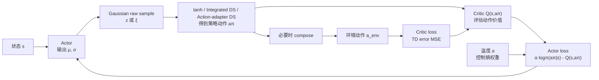
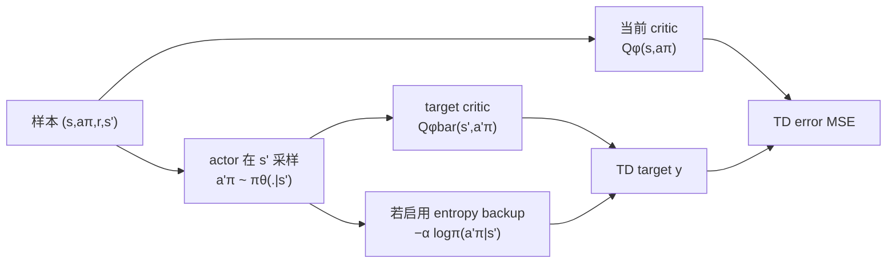
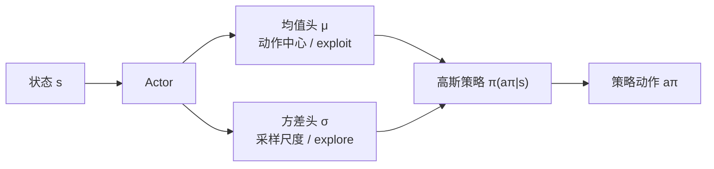
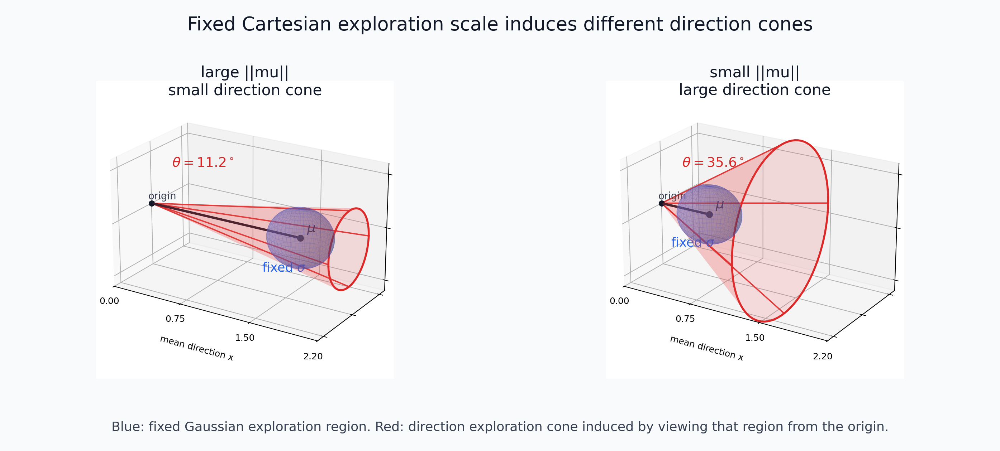
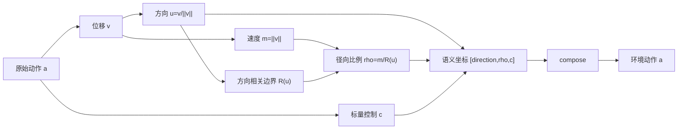
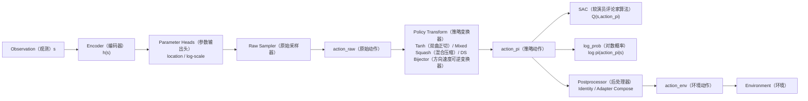
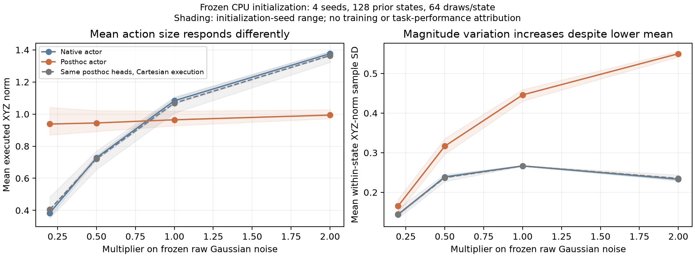
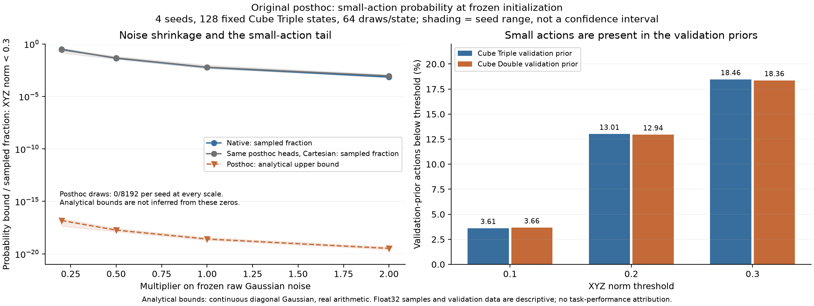
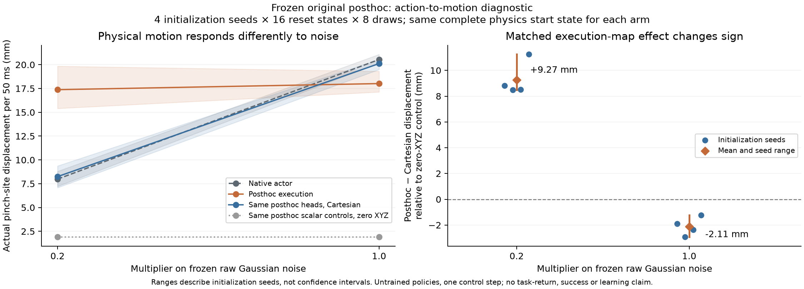
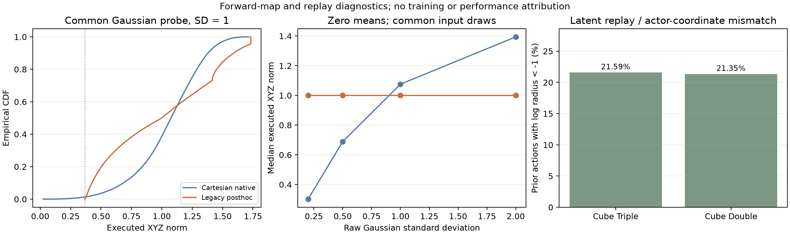

# 方向+速度动作分解

> 按需参考 · [文档入口](../index.md)。本文保留详细说明或工作稿；当前执行和结果分别见 [日常实验](../current/experiments.md) 与 [当前结果](../current/results.md)。

本文统一使用两种架构名称：**Distribution-integrated DS（Integrated DS）** 表示 DS 几何被纳入 actor 的 transformed distribution；**Action-adapter DS（Adapter DS）** 表示 SAC 工作在 DS policy-action 坐标中，再由外部 adapter 在 policy/env action 之间 compose/decompose。配置入口分别为 `--ds_mode=integrated` 与 `--ds_mode=adapter`。

`bijector` 仅保留为可逆数学映射和 TensorFlow Probability API 的术语，不再作为架构模式名。

## 1. 背景：从 SAC 到探索的语义

方向-速度分层的动机来自 SAC 随机策略本身的一个表示问题：actor 用高斯分布探索，但高斯分布的坐标轴未必等于控制任务中真正有语义的坐标轴。本节先从连续控制常见 action space 讲起，再回顾 SAC 的 critic、actor 和 loss，最后引出为什么 Cartesian 三维高斯采样会把方向探索和速度探索耦合在一起。



### 1.1 动作空间：Delta World 与 Delta EE

机器人连续控制里的前三维动作通常表示末端执行器的位置增量，但这个增量至少有两种坐标语义：

$$
\Delta p = (\Delta x,\Delta y,\Delta z).
$$

一种是 **Delta World**，也就是在世界坐标系或机器人基座坐标系下表达的末端相对位移：

$$
p_{\text{target}}^{world}
=
p_{\text{ee}}^{world}
+
\Delta p^{world}.
$$

另一种是 **Delta EE**，也就是在末端执行器自身局部坐标系下表达的相对位移：

$$
p_{\text{target}}^{world}
=
p_{\text{ee}}^{world}
+
R_{\text{ee}}^{world}\Delta p^{ee}.
$$

二者都是“移动末端”，但方向语义不同：Delta World 的方向是全局方向，Delta EE 的方向会随末端姿态旋转。本文后续讨论的方向-速度分解只要求前三维是某个坐标系下的位移向量；如果任务使用 Delta World，则“方向”就是 world-frame 方向；如果任务使用 Delta EE，则“方向”就是 end-effector local-frame 方向。

在 OGBench manipulation / cube 这类环境中，前三维控制的是末端执行器位置增量，但这个增量是直接加到当前末端世界位置上的。因此更准确地说，它是 **end-effector position delta expressed in world frame**：控制对象是 EE position，坐标表达是 world/global frame。后文说的方向探索视锥，也是在这个 world-frame 位移向量上定义的。

### 1.2 三层 action（动作）与基础噪声

为了避免把基础噪声、原始采样动作、策略动作和环境动作混在一起，本文统一使用以下符号：

| 符号 | 含义 | 是否直接给环境执行 | 在哪里出现 |
| --- | --- | --- | --- |
| $\epsilon$ | Base noise（基础噪声），通常满足 $\epsilon\sim\mathcal N(0,I)$ | 否 | Raw Sampler（原始采样器）内部 |
| $a_{\text{raw}}$ | Raw Sampler 根据参数头输出与 $\epsilon$ 生成的原始动作 | 否 | `sample_raw()`、`raw_log_prob()`、Bijector inverse（可逆变换器逆变换） |
| $a_\pi$ | Policy Transform（策略变换器）输出、SAC（软演员评论家算法）训练使用的策略动作 | 视 Postprocessor（后处理器）而定 | $\pi(a_\pi\mid s)$、$Q(s,a_\pi)$、Actor Loss（策略损失） |
| $a_{\text{env}}$ | Environment（环境）真正执行的动作，必须符合环境动作空间 | 是 | `env.step(a_env)`、真实 Transition（状态转移）、原始 Dataset（数据集） |

三层动作在不同方法中的关系如下：

| 实现 | $a_{\text{raw}}$ | Policy Transform（策略变换） | $a_\pi$ 到 $a_{\text{env}}$ | SAC 中的动作变量 |
| --- | --- | --- | --- | --- |
| Baseline（基线） | Cartesian Gaussian（笛卡尔高斯）样本 | Tanh（双曲正切） | Identity（恒等映射） | $a_\pi$；且 $a_\pi=a_{\text{env}}$ |
| Action-adapter DS（动作适配器） | Policy-coordinate Gaussian（策略坐标高斯）样本 | Mixed Squash（混合压缩） | Adapter Compose（适配器合成） | $a_\pi$；通常 $a_\pi\ne a_{\text{env}}$ |
| Distribution-integrated DS（分布内集成） | 角度、平面或局部切空间的 Gaussian（高斯）样本 | DS Bijector（方向速度可逆变换器） | Identity（恒等映射） | $a_\pi$；且 $a_\pi=a_{\text{env}}$ |

因此，SAC 公式里的 $a$ 不是永远指“actor 高斯里刚采样出来的 raw 值”。更准确地说：

$$
\mathcal{L}_{\text{actor}}
=
\mathbb{E}_{s\sim\mathcal{D},\,a_\pi\sim\pi_\theta}
\left[
\alpha\log\pi_\theta(a_\pi \mid s)
-
Q_\phi(s,a_\pi)
\right].
$$

其中 $a_\pi$ 是 actor 分布对训练算法暴露出来的动作变量。它是否等于环境原生动作 $a_{\text{env}}$，取决于 actor 输出后是否还接了额外的执行层转换。可以统一写成

$$
a_{\text{env}}=g(a_\pi).
$$

baseline 和 Integrated DS 中 $g$ 是恒等映射，所以 $a_\pi=a_{\text{env}}$。有外部 adapter 时，两者不必相等。此时需要分别声明策略密度的变量和 critic 的输入特征：密度仍可在 $a_\pi$ 上定义，而 critic 可读取 $a_\pi$、$g(a_\pi)$，或执行动作的固定编码。不能直接把 $g(a_\pi)$ 代入原来的 policy-coordinate `log_prob`，也不能因 critic 读取 env action 就认定接口错误。三种已实现接口及对应 replay 处理见第 5.1 节；本节简写的 $Q_\phi(s,a_\pi)$ 可理解为已包含相应特征映射的复合函数。

### 1.3 Critic 的输出与 loss

Critic 学习状态-动作价值函数 $Q_\phi(s,a_\pi)$，评估训练算法所使用的策略动作 $a_\pi$ 的未来累计回报。为了降低 Q 高估，常使用多个 Q 函数形成集成：

$$
Q_\phi(s,a_\pi)
= [Q_{\phi_1}(s,a_\pi), \ldots, Q_{\phi_N}(s,a_\pi)].
$$

critic 的训练目标是最小化时序差分误差（TD error）。[标准 SAC](https://arxiv.org/abs/1801.01290) 的 soft Bellman target 包含下一动作的熵项，单样本形式为：

$$
y_{\mathrm{soft}}
=
r+\gamma m\left[
\operatorname{Agg}
\left(
Q_{\bar{\phi}}(s',a'_\pi)
\right)-\alpha\log\pi_\theta(a'_\pi\mid s')\right],
\qquad
a'_\pi\sim\pi_\theta(\cdot \mid s').
$$

其中 $m$ 是 bootstrap mask，$\bar{\phi}$ 是 target critic 参数，$\operatorname{Agg}$ 由具体配方声明。本项目冻结筛选的 ACRLPD 使用均值聚合，且省略该熵备份项，实际为 $y_{\mathrm{project}}=r+\gamma m\operatorname{Agg}Q_{\bar\phi}(s',a'_\pi)$；不能把两个 target 当作同一算法配方。下式中的 $y$ 应使用该实验实际声明的目标，critic loss 为

$$
\mathcal{L}_{\text{critic}}
=
\mathbb{E}_{(s,a_\pi,r,s')\sim\mathcal{D}}
\left[
\left(Q_\phi(s,a_\pi)-y\right)^2
\right].
$$



### 1.4 Actor 的输出与 loss

Actor 学习随机策略 $\pi_\theta(a_\pi \mid s)$。标准 SAC 中，actor 输出一个 $D$ 维对角高斯分布的均值和标准差：

$$
\mu_\theta(s),\quad \sigma_\theta(s)\in\mathbb{R}^D.
$$

也就是说，actor 实际上有两个头：

$$
\text{actor}(s)
\rightarrow
(\mu_\theta(s),\sigma_\theta(s)).
$$

$\mu$ 表示高斯分布的中心，$\sigma$ 表示高斯分布的尺度。对于前三维位移动作，可以把它们写成

$$
\mu_v=(\mu_x,\mu_y,\mu_z),
\qquad
\sigma_v=(\sigma_x,\sigma_y,\sigma_z).
$$

再从该分布中采样 latent action，并通过 squash 得到有界策略动作：

$$
z
\sim
\mathcal{N}
\left(
\mu_\theta(s),
\operatorname{diag}(\sigma_\theta(s)^2)
\right),
\qquad
a_\pi=\tanh(z).
$$

Actor loss 是软策略改进目标：

$$
\mathcal{L}_{\text{actor}}
=
\mathbb{E}_{s\sim\mathcal{D},\,a_\pi\sim\pi_\theta}
\left[
\alpha\log\pi_\theta(a_\pi \mid s)
-
Q_\phi(s,a_\pi)
\right].
$$

其中 $-Q_\phi(s,a_\pi)$ 鼓励选择高价值动作，$\alpha\log\pi_\theta(a_\pi \mid s)$ 对应最大熵正则。温度 $\alpha$ 控制探索强度：$\alpha$ 越大，策略越重视熵；$\alpha$ 越小，策略越接近纯粹利用 Q 值。

如果存在先验数据，还可以加入行为克隆项：

$$
\mathcal{L}_{\text{BC}}
=
-\beta
\mathbb{E}_{(s,a_{\text{data}})\sim\mathcal{D}}
\log\pi_\theta(a_{\text{data}} \mid s).
$$

这项鼓励策略不要远离数据分布，但不改变本文的核心问题：actor 的随机性仍然通过 $\mu,\sigma$ 表达。



### 1.5 Explore 与 exploit

强化学习的基本张力是 **explore** 和 **exploit**：

- **Exploit（利用）**：选择当前已知价值高的动作，把已经学到的知识兑现为回报。
- **Explore（探索）**：尝试尚不确定的动作，给策略发现更优行为的机会。

在 SAC 的高斯 actor 中：

- $\mu$ 更接近 exploit：它描述动作分布中心。
- $\sigma$ 更接近 explore：它描述围绕中心的采样半径。
- $\alpha$ 调节二者平衡。

这个解释隐含了一个前提：$\sigma$ 应该是可解释的探索量。也就是说，当我们增大 $\sigma$，最好能明确知道它增加的是哪一种探索。但在连续控制中，一个动作向量往往同时包含多个语义，此时逐维高斯探索的含义会变得混乱。

## 2. 问题：Cartesian 高斯探索耦合了方向和速度

连续控制任务的动作向量常常包含空间位移和若干标量控制项。例如可以写成

$$
a =
\underbrace{[a_x,a_y,a_z]}_{\text{空间位移 }v}
\;\Vert\;
\underbrace{c}_{\text{其他标量控制}}.
$$

前三维空间位移

$$
v=(a_x,a_y,a_z)
$$

同时承载两个语义：

$$
u=\frac{v}{\|v\|},
\qquad
m=\|v\|.
$$

其中 $u$ 是方向，$m$ 是速度或步长。但标准 actor 不是在 $(u,m)$ 上采样，而是在 Cartesian 坐标 $(x,y,z)$ 上逐维采样：

$$
z_i
\sim
\mathcal{N}(\mu_i,\sigma_i^2),
\qquad
i\in\{x,y,z\}.
$$

这意味着同一次高斯噪声会同时改变方向 $u$ 和速度 $m$。

### 2.1 固定 $\sigma$ 时，$\mu$ 的长度决定方向探索视锥

为了看清核心现象，先忽略 tanh 非线性，并假设三维标准差相同：

$$
\sigma_x=\sigma_y=\sigma_z=\sigma.
$$

此时可以把 actor 的前三维高斯理解成：以 $\mu_v$ 为中心，在 Cartesian 空间里放置一个由 $\sigma_v$ 决定大小的**固定置信水平下的等概率区域**。更准确地说，给定置信水平 $p$，例如 $p=95\%$，三维高斯的置信椭球可以写成

$$
(a-\mu_v)^\top
\Sigma_v^{-1}
(a-\mu_v)
\le
\chi^2_{3}(p),
$$

其中 $\Sigma_v=\operatorname{diag}(\sigma_x^2,\sigma_y^2,\sigma_z^2)$，$\chi^2_3(p)$ 是 3 维卡方分布的 $p$ 分位数。若 $\sigma_x=\sigma_y=\sigma_z$，这个 95% 置信区域近似是一个球；若各维 $\sigma_i$ 不同，则是一个椭球。图里画的蓝色球/椭球不是”所有可能动作”的边界，而是为了表达固定置信水平下的高概率采样区域。**该椭球是联合置信区域**（joint confidence region），保证总概率质量 = p——注意它和”每维 95% 区间拼成的长方体”不是一回事（后者只含 0.95³ ≈ 85.7% 联合质量）。

手稿里的关键洞察是：**蓝色区域表示 $\sigma$ 在某个固定置信水平下定义的动作采样置信椭球，红色视锥表示这个置信椭球投影到”方向”语义后得到的方向探索范围。**这两个东西不是同一个。置信水平和 $\sigma$ 固定时，蓝色置信椭球的体积不变，但红色视锥角会随 $\|\mu_v\|$ 改变。

定义

$$
l=\|\mu_v\|
=
\sqrt{\mu_x^2+\mu_y^2+\mu_z^2}.
$$

当 $\sigma<l$ 时，从原点到这个探索球的切线半角为：

$$
\theta
\approx
\arcsin
\frac{\sigma}{l}
\quad
(\text{小角度下也可近似为 } \arctan(\sigma/l)).
$$

因此，同一个 $\sigma$ 在不同 $l$ 下并不代表同一种方向探索。

| $l=\|\mu_v\|$ | 蓝色 95% 置信椭球 | 红色方向视锥 | 直观结果 |
| --- | --- | --- | --- |
| 大 | 大小不变 | 视锥角小 | 主要沿原方向伸缩，方向较稳定 |
| 中 | 大小不变 | 视锥角中等 | 方向和速度都会明显变化 |
| 小 | 大小不变 | 视锥角大 | 轻微噪声也可能把方向打散 |

也就是说：

- **$l$ 越小，方向探索的锥形角度越大**。当 actor 想输出小动作时，同样的 $\sigma$ 会让动作方向几乎随机化。
- **$l$ 越大，方向探索的锥形角度越小**。当 actor 输出较大位移时，同样的 $\sigma$ 更多表现为速度伸缩，方向变化反而较小。

这会造成一个具体问题：当 $\mu$ 比较小时，actor 本来可能只是想做小幅修正，但固定的 $\sigma$ 会带来过大的方向探索视锥，使动作方向在相邻采样间剧烈抖动。于是“探索”不再是可控地试探附近动作，而变成了小动作区域里的方向噪声放大。



上图用 Matplotlib 3D 静态图表达同一个现象：蓝色球表示固定 $\sigma$、固定置信水平下形成的局部高斯采样置信区域；更一般地，各维 $\sigma_i$ 不同时它会是置信椭球。可以把它理解成“例如 95% 概率质量所在的动作区域”的示意。红色锥体表示从原点看过去得到的方向探索视锥。左侧 $l=\|\mu_v\|$ 大，蓝色置信椭球离原点远，红色视锥较小；右侧 $l$ 小，蓝色置信椭球靠近原点，同样体积的置信椭球会覆盖更大的方向角度。

### 2.2 语义维度和表示维度不一致

问题的根源可以概括为：

$$
\text{表示维度}=(x,y,z),
\qquad
\text{语义维度}=(\text{方向},\text{速度}).
$$

SAC 的高斯分布在表示维度上定义噪声，但控制任务关心的是语义维度上的变化。只要这两套坐标不对齐，$\sigma$ 就不再是单纯、稳定、可解释的探索量。

## 3. 方法：动作空间的语义重参数化

核心假设是：位移的方向和幅值承担不同控制语义，应该在策略分布与探索噪声中被显式分离。

设连续动作 $a\in[-1,1]^D$ 可划分为空间位移 $v=a_{1:d}$ 和标量控制项 $c=a_{d+1:D}$。由于环境实际接收的是归一化动作，速度维度也应该定义在归一化动作空间中，而不是额外引入物理长度单位。

定义方向：

$$
m = \|v\|_2,\qquad
u = \frac{v}{\max(m,\epsilon)} \in S^{d-1}.
$$

对于 OGBench 这类前三维为 normalized cube 的动作空间，$v\in[-1,1]^3$，沿方向 $u$ 的最大合法半径不是固定的 1，而是 cube radial bound：

$$
R(u)=\frac{1}{\max_i |u_i|}.
$$

因此速度使用归一化比例：

$$
\rho=\frac{m}{R(u)}\in[0,1],
\qquad
s=2\rho-1\in[-1,1].
$$

并将动作表示为

$$
z = [u,\;s,\;c].
$$

其中 $u$ 位于单位球面，$s$ 是归一化速度坐标，$c$ 保留原始标量控制。反变换为

$$
\rho=\frac{s+1}{2},
\qquad
v = \rho R(\operatorname{norm}(u))\operatorname{norm}(u),
\qquad
a = [v,\;c].
$$



注意，逐维 Box 动作的空间位移范数上界是 $\sqrt{d}$ 而不是 1。如果简单使用固定半径 $m\le 1$，会把原本的 cube 动作空间裁成单位球。cube radial bound 的作用就是把“速度”定义成沿当前方向到 cube 边界的比例；该比例可以由 sigmoid 直接参数化，也可以转换成其他 policy coordinate。

### 3.1 模块化动作流水线

当前实现不再让一种方法独占一套 Actor（策略网络）代码，而是把动作生成拆成可替换组件，再由每种方法的 Recipe（组装方案）选择组件并形成完整 Pipeline（流水线）。

对应的交互式实体动画已经迁移到独立前端项目 [`docs/ds-visualizer`](../ds-visualizer)：运行 `npm run dev` 后，第 7 节可以切换 Integrated（分布内集成）与 Adapter（动作适配器），观察 $a_{\text{raw}}\rightarrow a_\pi\rightarrow a_{\text{env}}$ 三个动作实体如何流动。旧入口 [`ds_arch_comparison.html`](../ds_arch_comparison.html) 保留为迁移说明页。

#### 3.1.1 主动作流



这条图中只有三种动作实体发生流动：

1. $a_{\text{raw}}$ 只存在于策略分布内部。
2. $a_\pi$ 同时交给 Critic（价值网络）、`log_prob`（对数概率）和执行边界。
3. $a_{\text{env}}$ 只用于 Environment（环境）交互。

因此 Postprocessor（后处理器）绝不能插入 $Q(s,a_\pi)$ 或 $\log\pi(a_\pi\mid s)$ 内部。它只定义

$$
a_{\text{env}}=g(a_\pi).
$$

#### 3.1.2 组件契约

| 层 | 输入 | 输出 | 职责 |
| --- | --- | --- | --- |
| Parameter Heads（参数输出头） | Actor Feature（策略特征）$h(s)$ | Location / Log-scale Parameters（位置 / 对数尺度参数） | 预测状态相关分布参数；两个头不要求等宽 |
| Raw Sampler（原始采样器） | 两组参数与 $\epsilon$ | $a_{\text{raw}}$ | 完成基础随机采样，不负责环境几何 |
| Policy Transform（策略变换器） | $a_{\text{raw}}$ | $a_\pi$ | 执行 Tanh（双曲正切）、Mixed Squash（混合压缩）或 DS Bijector（方向速度可逆变换） |
| Density Interface（密度接口） | $a_{\text{raw}}$ 或 $a_\pi$ | `raw_log_prob` / `log_prob` | 通过 Inverse（逆变换）和 Jacobian（雅可比）连接两种密度 |
| Postprocessor（后处理器） | $a_\pi$ | $a_{\text{env}}$ | 只在执行边界执行 Identity（恒等映射）或 Adapter Compose（适配器合成） |

所有策略分布统一暴露以下接口：

```python
action_raw = distribution.sample_raw(seed=rng)
raw_log_prob = distribution.raw_log_prob(action_raw)
action_pi = distribution.raw_to_policy(action_raw)
recovered_raw = distribution.policy_to_raw(action_pi)
log_det = distribution.forward_log_det(action_raw)
log_prob = distribution.log_prob(action_pi)
```

其中

$$
\log\pi(a_\pi\mid s)
=
\log p(a_{\text{raw}}\mid s)
-
\log\left|\det\frac{\partial a_\pi}{\partial a_{\text{raw}}}\right|.
$$

#### 3.1.3 方法如何选择组件

| 方法 Recipe（组装方案） | Parameter Heads（参数头） | Raw Sampler（原始采样器） | Policy Transform（策略变换） | Postprocessor（后处理器） |
| --- | --- | --- | --- | --- |
| `BaselinePipelineRecipe` | 等宽逐动作参数头 | Diagonal Gaussian（对角高斯） | Tanh（双曲正切） | Identity（恒等映射） |
| `CartesianAdapterPipelineRecipe` | 等宽策略坐标参数头 | Diagonal Gaussian（对角高斯） | Mixed Squash（混合压缩） | Cartesian Adapter（笛卡尔适配器） |
| `SphericalAdapterPipelineRecipe` | 等宽策略坐标参数头 | Diagonal Gaussian（对角高斯） | Mixed Squash（混合压缩） | Spherical Adapter（球坐标适配器） |
| `StereographicAdapterPipelineRecipe` | 等宽策略坐标参数头 | Diagonal Gaussian（对角高斯） | Mixed Squash（混合压缩） | Stereographic Adapter（立体投影适配器） |
| `SphericalPipelineRecipe` | 等宽原始角度 / 速度参数头 | Diagonal Gaussian（对角高斯） | Spherical Bijector（球坐标可逆变换器） | Identity（恒等映射） |
| `StereographicPipelineRecipe` | 等宽平面 / 速度参数头 | Diagonal Gaussian（对角高斯） | Stereographic Bijector（立体投影可逆变换器） | Identity（恒等映射） |
| `TangentPipelineRecipe` | 不等宽中心 / 角尺度参数头 | Diagonal Gaussian（对角高斯） | Tangent Bijector（切空间可逆变换器） | Identity（恒等映射） |

Adapter Recipe（适配器组装方案）还会独立选择两个速度子模块：

| 速度子模块 | 可选项 | 所属阶段 |
| --- | --- | --- |
| `SpeedSquash`（速度压缩） | `tanh` / `sigmoid` | Policy Transform（策略变换器）中的 Mixed Squash（混合压缩） |
| `SpeedInterpretation`（速度解释） | `log` / `direct` | Postprocessor（后处理器）中的 DirectionSpeedAdapter（方向速度适配器） |

Registry（注册表）只负责找到对应 Recipe（组装方案）。Recipe 的 `assemble()` 返回完整的 `ActionPipelineAssembly(actor, postprocessor, components)`；训练入口不再判断具体方法类。`action_pipeline_components` 会写入配置，记录实验实际使用的参数头、采样器、策略变换器和后处理器。

#### 3.1.4 Assembly（完整组装结果）如何运行

下面的伪代码对应完整动作流：

```python
recipe = resolve_pipeline_recipe(config)
assembly = recipe.assemble(...)

distribution = assembly.actor(observation)
action_raw = distribution.sample_raw(seed=rng)
action_pi = distribution.raw_to_policy(action_raw)

# SAC（软演员评论家算法）在这里停止，不读取 action_env（环境动作）。
q_value = critic(observation, action_pi)
log_prob = distribution.log_prob(action_pi)

# 只有环境执行继续经过 Postprocessor（后处理器）。
action_env = assembly.postprocessor.compose_policy_output(
    action_pi,
    policy_action_dim,
)
next_observation = environment.step(action_env)
```

`components`（组件清单）不是装饰信息，而是实验配置的一部分。例如 Adapter（动作适配器）会记录速度使用 `MixedSquashBijector[speed=sigmoid]`（速度采用逻辑函数压缩）和 `DirectionSpeedAdapter[speed=direct]`（速度采用直接解释）。

#### 3.1.5 Dataset（数据集）与 Replay Buffer（回放缓冲区）边界

在线环境始终产生 $a_{\text{env}}$，而 SAC 始终训练 $a_\pi$。定义 Dataset Encoder（数据集编码器）$d$：

$$
a_\pi=d(a_{\text{env}}).
$$

- Integrated（分布内集成）与 Baseline（基线）：$g$ 是 Identity（恒等映射），所以无需转换。
- Adapter（动作适配器）：$d=\operatorname{decompose}$，把环境动作编码成一个规范的策略动作表示。
- 环境执行时走相反方向，使用 `compose`（合成）得到 $a_{\text{env}}$。

对于可逆表示，$d=g^{-1}$。对于 Cartesian Adapter（笛卡尔适配器），$g$ 是多对一映射，不存在唯一逆函数；`decompose`（分解）只选择一个规范方向向量，满足可表示域内

$$
g(d(a_{\text{env}}))=a_{\text{env}}.
$$

这保证 Replay Buffer（回放缓冲区）、Critic（价值网络）与 Actor（策略网络）始终对齐在 $a_\pi$ 空间，同时不错误声称 Cartesian Compose（笛卡尔合成）可逆。

### 3.2 结构化随机策略

DS 不在环境执行端额外注入噪声；探索仍来自 actor 自身的随机策略。区别在于随机变量的坐标系不同。

Baseline（基线）在原始动作维度上使用独立 Gaussian（高斯分布），再通过 Squash（压缩变换）得到策略动作；DS（方向速度方法）则让原始动作经过方向-速度参数化：

$$
a_{\text{raw}}\sim p_\theta(\cdot\mid s),
\qquad
a_\pi=f_{\text{DS}}(a_{\text{raw}}).
$$

这样，actor 的随机性仍然存在，但其作用方向与速度坐标一致，而不是在原始 Cartesian 维度上彼此纠缠。

对应到上一节的图像语言：baseline 的 $\sigma_v$ 先定义 Cartesian 空间里的蓝色采样置信椭球，再被动地诱导出一个随 $l=\|\mu_v\|$ 改变的红色方向视锥；DS 则直接在方向和速度上定义探索。方向维度的 $\sigma_u$ 固定时，方向探索视锥就固定；速度维度的 $\sigma_s$ 只影响沿当前方向的归一化速度比例，不会顺带改变方向。

### 3.3 速度维度：为什么使用归一化速度比例

方向-速度分解里，方向 $u$ 描述“往哪里走”，速度或步长描述“沿这个方向走多远”。但在归一化动作环境中，真正重要的不是物理距离的绝对值，而是当前方向上相对于动作边界的比例：

$$
\rho=\frac{\|v\|_2}{R(u)}.
$$

其中 $R(u)$ 是沿方向 $u$ 到达 Normalized Cube（归一化立方体）边界的最大半径。这样 $\rho=0$ 表示不移动，$\rho=1$ 表示沿当前方向走到动作空间边界。Integrated DS（分布内集成）固定使用 Sigmoid（逻辑函数）产生有界速度比例：

$$
s=\sigma(z)\in(0,1),
\qquad
\rho=s.
$$

这种表示和环境动作的归一化约束对齐：不管方向指向坐标轴还是 Cube Diagonal（立方体对角线），$s=1$ 都表示到达该方向上允许的最大归一化动作。

Adapter DS（动作适配器）则把速度拆成两个可替换模块：Speed Squash（速度压缩）选择 `tanh` / `sigmoid`，Speed Interpretation（速度解释）选择 `log` / `direct`。因此旧对数速度是 `tanh+log`，推荐的直接速度是 `sigmoid+direct`；两者不再作为一个不可拆分的配置处理。

因此，速度噪声 $\sigma_s$ 的含义是“沿当前方向的 normalized speed ratio 的探索强度”。它不会改变方向，也不会因为不同方向上的 cube 半径不同而改变动作空间覆盖范围。

### 3.4 与时序扩展动作的结合

如果策略一次输出 $H$ 个连续动作，方向-速度重参数化可以逐时间步独立应用：

$$
z_{1:H}=[z_1,\ldots,z_H],
\qquad
z_t=[u_t,s_t,c_t].
$$

因此该方法不要求关闭时序扩展；它只要求每个时间步的动作语义都按“方向、速度、其他控制项”来解释。

## 4. 三类概率化方向参数化

上述语义分解如果要用于 SAC 这类最大熵策略，还必须能计算动作概率密度。也就是说，actor 不只是要采样动作，还要知道

$$
\log\pi_\theta(a_\pi \mid s).
$$

如果策略动作经过变换 $a_\pi=f(\xi)$，则需要 change of variables：

$$
\log\pi(a_\pi)
=
\log p(\xi)
-
\log
\left|
\det
\frac{\partial f(\xi)}{\partial \xi}
\right|.
$$

因此，理想的 DS 策略分布需要一个可逆或几乎处处可逆的参数化。

### 4.1 Stereographic Cartesian 参数化

第一种方案避免直接输出 3D 冗余方向，而是在二维平面上采样点 $p=(p_x,p_y)$，再通过 inverse stereographic projection 得到单位方向：

$$
\rho^2=p_x^2+p_y^2,
\qquad
u(p)=
\left[
\frac{2p_x}{1+\rho^2},
\frac{2p_y}{1+\rho^2},
\frac{1-\rho^2}{1+\rho^2}
\right].
$$

速度由一个 unconstrained scalar 经过 bounded sigmoid 得到归一化速度比例：

$$
\rho=\sigma(r_{\text{raw}}),
\qquad
r=R(u(p))\rho,
\qquad
v=r\,u(p).
$$

该变换从 $(p_x,p_y,r_{\text{raw}})$ 到 3D 位移几乎处处可逆，并具有闭式 log-det：

$$
\log|J|
=
2\log r
+
\log\frac{4}{(1+\rho^2)^2}
+
\log
\left|
\frac{\partial r}{\partial r_{\text{raw}}}
\right|.
$$

它保留 Cartesian 位移动作的形式，同时把方向和速度的探索语义分开。

### 4.2 Spherical 参数化

第二种方案使用两个角度参数化单位球面。latent 坐标为

$$
\xi=[\theta_{\text{raw}},\phi_{\text{raw}},r_{\text{raw}}],
$$

并通过可逆变换得到

$$
\theta=\pi\sigma(\theta_{\text{raw}}),
\qquad
\phi=2\pi\sigma(\phi_{\text{raw}}),
\qquad
\rho=\sigma(r_{\text{raw}}),
\qquad
r=R(u)\rho,
$$

$$
v
=
r[
\sin\theta\cos\phi,
\sin\theta\sin\phi,
\cos\theta
].
$$

该方案几何意义直接，但球坐标在极点附近会出现退化，角度也有周期性。

### 4.3 Tangent-space wrapped Gaussian

Spherical 和 stereographic 都使用固定的全局坐标图，因此相同的坐标方差在不同方向上对应不同的角度范围。`tangent` 改为在 actor 当前方向中心 $\mu\in S^2$ 的切平面中采样。这里的 $\mu$ 是用三维单位向量表示的球面基点，不是下面二维 Gaussian 的 mean：

$$
\epsilon\sim\mathcal N(0,\sigma^2 I_2),
\qquad
q=\|\epsilon\|,
\qquad
r=(\pi-\delta)\tanh\frac{q}{\pi-\delta}.
$$

因此每个 tangent 方向组使用独立、可辨识的分布参数：

$$
\text{direction center raw}\in\mathbb R^3,
\qquad
\log\sigma_{angle}\in\mathbb R,
\qquad
\mu_{speed},\log\sigma_{speed}\in\mathbb R.
$$

方向中心 raw 归一化得到 $\mu$；二维切空间噪声共享一个 angular scale，从而保持各向同性。最终动作仍为三维 $xyz$，但 actor 的分布参数不再强制按照 action dimension 组织。

实现上 actor 只有两个通用输出 head，但二者宽度由分布参数 schema 分别决定。若动作布局中有 $n_d$ 个 tangent 方向组和 $n_s$ 个普通标量，则

$$
D_{location}=4n_d+n_s,
\qquad
D_{log\_scale}=2n_d+n_s.
$$

location head 中每个方向占用 `center_raw(3) + speed_mean(1)`；log-scale head 中每个方向占用 `angular_log_std(1) + speed_log_std(1)`。后续 tangent distribution interpreter 才把这些参数展开为二维切空间采样、exponential map 和三维动作，而不是要求两个 head 与最终 action 逐维对齐。

令 $B_\mu\in\mathbb R^{3\times2}$ 是 $\mu$ 处的任意正交切平面基，压缩后的切向量为

$$
v=B_\mu\frac{r}{q}\epsilon.
$$

再通过 sphere exponential map 得到方向：

$$
u=\operatorname{Exp}_\mu(v)
=\cos r\,\mu+\frac{\sin r}{r}v.
$$

由此得到的球面角距离严格满足

$$
\arccos(\mu^\top u)=r,
$$

而 $r$ 只依赖 $\|\epsilon\|$，不依赖 $\mu$ 指向北极、赤道还是南极。因此固定 $\sigma$ 对应相同的角距离分布。各向同性 Gaussian 也使切平面基 $B_\mu$ 的具体朝向不影响分布。

为了让变换在除对跖点外保持一一对应，径向压缩把无界平面映射到半径小于 $\pi$ 的圆盘。方向部分的面积 Jacobian 为

$$
\left|J_{dir}\right|
=\frac{\sin r}{q}\frac{dr}{dq}.
$$

实现中的 `log_prob` 还会加上 sigmoid speed、sphere/cube radial bound 和其他 tanh 标量的 Jacobian。该方案仍无法消除球面的拓扑 cut locus；$-\mu$ 是 measure-zero 的对跖奇点，但不会像固定 spherical/stereographic chart 那样使局部探索尺度随平均方向变化。

### 4.4 Cube radial bound

如果环境前三维动作本身是 normalized cube：

$$
v=(x,y,z)\in[-1,1]^3,
$$

那么固定半径 $r\le 1$ 实际覆盖的是单位球 $\|v\|\le 1$，不是完整 cube。cube radial bound 把速度上界写成方向相关的边界：

$$
R(u)=\frac{1}{\max(|u_x|,|u_y|,|u_z|)},
\qquad
r=R(u)\sigma(r_{\text{raw}}),
\qquad
v=r u.
$$

它的含义是：沿方向 $u$ 从原点出发，最多走到 cube 边界的距离。这样 actor 仍然学习“方向 + 归一化速度比例”，但最终 $v$ 可以覆盖完整的 $[-1,1]^3$，再交给环境底层做 component-wise scale。

在 bijector 中，cube radial bound 仍然几乎处处可逆。log-det 中的径向体积缩放由 $R(u)^3$ 决定；$R(u)$ 在多个坐标绝对值相等的位置不可微，但这些位置是 measure-zero，通常不影响基于密度的训练。

### 4.5 对比

| 维度 | Stereographic（立体投影） | Spherical（球坐标） | Tangent（切空间） |
| --- | --- | --- | --- |
| 方向坐标 | 2D 平面点投影到 $S^2$ | $(\theta,\phi)$ 两个角度 | 3D 方向中心加 2D 局部偏移 |
| 原始随机维度 | 每个方向 2D | 每个方向 2D | 每个方向 2D，各向同性共享角尺度 |
| 方向解释 | 平面坐标经逆立体投影 | 角度直接生成单位方向 | 局部偏移经 Exponential Map（指数映射）生成方向 |
| `log_prob`（对数概率） | 含投影面元与径向 Jacobian（雅可比） | 含球坐标面元与径向 Jacobian（雅可比） | 含局部压缩、指数映射与径向 Jacobian（雅可比） |
| 主要风险 | 一个极点的 Chart Singularity（坐标图奇点） | 南北极退化与方位角周期 | 对跖点 Cut Locus（截点轨迹）及大角度数值条件变差 |

## 5. Action-adapter DS 与 Distribution-integrated DS

方向-速度分解可以发生在两个不同层级：模型外部的数据/执行层，或者 actor 内部的概率分布层。二者的核心区别是：变换是否属于策略分布本身。

### 5.1 Action-adapter：模型外部的语义表示

Action-adapter 现在支持三种 policy-space 方向坐标。它们都在执行前通过确定性的 `compose` 变成环境 XYZ 动作：

| `ds_adapter_representation` | policy action 前缀 | 变换维度 |
| --- | --- | --- |
| `cartesian` | $[\tilde u_x,\tilde u_y,\tilde u_z,s]$，执行时归一化 $\tilde u$ | $D+1\to D$ |
| `spherical` | $[\theta_{frac},\phi_{frac},s]$，两个角度比例均在 $(0,1)$ | $D\to D$ |
| `stereographic` | $[p_x,p_y,s]$，平面坐标保持无界 | $D\to D$ |

后两种使用的方向公式与 Integrated DS 相同，但变换位置不同：Action-adapter DS 的方向坐标本身是 $a_\pi$，XYZ 只在执行 adapter 中产生。

速度处理拆成两个独立模块。Actor squash（策略网络压缩）先产生策略速度坐标：

$$
s=
\begin{cases}
\tanh(z), & \texttt{ds\_adapter\_speed\_squash=tanh},\\
\sigma(z), & \texttt{ds\_adapter\_speed\_squash=sigmoid}.
\end{cases}
$$

Adapter interpreter（适配器解释器）再决定该坐标的语义：

$$
\rho=
\begin{cases}
\exp(s), & \texttt{ds\_adapter\_speed\_interpretation=log},\\
s, & \texttt{ds\_adapter\_speed\_interpretation=direct}.
\end{cases}
$$

`direct`（直接速度）解释器不做指数或速度裁剪；最终完整 env action 仍会逐轴裁剪。当前分别登记 `tanh+log`（原始对数速度）与 `sigmoid+direct`（0 到 1 直接速度），两者不能视为同一方法。交叉组合 `tanh+direct` 会产生有符号径向值，`sigmoid+log` 的速度比例位于 $(1,e)$。径向参考边界独立配置：

$$
R(u)=
\begin{cases}
1, & \texttt{ds\_speed\_bound=sphere},\\
1/\max_i|u_i|, & \texttt{ds\_speed\_bound=cube},
\end{cases}
\qquad
v=\rho R(u)u.
$$

最终 env action 会裁剪到 $[-1,1]^D$。Legacy `tanh+log` 的 $\rho\in(e^{-1},e)$，因此 `sphere` 只是参考半径 1，不能把它描述为单位球约束；$\rho>1$ 时可以产生范数大于 1 的动作并触发逐轴裁剪。`sigmoid+direct` 的径向比例位于 $(0,1)$，才按该参考边界限制执行范围。

策略仍在 compose 前的变量 $a_\pi$ 上定义密度，但当前 ACRLPD 的 critic 可采用三种特征：

| `ds_adapter_critic_space` | sampled actor/target 查询特征 $\chi(a_\pi)$ | replay 输入 |
|---|---|---|
| `latent` | $a_\pi$ | 真实执行动作经过 `decompose` 的编码 |
| `env` | $g(a_\pi)$，包含实际执行裁剪 | 真实执行动作 |
| `canonical` | $h(g(a_\pi))$，其中 $h=\operatorname{decompose}$ | 同一个 $h$ 编码真实执行动作 |

actor 的价值项是 $Q_\phi(s,\chi(a_\pi))$，target 的 sampled action 也使用同一接口。对应 actor 目标写作：

$$
\mathcal L_{\mathrm{actor}}=
\mathbb E\left[\alpha\log\pi_\theta(a_\pi\mid s)-Q_\phi(s,\chi(a_\pi))\right].
$$

环境实际执行的是

$$
a_{\text{env}}
=
\operatorname{compose}(a_\pi).
$$

三种接口都保留原 policy-coordinate `log_prob` 和温度；仅改变 critic 特征不要求为原密度添加执行映射的 Jacobian。若奖励和转移只通过 $g(a_\pi)$ 依赖动作，且后续策略只依赖环境状态，则从 Bellman 定义可推出行为等效潜动作的真实价值相同，可写为

$$
Q^{\pi}_{\text{adapter}}(s,a_\pi)
=
\bar Q^{\pi}(s,g(a_\pi)).
$$

这是给定策略及其声明的熵正则下的价值分解，不是无约束 latent 神经网络必然满足的等式，也不声称三种接口会学出同一策略。`env` 和 `canonical` 按构造不能区分执行相同的潜动作；`canonical` 保留 D+1 输入宽度，检验这项约束时不缩减 critic 输入维数。近零归一化与编码边界仍须单独检查。

Canonical 不消除潜方向范数对熵的贡献，不能因此声称已经提高环境动作熵或状态熵。动作冗余与状态探索并不等价，已有[相关研究](https://proceedings.mlr.press/v161/baram21a.html)。另外，本分支冻结筛选中的 project ACRLPD **没有**在 Bellman target 中加入下一动作的熵项；本节的标准 SAC 背景不能替代该具体配方，原论文 RLPD 移植与 FQL 作者实现的区别见[基线参考](rlpd_baselines.md)。

对应统一 Pipeline（流水线）的组件选择是：

$$
\text{Gaussian Raw Sampler（高斯原始采样器）}
\rightarrow
\text{Mixed Squash（混合压缩）}
\rightarrow
a_\pi
\rightarrow
\text{DirectionSpeedAdapter（方向速度适配器）}
\rightarrow
a_{\text{env}}.
$$

Cartesian action-adapter 的归一化会丢弃 $\tilde u$ 的径向长度。在原向量与缩放向量都高于数值归一化下限时，对于正数 $\lambda$，

$$
\operatorname{norm}(\lambda\tilde u)
=
\operatorname{norm}(\tilde u).
$$

因此

$$
[\tilde u,s,c],
\quad
[2\tilde u,s,c],
\quad
[100\tilde u,s,c]
$$

都会映射到同一个 env action；比较合法策略样本时，还须保证缩放后仍在声明的策略支持内。这是多对一映射，而不是 bijection。

这带来三个理论影响：

1. **没有普通 change-of-variables log-prob。** 映射是 $D+1\rightarrow D$，Jacobian 不是方阵，也没有唯一 inverse。
2. **方向向量长度是不可观测自由度。** 模型可能把容量用在执行端会被丢弃的径向自由度上。
3. **熵目标取决于声明的动作变量。** policy-coordinate 熵与 env-action 熵通常不同；前者可以是一个明确定义的优化目标，不能仅因映射不可逆就断言算法在数学上不成立。

Spherical 与 stereographic 的 $D\to D$ 方向 codec 在避开图奇点且未触发执行裁剪的有效域内可逆，不包含 Cartesian 的冗余方向长度；执行裁剪仍可使整体映射多对一。其 `log_prob` 按实验定义仍是 compose 前 policy-coordinate density。Integrated DS 则把几何 Jacobian 纳入分布，并直接输出 env action。两者应作为不同的熵坐标消融，不应混称为同一个 env-action density。

### 5.1.1 原版 posthoc 优势的可检验解释

本节针对六月的 Cartesian D+1、tanh/log-speed posthoc。历史 task1–4 在 H1/H5 的八组
平均 observed-AUC 差均为正，task5 两组均为零，详见[统一重算](../current/results.md)。
这些结果支持优先复现完整方法；机制贡献仍需训练对照拆开。

目前的解释顺序是：先检验已有前向及物理证据的幅值分配，再检验价值坐标与潜动作熵。
具体的候选因果链是“映射改变小动作概率及噪声响应 → 收集行为和访问状态改变 → 数据与
价值学习改变 → 成功率改变”。现有固定策略干预只支持映射到单步物理运动的联系；
访问状态、长程价值学习与成功率的后续环节仍待训练对照，不把完整链条写成既定原因。

写 `u=tanh(z_xyz)`、`v=tanh(z_speed)`，原版执行映射为

$$
a_{xyz}=\operatorname{clip}\!\left(\exp(v)\frac{u}{\max(\|u\|,\epsilon)},-1,1\right).
$$

**幅值先验与噪声尺度。** 当方向范数不低于 epsilon 时，裁剪前的平移范数是
`exp(v)`，位于 `(exp(-1),exp(1))`。它以乘法调节幅值，改变方向坐标的模长本身不改变
执行方向或幅值。在零均值共同高斯探针中，降低方向头的噪声尺度不会像原 Cartesian
策略那样直接缩小执行动作；幅值仍主要由独立速度头决定。动作空间影响初始化与行为的
研究已有[相关证据](https://proceedings.mlr.press/v270/esser25a.html)，但本项目的归因须由自身对照验证。

例如固定 `v=0`、其余标量为零，`u=(0.001,0,0)` 和 `u=(0.5,0,0)` 都执行
`a_xyz=(1,0,0)`；同坐标的 Cartesian 执行范数则是 0.001 和 0.5。这说明它把方向向量
长度从行为幅值中移除，同时加入独立幅值控制。若噪声继续缩小到进入 epsilon 分支，
这个性质会改变；若位置参数或速度头随学习改变，也不能沿用固定初始化的响应结论。

以下为 200000 个固定、共同原始 Gaussian 样本的前向诊断。均值固定为零，标量控制维度
共享同一输入；它不是实际初始化网络或训练后策略的测量。

| 原始 Gaussian SD | Baseline XYZ 范数中位数 | Posthoc XYZ 范数中位数 | Posthoc 真实逐轴裁剪比例 |
|---|---:|---:|---:|
| 0.2 | 0.302 | 1.000 | 20.15% |
| 0.5 | 0.689 | 1.000 | 33.41% |
| 1.0 | 1.076 | 1.000 | 39.29% |
| 2.0 | 1.394 | 1.000 | 42.65% |

SD=1 时，baseline/posthoc 的**平均**范数是 1.053/0.995，不能概括为 posthoc 总是输出
更大的动作。共同 XYZ 原始输入在裁剪前给出完全相同的方向；新增“均匀方向”不是这组
映射差异的解释。更具体的候选是幅值分配、硬裁剪和噪声尺度到实际行为的响应发生改变。
这里约为 1 的中位数来自零均值速度坐标：一半的 `v` 为正、一半为负；常规方向分支
下逐轴裁剪不会把范数从单位球的一侧跨到另一侧。这不是已学策略中位数固定为 1 的结论。

近零方向是必须保留的例外：`||u||<epsilon` 时，归一化分母停止缩小，可以执行小于
`exp(-1)` 乃至零的动作。因此该幅值下界仅适用于常规分支，不能声称小动作在全局执行
支持中不存在。固定探针未采到该分支，不证明训练策略也不会进入它。

**冻结神经网络初始化的固定状态检查。** 后续在 CPU 上使用完整的冻结 `ccab449` 源码
重建真实 actor 架构；84 个源码文件逐一验哈希，有效配置来自正式运行目录，另行核对
配置文件 SHA。seeds 10–13、128 个 SHA 固定验证先验非终止状态、每状态 64 次共同
Gaussian draw；不读 reward/eval，不更新参数，也不认证与远程 GPU 初始化逐位相等。

保留网络实际输出的状态相关位置和尺度后，原始噪声倍率 1 下，按状态和初始化 seed 等权：

| 初始策略 / 执行映射 | 平均 XYZ 范数 | 平均状态内范数样本 SD | 平均状态内 XYZ 样本协方差 trace |
|---|---:|---:|---:|
| Native actor | 1.083 | 0.267 | 1.225 |
| Posthoc actor | 0.965 | 0.446 | 1.111 |
| 同一个 posthoc actor，XYZ 用普通 Cartesian 执行 | 1.068 | 0.267 | 1.183 |

最后一行固定 posthoc 的所有 Gaussian heads 和相同噪声，只丢弃速度头、直接执行 XYZ；
yaw/gripper 的执行值逐样本相同。这是读数上的映射反事实，不是独立训练的 baseline。
它表明上述初始化差异包含执行映射本身的贡献，仍未证明任何任务收益。

将固定网络的原始 Gaussian noise 乘数从 0.2 增到 2，native 平均范数由 0.384 到 1.376，
posthoc 由 0.938 到 0.994，同 posthoc heads 的 Cartesian 执行则由 0.405 到 1.365。
但 posthoc 的平均状态内范数 SD 同时由 0.165 增到 0.550，因此“平均幅值较稳定”不能
改写成“探索方差不变”或“噪声更小”。原始倍率下，posthoc pooled median 的四 seed
平均约为 0.926；上一节精确接近 1 的中位数不能外推到非零位置的网络或训练后策略。

初始化策略的范数波动、同状态 XYZ 协方差及不同状态均值变化分别统计；不把跨状态变化
冒充条件探索噪声。四个初始化 seed 的范围不是性能置信区间。



工具为 [`research/posthoc_initial_policy.py`](../../research/posthoc_initial_policy.py)，6 项测试
及八个完整初始化模型的 CPU 路径通过。报告位于数据盘
`reports/action_adapter_validation_20261019/posthoc-initial-policy-probes.json`。

**小动作的概率，而非全局不可达。** 对常规分支 `||u||>=epsilon`，逐轴 clip 后有
`||clip(rho*d)||₂>=min(rho,1)>=exp(-1)`：没有坐标被裁剪时范数为 rho；只要发生裁剪，
至少一个坐标的绝对值为 1。因此，对 `0<r<=exp(-1)`，执行范数小于 r 必须满足
`||u||<epsilon*r*e`。这仍允许近零分支执行小动作；它限制的是进入该区域的概率。

若同一状态的原始方向 heads 为独立 `Z_i~N(mu_i,sigma_i²)`，令
`w=atanh(epsilon*r*e)`，可由每个区间内的最大 Gaussian 密度得到

$$
\Pr(\|a_{xyz}\|<r\mid s)\le
\prod_{i=1}^3\min\left\{1,
\frac{2w}{\sigma_i\sqrt{2\pi}}
\exp\left[-\frac{\max(|\mu_i|-w,0)^2}{2\sigma_i^2}\right]\right\}.
$$

该保守上界不需要速度头的均值或方差。对同 heads 的 Cartesian 执行，使用内接坐标盒
`|tanh(Z_i)|<r/sqrt(3)` 及盒内最小密度另得下界。按状态先分别求界、再等权汇总，
采用 log-sum-exp；不把平均 log 概率当作平均概率。

后续 CPU 检查复用了上述八个 actor 的参数 SHA、同 128 状态面板与同一组共同噪声，
没有训练新网络。下表固定阈值 `||a_xyz||<0.3`；前两列为 float32 draws 的经验比例，
最后一列是连续 Gaussian、理想实数映射下的概率上界，二者不是相同类型的估计量。

| 固定原始噪声倍率 | Native 小动作经验比例 | 同 posthoc heads 的 Cartesian 经验比例 | Posthoc 概率上界约值（不是百分比） |
|---:|---:|---:|---:|
| 0.2 | 30.951% | 28.015% | 1.49e-17 |
| 0.5 | 4.358% | 4.688% | 1.84e-18 |
| 1.0 | 0.583% | 0.616% | 2.59e-19 |
| 2.0 | 0.070% | 0.092% | 3.34e-20 |

四个 posthoc 初始化 seed 在每档各 8192 个 draw 中均没有小于 0.3 的动作；解析界独立
来自参数和映射，不能由零次采样反推该数量级。阈值 0.1/0.2/0.3 都离 `exp(-1)` 有余量，
避免将浮点边界舍入误当成分支行为；这些界没有认证有限 RNG/float32 实现的精确概率律。
固定验证先验中，Cube Triple/Double 范数小于 0.3 的比例分别为 18.46%/18.36%，
与初始化策略行为分开报告，不作为整个训练 replay 分布的精确测量。



这为“方向噪声收缩时，执行幅值的分配受到不同约束”提供了更具体的机制证据。
初始化平均幅值较小与小动作概率极低可以同时成立；不能据此声称训练时一定避免坍缩、
小动作全局不可达、或这种偏置必然提高成功率。工具为
[`research/posthoc_small_actions.py`](../../research/posthoc_small_actions.py)，10 项测试与
八个完整冻结初始化路径通过。报告为数据盘
`reports/action_adapter_validation_20261019/posthoc-small-action-probes.json`。

**动作到物理位移的单步检查。** 使用相同八个冻结 actor，但另取 Cube Triple task2 的
16 个固定 fresh reset 状态、每状态 8 个共同 draw，比较噪声乘数 0.2/1。
每个条件先恢复同一份完整 `mjSTATE_INTEGRATION`，再刷新前向运动学；完整起始状态和
观测逐项相等。5120 次显式单步中包含 1024 次 posthoc 相同动作重放，末状态均精确一致。
初始状态与编译模型文件均保存；reset 内部的 goal-stabilization 步另于显式探针计数之外。
完整控制量随后从相同 actor 哈希、状态及已登记噪声重建，逐条核对原始 XYZ 请求和范数；
控制文件明确标为重建产物。独立的纯物理回放不重建 actor，恢复保存的完整积分状态后
执行这些控制，4096 条原始记录的完整起点及末状态均精确匹配。额外 4096 次验证步
单独记账；精确匹配的范围仍限于当前安装的仿真器与运行环境。

OGBench 当前控制周期为 0.05 s，XYZ 归一化指令先乘每轴 0.05 m，再做 workspace 裁剪、
IK 和 PD/物理仿真，不能把动作范数直接叫作真实速度。额外的零 XYZ 对照保留同一
posthoc yaw/夹爪值；先对实际位移向量减去该对照的位移，再取范数，得到下表。
它不是两个位移范数的直接相减，也不对 native 使用不同 scalar heads 的零点修正。

| 原始噪声乘数 | Posthoc 相对零 XYZ 的位移范数 | 同 heads Cartesian 相对零 XYZ 的位移范数 | 配对差均值及四个初始化 seed 范围（mm） |
|---:|---:|---:|---:|
| 0.2 | 17.159 mm | 7.893 mm | +9.266，范围 +8.495 到 +11.244 |
| 1.0 | 17.809 mm | 19.915 mm | −2.106，范围 −2.930 到 −1.231 |

原始噪声下，未作零点修正的 native/posthoc 平均实际末端位移也为 20.540/18.015 mm。
因此 posthoc 不是总让机器人移动更多；在这个固定、未训练单步实验中，它改变了整体
噪声变化与物理位移之间的响应。相同 heads、样本、scalar 控制及完整物理起点下，
posthoc/Cartesian 的单步差异可归于执行映射；该归因不延伸到训练收益或状态覆盖。



单纯重复 reset seed 的两次工程检查虽给出相同观测、qpos/qvel，但 ctrl 与 warm-start
缓存不同；本探针用完整状态恢复处理配对。尚未量化该差异对既有评估或长程比较的影响，
不能据此认定它造成了旧收益。当前冻结训练不改写，后续复现也须说明 seed 覆盖范围。
本地与云端 OGBench 的 45 个 Python 源文件及 OGBench 1.2.1、MuJoCo 3.9.0、Gymnasium
1.3.0 版本相同；这不认证不同硬件上的逐位物理等价。11 项位移、完整起点、float32
反归一化舍入及缺失配对测试通过，报告为数据盘
`reports/action_adapter_validation_20261019/posthoc-physical-motion-probes.json`。
状态来自 fresh reset，不能替代验证先验面板、已学策略访问分布或长期任务成绩。

**训练后固定状态复核（待运行）。** 为检查这些差异是否在学习后保留，已固定原筛选中
8 个 native 和 32 个原版 posthoc 的最终 1M checkpoint；按任务使用相同的验证状态、
共同噪声与四档噪声倍率。所有 40 个身份和分析输入单独绑定哈希，原版四种接口或设置
各自报告，不用 direct 配方替代。该计划在训练启动后、未读取中途成功率时登记，属于
描述性次分析。四 seed 不齐全时不输出该组均值。
工具 [`research/posthoc_checkpoint_policy.py`](../../research/posthoc_checkpoint_policy.py) 的
17 项测试与已有真实 64 步 checkpoint 的冻结源码恢复路径通过；正式终点分析尚未执行。
同 heads 的映射反事实仍不等于重训消融，也不能从固定验证状态的几何直接推断任务收益。

**方向/幅值的价值表示与理想梯度几何。** 在未裁剪的常规分支，令 `d=u/||u||`、
`rho=exp(v)`，可直接推得

$$
\frac{\partial a}{\partial u}=\frac{\rho}{\|u\|}(I-dd^\top),
\qquad \frac{\partial a}{\partial v}=\rho d.
$$

这使方向变量沿切向改变动作，log-speed 变量沿径向改变动作；它可能使依赖方向和幅值的
价值结构更容易表达和学习。对实际 mapper 的独立解析、JAX 自动微分和有限差分核对通过，
解析最大误差为 `1.30e-7`。这些导数针对 compose 后的执行映射，尚不是训练中的 actor
梯度证据：原版 latent critic 直接读取 `(u,v,...)`，不显式经过 compose。
只有当学得的 Q 遵循执行等价关系时，才自动具有上述理想价值梯度结构。

**Replay 与策略坐标的分布差异。** 两份 SHA 固定验证先验中，Cube-Triple 的
64849/300300（21.59%）、Cube Double 的 21371/100100（21.35%）平移动作范数低于
`exp(-1)`，其 canonical log-speed 编码低于 −1，超出 tanh 速度坐标的范围。
这是真实数据上的 latent 编码差异，不是“这些执行动作全局不可达”的证明；近零方向
分支可执行小动作，但它们会使用不同潜坐标。该差异可能改变 Q 的拟合/外推方式，效果
符号尚未确定。更容易拟合的径向特征与不受约束的潜动作外推需要分别验证。

这两份验证先验没有方向范数低于 epsilon 的动作。六月 Git 快照 `54d7c6d` 与当前
legacy mapper 在其全部动作的 decompose、以及 1024 个固定策略探针的 compose 上最大差
均为 0。零动作的 decompose 仍有差异：旧快照为零方向，当前实现回退到 north；已单独
保存边界检查。快照不是旧训练进程实际执行源码的认证。

**固定 target 下的方向范数反例（函数层面）。** 当前冻结筛选的 replay encoder 把 XYZ
编码成单位方向；低于 epsilon 时回退到 north。因此在理想算术下，replay 的方向坐标
满足 $\|u_i\|^2=1$，但六维 actor 的 tanh 样本没有这个约束。固定一组回归 target $y_i$，
取任意基准函数 $Q_0$，记 $b$ 为旋转、夹爪等其余控制坐标，构造

$$
Q_\lambda(s,u,v,b)
=Q_0(s,u,v,b)+\lambda(\|u\|^2-1),\qquad
L_\lambda=\frac1N\sum_i(Q_\lambda(s_i,u_i,v_i,b_i)-y_i)^2.
$$

所有 replay 点上扰动都为零，所以对任意 $\lambda$，$L_\lambda=L_0$。
然而取正缩放 $c$，使 $u$ 与 $cu$ 均位于合法策略范围且都高于归一化下限，则
$g(u,v,b)=g(cu,v,b)$，而两点 Q 差相对基准改变了

$$
\big[Q_\lambda(s,cu,v,b)-Q_\lambda(s,u,v,b)\big]
-\big[Q_0(s,cu,v,b)-Q_0(s,u,v,b)\big]
=\lambda(c^2-1)\|u\|^2.
$$

同样，冗余径向导数相对基准改变 $2\lambda\|u\|^2$。这解释了为何已登记的等效动作
Q 差与 $u\cdot\nabla_uQ$ 能诊断一种数据值监督无法直接辨识的方向；它不要求真实误差
恰好是上述二次形式。Env/canonical 接口都先通过实际执行动作，因此不能以同样方式
区分两个执行完全相同的潜动作，仍保留原策略与潜动作熵。

浮点编码可令单位范数有误差。若 $\eta_i=\|u_i\|^2-1$ 满足 $|\eta_i|\le\delta$，
记 $e_i=Q_0(s_i,u_i,v_i,b_i)-y_i$，则直接展开平方可得

$$
|L_\lambda-L_0|
\le 2|\lambda|\delta\frac1N\sum_i|e_i|+\lambda^2\delta^2.
$$

该论证仅针对固定 target 的函数值回归；目标网络更新、完整 Bellman 固定点和策略访问
分布不在等价主张内，也没有证明当前 MLP 可以精确实现此扰动或训练一定产生它。
它更不推出 canonical 性能一定更高：实际影响的大小和符号由已冻结的训练与诊断检验。
同一批次冻结 mapper 的 84 个源码文件已验 SHA，66 个合成动作（包括零与近零分支）
的 float32/float64 回归界以及三档系数的缩放差、自动微分检查通过。没有读取任务结果、
训练 critic 或与环境交互，记录为数据盘
`reports/action_adapter_validation_20261019/posthoc-fixed-target-unidentifiability.json`。

**潜坐标熵。** D+1 策略增加一个方向模长自由度；在常规分支放缩 `u` 不改变执行动作，
却可能改变 latent log-prob。H1 的默认熵目标也从 baseline 的 −2.5 变成 −3，H5 则为
−12.5/−15。因而潜动作熵和实际行为探索不能等同，已有
[动作冗余研究](https://proceedings.mlr.press/v161/baram21a.html)也讨论了动作熵与状态熵的区别。
共同数值熵目标对照仅排查 setpoint 差异，没有统一参考测度或消除冗余自由度。

| 当前问题 | 已冻结对照 | 解释范围 |
|---|---|---|
| 完整原版收益能否在同协议下重现？ | legacy latent − native | 完整配方效果，不能直接分摊各机制贡献 |
| 收益是否依赖潜动作 critic 接口？ | legacy latent / env / canonical | 固定 actor 和熵；canonical 与 latent 保持相同输入维数，干预执行等价编码 |
| 熵目标数值是否是主要来源？ | legacy common entropy − legacy latent | 仅改变数值目标；仍保留 latent 熵和额外坐标 |
| 原版与 direct 配方为什么不同？ | 分别登记的两组接口对照 | 包含 squash、幅值映射和支持差异，不能单独归因为 log-speed |

如果 legacy 的优势在 env/canonical 接口仍保留，则“潜 critic 的冗余是收益必需条件”会受到
削弱；仍需区分 actor 映射和熵。若共同熵目标后优势保留，只能削弱“目标值差异单独解释
全部收益”的说法。当前九组不是完整因素析因设计，尚不能排尽容量差异，也没有固定状态
下执行分布完全匹配的 actor 对照。后续严格幅值先验归因仍需在选定配方后预先冻结比较。
H5 的方向和幅值都逐 chunk 产生，本轮 posthoc 没有独立的方向/幅值时钟，不将 H5 正向
结果直接解释为“方向慢、幅值快”。

**评估执行方式。** 六月快照与当前冻结 evaluator 虽然声明 `eval_temperature=0`，函数体
未读取它；实际路径是 actor 的 `dist.sample` 后再 compose。八个相同初始化 actor 的
16 项路径核查中，temperature 0/1 的输出与同键直接采样均逐项相同。因此当前源码证据
不支持将优势归于确定性均值归一化；历史执行身份与 RNG 隔离仍有限制，详见
[评估核查](../current/results.md#评估采样路径核查)。这是分析发现，没有更改冻结训练协议。



工具为 [`research.posthoc_mechanism`](../../research/posthoc_mechanism.py)，9 项测试通过。
输入绑定当前冻结 mapper、六月快照、两份 validation-prior SHA 和共同 probe 面板。
报告为数据盘 `reports/action_adapter_validation_20261019/posthoc-mechanism-probes.json`。
本次只运行 CPU 诊断，未修改冻结 72 组训练。

### 5.1.2 共同六维策略下的投影对照

首轮完整结果中简单投影的两个任务平均 AUC 都高于原版，下一批机制设计因而应包含
容量、潜动作正则与 critic 接口匹配的投影。设共同 tanh 策略输出
$z=(u,b,c)\in(-1,1)^3\times(-1,1)\times(-1,1)^2$。三个执行映射为

\[
g_{\mathrm{cart}}(z)=(u,c),\qquad
g_{\mathrm{proj}}(z)=\left(\frac{u}{\max(1,\|u\|_2)},c\right),
\]
\[
g_{\mathrm{legacy}}(z)=
\left(\operatorname{clip}_{[-1,1]^3}
\left(e^b\frac{u}{\max(\|u\|_2,\epsilon)}\right),c\right).
\]

前两组忽略执行坐标 $b$，但保留相同的六维 actor、全六维 log-prob、温度及目标熵
−3；三组 critic 的 replay 输入均是原始五维环境动作，actor/target 查询才经过各自
执行映射。旋转和夹爪均保留相同两个 scalar。原有 cube-uniform warmup 不经过这些
策略映射，不能要求 warmup 动作满足 projection 的单位球约束；也不把原始先验投影。

`cartesian_projection_aux` 已在 `311d7af` 实现，并限制 H1 ACRLPD、env critic、普通
SAC、无 BC。零辅助坐标的 lift 不是球外环境动作的执行逆，不得用作 BC 标签。潜
坐标熵也不是投影后环境动作的体积密度。双任务 CPU 64 步工程、独立恢复、实际评估
计数、共同完整初始化和共同 warmup 已通过，见[实验准备](../current/experiments.md#将投影加入共同接口对照2026-10-20)。
后续本机 RTX 6000 Ada 的单任务三组 GPU 工程也已通过；新增投影对照的 4090 和
长程证据仍待完成，科学矩阵尚未冻结。三组匹配的是可序列化参数、优化器状态与 RNG，
执行映射配置及初始环境动作分布仍不同。

这个对照只能识别共同 env 接口下的完整执行映射效应，仍包含动作支持和分布的变化；
不能由它单独证明独立幅值头必要，也不能替代原版 latent critic 内的作用估计。首轮
canonical 的零 Q alias 未改善平均表现，要求将表示诊断与任务性能继续分开报告。

### 5.2 Distribution-integrated DS：actor 分布内部的语义变换

Integrated DS（分布内集成）把方向-速度结构放在统一 Pipeline（流水线）的 Policy Transform（策略变换器）位置：

$$
\text{Gaussian Raw Sampler（高斯原始采样器）}
\rightarrow
a_{\text{raw}}
\rightarrow
\text{DS Bijector（方向速度可逆变换器）}
\rightarrow
a_\pi
\rightarrow
\text{Identity（恒等映射）}
\rightarrow
a_{\text{env}}.
$$

其中 spherical 和 stereographic 的 base latent 本身仍是逐坐标对角 Gaussian，所以 location/log-scale head 等宽。以 spherical 为例，每个方向组先采样

$$
(\theta_{raw},\phi_{raw},r_{raw})
\sim
\mathcal N(\mu_{raw},\operatorname{diag}(\sigma_{raw}^2)),
$$

这里 location head 的前两项分别是 $\theta_{raw}$ 和 $\phi_{raw}$ 的 Gaussian 均值；采样后才由 spherical interpreter 做 sigmoid、角度缩放和 XYZ 映射。tangent 不把三维方向中心当作这个二维 Gaussian 的均值，因此允许 location 与 log-scale head 使用不同宽度。

外部看，actor 对训练算法暴露的是 policy action $a_\pi$；内部看，Gaussian latent action 先经过方向-速度 bijector，再成为 $a_\pi$。因为该变换具有 forward、inverse 和 log-det Jacobian，所以可以得到 $a_\pi$ 上的严格概率密度：

$$
\log\pi(a_\pi)
=
\log p(\xi)
-
\log|\det J_f(\xi)|.
$$

这里的 bijector 只保证

$$
a_\pi
=
f(\xi).
$$

至于环境实际执行什么，取决于 actor 输出后是否还接外部转换：

$$
a_{\text{env}}
=
g(a_\pi).
$$

如果是 Integrated DS，$g$ 是恒等映射，因此 $a_\pi=a_{\text{env}}$。如果后接额外 adapter，两者不必相等；保留 policy-coordinate 熵时，密度项与价值项分别写作

$$
\log\pi_\theta(a_\pi \mid s),
\qquad
Q_\phi(s,\chi(a_\pi)),
$$

而不是自动变成 $\log\pi_\theta(a_{\text{env}} \mid s)$。现有 policy-coordinate `log_prob` 不能直接充当 env-action density。若要求执行动作的分布，须计算整个映射的 pushforward；多对一映射不能直接使用普通可逆换元的方阵行列式，执行裁剪产生的边界概率也须另行处理。这里并非断言所有多对一映射都不存在可计算的执行密度。

### 5.3 对比

| 维度 | Action-adapter DS | Distribution-integrated DS |
| --- | --- | --- |
| 变换位置 | 模型外部 | actor 分布内部 |
| 模型视角 | 分解动作空间 | bijector 输出的 policy action 空间 |
| 可逆性 | Cartesian 为多对一；spherical/stereographic codec 在有效域内可逆，整体仍受执行裁剪影响 | bijector 层有 forward + inverse；若后接不可逆 adapter，整体链路不再严格可逆 |
| `log_prob` | compose 前 $a_\pi$ 的严格 policy-coordinate density | $a_\pi$ 上含几何 Jacobian 的密度；Integrated DS 中也是 env-action density |
| 理论定位 | 声明潜动作熵和 critic 接口的策略；价值接口与探索收益须实证检验 | 在声明参考测度下包含几何 Jacobian 的策略；性能同样须实证检验 |

## 6. 总结

标准 SAC actor 在 Cartesian 坐标中使用逐维高斯探索。对于三维位移动作，这会把方向和速度两个语义混在一起：同一个 $\sigma$ 在大 $\mu$ 和小 $\mu$ 下对应完全不同的方向探索视锥。尤其当 $\mu$ 较小时，固定 $\sigma$ 会造成方向探索角度过大，从而导致动作剧烈抖动。

方向-速度分层的核心价值是把探索重新放回语义坐标：

- 方向上的 $\sigma_u$ 控制方向探索视锥。
- 速度上的 $\sigma_s$ 控制速度或步长探索。
- 二者互不干扰，策略不确定性更可解释。
- stereographic / spherical bijector 给出概率自洽的分布层实现。
- action-adapter 保留方向–幅值分解；不可逆性要求区分潜动作熵、执行动作与 critic 特征，不自动决定它的实验地位或性能。

因此，方向-速度分层不是额外探索噪声，而是对 actor 随机策略坐标系的重新选择：让分布参数对应控制任务中真正有意义的探索维度。
