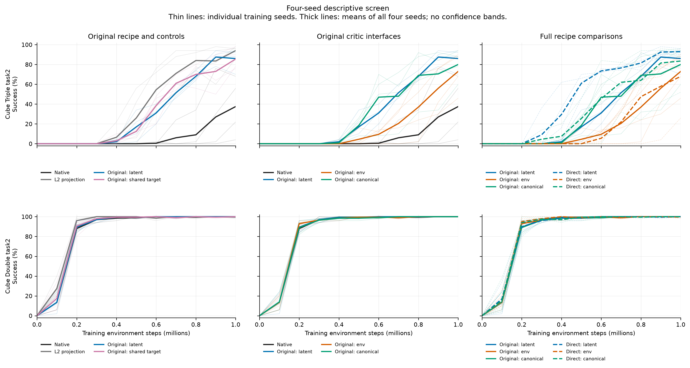
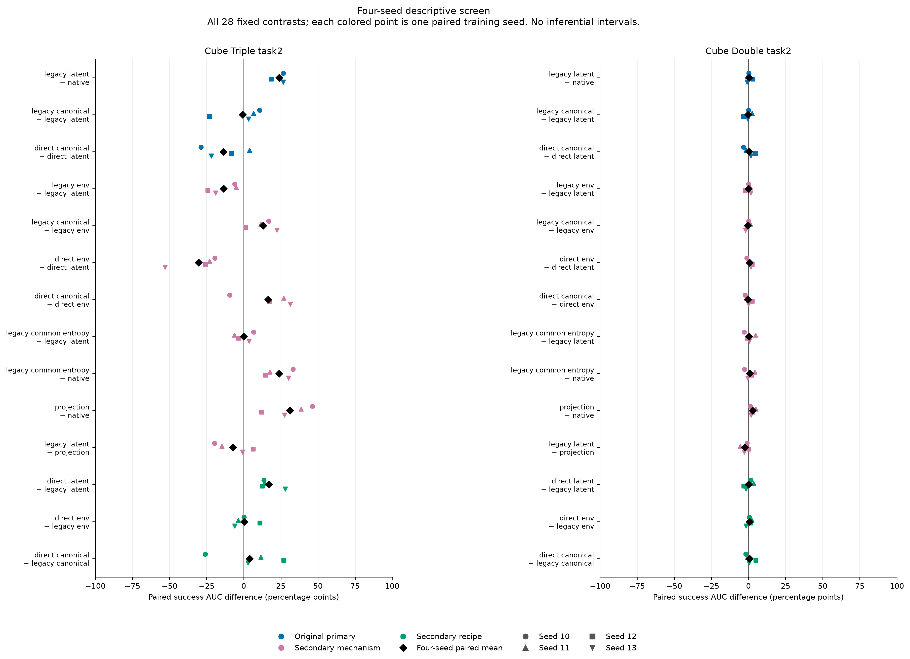
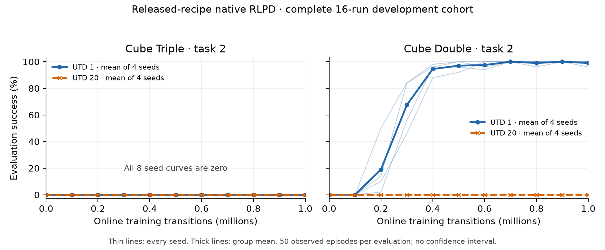
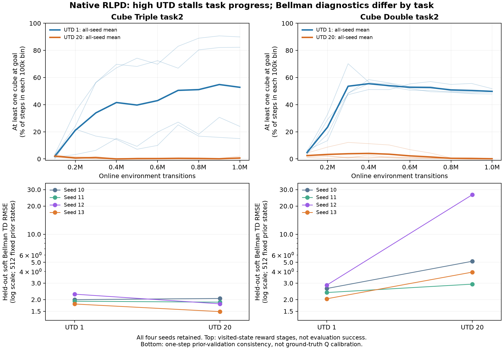

# Post-hoc Action Maps in Off-Policy Reinforcement Learning: Performance and Critic-Gradient Effects

> English working manuscript, 20 October 2026. This draft separates completed development evidence from pending experiments. It is not a submission-ready paper or a claim of established novelty. Operational status belongs in the [runbook](../current/runbook.md); the maintained [research](../current/research.md), [experiments](../current/experiments.md) and [results](../current/results.md) documents define the current study. The earlier MME, DS-FER and temporal-control manuscript is preserved in the [historical archive](../archive/historical_direction_speed_manuscript.md).

## Abstract

Post-hoc action maps change the actions executed by an environment while leaving several choices about policy regularization and critic inputs open. We study these choices in off-policy manipulation learning. A completed development screen comprises nine methods, two OGBench cube task-2 environments, four paired training seeds and one million online transitions per run. The original direction–amplitude posthoc recipe improves normalized success AUC over the native policy by 23.875 percentage points on Cube Triple, but by only 0.400 points on Cube Double. A simple L2 projection has higher mean AUC than the original recipe on both tasks. Critic interfaces that enforce equality across execution-equivalent latent actions eliminate measured Q aliasing, yet do not improve the original recipe's mean AUC. An exploratory analysis of 56 final checkpoints shows that a radial Q component annihilated directly by the execution map can still change executed actions after pullback through actor parameters. These observations motivate a separately frozen, fresh-seed training intervention on that gradient path. A separate 16-run released-recipe native RLPD cohort is complete: only Cube Double at UTD1 learns the task, while the other three task/UTD groups have zero recorded success. Its matched posthoc comparison, FQL and GAC comparisons, the intervention's training outcomes, and held-out-task validation remain incomplete. The current evidence establishes task-dependent development results and a local derivative effect; it does not establish a general performance advantage or the causal source of the posthoc gain.

## 1. Introduction

An action representation affects both behavior and optimization. Normalizing a direction, predicting an amplitude and clipping the resulting command changes the distribution of executed actions. Giving a critic the latent command instead of the executed command also changes the function it learns and the derivatives supplied to the actor. Improvements over a native Cartesian policy do not identify which of these changes matters.

We separate three questions. First, does the complete posthoc recipe reproduce its performance gain under a matched protocol and stronger learning recipes? Second, which changes in execution, entropy convention and critic interface can account for that gain? Third, does a derivative along an execution-equivalent latent direction affect learning through the actor's parameterization? These questions require different evidence: complete-method comparisons, controlled training interventions, and local mathematical or numerical analysis.

The development screen gives a mixed answer. Original posthoc improves Cube Triple substantially relative to the native project learner, while Cube Double is close to saturation. Projection improves both mean AUCs more than the original recipe. Eliminating measured critic aliasing is insufficient for improved performance. Consequently, an independent amplitude head, a canonical critic and a radial-gradient explanation remain hypotheses rather than established contributions. We report all nine methods, retain unfavorable comparisons, and leave unfinished comparison cells empty.

## 2. Action maps and learning interfaces

### 2.1 Original posthoc map

Let the six-dimensional squashed policy coordinate be $z=(u,b,c)$, where $u\in(-1,1)^3$, $b\in(-1,1)$ and $c\in(-1,1)^2$. These coordinates are produced by a tanh-transformed Gaussian in the original recipe. The three-dimensional translation command is formed from the normalized direction and an exponential amplitude:

\[
g(z)=\left[\operatorname{clip}_{[-1,1]}\left(e^b\frac{u}{\max(\|u\|_2,\varepsilon)}\right),c\right].
\]

The radius setting called `sphere` is a reference radial bound of one before multiplication by $e^b$. Since $e^b\in(e^{-1},e)$, it is **not a hard unit-ball constraint**. Clipping is per Cartesian coordinate; executed translation norms can exceed one. The denominator floor is part of the implementation, so the near-zero branch must be preserved in both analysis and validation. “Speed” is the repository's historical name for command amplitude, not measured end-effector velocity.

The `direct` family changes the amplitude squash to sigmoid, uses direct amplitude interpretation and a cube radial bound. Away from the denominator floor, its pre-clipping translation is $\rho R(n)n$, where $\rho\in(0,1)$, $n=u/\|u\|$ and $R(n)=1/\max_i|n_i|$. This is a complete squash/support recipe change. A direct-versus-original contrast cannot isolate a single log-amplitude factor.

The simple projection baseline uses an ordinary five-dimensional Cartesian policy and rescales only its first three coordinates by $\min(1,1/\|x\|_2)$. Its translation lies in the unit ball. Its actor dimension, execution distribution and entropy convention differ from six-dimensional original posthoc. The screen therefore does not treat it as a capacity- and regularization-matched single-factor intervention.

### 2.2 Critic representation and policy regularization

Raw prior and online actions remain five-dimensional environment commands in storage. The learner uses the declared encoder $d$ to form the latent replay representation when required; storage is not overwritten. Actor and target queries use one of three interfaces:

\[
Q_{\rm latent}(s,z),\qquad Q_{\rm env}(s,g(z)),\qquad
Q_{\rm canonical}(s,d(g(z))).
\]

The canonical query is determined by the executed action and hence assigns the same input to execution-equivalent latent commands. This is an interface property, not a guarantee that its value estimates are accurate or useful for learning. The policy regularizer remains a latent-coordinate log probability in all these adapter arms; canonicalizing the critic does not remove redundant latent entropy.

The project's development learner minimizes an actor loss of the form

\[
L_\pi(\theta)=\mathbb E_{s,\xi}
\left[\alpha\log\pi_\theta(z_\theta(s,\xi)\mid s)
-\overline Q_\psi(s,\chi(z_\theta(s,\xi)))\right],
\]

where $\chi$ is the declared critic interface and $\overline Q$ is the mean of ten critics. The default numerical target entropy is −2.5 for native/projection and −3 for the adapter. A separate original-posthoc arm uses −2.5. Equal numerical targets across different coordinate spaces do not match the induced execution entropy.

The development learner is a project RLPD-style fork: actor/critic networks have four layers of width 512, target values aggregate ten Q heads by their mean, entropy is absent from the TD backup, UTD is one, and prior/online samples are mixed equally. It is distinct from the [released RLPD recipe](rlpd_baselines.md), including its network size, target aggregation and update schedule. No development-screen result below is labeled an official RLPD reproduction.

### 2.3 Collection and initialization controls

The first 5,000 environment actions use the driver's raw five-dimensional random warmup and bypass the policy map. All 72 recorded warmup prefixes were checked: each of the eight task/seed groups has an identical float32 action-sequence hash across its nine methods. This covers 360,000 logged action rows. Equal commands alone do not certify an identical complete simulator state, and do not match the subsequent policy's initial executed-action distribution. Matching parameter initialization is also insufficient for that latter claim.

### 2.4 Execution-distribution explanation to be tested

Separate initialization probes retain the same Gaussian heads and noise samples while changing only how their outputs are executed. They show a concrete alternative to a critic-only explanation: Cartesian translation shrinks when direction-head noise is reduced, whereas normalized direction with an independent amplitude coordinate changes that response. At the sampled initial policies, mean norm, small-action probability and conditional covariance need not move together. Matched-state single-step simulator probes also show that this map difference changes physical displacement; the sign of the mean displacement difference changes with the tested noise scale. These are bounded initialization and forward-behavior findings, documented in the [mechanism results](../current/results.md#原版-posthoc-的前向机制诊断). They do not establish that the effect persists after training, that posthoc always moves farther, or that this distributional change causes the task-success gain. A matched training comparison against projection is still required.

## 3. A bounded critic-gradient mechanism

### 3.1 Replay values do not identify every latent derivative

On an idealized replay slice with unit direction coordinates, the functions $Q_0(s,z)$ and

\[
Q_\lambda(s,z)=Q_0(s,z)+\lambda(\|u\|_2^2-1)
\]

have the same values on that slice, but different radial derivatives away from it. Thus fixed-target regression values on the slice need not identify the derivative supplied to an actor. This is a function-level counterexample, with floating-point qualifications discussed in the [method reference](method.md). It does not show that trained MLPs acquire that particular extension, that two complete Bellman fixed points are equivalent, or that canonicalization improves return.

### 3.2 Direct action null directions need not be parameter-update null directions

Consider a smooth branch above the denominator floor. Let $G=D_zg$ and let $v$ be the radial component of the latent Q cotangent in the first three direction coordinates. Positive radial rescaling leaves the normalized direction unchanged, so $Gv=0$. Let $J=D_\theta z_\theta$ for a fixed state and noise sample. The executed-action response to the corresponding Euclidean Q-ascent parameter direction is instead

\[
GJJ^\top v,
\]

which need not vanish. For a local linear parameterization with $J=\operatorname{diag}(2,1,1)$, $u=(0.4,0.4,0)$, map $g(u)=0.5u/\|u\|$, and $Q(u)=\tfrac12(\|u\|^2-1)$, the direct response is zero while the parameter-mediated response is approximately $(0.53033,-0.53033,0)$. An isometric $J=I$ removes this counterexample. Automatic differentiation and finite differences agree for this constructed example.

The expression is local and parameterization dependent. The measured checkpoint analysis uses a batch actor-Q gradient pulled back through the whole actor and evaluates its action response on the fixed panel, including shared-parameter interactions across states. It is not an observed optimizer update: Adam state, step size, clipping, simultaneous losses and subsequent learning can change the effect. Norm ratios and direction-space cosine summaries cannot be interpreted as a percentage of wasted actor updates.

There is also a useful limiting case. If a differentiable latent critic exactly factors as $Q_\psi(s,z)=q_\psi(s,g(z))$, its Q cotangent has zero radial component on a valid smooth branch by the chain rule. The radial-cut and full actor-Q gradients then coincide. Any difference measured by the proposed cut concerns a failure of this local factorization and its learning consequences, rather than a universal benefit of deleting a mathematically necessary policy-gradient term.

### 3.3 Prospective intervention

The separately frozen intervention keeps the forward latent Q input unchanged but replaces its direction-coordinate backward derivative by $I-nn^\top$, where $n=u/\|u\|$ above the fixed norm floor of $10^{-6}$. Below that floor it retains the full derivative. Amplitude and other coordinates are unchanged. Entropy, replay inputs, critic regression and target construction are retained. This is an explicit **surrogate-gradient intervention** in the actor's Q term. It is not claimed to be the ordinary derivative of the logged forward scalar, an unbiased policy-gradient estimator, or a variance-reduction method.

The protocol has 40 runs: the two development tasks, two conditions and ten fresh training seeds 20270–20279, each with one million online transitions. Both conditions are newly trained; screen checkpoints are not substituted for the full condition. The two primary contrasts are cut-minus-full success AUC, one per task. All ten pairs are required. The fixed 20,000-resample paired bootstrap uses seed 20261025 and 97.5% descriptive intervals, with the nominal Bonferroni level for two task comparisons. Finite-sample coverage is approximate; these are not exact tests or equivalence guarantees. All 40 runs must be terminal before outcomes are inspected, and failures remain in the record. Training outcomes are pending.

## 4. Completed development protocol

The screen uses `cube-triple-play-singletask-task2-v0` and `cube-double-play-singletask-task2-v0`, training seeds 10–13, horizon one, nine methods and one million online transitions per run. All 72 runs are terminal and technically accepted with observed process exit code zero. Each contains the actual evaluation grid 0, 100k, …, 1M, a final checkpoint and the expected 995,001 joint updates after collection warmup. The original driver configured 50 episodes per evaluation but did not retain an independently checkable returned episode count. We report that limitation rather than certifying an observed count of 50.

For success fraction $s_k$ at $t_k=100{,}000k$, the AUC reported in percentage points is

\[
\mathrm{AUC}=\frac{100}{10^6}\sum_{k=0}^{9}
\frac{s_k+s_{k+1}}{2}(t_{k+1}-t_k).
\]

Final success is the success percentage at 1M. Means use all four training seeds. Six primary comparisons were frozen before training; 22 additional descriptive comparisons were fixed after training started but before results were unsealed. All 28 are retained in the [complete results](../current/results.md#冻结筛选的完整结果2026-10-20). These are two development tasks and four seeds, not an independent confirmatory suite. We make no confirmatory significance claim from this screen.

## 5. Development results

### 5.1 All methods and task outcomes

| Method | Triple AUC | Triple final (%) | Double AUC | Double final (%) |
|---|---:|---:|---:|---:|
| Native | 6.125 | 37.5 | 84.500 | 100.0 |
| L2 projection | 37.250 | 94.0 | 87.175 | 99.5 |
| Legacy latent (original posthoc) | 30.000 | 86.0 | 84.900 | 100.0 |
| Legacy env | 16.400 | 73.0 | 84.950 | 100.0 |
| Legacy canonical | 29.400 | 80.0 | 84.550 | 100.0 |
| Direct latent | 47.000 | 93.0 | 84.950 | 100.0 |
| Direct env | 16.700 | 68.0 | 85.625 | 99.5 |
| Direct canonical | 33.225 | 83.5 | 85.300 | 100.0 |
| Legacy common entropy (−2.5) | 30.075 | 85.5 | 85.350 | 100.0 |

Original posthoc exceeds native on Cube Triple in all four paired seeds, with differences +26.6, +23.9, +18.4 and +26.6 AUC points. Its mean AUC is 7.250 points below projection on that task. On Cube Double, native and original posthoc both reach 100% mean final success; the small AUC gap should be interpreted in the presence of this ceiling. The comparison therefore supports a substantial task-specific development gain over native, while leaving the value of an independent amplitude head unresolved.

### 5.2 Paired contrasts and unfavorable findings

| Contrast | Triple mean difference; positive pairs | Double mean difference; positive pairs |
|---|---:|---:|
| Original − native | +23.875; 4/4 | +0.400; 2/4 |
| Projection − native | +31.125; 4/4 | +2.675; 4/4 |
| Original − projection | -7.250; 1/4 | -2.275; 1/4 |
| Legacy canonical − latent | -0.600; 3/4 | -0.350; 1/4 |
| Legacy env − latent | -13.600; 0/4 | +0.050; 2/4 |
| Direct canonical − latent | -13.775; 1/4 | +0.350; 2/4 |
| Direct env − latent | -30.300; 0/4 | +0.675; 2/4 |
| Legacy common entropy − original | +0.075; 2/4 | +0.450; 2/4 |
| Direct latent − original | +17.000; 4/4 | +0.050; 2/4 |

The original-posthoc arm with common numerical target entropy retains the Cube Triple gain: +23.950 AUC points versus native, with four positive pairs. This weakens an explanation relying solely on the −3 versus −2.5 target difference. Its +0.075 contrast against original posthoc does not establish equivalence, nor does it exclude an effect of latent-coordinate entropy.

Legacy env loses 13.600 AUC points relative to legacy latent on Cube Triple, and legacy canonical loses 0.600 points. Three canonical pairs improve, but one large negative pair determines the mean. Direct canonical and direct env also lose mean AUC relative to direct latent on that task. These findings disfavor an unconditional claim that removing execution-equivalent critic distinctions improves task learning. Direct latent has the largest observed mean AUC on Cube Triple, but its change in squash and support prevents a single-factor explanation. Its ranking relative to projection is descriptive; that pair was not added retrospectively as a confirmatory comparison.

### 5.3 Critic aliasing at final checkpoints

The frozen critic analysis completed all 56 adapter checkpoints: seven adapter arms, two tasks and four seeds. Each checkpoint uses 128 fixed validation-prior states with both a policy-conditioned and a common-Gaussian panel of execution-equivalent action pairs. All 128 pairs per panel were valid, with no near-zero exclusions. The analysis concerns ensemble-mean Q, not the complete actor objective.

For original posthoc on Cube Triple, the policy-conditioned mean absolute Q alias difference is 0.709731, the relative difference is 0.00624546, and radial Q-derivative RMS is 1.382977. The recorded value `radial_q_gradient_fraction_mean=0.758608` is a mean absolute cosine within the three-dimensional post-squash direction subvector. It excludes entropy and the actor's parameter chain; it is not “76% wasted actor gradient.”

Env and canonical interfaces yield zero alias difference on this panel by construction. They do not yield better mean task AUC, so zero aliasing is insufficient for a performance claim. The frozen summary also lacks full Q-variance and full action-gradient scale information. It cannot establish calibration or assign the original performance gain to aliasing.

### 5.4 Exploratory actor-parameter response

After the screen outcomes were known, a separate analysis evaluated all 56 adapter checkpoints on the same fixed 128 validation-prior states, with one fixed Monte Carlo noise draw per state, seed 20261023. This is a post-outcome exploratory diagnostic. All 7,168 state samples are above the direction floor. No optimizer step or environment rollout is taken.

All 24 latent-critic checkpoints have a direct radial-to-execution response at numerical zero (maximum RMS $5.11\times10^{-10}$), yet a nonzero parameter-mediated response (per-checkpoint RMS range 1.31447–38.73597). The table reports the mean of the four per-checkpoint RMS values within each task and adapter:

| Adapter | Triple parameter response RMS | Double parameter response RMS |
|---|---:|---:|
| Legacy latent (original posthoc) | 3.96048 | 3.76959 |
| Legacy env | 2.95547e-07 | 7.92018e-08 |
| Legacy canonical | 3.0417e-07 | 6.35326e-08 |
| Direct latent | 3.20746 | 1.8704 |
| Direct env | 8.62974e-08 | 4.48186e-08 |
| Direct canonical | 7.99509e-08 | 3.81467e-08 |
| Legacy common entropy (−2.5) | 12.6602 | 2.63946 |

The env/canonical responses are at floating-point scale (largest individual RMS approximately $5.03\times10^{-7}$). Their response per unit radial parameter gradient is undefined below the fixed gradient floor, and is recorded as unavailable rather than zero. The common-entropy latent arm includes a Cube Triple seed with response 38.73597; it is retained in the mean. Raw response units depend on parameterization and Q scale. They are not a dimensionless amplification or wasted-gradient percentage.

Reconstructing the complete actor loss, including entropy, agrees with the original implementation to a maximum error of $5.283\times10^{-7}$, and the Q-gradient decomposition error is at most $5.114\times10^{-7}$. This validates the diagnostic's local accounting. It does not measure Adam's actual update or show that radial inconsistency improves or harms long-run success. The fresh-seed intervention in Section 3.3 is designed to test that learning consequence separately.

### 5.5 Final-policy conditional action geometry

The registered secondary diagnostic completed all 40 eligible checkpoints (native and four original-map variants), retaining four seeds per group. The other 32 screen checkpoints are outside this diagnostic's registered scope. Each task uses a shared panel of 128 prior-validation states and 64 common Gaussian draws per state. Restored checkpoints retain 995001 training updates; the CPU analysis performs no updates or environment interactions. The table reports all ten group means at the original noise multiplier of one.

| Task / method | Mean XYZ norm | Within-state radius SD | Within-state XYZ covariance trace |
|---|---:|---:|---:|
| triple2 / Native | 1.338446 | 0.118393 | 0.133003 |
| triple2 / Original posthoc / latent Q | 1.346353 | 0.156101 | 0.214822 |
| triple2 / Original / env Q | 1.475933 | 0.110536 | 0.110418 |
| triple2 / Original / canonical Q | 1.226905 | 0.118772 | 0.097494 |
| triple2 / Original / target entropy −2.5 | 1.327747 | 0.165189 | 0.234886 |
| double2 / Native | 1.320970 | 0.131125 | 0.190640 |
| double2 / Original posthoc / latent Q | 1.486933 | 0.144138 | 0.321003 |
| double2 / Original / env Q | 1.465405 | 0.117821 | 0.141214 |
| double2 / Original / canonical Q | 1.354835 | 0.115712 | 0.115658 |
| double2 / Original / target entropy −2.5 | 1.501237 | 0.161455 | 0.367328 |

For original posthoc minus native, Cube Triple's mean norm difference is only +0.007907 (two positive and two negative seed pairs), while within-state radius SD and XYZ covariance trace differences are +0.037708 and +0.081819 (four positive pairs each). Cube Double's corresponding differences are +0.165963, +0.013014 and +0.130363, all with four positive pairs. All four frozen noise multipliers (0.2, 0.5, 1, 2) retain four positive radius-SD and XYZ-trace differences on both tasks. Triple's norm difference becomes −0.065481 at multiplier two, with four negative pairs.

A same-head instantaneous execution counterfactual also separates magnitude from dispersion: at multiplier one, replacing the Triple posthoc map with Cartesian execution increases mean norm by 0.026404 while reducing within-state XYZ trace by 0.035724; both directions hold in all four seeds. For Double, posthoc has larger norm and trace than that counterfactual. Thus a uniformly larger executed magnitude is not a sufficient description of these trained policies. These are descriptive fixed-panel action statistics, not online visitation, coverage, task effectiveness or a causal attribution of learning success. The same-head counterfactual does not estimate the result of retraining. All scales, seeds and counterfactuals are retained; derived contrasts introduce no new significance claim.

## 6. Released-recipe baseline and remaining comparisons

### 6.1 Complete native reference cohort

All 16 native runs of the released-recipe RLPD port completed one million environment transitions, with actual driver and scheduler exits of zero. Each task/UTD group retains all four seeds (10–13). AUC uses the actual eleven-point 0–1M / 100k grid. Every evaluation records 50 returned episodes and integral success counts.

| Task | UTD | Mean AUC | Final success % | Tail-3 success % |
|---|---:|---:|---:|---:|
| Cube Triple task2 | 1 | 0.000 | 0.0 | 0.000 |
| Cube Triple task2 | 20 | 0.000 | 0.0 | 0.000 |
| Cube Double task2 | 1 | 72.400 | 99.0 | 99.333 |
| Cube Double task2 | 20 | 0.000 | 0.0 | 0.000 |

The 12 runs outside Cube Double UTD1 have zero success at every recorded evaluation; they are complete zero outcomes, not missing data. Double UTD1 seed AUCs are 69.2, 74.0, 68.2 and 78.2, with final success 96%, 100%, 100% and 100%. All retained training-log scalars are finite, which does not explain the zero outcomes or certify Q calibration. Each run performs 995001 actor and temperature updates; critic updates are 995001 at UTD1 and 19900020 at UTD20.

All 20 frozen external-recipe contrasts are reported in the terminal summary. For example, Double UTD1 native is 12.1 AUC points below the project-screen native. These contrasts change the entire learner recipe and do not isolate the posthoc representation. Native completion alone therefore does not establish a posthoc advantage under the released learner. This cohort remains a descriptive study on two development tasks and four seeds.

### 6.2 Post-outcome implementation and recipe diagnosis

A separate CPU diagnostic used the frozen native source, full 256×256 networks, actual prior data and 64-step engineering replay per task. Executing the frozen driver's batch-construction expression preserves 128 prior and 128 online samples in every minibatch. All four task×UTD cases agree with the pinned, unmodified upstream learner over three update calls, with maximum state difference zero, including optimizer state, counters and RNG. Reward/mask recomputation from the original qpos agrees with the loaded prior; online engineering rewards agree with the environment's pre-action success timing. This provides bounded evidence against an update or input-bridge error, not proof that every historical training input was correct.

The Triple prior has no full-success transition among three million rows; Double has 581 reward-zero/mask-zero rows among one million. All sixteen existing environment logs retain one million consecutive steps. Partial-goal occupancy is the fraction of steps with reward above the all-unfinished value, not episode success. The held-out diagnostic uses 512 fixed prior-validation states per task and the original soft Bellman target without updating the saved agents.

| Task | UTD | Last 100k: partial-goal step % | Held-out soft TD RMSE: mean / median |
|---|---:|---:|---:|
| triple2 | 1 | 52.7895 | 1.9996 / 1.9596 |
| triple2 | 20 | 0.6755 | 1.8055 / 1.8392 |
| double2 | 1 | 49.7910 | 2.4756 / 2.5031 |
| double2 | 20 | 0.1380 | 9.6068 / 4.5338 |

Double UTD20 has higher held-out soft TD RMSE in all four seed pairs; seed 12 is 26.4344 and is retained. Triple UTD20 has slightly lower mean RMSE despite negligible partial-goal occupancy. Thus a universal TD-loss-explosion explanation is unsupported. One-step prior Bellman consistency does not establish Q calibration or identify the cause of poor online control.

The reference uses the released general recipe, not a tuned OGBench baseline. The pinned upstream README changes network depth and disables entropy backup for Antmaze and Adroit, and changes the target subset for Antmaze. This motivates separate checks of recipe suitability; it does not establish which choice caused these failures. Existing native outcomes and the running matched posthoc cohort remain unchanged. The post-outcome diagnostics and preserved observer repairs are stored under `/data/chainpray/qc/control/rlpd_utd20_diagnosis_20261020/`. Any future recipe tuning requires a separately frozen, matched comparison.

A separate completed check evaluates every terminal checkpoint for five stochastic and five deterministic-mode episodes (160 episodes total). Both UTD20 task groups remain 0/20 under either mode; Triple UTD1 is also 0/20, while Double UTD1 is 20/20 under both. These seeds overlap the original evaluation protocol, so the check is descriptive and does not replace the original fifty-episode curves. It provides no evidence that stochastic evaluation alone hid an already successful UTD20 policy.

### 6.3 Pending matched and prospective evidence

The following comparisons have no complete paired performance result. They reuse the authorized four-GPU allocation in the established queue; engineering acceptance is separate from scientific evidence.

| Question | Frozen comparison | Evidence status at this revision |
|---|---|---|
| Does the result hold under a released RLPD learning recipe? | Native 16 runs and original posthoc 16 runs; two tasks, four paired seeds, UTD 1/20 | Native 16/16 complete; matched posthoc training started; complete paired performance unavailable |
| Does the complete map transfer to another learner? | FQL native/posthoc, 16 runs, 1M offline plus 1M online transitions | Engineering validated; long-run comparison pending |
| Is the method competitive with a geometric-action algorithm? | Released-code GAC, 32 runs, radii 1/2.5 crossed with online-only/prior-balanced protocols | Source and protocol frozen; full comparison pending |
| Does the radial actor-Q path affect learning? | Full/cut 40 runs on ten fresh seeds | Protocol and runtime frozen; training not started |
| Is the amplitude map useful beyond a matched projection? | Shared six-dimensional actor and regularization with Cartesian auxiliary / projected auxiliary / direction–amplitude execution; 60 prospective runs on ten new seeds | Both tasks passed local Ada engineering with actual constructor captures; protocol/terminal analysis frozen; continuation armed after the existing queue; 4090 engineering and long-run outcomes pending |
| Does any gain generalize beyond these development tasks? | Held-out tasks and broader domain evaluation | Not completed; no generalization claim |

The RLPD port preserves its distinct critic/actor update ratio, random two-Q minimum target and entropy backup, while adapting data, collection and evaluation to OGBench. It is not a byte-for-byte reproduction of the upstream locomotion driver. FQL has a flow teacher and distilled student; its distillation coefficient is not a SAC temperature. GAC is a complete competing algorithm rather than a one-factor map replacement. Its frozen comparison targets released code at a fixed commit: the paper's normalized-mixture sampling formula and released sampler differ, and the registered radius comparison does not include every adaptive-radius variant. The [RLPD](rlpd_baselines.md), [FQL](fql_baseline.md) and [GAC](gac_baseline.md) references record these boundaries.

## 7. Related work and scope of the estimator claim

[Efficient Online Reinforcement Learning with Offline Data](https://proceedings.mlr.press/v202/ball23a.html) motivates the independent released-recipe RLPD comparison. Its released learning recipe is kept distinct from our project's development fork. The native reference cohort is complete; its pending matched posthoc comparison determines whether the observed gain survives that change of learner.

[Action Space Design in Reinforcement Learning for Robot Motor Skills](https://proceedings.mlr.press/v270/esser25a.html) studies task-dependent effects of action-space choice, including initialization and behavior. Our common warmup and parameter controls do not establish a new initialization-matching technique or remove this alternative explanation. [Beyond Distributions: Geometric Action Control](https://proceedings.iclr.cc/paper_files/paper/2026/hash/e58fa42d4b7a798eef8d0d75098f87ad-Abstract-Conference.html) provides direct geometric-action prior work and a competing algorithm. We do not claim the first use of normalized directions or amplitude-related action control.

[Clipped Action Policy Gradient](https://proceedings.mlr.press/v80/fujita18a.html) modifies likelihood-ratio scores for a clipped action distribution using boundary probability masses. Its guarantees under its stated conditions do not justify deleting all gradients in a clipped region. [Marginal Policy Gradients](https://arxiv.org/abs/1806.05134) studies pushforward marginal scores, including angular policy gradients for normalized Gaussian actions. Its regularity and execution-dependent weighting conditions must be checked before importing its identities. Our actor-Q cotangent intervention neither computes that marginal score nor inherits an unbiasedness or variance-reduction guarantee.

The current direction distribution normalizes a **tanh-transformed** Gaussian, not the raw Gaussian of the angular example. For its smooth valid branch $V=\{\|U\|>\varepsilon\}$, ordinary polar coordinates give the conditional directional density

\[
p(N=n\mid V,s)=\frac{\int_{\varepsilon}^{1/\max_i|n_i|}
p_U(rn\mid s)\,r^2\,dr}{\Pr(V\mid s)}.
\]

This is only the valid-branch direction marginal with respect to sphere surface measure. It is not the five-dimensional executed-action density. The near-zero branch, amplitude, clipping and any induced boundary mass require separate treatment. We do not replace the frozen latent-entropy objective with an unverified angular likelihood.

[Action Redundancy in Reinforcement Learning](https://proceedings.mlr.press/v161/baram21a.html) distinguishes action entropy from exploration of transitions and develops the MinRed action-posterior/redundancy-bonus approach. Our canonical critic retains latent-coordinate entropy and does not implement that bonus. The relevant potential contribution is therefore a precisely scoped empirical analysis and controlled training intervention for a particular map/critic/learner combination. The reviewed papers do not certify its novelty; broader positioning remains open.

## 8. Limitations and claim readiness

The completed evidence uses only two development tasks and four training seeds. Cube Double has a final-success ceiling. The project-screen evaluation logs cannot independently certify episode counts; the separate native reference cohort does record 50 returned episodes per evaluation. The project learner differs materially from the released RLPD recipe. The projection baseline differs in dimension and regularization. Direct amplitude changes multiple factors. A zero-alias critic need not be calibrated, and a local gradient response need not predict an optimizer or learning outcome. The actor diagnostic was designed after screen outcomes were known.

Historical posthoc results remain supplementary provenance, not independent confirmation of this study. A separate reanalysis of 200 old runs retained all task1–5/H1/H5 settings and their zero results. Those files do not independently certify the historical process exits, executed source or evaluation RNG, and their observed 100k–1M AUC must not be pooled with this screen's actual 0–1M grid. Earlier synthetic, MME and temporal-control results are preserved in the historical manuscript without being presented as evidence for the current robot method.

Before a submission can make a stronger performance or mechanism claim, it needs the completed released-recipe native/posthoc comparison, competitive and cross-learner results, the fresh-seed intervention with all failures retained, and validation outside the development tasks. A null or negative intervention result must constrain the mechanism claim. The present manuscript deliberately leaves the general-performance and causal claims unresolved.

## Appendix A. Reproduction and source bindings

The completed screen is bound to training source `ccab449959475494450942578a474294f55f5520`. Its terminal report SHA-256 is `81891a0d2f61029929e599797970a9be3f70e4b52f63e393dbad897ee75a7f06`. Published local reports are stored under `/data/chainpray/qc/reports/action_adapter_validation_20261019/`; these are local reproduction paths, not an assertion of a public artifact release.

| Evidence | Local artifact in that report directory | Interpretation |
|---|---|---|
| All 72 runs, grids and updates | `screen-report.json`, `screen-per-seed.csv`, `screen-method-means.csv` | Completed development performance |
| All fixed pairwise comparisons | `posthoc-screen-comparisons.json` | Six original plus 22 later-fixed descriptive comparisons |
| Original critic diagnostics | `critic-invariance.json` | Published augmented report, distinct from the original raw remote report |
| Final-policy conditional geometry | `posthoc-final-policy-probes.json`, `final-policy-summary.json`, `final-policy-288-seed-cases.csv`, `final-policy-72-case-means.csv` | All registered 40 checkpoints; four frozen noise scales; no learning intervention |
| Local actor-parameter analysis | `posthoc-actor-radial-response.json`, `posthoc-actor-radial-summary.json` | Post-outcome exploratory derivatives, no training steps |
| Provenance and plots | `terminal-screen-evidence-binding.json`, `actor-radial-evidence-binding.json`, `figures/figure-receipt.json` | Source/report/checkpoint bindings |

The separate native reference cohort is bound to training source `2c2d0c3054aebf6025f13a0836c12feeff2ab776`. Its raw report at `/data/chainpray/qc/reports/action_adapter_reference_20261019/reference-report.json` has SHA-256 `683f17ecc1d3b85061e926e22f33ae6b28ff58ec6de0f099ac6cc1c7c768596a`. The same directory contains `reference-summary.json`, all 16 seed rows, all four means, all 20 external-recipe contrasts and `figures-r2/figure-receipt.json`. Independent read-only acceptance is recorded under `/data/chainpray/qc/control/action_adapter_reference_20261019/terminal-audit-20261020-r2/`. It rechecks original evaluations, source/runtime bindings and all checkpoint bytes; finite states and optimizer counts use the frozen per-case validator records, rather than a second independent deserialization. The first observer field-name failure and its observer-only repair are retained.

The prospective actor-Q protocol is frozen at `/data/chainpray/qc/control/posthoc_actor_q_ablation_20261020/plan.json`, SHA-256 `0116e96c8ee634fd3567aab2caf59a22d2029f29e4a0ee336a6a7947e9ed737c`, with training source `db861f3c1217c642d8138453630f8a2b8f275219`. Runtime versioning and engineering repairs are recorded separately and do not overwrite the plan or failed engineering evidence. The current four-GPU queue does not gate later scientific cohorts on favorable performance.

The table-generation inputs and this manuscript's preservation record are under `/data/chainpray/qc/control/posthoc_manuscript_20261020/`. Numerical tables are generated from terminal reports, not manually selected best seeds. There are no substituted outcomes for pending cohorts. Exact execution commands and current process status remain in batch control records rather than this manuscript.

A separate matched-map engineering matrix at training source `db861f3c1217c642d8138453630f8a2b8f275219` completed both tasks and all three six-dimensional maps on local RTX 6000 Ada GPU 0. Each of six drivers completed 64 transitions and 33 updates; six final independent CPU restorers compared 150 state leaves each. Actual constructor captures before initial evaluation have identical serialized parameter/optimizer/RNG state within each task, and the 32-action warmup prefixes match. This is distinct from earlier configuration-based reconstruction. The initial checkpoint-restoration interface error and its read-only repair are retained; no driver was repeated. The audit is stored at `/data/chainpray/qc/control/posthoc_execution_map_capture_20261020/pairing-audit.json`. This establishes a bounded local engineering control, not simulator-state matching, execution-distribution matching, a 4090 validation, or a learning-effect estimate.

Following that engineering audit, a prospective 60-run protocol was frozen for the two development tasks, three maps and seeds 20290–20299. The four primary contrasts compare direction–amplitude execution against each of Cartesian auxiliary and projected auxiliary, separately per task. Each task requires its complete, matched three-map panel before group means. The protocol uses ten paired seeds, actual 0–1M/100k success AUC and descriptive 98.75% paired bootstrap intervals (20,000 draws; the same seed 20261028 generates paired resampling indices for each contrast), with a nominal Bonferroni convention for four primary contrasts and approximate coverage. Each evaluation must record 50 completed episodes. The comparison estimates a complete map effect under the common env critic and latent regularizer, not a single amplitude-head effect or the original latent-Q recipe's effect. No run is reused from the screen. The plan at `/data/chainpray/qc/control/posthoc_matched_map_study_20261020/plan.json` has SHA-256 `0b03d10bafadb9fa3431194fe3c56f6804604d3e8be4aefd9921e39e84ca5f82`; its original prelaunch metadata correction is preserved. A separately versioned continuation (`9cd028f`, runtime specification SHA-256 `6b0eb9c07af4c42aa9f1cd15aa67c4f75156551c20ea567195c768650f38243f`) is now armed on the existing four-4090 job, waiting for the preceding 40-run technical terminal and idle GPUs. Local and cloud CPU checks passed, and one bounded local Ada integration verified actual driver/validator exits; the required six-case 4090 engineering and these 60 training outcomes remain pending. All 60 source-bound process exits must be verified before the first outcome is read; failures and unmatched panels are retained without partial task means.
