# Action-adapter：实验依据与论文工作稿

> 按需参考 · [文档入口](../index.md)。本文保留详细说明或工作稿；当前执行和结果分别见 [日常实验](../current/experiments.md) 与 [当前结果](../current/results.md)。

> 历史英文候选题目：**Beyond Local Covariance: Manifold-Matched Exploration for Continuous Control**
>
> 历史方法暂名：**MME-DS**（Manifold-Matched Exploration with a Direction–Speed Instantiation）；DS-FER 保留为语义正则化扩展名，尚非本轮 action-adapter 已确定的论文方法。
>
> 历史初稿状态：原正文更新于 2026-09-26，当前 action-adapter 证据边界修订于 2026-10-19。旧受控实验包含 32-seed 确认，不能替代本轮机器人方法的确认；不可直接作为投稿终稿。

> 2026-10-10 编辑说明：下方旧版正文与历史实验叙述予以保留，不能与正在执行的新一轮实验混为一谈。当前研究同时考察动作支持、噪声几何与分量时间尺度，主要平台为 OGBench，稳定后才开展 Robomimic 和其他算法迁移。新增时间分层研究的可证伪问题、真实实现和已注册实验见下一节。新一轮成功率尚未解封；技术完整性检查不是算法性能结果。

## 2026-10-19：当前主线与证据边界

当前优先验证完整 action-adapter。历史 posthoc 的正向结果与后来的 direct-speed critic
消融属于不同配方；不能用后者直接解释或否定前者。已从当前固定 HF revision 的 200 次
原版运行重新读取 400 个文件并核对旧索引哈希，统一计算 1M endpoint、末三次均值，以及
实际观测的 100k–1M AUC，包含 task5 的全零结果。回顾性结果和完整图表见[当前结果](../current/results.md)。
这些文件不能独立认证旧进程退出码、执行源码或评估 RNG，不能当作新确认实验。

| 证据 | 对应配置与范围 | 当前能支持什么 |
|---|---|---|
| 原 posthoc | Cube-Triple task1–5，H1/H5，各十配对 seed | task1–4 的八组平均 observed-AUC 差均为正，task5 两组为零；完整方法值得优先复现 |
| 2026-09-25 critic 消融 | sigmoid/direct，cube/sphere，task2 H1，各四 seed、500k | 该 direct 配方对 critic 接口敏感；不能转用于六月 tanh/log 配方的因果解释 |
| 本分支冻结筛选 | 两任务、四 seed、九方法、1M，共 72 运行 | 比较完整 legacy/direct 配方、等宽 canonical、env critic、投影与熵目标；长程结果尚缺 |
| 外部 RLPD 配方 | 独立的 16 运行、UTD=1/20 | learner 数值对照与短测已通过，正式性能尚缺；不是纯动作表示干预 |
| 同 RLPD 配方的原版 posthoc | 新增独立 16 运行，配对既有 16 个 native，UTD=1/20 | 十二类数值核对和真实 GPU 短测通过，批次已冻结接续；长程结果尚缺，不是 fresh-seed 确认 |

论文须先回答完整方法能否在统一协议下复现及迁移，再解释 critic、熵目标与动作支持的贡献。
Canonical 只约束价值接口，保留潜动作熵；不得写成已经消除冗余探索或证明样本效率提高。
后续仍需独立 seed 确认、开发任务之外的任务、强基线与跨算法/跨域证据，不能把工程通过
写成顶会投稿准备度已经成立。原版数值没有填入尚未执行的新批次，执行设计见[当前实验](../current/experiments.md)。

以下选择性持续控制、MME、DS-FER 的正文保留为历史工作稿。标题中的“当前”、数值与执行
状态均相对于原段落日期，不代表本分支正在执行那些实验，也不是本轮论文的已定结论。

## 历史研究分支：方向慢、幅度快的选择性持续控制

### 研究问题与候选贡献

机器人平移指令可以分为方向和幅度，但分解本身不足以构成新算法贡献。本研究考察一个更具体的问题：**当任务要求持续朝一个方向接近目标，同时需要快速调整步长和其他控制量时，仅让方向保持多个环境步，是否比逐步重采样或重复整个平移动作更有效？** 候选贡献是分量选择性持续控制及其适用边界，而不是泛化的“时间抽象”“动作重复”或“球面动作”首创。

本文数学定义使用 direction–amplitude。幅度是归一化动作指令的大小，不是观测得到的末端物理速度。“Direction–speed”只作为项目的惯用简称。对当前时间分层实现，执行动作写作

\[
a_t=[v_t,c_t],\qquad v_t=\rho_t u_t,
\quad u_t\in S^2,\quad 0<\rho_t<1,\quad c_t\in(-1,1)^2.
\]

因此当前新采样平移指令位于单位球内。它不是旧版全文所述的完整 box 径向覆盖映射 \(v=\rho R(u)u\)。先验数据中的原始 cube 动作保留不变；先验支持与新采样支持的差异必须披露，不能把当前实验描述成所有数据均已投影到球内。

### 控制器与学习接口

方向、幅度、yaw／夹爪分量通过顺序条件策略采样：

\[
\pi(u,\rho,c\mid s,m)
=\pi_u(u\mid s,m)\,
 \pi_\rho(\rho\mid s,m,u)\,
 \pi_c(c\mid s,m,u,\rho).
\]

其中 \(m\) 表示保持分量及剩余时间的控制器记忆。它不是三个互相独立的分布。当前方向头使用两维 Gaussian 的立体投影，幅度头使用 sigmoid 变换，其他分量使用 tanh 变换，并包含各自变换的密度项。在冻结实现中，actor 正则使用活跃分量的条件语义 score；该 score **不是五维执行动作的体积密度**，也不是“继续保持”这个离散事件的概率。当前设置是每次刷新事件的正则约定，不能把不同刷新频率的比较直接解释为只改变了物理控制时间尺度。

当前 learner 使用 QC 改写的 RLPD-style prior／online 对称混合：每次 minibatch 为128条先验样本加128条在线样本，UTD=1，十个 Q head，actor／critic 各四层512单元，critic 使用 LayerNorm，学习率 \(3\times10^{-4}\)，primitive-step 折扣 \(\gamma=0.99\)，target EMA 系数0.005。无离线预训练、BC权重为0，TD target 不含熵 backup。它不是未经修改的上游 RLPD 复现，也不应在论文中笼统称为标准 SAC。

时间持续决策还要求准确说明 critic 的记忆输入。当前冻结实现使用 arm-specific 的控制器记忆编码以及所选分量特征；这与旧版正文中“critic 永远只看无记忆的环境动作”的假设不同。这里评估的是已经定义的控制器／正则／记忆接口组合。未来机制实验需要共同的 Markov 记忆表示与容量、信息访问匹配的 critic 对照，不能仅因记忆向量宽度相同就声称这些混杂已消除。

### 已注册的40次主实验

主实验为两项 OGBench manipulation 任务 Cube Double task2 与 Scene task2，四种控制器，五个训练seed（72300–72304），每次500,000环境步，共40次／20M预定交互。四种方法共享当前方向–幅度参数化，而不是把 R 当作原始 Cartesian Gaussian：

| 控制器 | 方向刷新 | 幅度刷新 | yaw／夹爪刷新 |
|---|---|---|---|
| R：逐步控制 | 每步 | 每步 | 每步 |
| D：方向保持 | 每5步 | 每步 | 每步 |
| T：平移重复 | 每5步 | 每5步 | 每步 |
| F：完整动作重复 | 每5步 | 每5步 | 每5步 |

预算以 primitive environment steps 计量，不按 manager 刷新次数折算。前5,000步使用预定初始化采集，冻结入口在第5,000步开始更新，因此最终预定 optimizer 更新计数为495,001。每次实验在0、50k、100k、…、500k共11个轴评估：每轴50个 stochastic-primary episode 与20个 latent-location-secondary episode，共770个预定episode。两种评估策略分别报告；secondary 不能替代缺失的 primary。

成功标签使用实际最后一次返回转移的官方 success，即 **LAST**。一次episode中较早出现过 success，但最后返回 success=False，必须计为False；未启动、未闭合或失败episode保留为UNKNOWN，不能删除、补False或缩小分母。历史 noise screen 使用的 EVER 口径与本轮不同，二者不作同口径效果拼接。

主要对比为同任务、同seed的 D−T，主要指标是归一化成功率曲线的早期梯形AUC：Cube Double窗口0–300k，Scene窗口0–100k，均保留实测axis0。D−R和D−F为次要对比。每个seed内先配对再汇总，不混合任务或两种评估策略。seed72300使用本地硬件，另外四个seed使用云端4090；报告 local／cloud 描述性分层，不能据此识别硬件因果作用，也不能把五个seed当作硬件完全同质的重复。

当前 D−T 可以回答已定义的控制器组合是否改善早期利用／探索效率，**不能单独证明“幅度的快反馈”就是因果机制**。后续机制确认应补方向时钟×幅度时钟的2×2设计：R=(1,1)、D=(5,1)、A=(1,5)、T=(5,5)，同时保持其他分量逐步更新，并分别控制每事件与每环境步的正则强度。交互量 \((D-T)-(R-A)\) 是可检验假设，不是已经取得的结果。新增A、period／rate扫描和跨算法实验尚未执行。

### 当前结果边界与迁移顺序

#### 基线身份与下一轮必要对照

原项目 RLPD 入口默认 `horizon_length=5` 与 action chunking，产生25维动作队列及多步目标；不能把该默认配置标成逐步五维基线。下一轮逐步基线必须显式指定 `horizon_length=1`，而非仅关闭 chunking。原 pinned RLPD 的单步策略为只读观测的五维 TanhNormal，对应 cube 动作域，critic 读取观测与真实动作5；本轮40次中的 R 则是 DS reactive，对照的是时间控制器而非原始 Cartesian 参数化。

候选 canonical DS-R 和 autoregressive Cartesian-R 使用共同历史记忆、前缀条件采样及联合 packet9，平移动作域均为单位球，不能用后者替代原 RLPD 基线。下一轮至少保留三组明确分开的比较：原始 RLPD K1；同新家族内 DS-R 对 autoregressive Cartesian-R 的参数化比较；共同接口下 R/D/A/T 的时间时钟比较，并分别报告每事件／周期补偿正则。跨这些组的差异同时包含动作支持、上下文与 critic 增广、策略表达及熵测度；原 TanhNormal 与 semantic 策略的 log-scale 下界也不同。相同网络宽度、初始中心或局部协方差不构成这些因素的等效性证明。此处是已核对源码的实验设计约束，尚未报告这些新增对照的真实收益。

这里的“原项目 RLPD”指项目 pinned ACRLPD fork，而非原作者代码的逐字复现。原作者[配置](https://github.com/ikostrikov/rlpd/blob/main/configs/rlpd_config.py)设置10个 Q 与2个 target 子集，[更新实现](https://github.com/ikostrikov/rlpd/blob/main/rlpd/agents/sac/sac_learner.py)使用子集最小值、更新后 critic 的 EMA及多 critic 更新后一次 actor 更新；项目当前使用均值聚合、更新前 EMA 与 UTD1。因此正式算法比较还需明确报告 fork 配方，并补足原作者配方或说明适配差异，不能把方法对当前 fork 的比较直接宣称为对原始论文算法的完整复现。

#### 独立下一轮实现与初始化诊断（2026-10-11）

候选家族还完成了一次独立标识的真实 CPU 闭环工程运行：Cube Double task2、D／K5、seed0，完整512×4／10-Q网络，原5,000步初始化采集后12次策略动作、13次128prior+128online更新。真实环境共交互5,012次，均匀 replay 实际抽到5条 learned packet 和1,659条 warmup packet；模型／Adam时钟为14／13，所有更新有限，返回环境正常关闭，外部进程实际退出0／54.464秒。没有采用小网络或模拟物理回调，也没有导出权重。这只验证 CPU 采集—replay—网络更新闭环，不是50万步正式训练、GPU吞吐、成功率或跨域收益证据。

随后，同一固定工程配方在本地 RTX6000 Ada 的指定 GPU1 上实际完成 CUDA 闭环：单 GPU、float32、原始数据加载及真实物理环境，5,000次 uniform 加12次 learned控制、13次完整网络更新；均匀 replay 实际抽到5条 learned及1,659条 warmup，模型／Adam时钟14／13，全部更新有限，返回环境正常关闭，真实子进程退出0／96.260秒。该运行与现有图形应用共享GPU，未导出模型或执行成功率评估。首次更新25.384秒包含冷启动工作，且stderr保留了 XLA／xtile fusion诊断；日志未明确报告数值比较失败或CPU fallback，但诊断触发原因尚未确认。**这补充了该家族真实GPU可执行性的工程证据，不构成稳态吞吐、CPU/GPU数值等价、50万步完整native实验或机器人成功率证据。** 报告与外部真实wait保存在 `canonical-real-closed-loop-gpu-engineering-current/actual-root-once-v1/`，原CPU及正在进行的正式实验不变。

#### 实现效率诊断：原 Base907 家族，非方法收益

为定位低GPU利用率，另行执行原 Base907／T／Cube task2 的两次真实工程诊断：旧list replay与连续数组 replay各一次，均为seed0、完整512×4／10-Q、batch256=128prior+128online、UTD1，15,200 primitive训练步和10,201次更新。首调用及settling后，每次保留10,000次稳定阶段更新，实际窗口分别145.668秒与100.274秒；两进程退出0、更新有限、环境正常关闭，没有模型或评估输出。

| 稳定阶段条件性计时 | 旧list replay | 数组 replay |
|---|---:|---:|
| 含完整步骤的平均耗时 | 14.555 ms | 10.016 ms |
| 完整checked采样 | 4.647 ms | 1.013 ms |
| 更新完整调用，包括校验／提交／等待 | 5.447 ms | 4.790 ms |
| 动作可用等待与检查 | 2.189 ms | 2.070 ms |
| CPU Env.step | 1.584 ms | 1.523 ms |

旧版采样占该运行单步时间约31.9%，CPU仿真约10.9%；这支持先优化replay与主机提交／同步，而不是预设仿真占主导。表中更新完整调用包含其内部阶段，不能重复相加，也不能把host enqueue时间当独立GPU kernel耗时。两次各142,459条原始技术计时事件均完整保留，未截断。**运行与图形应用共享GPU、顺序各一次、包含instrumentation且无评估，不构成独占吞吐、replay-only因果提速或正式50万步实验加速证明。** 两次末模型及最后batch哈希不同，来源尚未定位；同archive/source/data-binding描述不自动证明同派生prior或同在线轨迹。实际singletask注册关闭block permutation，不能用构造器默认随机排列解释这一差异。后续需在共同实际输入上核验两sampler及初始prior／模型／物理状态绑定，再评估速度归因与部署。原40次训练保持不变。实测摘要在 `temporal-hotpath-real-diagnostic-current/actual-root-pair-v1/derived-technical-summary-v1.json`。

随后，独立同输入CUDA核验实际完成：同一真实Cube task2环境、prior、Base907／T模型和在线数据流，同时供给旧版与数组版采样器；每更新各采样一次，严格比较类型、dtype、shape、字节、完整provenance及两组sampler RNG状态，全部通过后只由旧版batch更新唯一模型。15,200次环境交互中，10,201对采样均一致、无首次差异；10,201次模型更新有限，模型／Adam时钟10,202／10,201，31次显式reset，返回环境正常关闭。外部真实wait退出0／231.437秒，无超时、重试、权重或评估输出。这支持**本次共同输入与固定配方下的采样一致性**，不是两套独立训练轨迹等价、此前末模型差异的归因、加速或并发容量证据。双采样和逐字节检查的额外开销使该时长不适于速度比较。报告与真实wait在 `temporal-replay-same-input-current/actual-root-once-v1/`；原40次实验保持不变。

#### 条件性共享GPU吞吐测量（2026-10-12，非学习收益）

同输入核验后，在本地RTX6000 Ada GPU1上另行执行固定顺序的数组replay单任务→双任务工程测量，保留完整Base907／T／Cube task2／K5／seed0／per_event／512×4／10-Q／128prior+128online／UTD1。三项独立任务各完成15,200次训练接口交互、10,201次有限值更新和10,000次稳态更新，返回环境正常关闭、外部真实退出0，没有权重或成功率评估。双任务分配CPU22,23和24,25；已有图形应用和GPU0其他训练保持不变。

| 条件性实测指标 | 单任务 | 双任务 |
|---|---:|---:|
| 共同稳态窗口 | 103.864 s | 110.765 s |
| 窗口内实际完成更新数 | 10,000 | 9,914 + 9,988 |
| 聚合更新吞吐 | 96.280 /s | 179.678 /s |
| 各任务完整稳态吞吐 | 96.280 /s | 89.674／90.174 /s |
| 整卡GPU利用率点采样均值 | 43.10% | 61.75% |
| 整卡已用显存点采样最大值 | 8,584 MiB | 9,291 MiB |

聚合吞吐比值为1.866；分母是两任务真正稳态区间的交集，分子由原始NN更新事件在该窗口内的结束点逐条计数，不是相加非共同窗口的单任务速率。独立只读核验重新计算了完整事件计数、产物绑定及资源统计。GPU点采样包括图形及整卡其他工作，算术均值不是时间加权均值或训练独占指标；资源时间戳在GPU查询和CPU读取之后记录，端点间隙只描述记录锚点，不保证底层查询全部严格处于共同窗口。固定顺序、CPU核位置、图形负载、采样开销和独立演化的轨迹仍是混杂因素。故以上只支持**本地共享环境中的条件性工程吞吐观察**，不是replay因果提速、独占容量、云端4090性能或RL成功率证据。stderr保留XLA诊断与Box精度警告，未确定触发原因，不能称无异常日志。证据在 `temporal-shared-throughput-current/actual-root-cohorts-v1/`，独立核验为 `temporal-shared-throughput-review-current/actual-readreview.json`；不由此自动执行四／六任务或修改原40次实验。

#### 下一轮共同接口与初始化控制

为支持方向时钟×幅度时钟的2×2确认，我们另行实现了共同决策前记忆的候选家族：所有 R/D/A/T 使用相同的历史方向3、历史幅度1、历史执行命令5和共享相位1；actor 在原记忆10之外附加当前条件采样 prefix4，critic 读取原记忆和联合 packet9（执行命令5、当前所选方向3、当前所选幅度1）。该 packet 定义后续控制器状态，不因两个平移向量恰好相同而丢失所选持久 token。该家族是新的学习接口，不是对正在运行的40次实验的热修复，也不声称等价于当前 arm-specific 记忆接口。

其 Cartesian-R 对照使用同容量的 autoregressive `zx→zy→zz→其他分量` 和 `x=z/sqrt(1+||z||²)` 球内映射，而不是标准对角 Gaussian 基线。它与 DS 使用相同的连续语义参考测度；保持因素不被赋予虚构的五维动作体积密度。独立小网络测试及正式宽度512×4／10-Q／batch256的 DS-D、Cartesian-R 各一次真实 Adam 更新均已通过。完整 native 训练／评估接口的源码接入与独立回归也已完成，正式宽度 DS-D 初始化和更新后快照通过了精确字节恢复及只读策略回调检查。随后真实 CPU 输入检查调用原加载器与新 immutable prior 接口，Cube Double／Scene 各100万转移的原动作、任务 bootstrap mask、观测和 chronology 字节均保持，两个返回的 Env 正常关闭，实际数据子进程退出0／14.089秒；该输入检查未额外执行在线 step 或训练。**这些与上述5,012步检查共同补充了真实数据和短程 CPU 闭环证据，仍未验收该家族的正式50万步 GPU训练／评估，尚无该家族的机器人成功率结果。**

初始化保留 DS 的 +X 中心与幅度0.4，并解析匹配 Cartesian 的命令中心和一阶 `JΣJᵀ`。但有限噪声下的分布不能由此视为相同。使用冻结采样器，各262,144个初始化随机样本得到：

| 初始化诊断量 | DS-R | Autoregressive Cartesian-R |
|---|---:|---:|
| 平均 X 归一化指令 | 0.388260 | 0.391027 |
| 该均值的 Monte Carlo 标准误 | 0.000177 | 0.000187 |
| X 指令的有限噪声方差 | 0.008231 | 0.009144 |
| 平均归一化幅度 | 0.403786 | 0.407763 |

两者的确定性 mean-location 都为 `(0.4,0,0,0,0)`，局部协方差都为 `diag(0.009216,0.0064,0.0064,0.09,0.09)`；上表却呈现不同的有限噪声矩。这里的标准误只衡量该 Monte Carlo 估计，不是 RL 多seed不确定性，指令也不是物理速度。这一诊断要求后续论文只声称**初始中心与局部协方差匹配**，而非完整噪声、熵或有效策略容量匹配；更不能据此把未来回报差全部解释为时钟因果效应。诊断证据保存在 `/data/chainpray/qc/archive/consolidated-legacy-storage-20261018/project-evidence/evidence/legacy-sdd-20261013/root-sdd/2026-10-09-eight-gpu-orchestration/canonical-temporal-root-decision-current/initial-law-evidence.json`。

离线记忆扩增须与真实控制器历史明确区分。候选家族保留原数据的一步物理动作和转移，同时独立生成假设控制器记忆与所选 token；它不是从示范动作反演得到的真实方向／幅度历史。可条件性地定义共同干预核：状态为完整物理状态与控制器记忆 `(x,m)`，联合指令为 `(a,u,ρ)`，物理部分按 `P_phys(·|x,a)` 转移，记忆部分按确定性的 `G(m,a,u,ρ)` 推进。各 R/D/A/T 策略只在该较大干预域的相应受限子域发出动作。在物理一步与纯软件记忆写入无关、任务标签一致等前提下，这是反事实的一步转移扩增；**不是已观测 manager replay，也不证明真实行为分布覆盖目标策略查询。** 特别地，离线原 cube 动作可使 T 的假设缓存暂时落在单位球外，因此不能把整个离线扩增域宣称为在线球内策略的可达域。

我们在两个已知标量动力学系统上进行了有限时域机制检查：调用未修改的真实采样器、控制器、replay 和 Bellman target，只把目标 critic 替换成已知解析值；独立参考计算直接展开两／三个奖励的物理 rollout。开发者与独立审查者各一次 CPU 运行的8项检查均通过，覆盖 R/D/A/T 的刷新／保持／相位回绕、原动作覆盖、T 球外缓存、终止屏蔽、超时前真实下一观测和下一条控制指令一致性。三奖励负控中，错误使用上一步记忆或错误提前刷新会产生不同的解析回报，说明检查确实对记忆推进敏感。**这是有限测试点上的接口与数学机制证据，不是无限时域收敛、真实 OGBench Markov 性、支持覆盖或收益证明。**

真实输入与优化目标仍需独立验收。当前候选 actor 对128条离线加128条在线样本的全部假设记忆进行优化；第5000步的第一次更新尚无 learned-controller 样本，且离线128条持续存在。这是明确的反事实上下文加权选择，后续须用辅助上下文的 actor 权重／真实在线记忆对照加以区分。官方任务 goal mask 与原轨迹结束不能混为一谈；未知 physical termination／truncation 的 False 占位也不能作为“没有物理结束”的证据。37/40维观测包含关节速度，但没有完整 cube 速度等状态，补充控制器记忆不构成物理完全可观测性证明。

截至2026-10-11，本地8次训练以及云端前两批各8次训练已取得终态技术证据，其中最新本地F与云端第二批的完整结构／模型证明均已闭合；云端第三批原定8次已实际启动并核验身份。06:50UTC的只读资源窗口中，八个任务均处于学习阶段、无活动评估，最近完整进度标记61k–96k；平均GPU利用率13.00%，训练主线程约占0.90–0.96核，未观察到CPU配额限流、磁盘I/O或内存压力。该窗口指向串行主机供给瓶颈，但不是具体函数耗时归因或学习收益；最后一批8次尚未启动。训练完结、模型有限和评估记录完整仅构成技术证据，**本轮成功率、AUC差与方法排序尚未报告**。本节不把进行中的实验填入旧版摘要，也不把“通过工程门”写成方法有效。

后续07:49:28–07:49:54UTC的26.134秒资源窗口确认原八项继续运行，最新完整标记149k–180k。六项全窗学习任务平均GPU利用率13.65%；另两项处于150k同步CPU评估，其中一项窗口内恢复训练，使八卡整体均值降至10.48%。全窗评估任务显示149k是barrier之后才发布进度的记录滞后，不能据此判定训练卡住。112核配额没有节流，I/O与内存pressure为零；学习任务主线程接近占用一核。以上是运行效率诊断，没有读取成功率，不是更高GPU并发容量或方法优势证据。原始记录在 `cloud-third8-gpu-resource-observation-20261011T074901Z-v1/technical-summary.json`。

2026-10-12的再次核验未取得云端新终态：旧外部工具句柄不可用，初次SSH遇到代理DNS/VPN问题；用户恢复VPN后，DNS、tun0路由及代理TCP可达已真实确认，但原task的SSH仍返回SOCKSv5 Host unreachable，控制台页面内容读取也超时。**云端第三批当前状态为未知**，不能沿用昨日live记录宣称完成、健康、空闲或失败；第四批没有据此启动，原结果仍未解封。恢复准确实例端点后必须读取真实持久wait与闭合证据。

下一阶段按固定40次对比结果确定该候选控制器是否值得机制确认；如结果不支持假设，保留负结果并区分操纵失败、性能失败与任务边界，不以额外seed或事后调参挽救原主张。先在更广OGBench任务及噪声／动作支持／时间分层消融上形成稳定方法，再冻结设计迁移至Robomimic，最后在FQL等不同学习目标上验证泛化。跨平台、跨算法收益和顶会投稿准备度目前均未证明。

本地已有action-chunking FQL实现，但尚未接入共同B／G／packet接口。源码核对显示，其固定alpha为teacher–student蒸馏系数，并非RLPD学习到的熵温度；flow base noise也不直接提供semantic Gaussian log-density。FQL迁移必须同时对齐采集、actor-Q、Bellman target和逐primitive评估，区分horizon5 chunking与K5选择性保持，并控制offline pretraining／replay配比及teacher–student容量差异。仅在输出端添加DS postprocessor或复制RLPD的熵损失不能视为保持原FQL算法的透明适配。这是实施准备而非已运行的跨算法验证。

另行核对[官方FQL当前源码](https://raw.githubusercontent.com/seohongpark/fql/master/agents/fql.py)，其Q归一化开关确实参与actor loss，而本地fork的同名开关未被该loss使用；官方实现为一步目标，本地则随horizon构造序列目标。[官方复现说明](https://github.com/seohongpark/fql)列出的Cube Double／Scene task2配方使用alpha300，不等于源码默认10或本地默认100，且明确区分后续推荐的Q归一化与原论文设置。这些核对要求跨算法比较分别标明原配方与匹配配方适配，不构成自动改参、FQL部署或新实验结果；引用当前master也不等于冻结的执行源码。

## 历史投稿判断（按本轮配方边界修订）

原版 posthoc 在 Cube-Triple task1–4、H1/H5 中保留了值得复现的正向信号，不能因后续方法失败而放弃。2026-09-25 的 critic-space 反事实使用的是 sigmoid/direct 配方：task2 四 seed 的 cube/sphere 终点分别从 49.5%/66.5% 变为 6.5%/27.5%。该结果说明这两项 direct 配方依赖具体 critic 接口，不能推出六月 tanh/log 原版的优势主要由冗余 critic 造成。原始[投影协议](../data/summaries/2026-10-19/protocols/projection_counterfactual_protocol.md)与[critic 协议](../data/summaries/2026-10-19/protocols/envq_counterfactual_protocol.md)须按配方分别引用；新的等宽 canonical 对照还要区分冗余坐标约束和 critic 输入维数变化。

因此，不建议把论文核心写成“把 Cartesian action 改写成方向+速度”。这个表述会同时遇到三类审稿质疑：

1. 只要变换可逆且 Jacobian 正确，环境动作上的最大熵目标在换元后并没有产生新的探索原则；它主要改变策略族和优化条件。
2. 2025 年的 [Action Space Design in Reinforcement Learning for Robot Motor Skills](https://proceedings.mlr.press/v270/esser25a.html) 已系统说明动作空间选择会显著且依任务地影响 RL，并把部分收益归因于初始化和时序行为。
3. 2026 年已有 [SO(3) Action Representations](https://proceedings.iclr.cc/paper_files/paper/2026/hash/64b87a2117389be8d783029ab063e58f-Abstract-Conference.html) 和 [DD-SRad](https://arxiv.org/abs/2605.04185)；“几何表示影响探索”“球面–径向分解覆盖 box 约束”都不能再单独作为核心新颖性。
4. 2026-09-24 新发布的 [Direction--Scale Decomposition for VLA](https://arxiv.org/abs/2609.28865) 已把平移和旋转增量分成方向与尺度后再离散化，并在 LIBERO、SimplerEnv 和真机模仿学习中报告收益；因此“方向--尺度分解”本身及其跨数据归一化优势也不能作为本文首创点。该工作不研究随机 RL 策略、最大熵参考测度、执行空间探索矩或局部协方差匹配反事实，正好要求本文把贡献收窄到这些可证伪问题。
5. ICLR 2026 的 [Beyond Distributions: Geometric Action Control for Continuous Reinforcement Learning](https://proceedings.iclr.cc/paper_files/paper/2026/hash/e58fa42d4b7a798eef8d0d75098f87ad-Abstract-Conference.html) 已用学习方向、单位球面噪声和状态相关浓度直接构造几何动作，并在 MuJoCo/DMControl 报告强结果。它比一般的球面分布工作更接近本文动机，因此“在球面上探索”“方向中心加浓度控制”乃至笼统的“几何动作控制”都不能作为本文首创。本文若投稿，核心必须是它没有给出的因果识别：局部协方差相同但曲线支持不同、DS 与 Cartesian projected-tangent flow 的同支持等效性，以及这些机制跨 replay/critic 接口和机器人负结果的边界。

新的 flow 反事实进一步改变了主线：**关键不是把动作变量命名为 direction 和 speed，而是让有限幅度探索的支持贴合动作流形。局部协方差只描述无限小邻域；在窄半径约束下，切向直线与沿壳层曲线具有相同的一阶协方差，却产生完全不同的发现概率。** Direction–speed 是这一原则的紧凑实现，而不是唯一实现。GAC 已建立“球面几何动作生成可以有效”这一算法事实；本文可区分的增量是解释何时一阶协方差不足、用同支持 flow 否定坐标专属解释，并给出跨学习接口的等效反事实。语义参考测度和分量温度仍是可检验扩展，但现有机器人数据尚未证明它们带来回报优势。

投稿会议与时间窗口在证据形成后按当届官方 CFP 核验；不沿用历史文稿中的截止日期，也不为赶日期跳过完整方法复现、独立确认和适用边界验证。

---

## 历史摘要草稿

连续控制策略通常在笛卡尔动作坐标中使用逐维高斯分布。对于机器人末端位移，这一表示把“往哪里移动”的方向与“移动多远”的速度编码在同一个向量中，使固定的 Cartesian 方差产生依赖于动作均值模长的方向扰动：当均值接近零时，微小噪声即可引起大角度变化；当均值较大时，同样噪声主要改变动作幅值。我们指出，这一问题不仅是策略参数化问题，更来自连续最大熵强化学习中被忽略的参考测度选择。对可逆动作变换使用完整 Jacobian 只会恢复原动作测度下的目标，而在冗余潜变量上直接最大化熵又可能奖励不改变环境行为的随机性。

本文提出流形匹配探索（MME）的观点，并以方向–速度分解作为紧凑实例。对于位移向量，我们把角向搜索与径向精度分开，使有限幅度样本沿速度壳层移动，而不是沿均值处的切平面直走。策略样本始终组合成原始环境动作后交给 critic，从而避免冗余潜动作价值外推。作为坐标无关的强反事实，我们还构造具有完整 change-of-variables 密度的 Cartesian projected-tangent flow：它从切向 Gaussian 出发，但在执行前投影回半径壳。语义参考测度和独立方向/速度温度被保留为扩展，而不是当前性能结论的必要组成。

在固定局部协方差体积的受控两阶段球壳诊断中，方向–速度策略可把随机性从径向重分配到切向搜索，并在精细阶段显式收窄：相对每个场景单独调优的 Cartesian 上界，端到端发现率从 17.54% 提高到 93.06%。在进一步的稀疏奖励两步 MDP 中，32-seed REINFORCE 实验显示 DS-stage 相对参数更多、获得目标对齐协方差初始化的 Cartesian full-cov oracle 提高 6.43 AUC 点（bootstrap [6.32,6.53]，32/32 配对为正），达到 50% 成功所需交互减少 26.65%；去阶段尺度和径向解耦分别损失 2.34 和 4.83 AUC 点。预注册的 axis-aligned 反例中二者 AUC 差仅 +0.045 点，区间完全落在 ±1 点等效界内，说明优势来自紧凑的旋转对齐归纳偏置而非普遍更强的容量。新的 32-seed off-policy twin-Q 桥接进一步使用环境动作 critic、replay 和无反事实标签的 AWR actor；DS-stage 相对 full-cov oracle 提高 2.63 AUC 点（95% CI [2.28,2.98]，32/32 为正），达到 50% 所需交互减少 12.12%，但固定终点成功率低 12.54 点。因此正结论是早期样本效率而非更高渐近性能。在固定均值的 contextual rotation 检验中，DS 在 12 个未见中间角上的成功率为 12.10%，9 参数 Fourier full-cov 为 6.62%（差 +5.48 点，95% CI [5.38,5.58]，32/32），并达到知道正确旋转基底的 Cartesian oracle 的 11.36%。进一步的预注册联合学习实验把 context 编码成 32 维状态，并让所有方法用同一 MLP 同时学习动作均值。32 个全新 seeds 上，DS-global 在 36 个未见中间角达到 63.03% 成功率，参数更多的 state-conditioned Cartesian full-cov 为 46.13%，配对差 +16.90 点（95% CI [14.46,19.33]，32/32 为正）；AUC 提高 14.43 点，并在 36/36 个测试角度上领先。DS 与知道正确旋转基底的 oracle 相差仅 +0.49 点，所有 13 项冻结判据通过。该结果把证据从固定均值扩展到高维状态下均值–协方差联合学习，但仍是无 critic 的受控 contextual bandit。OGBench cube-triple 的审计则给出更谨慎的结论：后来的 sigmoid/direct 配方在 task2 上对 critic 接口敏感，这不能解释六月 tanh/log 原版的正向汇总；semantic reference、方向图和奖励阶段正则均没有形成跨 seed 稳定收益。进一步的显式阶段 speed cap 在 4/4 fresh-seed 配对上准确降低后期动作范数，却使固定复评成功率平均变化 -1.75 点，说明正确的动作尺度并不足以修复状态访问与价值学习。把合成实验中有效的 replay-supported AWR 与阶段均衡 replay 带回 OGBench 后，预注册的 2-seed、100k discovery pilot 也否定了直接迁移：三个 AWR 温度的归一化回报 AUC 和阶段推进均为零，相对 DS-SAC/均匀的配对 AUC 变化为 -0.00565/-0.00427，三个确认门槛全部失败；阶段均衡 SAC 虽把平均在线阶段推进从 1.72% 提到 2.67%，却没有形成最终成功。本文因此把“表示能够表达有用探索”“训练算法在受控 MDP 中学到该分配”和“机器人回报可复现提高”明确分开。当前证据支持方向–速度几何机制、受控样本效率和一套无混杂审计方法，但尚不支持把现有 DS-FER 实例宣称为机器人性能改进方法。

最新的 state-conditioned matched-support pilot 进一步直接比较 Cartesian L2 projection、sphere exponential tangent 和 normalized projected tangent：在 task1/task2、fresh seeds 50/51 的 12 条 100k 训练中，两种球面方法相对 Cartesian 的四配对归一化回报 AUC 均值只变化 +0.177/-0.111 点，远低于预注册 +2 点门槛；二者彼此仅差 -0.288 点并通过实用等价规则。共同 100 回合复评成功率均值仅为 0.25%/0.50%/0%，不能建立机器人收益。

为排除 100k floor effect，我们又在预先由历史曲线选定的 task1 上用 fresh seeds 52--55 完成 12 条 300k 训练。Exp/projected tangent 相对 Cartesian 的归一化回报 AUC 分别变化 -2.67/-3.10 点，均仅 1/4 配对为正，未通过冻结的 +2 点与 3/4 同向门槛；两种 retraction 彼此只差 -0.44 点并满足实用相似性。100 回合固定复评中 exp 的均值虽为 39.5%，高于 Cartesian 21.75%，但其提升集中在部分种子的训练末端，不能改写负的学习曲线 AUC。共同状态诊断确认两种流形 actor 在 300k 仍显著扩大角偏差（0.380/0.579 对 0.159 rad）和径向波动，因此失败不是干预未生效，而是额外探索没有转化为稳定的早期利用。

我们随后用 fresh seeds 56--59 冻结并执行了显式“方差匹配”反事实，但预期操纵没有在学习后保持。静态缩小角度/速度 log-scale 并提高速度 raw mean 后，matched tangent 相对默认 tangent 的 AUC 仅提高 1.12 点（95% CI [-1.05,3.30]，2/4 为正），相对 Cartesian 反而低 3.51 点（[-8.09,0.21]，1/4 为正）；固定复评成功率为 19.50%/24.75%/43.50%。更关键的是，matched 的半径、径向标准差和角偏差为 0.787/0.147/0.333，而 Cartesian 为 0.989/0.022/0.161，三项冻结匹配门槛全部失败。其自动熵温度升至 1.313，并伴随 actor 把有效速度位置从默认版的 2.793 补偿到 1.566。该结果否定“用可学习策略上的静态 offset 就能建立方差匹配反事实”，但由于操纵检查失败，不能据此否定真正的执行空间方差匹配假设。

容量匹配、初始局部协方差匹配的 Cartesian mean-frame 反事实进一步只保留“协方差随均值旋转”，但用切向直线而非角度圆弧采样；fresh 32 seeds 中 DS 为 63.24%，mean-frame 为 34.47%，差 +28.77 点（95% CI [24.69,32.63]，31/32 为正）。这说明有限转角下的曲线流形支持不能由一阶局部协方差完全解释，但尚未排除能表示同一曲线支持的 flow 或 mixture 策略。

但当 Cartesian 控制改为具有精确 Jacobian 的 projected-tangent flow、把切向提议归一化回同一半径壳后，fresh 32-seed 等效性确认中 flow/DS 的成功率为 61.41%/61.73%，配对差仅 +0.318 点，95% CI [+0.020,+0.606]，完整落在预注册的 ±1 点等效区间；AUC 差也只有 +0.324 点。该等效性还通过了 replay/twin-Q/AWR 接口：另一组 fresh 32 seeds 中 flow/DS AUC 为 39.08%/39.03%，差 -0.051 点 [-0.271,+0.173]，终点为 68.15%/69.11%，13/13 等效检查通过。由此，受控实验支持的核心不是方向–速度坐标的唯一优越性，而是超越一阶局部协方差的流形匹配探索支持。

## 1. 引言

强化学习中的探索通常被视为“增加随机性”。在连续动作算法中，这种随机性往往由高斯策略的标准差给出。例如 Soft Actor-Critic（SAC）在最大熵目标下联合优化回报与动作熵，并成为连续控制的标准基线之一。然而，“方差更大”并不等于“在任务相关语义上探索更多”。策略在哪个坐标系中定义密度、相对于哪个参考测度计算熵，都会改变随机性的行为含义。

机器人笛卡尔控制提供了一个直接例子。设策略输出前三维末端位移

\[
v=(\Delta x,\Delta y,\Delta z).
\]

同一个向量同时包含方向

\[
u=\frac{v}{\|v\|_2}
\]

和速度或步长

\[
r=\|v\|_2.
\]

标准对角高斯在 \((x,y,z)\) 上独立注入噪声，因此方向误差和速度误差被被动耦合。抓取前的大范围接近主要需要方向探索，而插入、对齐和释放阶段更依赖小速度下的精细修正；单一 Cartesian 方差无法直接表达这种差异。

一个看似自然的方案是把策略改成球坐标或立体投影坐标。但这还没有回答最大熵目标究竟鼓励哪种随机性。连续微分熵依赖坐标。若变换是可逆的并在 `log_prob` 中加入完整 Jacobian，那么新坐标只是原环境动作密度的另一种表达；若忽略 Jacobian，则算法实际优化了另一种参考测度下的正则目标。两者都可能有用，但必须被明确区分。

本文从“探索参考测度”而不是“换坐标”出发。我们提出 DS-FER，将平移动作建模为方向与归一化速度的乘积变量，并相对于语义参考分布分别施加 KL 正则。其关键设计包括：

1. **方向–速度耦合诊断。** 我们给出 Cartesian 高斯局部角方差随均值模长平方反比变化的近似，说明固定标准差并不对应固定方向探索。
2. **显式语义参考测度。** 我们不把潜变量熵冒充环境动作熵，而是明确优化方向、速度和其他控制量相对于各自参考分布的 KL，并分别学习温度。
3. **价值接口对照。** 分别检验 latent、env 与等宽 canonical critic。价值对执行等效动作保持不变，不等于潜坐标熵已不再奖励冗余方向范数；这两项干预必须分开。
4. **系统性实证。** 我们先在局部协方差体积匹配的两阶段球壳任务中做方向分配、阶段切换和径向解耦消融，再比较 Cartesian、adapter、球坐标、立体投影、局部切空间和内禀球面分布，并在单步动作与动作块上测量成功率、AUC、方向覆盖、速度覆盖和 critic 外推误差。

我们的目标不是证明方向–速度表示对所有任务都更优。相反，我们研究它何时有效、收益究竟来自策略族还是正则测度，以及如何在不破坏 actor–critic 一致性的情况下获得可控的语义探索。

## 2. 背景与相关工作

### 2.1 最大熵连续控制

[Soft Actor-Critic](https://proceedings.mlr.press/v80/haarnoja18b.html) 通过随机 actor、off-policy critic 和熵正则实现样本高效连续控制。当前代码建立在 [RLPD](https://proceedings.mlr.press/v202/ball23a/ball23a.pdf) 的大 Q ensemble 与先验数据对称采样思想之上。需要准确说明的是，仓库的 `main_online.py` 每次更新混合先验数据集和在线 replay，各占一半；它不是“纯在线、无先验数据”的设置，而是 **online RL with prior data**。

本文并不声称“相对于参考分布的 KL 正则”本身是新的。[A Theory of Regularized Markov Decision Processes](https://proceedings.mlr.press/v97/geist19a.html) 已给出涵盖熵与 KL 正则的统一 MDP 理论；[Relative Entropy Policy Search](https://ojs.aaai.org/index.php/AAAI/article/view/7727) 也通过限制新旧状态--动作分布的相对熵实现稳定策略改进。[Mutual-Information Regularization in Markov Decision Processes and Actor-Critic Learning](https://proceedings.mlr.press/v100/leibfried20a.html) 明确把普通熵正则解释为偏离均匀参考策略的代价，并在连续动作 actor--critic 中学习参考边缘策略。DS-FER 的候选贡献因此更窄：参考分布不是上一轮策略或学习到的动作边缘分布，而是由机器人动作的方向、归一化速度和标量控制的物理语义定义；实验则固定 forward action distribution，只干预这个参考测度。

当前 ACRLPD 实现的 TD target 中没有 `-alpha log pi`，熵项仅出现在 actor loss 和温度更新中。因此终稿应称其为“RLPD-style actor regularization”，或补充标准 soft Bellman backup 的对照，不能在公式和代码不一致时笼统称为完整 SAC。

### 2.2 动作表示与动作空间设计

[Action Space Design in Reinforcement Learning for Robot Motor Skills](https://proceedings.mlr.press/v270/esser25a.html) 表明，关节位置、速度和力矩等动作接口会显著影响学习，且效果依赖任务；这要求本文把“语义探索测度”与一般动作接口选择区分开。[A Primer on SO(3) Action Representations in Deep Reinforcement Learning](https://proceedings.iclr.cc/paper_files/paper/2026/hash/64b87a2117389be8d783029ab063e58f-Abstract-Conference.html) 进一步说明旋转表示会改变探索、熵正则和训练稳定性，并观察到局部切向量通常更可靠。本文研究的是平移或轴角增量中的方向–径向语义，以及其参考测度，而不是再次证明“几何表示很重要”。

[Direction--Scale Decomposition in Action Representation](https://arxiv.org/abs/2609.28865) 与本文共享最表层的物理分解：它把 VLA 的平移增量分成方向和幅度、把旋转增量分成轴和角度，再分别进行离散 tokenization，目标是减少执行速度和数据集归一化对 token 的干扰。它使用模仿学习/VLA 预测，不定义随机连续策略的密度或熵，也不研究探索--利用效率。因而本文不能再把“direction--scale 表示”列为独立创新；可区分的研究问题是：在连续 RL 中，相同局部协方差或相同执行矩下，有限幅度样本的流形支持是否改变发现概率和学习 AUC，以及参考测度与自动温度是否会破坏预期的探索几何。

[Geometric Action Control (GAC)](https://proceedings.iclr.cc/paper_files/paper/2026/hash/e58fa42d4b7a798eef8d0d75098f87ad-Abstract-Conference.html) 是更直接的连续 RL 先行工作。它将学习到的单位方向与单位球面噪声按状态相关浓度加权混合，并整体乘以半径尺度；论文在六个 MuJoCo 任务及 DMControl 上报告竞争性结果。其[公开实现](https://github.com/Lin-Zhihao98/GAC/blob/main/GAC.py)没有对混合后的向量再次归一化，而是使用近似熵 `-kappa` 和额外的浓度范围、跨 batch 方差及对数正则，因此 forward support 与优化目标都不等同于本文的正规化壳层分布。GAC 仍已覆盖“球面噪声优于 squashed Gaussian”和“状态相关角向探索”这两个宽泛主张。本文不应以另一个球面 actor 与其竞争首创，而应回答 GAC 没有隔离的问题：固定局部协方差时曲率支持是否仍有因果作用；把同一曲线支持写成 Cartesian flow 后收益是否等效；以及该机制通过 replay、twin-Q、AWR 和机器人稀疏奖励时在哪些环节失效。本文还显式保留可学习速度与标量动作；这一差异只能算适用范围差别，不能单独支撑新颖性。正式实验必须加入 GAC：一组复现其公开 forward/objective，另一组在共同 learner 下匹配支持，以免把其手工浓度正则与几何支持混为一谈。

[Action Redundancy in Reinforcement Learning](https://proceedings.mlr.press/v161/baram21a.html) 指出，多个动作产生相同转移时，动作熵与行为或状态探索并不一致。这与旧版 D+1 adapter 直接相关：不同长度的方向向量在 normalize 后可产生相同环境动作，因此在冗余 policy space 上增加熵不一定增加真实行为多样性。

### 2.3 球面分布与流形密度

方向变量自然位于 \(S^{d-1}\)。[Hyperspherical Variational Auto-Encoders](https://arxiv.org/abs/1804.00891) 使用 von Mises–Fisher 分布表示球面变量；[Power Spherical distribution](https://arxiv.org/abs/2006.04437) 提供了更易重参数化、数值更稳定的球面分布；[Normalizing Flows on Tori and Spheres](https://proceedings.mlr.press/v119/rezende20a.html) 系统研究了球面可逆流。这些工作意味着球面参数化本身不是新贡献，但为构造可微方向策略提供了成熟工具。

[Improving Exploration in SAC with Normalizing Flow Policies](https://arxiv.org/abs/1906.02771) 已说明，比对角 Gaussian 更有表达力的可逆策略可以改变稀疏奖励探索。因此本文必须保留具有正确 Jacobian 的 flow 强基线，不能把“非 Gaussian 更灵活”当作流形机制。本文的 projected-tangent flow 与 DS 等效实验进一步把结论限定为共享的曲线支持，而非特定坐标或分布名称。

[Action Noise in Off-Policy Deep Reinforcement Learning](https://arxiv.org/abs/2206.03787) 系统比较 Gaussian/OU 噪声及尺度，发现更大覆盖并不自动提高回报，且较小或衰减噪声常更有利。这与机器人负结果一致，也使下一项执行矩匹配成为必要控制：若不先匹配噪声宽度，就不能把 tangent 与 Cartesian 的回报差归因于支持几何。

### 2.4 动作块与离线到在线强化学习

[Reinforcement Learning with Action Chunking](https://arxiv.org/abs/2507.07969) 通过直接在时序扩展动作空间上运行 TD 学习，利用先验数据中的时间一致行为并获得无偏多步 backup。本文把动作块作为高维、稀疏奖励条件下的压力测试，而不是重新主张 action chunking。本项目所用 [OGBench](https://proceedings.iclr.cc/paper_files/paper/2025/hash/ecd92623ac899357312aaa8915853699-Abstract-Conference.html) 提供多种 manipulation 环境；现有实验只覆盖 cube-triple 的五个固定目标，尚不能代表完整 benchmark。

### 2.5 约束几何与径向边界

[DD-SRad](https://arxiv.org/abs/2605.04185) 已使用动态球面–径向压缩对齐 box 型执行器约束。因此本文采用的

\[
R(u)=\frac{1}{\|u\|_\infty}
\]

只能作为正确覆盖归一化动作 box 的技术组件，不能作为核心新颖性。本文与其区别应落在“探索参考测度、独立语义温度、机器人任务中的利用–探索效率”，而不是硬约束保证。

## 3. 为什么 Cartesian 高斯耦合方向与速度

考虑忽略 squash 后的局部模型：

\[
v=\mu+\epsilon,\qquad \epsilon\sim\mathcal N(0,\Sigma),
\]

记 \(r=\|\mu\|_2\)、\(u=\mu/r\)，并定义正交投影

\[
P_{u^\perp}=I-uu^\top.
\]

对归一化映射 \(g(v)=v/\|v\|\) 在 \(\mu\) 处一阶展开：

\[
\delta u
\approx
\frac{1}{r}P_{u^\perp}\epsilon.
\]

于是

\[
\operatorname{Cov}(\delta u)
\approx
\frac{1}{r^2}P_{u^\perp}\Sigma P_{u^\perp}.
\]

当 \(\Sigma=\sigma^2I\) 时，期望平方角扰动近似满足

\[
\mathbb E[\|\delta u\|^2]
\approx
\frac{(d-1)\sigma^2}{r^2}.
\]

因此，相同 \(\sigma\) 在小动作附近引起更大的方向随机性，在大动作附近则引起更小的方向随机性。径向扰动的一阶项为

\[
\delta r\approx u^\top\epsilon,
\]

其方差为 \(u^\top\Sigma u\)。Cartesian covariance 同时决定这两类扰动，actor 无法直接指定“保持速度、只试探方向”或“保持方向、只调整步长”。

这一定理只说明局部条件数问题，并不自动推出所有任务都应使用方向–速度策略。若任务最优动作天然按轴分离，Cartesian 表示可能更合适。因此实验必须包含方向主导、速度主导和轴向主导的控制任务。

## 4. 换坐标为什么还不够

设环境动作由可逆变换 \(a=f(z)\) 得到。若目标是在环境动作的 Lebesgue 测度下最大化熵，则

\[
\log\pi_A(a\mid s)
=
\log\pi_Z(z\mid s)
-
\log\left|\det J_f(z)\right|.
\]

把这个完整密度代回 actor loss，只是同一个环境动作目标的换元表达。换言之：**正确 Jacobian 的可逆重参数化本身不会创造新的最大熵原则。** 它可以通过更好的 inductive bias、不同策略族或更好的优化条件改善训练，但不能把所有收益解释为“方向和速度熵被独立控制”。

相反，如果直接最大化 \(z\) 空间熵而不使用环境动作 Jacobian，算法实际选择了新的参考测度。这个选择并非天然错误，但应被写成方法设计，而不是密度计算近似。旧版 adapter 的强结果很可能与这种目标改变有关，同时混有冗余动作和 critic OOD 外推。

这一观察给出本文的核心问题：

> 对机器人位移控制，什么样的参考测度能让探索随机性对应“方向”和“速度”的独立语义，并保持 actor、critic 与真实环境动作一致？

## 5. DS-FER：方向–速度因子化探索正则

### 5.1 语义动作分解

将动作写成

\[
a=[v,c],\qquad v\in[-1,1]^d,
\]

其中 \(v\) 是平移或轴角增量，\(c\) 是夹爪等其余标量控制。定义

\[
u=\frac{v}{\|v\|_2},\qquad
R(u)=\frac{1}{\|u\|_\infty},\qquad
\rho=\frac{\|v\|_2}{R(u)}.
\]

于是 \(u\in S^{d-1}\)、\(\rho\in[0,1]\)，并且

\[
v=\rho R(u)u.
\]

\(R(u)\) 使所有方向都能到达 box 边界，而不是把原动作空间错误裁成单位球。零速度时方向在数学上不可辨识；实现中可以保留任意规范方向，但所有损失都应保证 \(\rho\to0\) 时不会让 critic 依赖该方向。

### 5.2 因子化策略

我们定义

\[
\pi_\theta(u,\rho,c\mid s)
=
\pi_{\theta_u}(u\mid s)
\pi_{\theta_\rho}(\rho\mid s)
\pi_{\theta_c}(c\mid s).
\]

首选实现为：

- 方向：Power Spherical \(\operatorname{PS}(\mu_u(s),\kappa(s))\)，或数值正确的 vMF；
- 速度：logit-normal，保留当前 JAX/TFP 重参数化路径；
- 标量：TanhNormal；
- 环境动作：通过 \(a=f(u,\rho,c)\) 组合；
- critic：始终计算 \(Q(s,a)\)，不读取冗余 policy coordinate。

Power Spherical 的价值不在于“球面分布首次用于 RL”，而在于它提供旋转对称、无固定极点、可重参数化的方向策略，可作为检验参考测度假设的干净载体。

### 5.3 语义参考分布

为每个分量指定参考分布：

\[
q(u,\rho,c)
=q_u(u)q_\rho(\rho)q_c(c).
\]

默认选择为：

- \(q_u\)：球面均匀分布；
- \(q_\rho\)：\([0,1]\) 上均匀分布，表示各速度比例具有同等语义权重；
- \(q_c\)：与 baseline 一致的有界参考分布。

actor 目标为

\[
\mathcal L_\pi
=
\mathbb E\Big[
-Q_\phi(s,f(u,\rho,c))
+\alpha_u\log\frac{\pi_u(u\mid s)}{q_u(u)}
+\alpha_\rho\log\frac{\pi_\rho(\rho\mid s)}{q_\rho(\rho)}
+\alpha_c\log\frac{\pi_c(c\mid s)}{q_c(c)}
\Big].
\]

这不是把环境动作微分熵换一种写法，而是显式定义“方向多样性”和“速度多样性”的语义正则。为验证参考测度而非网络结构是关键因素，实验还应包含 action-volume reference。对于球形动作域，均匀体积在径向坐标中的参考密度满足

\[
q_{\text{volume}}(\rho)\propto\rho^{d-1};
\]

它与均匀速度参考 \(q_\rho(\rho)=1\) 不同。这个对照可以直接回答收益是否来自对小速度探索的更高权重。

### 5.4 独立温度与约束

我们为方向和速度分别学习温度：

\[
\alpha_u,\alpha_\rho,\alpha_c>0.
\]

每个温度对应独立目标 KL 或目标熵。例如

\[
\mathbb E_s[\operatorname{KL}(\pi_u\|q_u)]\le\delta_u,
\qquad
\mathbb E_s[\operatorname{KL}(\pi_\rho\|q_\rho)]\le\delta_\rho.
\]

这样，策略可以在接近目标时降低速度随机性而保留方向试探，或在方向已确定时扩大径向搜索。单一 \(\alpha\) 无法区分这两种行为。

### 5.5 动作块

对于长度 \(H\) 的动作块，基础版本逐步因子化：

\[
\pi(u_{1:H},\rho_{1:H},c_{1:H}\mid s).
\]

主论文第一版应先使用每步独立 head，确保收益来自语义正则，而不是额外的时序模型。若该版本在 H=5 明显弱于 adapter，再加入“共享宏方向 + 切空间残差”的结构化 chunk：

\[
\bar u\sim\pi(\bar u\mid s),\qquad
u_t=\operatorname{Exp}_{\bar u}(\delta_t).
\]

该扩展把整个 chunk 的全局移动方向与每步修正分离，可减少 H 倍独立角噪声导致的轨迹抖动。它应作为第二阶段消融，不能和基础 DS-FER 同时引入后只报告一个总增益。

## 6. 当前实现与结果审计

### 6.1 数据口径

以下主表使用 `docs/data/ds_experiments` 中每个 seed 最后 200k 环境步（最后三个评估点）的平均成功率。每个设置 10 seeds。adapter 对应旧数据目录名 `posthoc`。该口径比只取最后一次评估更稳定，但现有文档在“最终值”和“末段平均”之间有混用，终稿必须统一。

### 6.2 合成几何诊断

为直接检验第 3 节的局部结论，我们固定 Cartesian 高斯噪声标准差为 \(\sigma=0.03\)，令均值沿同一方向、半径 \(r\in\{0.10,0.15,0.25,0.40,0.65,1.00\}\)，并在每个半径采样 200,000 个动作。对 \(r\ge0.25\) 的点做 log–log 拟合，角误差均方相对半径的斜率为 -2.002；\(r^2\mathbb E[\theta^2]\) 的均值为 0.001803，与一阶理论值 \(2\sigma^2=0.001800\) 一致。相反，固定切平面角噪声的 direction–speed 采样在所有半径上的角误差均方约为 0.0194，不随动作幅值系统变化。

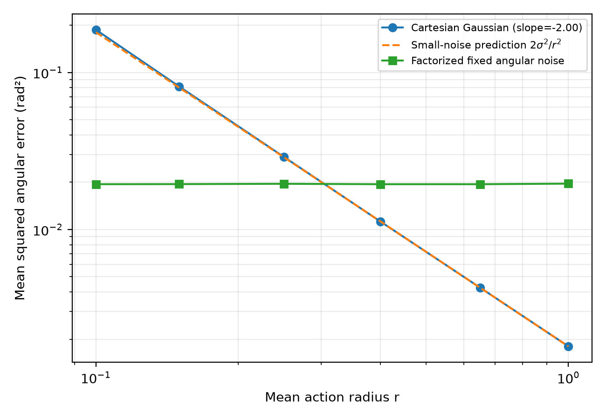

这一结果验证的是“Cartesian 加性噪声在小动作附近耦合方向与速度”的局部机制，而不是下游 RL 性能；后者仍可能被 critic 空间、熵参考测度和任务轴向结构抵消。

进一步的两阶段球壳诊断把“方向搜索”和“速度精度”作为可独立操纵的因果变量。Approach 阶段要求在 100 次采样内发现与当前均值相隔 (30^\circ) 的方向，同时动作半径必须落在 (0.75\pm0.025)；precision 阶段把均值重定位到已发现方向和半径 0.15，并要求 20 次内达到角误差 (7.5^\circ)、径向误差 0.015。Cartesian 基准使用各向同性 σ=0.08；DS 使用切向标准差 0.25 和径向标准差 0.008192，使二者局部协方差行列式平方根严格匹配为 (0.08^3=0.25^2\times0.008192)。为避免弱基线，我们还在独立 50 万样本上为每个难度单元单独选择 Cartesian approach σ。

在冻结的 16 个正式 Monte Carlo seeds 上，普通 Cartesian stage、调优 Cartesian stage、DS global、DS stage 和 DS coupled-radius 的端到端成功率分别为 0.06%、17.54%、71.34%、93.06% 和 47.93%。DS stage 相对调优 Cartesian 的配对差为 +75.52 点，16/16 为正，bootstrap 区间 [75.01,76.07]；阶段切换和独立径向控制分别贡献 21.72 和 45.13 点。跨 (3\times3) 个角偏移/球壳宽度单元，DS 相对调优 Cartesian 的优势均为正，范围 +3.65 到 +81.13 点。该实验说明方向–速度分解确实能表达 Cartesian 各向同性噪声难以表达的“宽角搜索、窄速度壳”，同时也说明这种分配必须在精细阶段收窄。

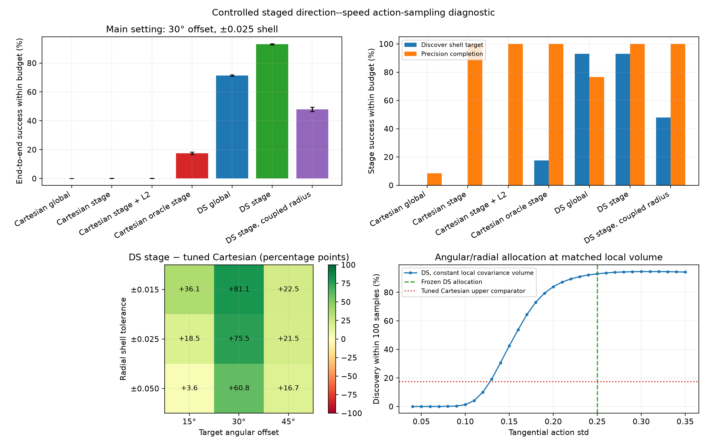

这里的均值重定位是理想化的“获得信息后已经学会目标”操作。因此它只证明动作分布的能力与两项机制消融，不证明 actor--critic 能从稀疏奖励中学会阶段或噪声分配。机器人实验正是在这个学习接口上失败。

为检验该接口，我们把同一几何条件改成真正的两步稀疏奖励 MDP。Stage 0 只有命中偏转球壳才获得 discovery reward 并进入 stage 1；stage 1 再要求小半径精细动作。所有策略使用相同 REINFORCE、stagewise baseline、2048 batch、300 次更新和 common random numbers。除 Cartesian diagonal 外，我们加入 10 参数 full-covariance Gaussian；其 oracle 版本直接获得与 DS 相同的径向/切向初始协方差，而 DS-stage 只有 8 个参数。正式 seeds 100--131 中，DS-stage、full-cov oracle、普通 Cartesian-stage 的归一化成功 AUC 分别为 73.89%、67.46%、54.29%。DS 相对 oracle 的配对差 +6.43 点，bootstrap [6.32,6.53]，32/32 为正；达到 50% 成功的交互从 223.36k 降到 163.84k，减少 26.65%。共享阶段尺度和耦合径向噪声分别使 AUC 下降 2.34 和 4.83 点，且 32/32 配对同向。

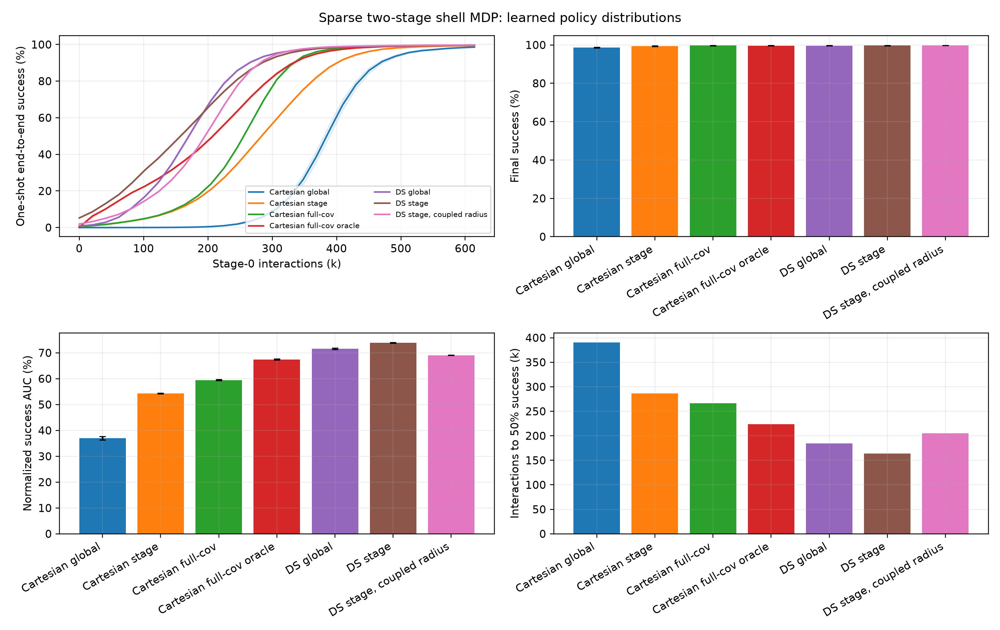

最终策略诊断显示，DS-stage 的 stage-0 切向/径向局部标准差为 0.0323/0.00627，full-cov oracle 为 0.0184/0.00832；二者平均方向误差为 0.18/2.62 度。DS 没有靠扩大径向动作获胜，而是更快旋转均值并保持切向覆盖。为防止把该结果解释为普遍优势，我们又预注册了 target angle 为零的 axis-aligned 反例。Seeds 200--231 中 DS-stage 与 full-cov oracle 的 AUC 为 79.260%/79.215%，差 +0.045 点，bootstrap [-0.0046,+0.0919] 点，完全位于 ±1 点等效区间；达到 50% 也只差 640 次交互。两种结构化策略均比普通 Cartesian-stage 高 23 点以上。

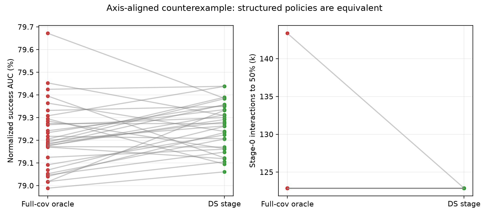

为排除上述结果只依赖 on-policy REINFORCE，我们进一步建立 replay + twin-Q 的 off-policy 桥接。两个 stage critic 只接收环境实际执行的二维 Cartesian action；stage-0 target 只有在观测到 discovery 后才 bootstrap，stage-1 loss 也只在真实到达后计算。最初的直接 reparameterized Q-gradient 在 pilot 中把所有方法推向 replay 支持之外的虚假 Q 峰，DS 的 stage-0 平均半径从正确的 0.750 漂到 0.853，最终成功率接近零。冻结版本改用 discovery-balanced replay、保守 critic 初始化和 AWR/CRR 风格 actor：用 twin-Q 的较小值为已执行 replay action 加权，但不沿未知动作区域对 Q 求上升方向。

正式 seeds 400--431 使用 512k 交互、四次 critic 更新/轮、AWR 温度 0.10，并在读取正式结果前冻结判据。Cartesian-stage、full-cov oracle、DS-global、DS-stage 和 coupled-radius DS 的最终成功率分别为 37.06%、81.15%、65.25%、68.61% 和 82.78%；成功 AUC 分别为 12.35%、36.30%、32.65%、38.93% 和 30.49%。DS-stage 相对 full-cov oracle 的配对 AUC 差为 +2.63 点，bootstrap 95% 区间 [2.28,2.98]，32/32 为正；达到 50% 的平均交互从 346.4k 降至 304.4k，减少 12.12%，同样 32/32 更快。它相对 Cartesian-stage、DS-global 和 coupled-radius DS 的 AUC 分别高 26.58、6.28 和 8.44 点，三个对比均为 32/32 同向。

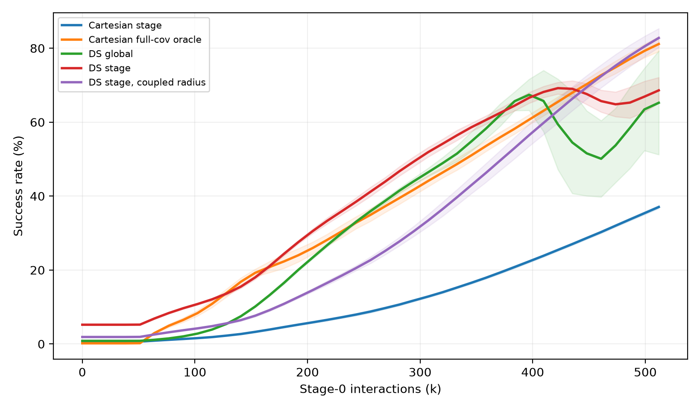

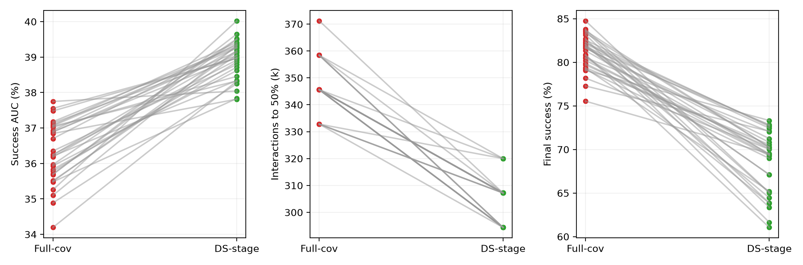

必须同时报告其代价：在固定 512k 终点，DS-stage 比 full-cov oracle 低 12.54 点，bootstrap 区间 [-14.12,-11.03]；虽通过预设 -15 点非劣界，但不能写成最终性能更好。受控学习实验由此支持一个窄而可证伪的结论：DS 是一种参数高效、随均值方向自动旋转的协方差结构，能在 on-policy 与 replay/critic 两种接口中提高早期样本效率。当任务几何需要旋转对齐时，它比全局坐标 Gaussian 更容易优化；当 Cartesian covariance 已与任务轴对齐且获得相同初始化时，优势消失；训练足够久时，更灵活的 Cartesian 或宽径向策略可取得更高终值。

在完成 projected-tangent contextual 反事实后，我们把同一 Cartesian flow 接入完全相同的 replay/twin-Q/AWR 桥接。它与 DS-stage 都有 8 个 actor 参数，使用相同 stage means、局部尺度、environment-action critics、replay 和 AWR weights；flow 的 replay-action likelihood 包含精确投影 Jacobian。12-seed pilot 后冻结实用等效区间，正式 seeds 1400--1431 中 flow/DS 的成功 AUC 为 39.08%/39.03%，DS--flow 差 -0.051 点，95% 区间 [-0.271,+0.173]；终点为 68.15%/69.11%，差 +0.96 点 [-0.56,+2.48]。64/64 个运行达到 50%；DS 平均早 8.8k 交互，但仍位于预设 ±20k 等效区间。13/13 检查全部通过。因此原先“DS 相对 full-cov oracle 更易优化”的结论必须进一步限定：优势针对不匹配曲线支持的 Gaussian；一旦 Cartesian flow 匹配支持，off-policy 样本效率也基本等效。

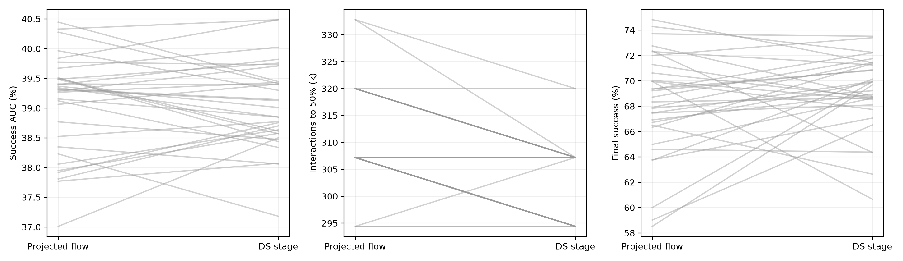

我们进一步把“随均值方向自动旋转”改成显式的 train/test 检验。对 context 方向 \(\theta\)，策略均值固定在半径 0.75、方向 \(\theta\)，稀疏目标位于同半径的 \(\theta+30^\circ\)。训练 context 为 0/30/.../330 度，测试为从未出现的中间角 15/45/.../345 度；所有方法只学习探索协方差。除全局 Cartesian 和 DS 外，我们加入 9 参数的二阶 Fourier context-to-Cholesky full-covariance，以及直接知道目标弦方向、协方差基底随 context 旋转的 Cartesian oracle。

正式 seeds 600--631 中，DS、旋转 oracle、Fourier full-cov、constant full-cov 和 coupled DS 的 held-out 成功率分别为 12.10%、11.36%、6.62%、0.78% 和 0.76%。DS 相对 Fourier 的配对差为 +5.48 点，95% 区间 [5.38,5.58]，32/32 为正；相对旋转 oracle为 +0.74 点，也为 32/32。DS 的 train--test gap 仅 -0.0005 点，并在 12/12 个未见角上超过 Fourier。Fourier 又比 constant full-cov 高 5.84 点，说明它不是没有学习的弱控制；但其 held-out 曲线出现周期性谷值，表明低阶 context-to-Cholesky 映射并不自动具有旋转等变性。

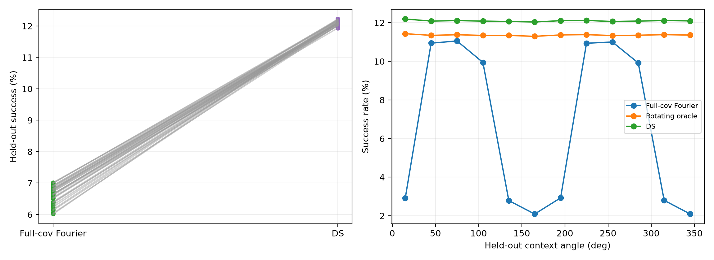

该实验只隔离了探索协方差的旋转迁移，均值由任务固定，并没有证明完整 actor 网络能从高维状态学习目标方向。更丰富或显式等变的 Cartesian covariance network 也可能消除差异。因此它支持的是“DS 用两个尺度参数紧凑实现了旋转等变偏置”，而不是“任何 DS 网络都优于任何 full-cov 网络”。

为直接补上固定均值限制，我们冻结了一个均值–协方差联合学习确认实验。Context 由 1--16 阶正余弦构成 32 维状态；所有方法共享同一个 32--64--2 Cartesian residual-mean MLP，从半径 0.75 的 anchor 学习到旋转 (30^\circ) 的稀疏球壳目标，同时学习探索尺度或协方差。训练角为每隔 (10^\circ) 的 36 个角度，测试角为未见过的 (5^\circ) 中间点。主基线 Cartesian full-cov state 使用额外的 32--64--3 Cholesky 网络，总参数 4,549；DS-global 仅用两个全局方向/径向尺度，总参数 2,244。所有条件使用相同初始化、REINFORCE、每 context baseline、每次更新每角 512 个样本、Adam (2\times10^{-3}) 和 2,400 次更新。Seeds 700--727 只用于发现 12-context 版本会过拟合并冻结 36-context 协议；正式 seeds 800--831 未参与选择。

正式结果中，DS-global、旋转 Cartesian oracle、Cartesian full-cov state、DS-state、Cartesian diagonal state 和 coupled DS 的 held-out 成功率依次为 63.03%、62.54%、46.13%、45.63%、34.25% 和 11.92%。DS-global 相对 full-cov state 的配对差为 +16.90 点，95% bootstrap 区间 [14.46,19.33]，32/32 seeds 为正；held-out AUC 为 52.54% 对 38.11%，差 +14.43 点，区间 [12.42,16.45]。DS-global 与 oracle 的差为 +0.49 点，区间 [0.06,0.93]，应解释为匹配而非实质超越；其 held-out 均值误差为 0.0262，train--test gap 为 19.33 点，并在平均意义上赢得 36/36 个未见角。Full-cov 比 diagonal 高 11.88 点，说明主基线确实利用了相关协方差而非弱控制。所有 13 项预注册判据均通过。

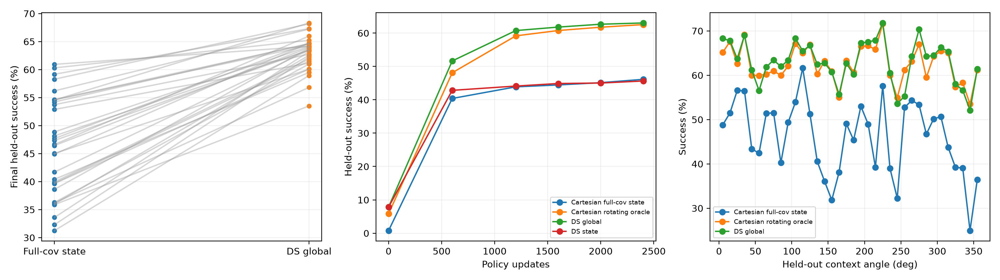

我们又构造了容量匹配的 Cartesian mean-frame 反事实。它不使用极坐标采样，而是在当前 learned mean 的径向/切向基底中直接采样 Cartesian Gaussian；两个全局尺度、总参数量 2,244、均值网络、随机噪声和 DS 完全相同。配置的切向/径向标准差为 0.25/0.008192，但共享的 `log_scale >= -4` 约束使两者实际初始径向标准差均为 0.018315，故有效的一阶局部协方差仍严格匹配。区别在于 Cartesian 扰动沿切线直走，而 DS 角扰动沿半径不变的圆弧移动。12-seed pilot 通过后，我们在读取 fresh seeds 前冻结 8 项确认门槛。

正式 seeds 1000--1031 中，DS-global 与 Cartesian mean-frame 的 held-out 成功率为 63.24% 和 34.47%，配对差 +28.77 点，95% 区间 [24.69,32.63]，31/32 seeds 为正；held-out AUC 为 53.03% 和 28.67%，差 +24.36 点 [20.89,27.64]，同样 31/32 为正。DS 在 36/36 个角度平均值上领先，mean-frame 本身超过预设的 25% 学习下限，全部 8 项门槛通过。该反事实排除了“一阶局部旋转椭圆已经足够”的解释：在 (30^\circ) 有限转角和很窄的速度壳上，切向直线会产生二阶径向漂移，而角度采样直接提供曲线支持。它仍未排除 normalizing flow、mixture 或显式 manifold-aware Cartesian 策略。

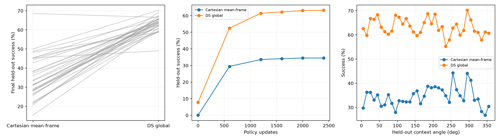

最后，我们给 Cartesian 基线加入同样的曲线支持，而不是继续增加局部 Gaussian 容量。Projected-tangent flow 先在当前均值的 Cartesian 切向上采样 (t\sim\mathcal N(0,\sigma_t^2))，再把 (m+t e_t) 归一化回半径壳，并独立加入径向扰动。其从 ((t,d)) 到环境动作的 Jacobian 为 (|r+d|r/(r^2+t^2))，训练使用完整 change-of-variables log density。该方法与 DS 均为 2,244 参数，并共享均值网络、有效初始局部尺度、噪声、优化器和样本预算；区别仅为 normalized Gaussian tangent 与 Gaussian angle。

12-seed pilot 显示两者近乎重合后，我们在读取新数据前将正式等效区间冻结为 ±1 成功率点。Fresh seeds 1200--1231 中，projected-tangent flow 与 DS 的最终 held-out 成功率为 61.41% 和 61.73%，DS--flow 配对差 +0.318 点，95% 区间 [+0.020,+0.606]；虽可检测到极小正差，但整个区间都在等效界内。AUC 为 51.43% 和 51.75%，差 +0.324 点 [+0.085,+0.557]；逐角平均绝对差仅 0.612 点，最大 2.257 点。11/11 个冻结等效判据全部通过。

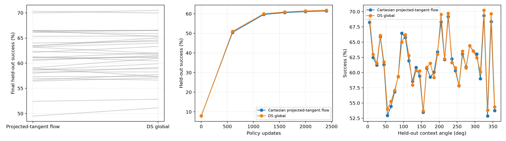

这个结果是关键反事实：mean-frame 失败不能被解释为“只有 polar 坐标能工作”，而是因为直线切向支持在有限转角下离开窄壳；Cartesian flow 一旦恢复同一曲率与半径保持性质，就复现 DS。因而可投稿的机制主张应是 manifold-matched exploration，而 direction--speed 是参数高效、易解释的实例。任何坐标专属的优越性表述都应删除。

两个消融限定了机制。首先，state-dependent DS 比 global DS 低 17.40 点，说明在当前密集旋转族上增加状态条件尺度反而增加了不必要的估计负担；这不是“网络越复杂越好”的容量结果。其次，共享一个方向/径向尺度的 coupled DS 低 51.11 点，验证独立控制切向搜索与径向精度是关键。这个 contextual bandit 没有时序 credit assignment 或 learned critic，且目标族具有精确旋转结构；因此它解决了“固定均值”质疑，却不能替代机器人或一般 MDP 的性能证据。

### 6.3 OGBench cube-triple 先导结果

下表保留历史稿的 tail3（800k/900k/1M 均值）口径，不是 endpoint。后面的旧 IQM 汇总
只包括 task1–4 的八个设置，不包含 task5；它不是完整五任务汇总。本轮 200 运行复核覆盖
baseline/posthoc 两列和 task5，未重新核验整套 stereographic/spherical 运行及旧 IQM 区间；
统一 endpoint、tail3、observed-AUC 和全部零结果以[当前结果](../current/results.md)为准。

| 任务 | H | Cartesian | Adapter | Stereographic | Spherical |
|---|---:|---:|---:|---:|---:|
| task1 | 1 | 89.4 | **99.7** | 83.4 | 58.3 |
| task1 | 5 | 49.1 | **81.3** | 53.6 | 38.8 |
| task2 | 1 | 37.3 | **91.0** | 61.6 | 45.8 |
| task2 | 5 | 2.0 | 22.0 | **23.5** | 9.4 |
| task3 | 1 | 1.1 | **22.4** | 2.5 | 3.1 |
| task3 | 5 | 0.6 | **27.5** | 1.7 | 1.4 |
| task4 | 1 | 44.4 | 61.4 | **62.4** | 55.6 |
| task4 | 5 | 1.1 | **14.6** | 3.9 | 2.6 |

跨上述 8 个 task×horizon 设置：

| 方法 | Mean | Median | IQM |
|---|---:|---:|---:|
| Cartesian | 28.1 | 3.2 | 15.6 |
| Adapter | **52.5** | **42.7** | **50.3** |
| Stereographic | 36.6 | 21.2 | 27.2 |
| Spherical | 26.9 | 10.7 | 16.2 |

历史稿对这八个设置做过非正式配对 bootstrap，记录 IQM 差值约 +34.7 点、区间约 [20.1,51.3]，经验 improvement probability 约 0.90。这些数字保留历史来源，不作为本轮重新验收的统计量。正式跨任务分析应预先固定任务集合、指标和 seed 层级，包含 task5，再按 [RLiable 统计协议](https://proceedings.neurips.cc/paper/2021/hash/f514cec81cb148559cf475e7426eed5e-Abstract.html) 生成 IQM、performance profile 与分层区间。

### 6.4 Tangent 结果

新实现的 tangent 分布已经完成 task1–3、H1/H5、10 seeds，但每次评估只有 50 episodes，且尚未进入 canonical 数据目录。按最后 200k 步平均：

| 任务 | H=1 Tangent | H=5 Tangent |
|---|---:|---:|
| task1 | 54.3 ± 35.0 | 40.8 ± 37.4 |
| task2 | 45.6 ± 32.9 | 1.7 ± 1.7 |
| task3 | 2.3 ± 2.9 | 1.3 ± 1.6 |

Tangent 没有超过 stereographic，更没有接近 adapter；task2 H=5 的退化尤其明显。因此，当前数据不支持“局部切空间是最终方法”的结论。可能原因包括角尺度初始化、单一总温度、环境动作 Jacobian 对小速度的强惩罚、chunk 中逐步独立角噪声，以及任务本身对坐标轴方向的偏好。

### 6.5 速度参数化与径向边界受控筛选

我们在 task2、H=1 上固定训练器与网络，运行 500k 环境步、每 100k 步用 50 episodes 评估，并使用配对 seeds 0/1 比较六个条件。该实验是机制筛选而非主结果；两个种子不足以支持显著性结论。

| 条件 | 300k（s0/s1） | 400k（s0/s1） | 500k（s0/s1） | 0–500k AUC |
|---|---:|---:|---:|---:|
| Cartesian baseline | 0 / 0 | 0 / 0 | 0 / 4 | 0.2 |
| Adapter, Cartesian, log, cube | 2 / 0 | 2 / 2 | 2 / 4 | 0.9 |
| Adapter, Cartesian, direct, cube | 0 / 0 | 0 / 14 | 8 / 34 | 3.5 |
| **Adapter, Cartesian, direct, sphere** | **0 / 22** | **54 / 48** | **74 / 58** | **19.0** |
| Adapter, spherical coordinates, direct, cube | 0 / 0 | 0 / 0 | 0 / 0 | 0.0 |
| Integrated stereographic, cube | 0 / 0 | 0 / 2 | 0 / 0 | 0.2 |

AUC 是从 step 0 补零后对成功率曲线作梯形积分，再除以 500k；表中数值为百分比点。终点两种子均值依次为 2%、3%、21%、66%、0% 和 0%。学习曲线见下图。

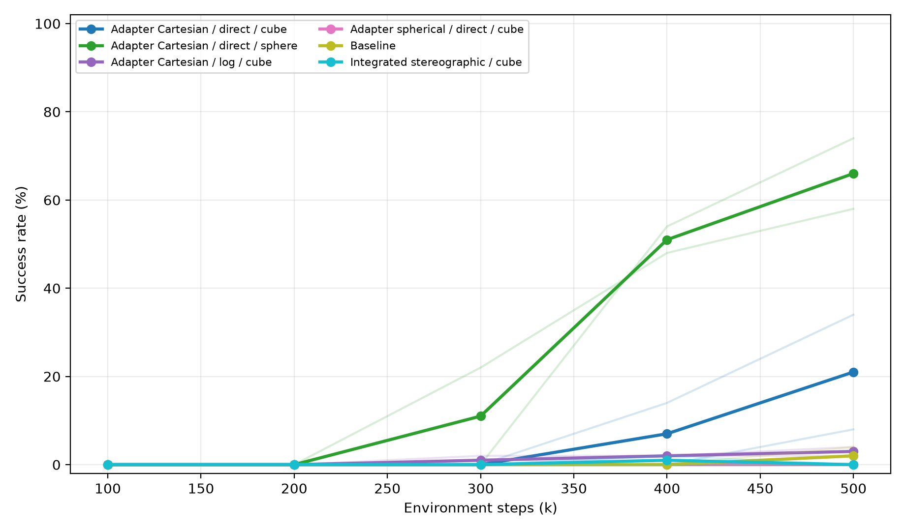

该筛选给出三个重要修正。第一，`sigmoid + direct speed` 在 cube bound 下已明显强于 legacy `tanh + log speed`，旧结果不能代表当前参数化。第二，把 direct-speed 的径向上界从动作 cube 改成单位球后，终点从 21% 提升到 66%，差异大于本轮任何坐标图差异。第三，非冗余 spherical-coordinate adapter 和 Jacobian-correct integrated stereographic 都没有学习，故当前数据不支持“球面坐标本身提高探索”的解释。

先验数据含 300 万条动作，其中 XYZ 范数中位数为 0.743，33.8% 大于 1，95 分位为 1.416。sphere 条件把 actor 的 XYZ 范数限制到 1，而 cube 条件允许最高达到 \(\sqrt3\)。因此最可信的新假设是：**动作范数约束/速度正则化促成更早学习，Cartesian 冗余 adapter 与 latent critic 可能进一步放大该效果。** 下一节用原始 TanhNormal 加相同 L2-ball projection 检验前半句；critic 空间的统一仍留待下一轮。

### 6.6 Cartesian L2 投影反事实

为检验上一节的 sphere 优势是否只是动作范数约束，我们加入普通 5 维 Cartesian TanhNormal 加 XYZ 单位 L2-ball projection 的控制。Projection 在环境执行、actor 的 Q 查询和 target critic 的下一动作上使用同一投影，从而避免单位球外 Q 外推；其余训练配置与 baseline 相同。我们在 task2、H=1、500k steps 上以配对 seeds 0–3 比较 baseline、projection、direct-speed cube 和 direct-speed sphere。

| 条件 | 500k，seeds 0/1/2/3 | 终点均值 ± SD | 末三点评估均值 | AUC |
|---|---:|---:|---:|---:|
| Cartesian baseline | 0 / 0 / 0 / 24 | 6.0 ± 12.0 | 2.2 | 0.7 |
| Cartesian + L2 projection | 8 / 50 / 22 / 40 | 30.0 ± 18.7 | 14.8 | 5.9 |
| DS direct / cube | 30 / 66 / 40 / 62 | 49.5 ± 17.3 | 23.0 | 8.8 |
| **DS direct / sphere** | **44 / 64 / 76 / 82** | **66.5 ± 16.8** | **33.8** | **13.7** |

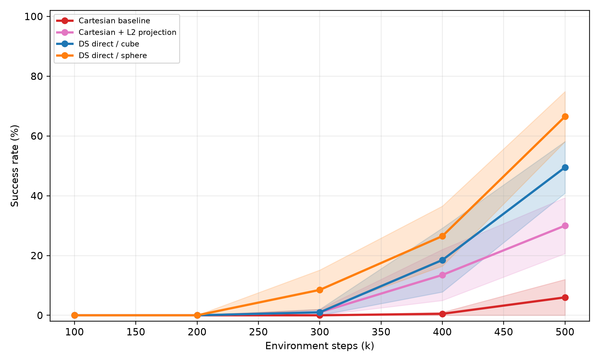

Projection 相对 baseline 的配对终点差值为 +24.0 点，而 DS-cube 相对 projection 为 +19.5 点、DS-sphere 相对 projection 为 +36.5 点。四对 seeds 太少，双侧精确 sign-flip 检验的最小 p 值为 0.125，因此这里只报告机制趋势，不作显著性声明。动作诊断显示 baseline、projection、DS-cube 和 DS-sphere 的平均 XYZ 范数分别为 0.885、0.737、0.629 和 0.542；DS-cube 虽允许达到 \(\sqrt3\)，平均动作反而比硬投影更小。

仅根据该实验，projection 没有追平任一 direct-speed adapter，而只加入 projection 又把终点成功率从 6% 提高到 30%，所以当时可排除“全由硬约束解释”和“范数约束完全无关”两个极端。下一节的 critic-space 反事实进一步表明，projection 之外的表面优势并没有在无冗余 critic 下保留。

### 6.7 Env-action critic 反事实

为隔离冗余价值表示，我们保持 6 维 direction–speed actor、forward compose、熵目标、网络和训练数据不变，只把 critic 输入从 6 维 latent action 改为环境实际执行的 5 维 action。Replay 对 env-Q 直接保留环境动作；target critic 和 actor loss 均查询 \(Q(s,\operatorname{compose}(z))\)。实验沿用 task2、H=1、500k steps、50 eval episodes 和配对 seeds 0--3。

| 条件 | 500k，seeds 0/1/2/3 | 终点均值 ± SD | 末三点评估均值 | AUC |
|---|---:|---:|---:|---:|
| DS cube / latent-Q | 30 / 66 / 40 / 62 | 49.5 ± 17.3 | 23.0 | 8.8 |
| **DS cube / env-Q** | **0 / 0 / 2 / 24** | **6.5 ± 11.7** | **2.2** | **0.7** |
| DS sphere / latent-Q | 44 / 64 / 76 / 82 | 66.5 ± 16.8 | 33.8 | 13.7 |
| **DS sphere / env-Q** | **14 / 74 / 0 / 22** | **27.5 ± 32.3** | **13.7** | **5.4** |

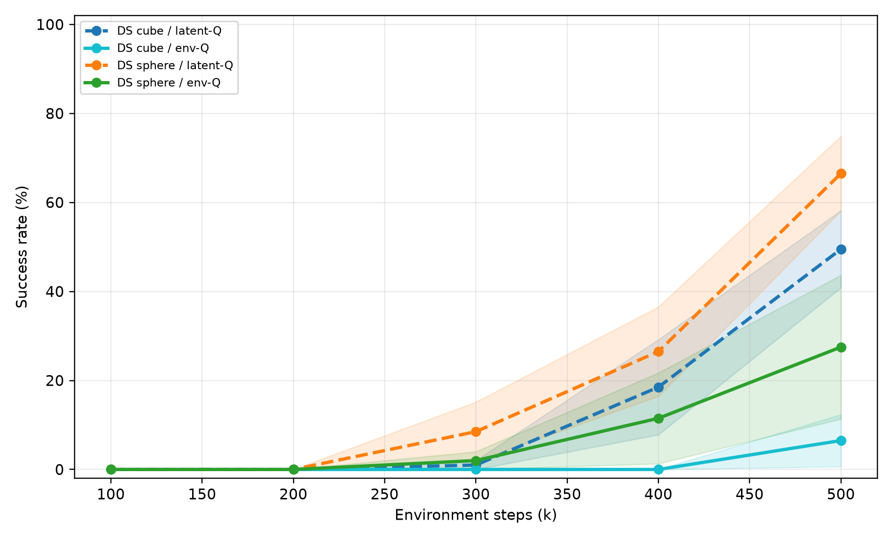

env-Q 相对 latent-Q 的配对终点差值在 cube 为 -43.0 点（四对差值 -30/-66/-38/-38），在 sphere 为 -39.0 点（-30/+10/-76/-60）；配对 AUC 差值两者均为 -8.2 点。四个 seed 的 bootstrap 区间分别为 cube 终点 [-59.0,-32.0]、sphere 终点 [-68.0,-7.5]，但样本极小且最小双侧 sign-flip \(p=0.125\)，故不作总体显著性声明。

更关键的是对照结构：cube env-Q 的终点/AUC 6.5/0.7 几乎等于 Cartesian baseline 的 6.0/0.7；sphere env-Q 的 27.5/5.4 也接近 Cartesian projection 的 30.0/5.9。这不是形式上的等价性检验，却说明旧 latent-Q adapter 超出简单控制的优势基本消失。当前证据支持的结论不再是“显式速度因子已经提高探索”，而是“冗余 latent critic 能显著改变表面样本效率，任何语义探索主张都必须在 env-action critic 下重新建立”。

执行动作还显示明显径向漂移：cube 的平均 XYZ 范数由 latent-Q 的 0.629 增至 env-Q 的 0.920，sphere 则由 0.542 增至 0.782；sphere 仍严格满足单位球约束。这是 critic 干预后的结果变量，不能单独解释因果，但提示在无冗余 Q 下，单一 latent-coordinate entropy target 没有提供所需的速度调节。下一步应显式匹配 radial reference 并单独学习速度温度。

### 6.8 其他结果

matched-forward reference-measure 实验已经完成 12 个正式训练。协议固定为 task2、H=1、500k steps、seeds 0--3；三个条件使用相同的 integrated spherical actor、单位球动作域、5 维环境动作 critic 和初始化。V1（action volume，单温度）、S1（semantic product，单温度）和 S3（semantic product，方向/速度/标量独立温度）的终点成功率依次为 9.5±12.6%、5.5±11.0% 和 0.0±0.0%，AUC 为 1.45%、0.95% 和 0.0%。S1--V1 的同 seed 终点差为 0/-4/+16/-28 点，均值 -4 点，bootstrap 95% 区间 [-21,+11]，精确 sign-flip (p=0.75)，没有语义参考优于动作体积参考的证据。

干预本身是有效的：V1/S1/S3 的平均执行平移范数为 0.779/0.592/0.576；S3 最终方向、速度和标量温度为 0.232/0.168/0.087，相应归一化熵为 -1.014/-0.507/-1.002，接近 -1/-0.5/-1 的目标。因此负性能结果不能解释为“代码没有使用语义参考或独立温度”。固定 100 回合 checkpoint 复评得到 V1/S1/S3 成功率 6.75%/5.50%/0.25%，其中 S3 四 seed 为 0/0/1/0%。在相同的 1024 个先验数据状态上，V1/S1/S3 条件平均半径为 0.879/0.818/0.795，角偏差为 0.431/0.491/0.614 rad。也就是说，S3 的方向覆盖最广、动作最短，但任务结果最差；当前数据直接否定“增加角覆盖本身即可提高样本效率”的简单假设。

探索性 KL-budget 校准也已完成。把归一化 target entropy 从 -2.5 改为历史等价的 -5.3187 后，V5 action-volume 与 S5 semantic-product 的终点成功率为 9.0±8.4% 和 2.5±3.0%，AUC 为 0.90% 和 0.55%。固定 100 回合复评为 7.5% 和 1.75%；S5--V5 配对差为 -5.75 点，bootstrap 区间 [-14.5,+2.0]。两者实际熵分别为 -5.319/-5.374，说明目标已命中；平移范数仍从 0.838 降至 0.722。故主实验负结果不能仅由 KL 预算过紧解释。

在相同 semantic reference、KL=5.3187 和 env-Q 下，方向坐标图筛选出现了一个随后被否证的重要先导信号。Discovery seeds 0--3 中，spherical/stereographic 终点为 2.5%/21.0%，G5--S5 配对差 +18.5 点，四对均为正；固定 100 回合为 1.75%/20.5%。然而预先固定的 confirmation seeds 4--7 中，终点变为 2.0%/1.5%，差值 -0.5 点（bootstrap [-2.0,+1.0]，仅一对为正、一对持平），固定 100 回合也为 1.5%/1.0%，差值 -0.5 点。虽然 pooled 八种子均值表面上仍有 +9.0 点，但完全由 discovery cohort 的极端高值驱动，不能覆盖独立确认失败。固定状态诊断还显示 stereographic 的平均半径几乎相同、角偏差反而更小（0.262 vs 0.277 rad），因此 discovery 信号也不能解释为更广的角探索。当前证据把“方向图效应”归类为 seed-unstable，而非可投稿的性能改进。

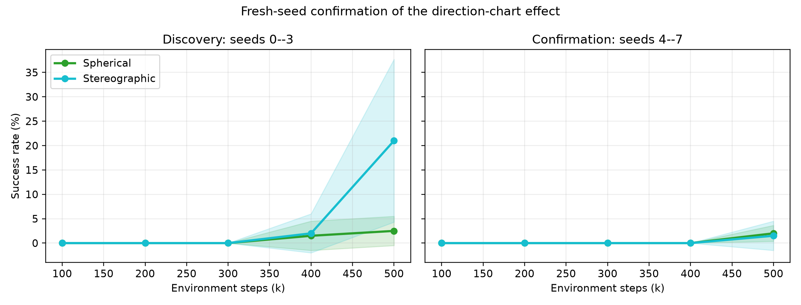

奖励阶段正则筛选进一步检验了“全局 KL 与任务阶段错配”的假设。两组都使用 integrated spherical、semantic-product、env-Q、KL=5.3187；处理组只把零/一/二块已完成状态的方向与速度正则乘以 1/0.5/0.25。Seeds 8--11 的 500k 终点为全局 0/0/0/0%，处理 0/12/0/0%，均值差 +3 点但只有一对为正（bootstrap [0,+9]，sign-flip p=1.0）。固定 100 回合为全局 1/0/0/0%、处理 2/12/0/0%，仍主要由 seed 9 驱动。干预把一块/两块阶段的平均平移范数从 0.691/0.574 提高到 0.784/0.706，但至少完成一块/两块的在线状态占比仅从 34.2%/10.5% 变为 35.0%/10.3%。因此该启发式确实改变了后期动作，却没有稳定改善阶段推进或任务成功。

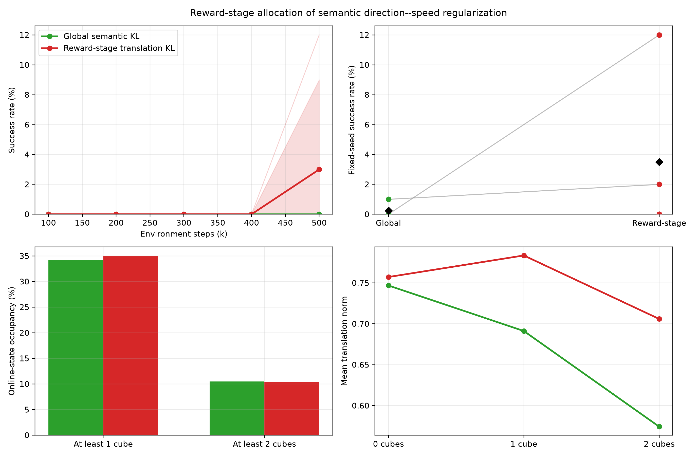

上述负结果促使我们把“降低后期探索”从间接正则权重改成直接的径向约束。对当前状态的任务进度
\(p=\operatorname{clip}(r+3,0,2)\)，定义平移范数上限
\(c(p)=1.0\times0.5^p\)，并在 actor loss 中加入
\(\lambda[\max(0,\|a_{xyz}\|_2-c(p))]^2\)。惩罚在 integrated policy 已组成的环境动作上计算，critic、replay 与环境仍使用同一个五维真实动作；阶段奖励只在训练时提供监督，评估策略仍只接收普通观测。两种子、200k 步的预注册超参 pilot 比较 \(\lambda\in\{0,10,30,100\}\)，四组完整成功率均为 0%，所以不能作为性能证据。预定规则选择了最小合格系数 10：阶段 1 的执行平移范数从 0.672 降至 0.390（两对都下降），阶段 0 仅变化 +0.002，actor batch 的 cap 超限率从 6.60% 降至 3.18%，最终回报两对均提高、平均 +253.6。阶段 2 只有一个有限配对，不能稳定估计。该 pilot 只证明直接接口按预期改变了后期速度；fresh seeds 14--17 的 500k 确认实验在读取结果前另行冻结协议。

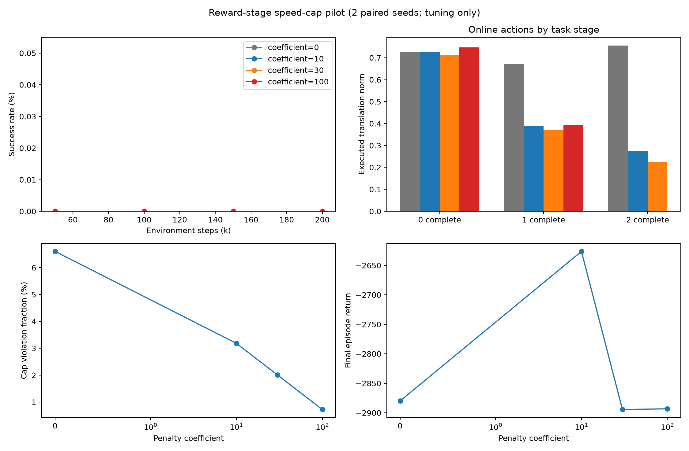

随后严格使用 fresh seeds 14--17、500k 步和零惩罚同路径对照进行确认。训练末次 50 回合成功率为对照 10/0/0/0%、cap 0/0/0/0%；独立 100 回合 checkpoint 复评为对照 8/0/0/0%、cap 0/1/0/0%，配对均值差 -1.75 点，bootstrap 区间 [-6.0,+0.75]，成功 AUC 也下降 0.25 点。预注册性能判据全部未通过。另一方面，干预在 4/4 配对上一致把阶段 1/2 的执行平移范数降低 0.285/0.370，而阶段 0 仅变化 -0.0027；actor batch 诊断给出相同方向。阶段 1/2 在线状态占比却分别下降 3.56/1.23 点。这一反事实把失败定位得更窄：直接径向约束确实学会了预期的 coarse-to-fine 速度日程，但没有改善状态推进或价值学习，甚至略微降低成功 AUC。

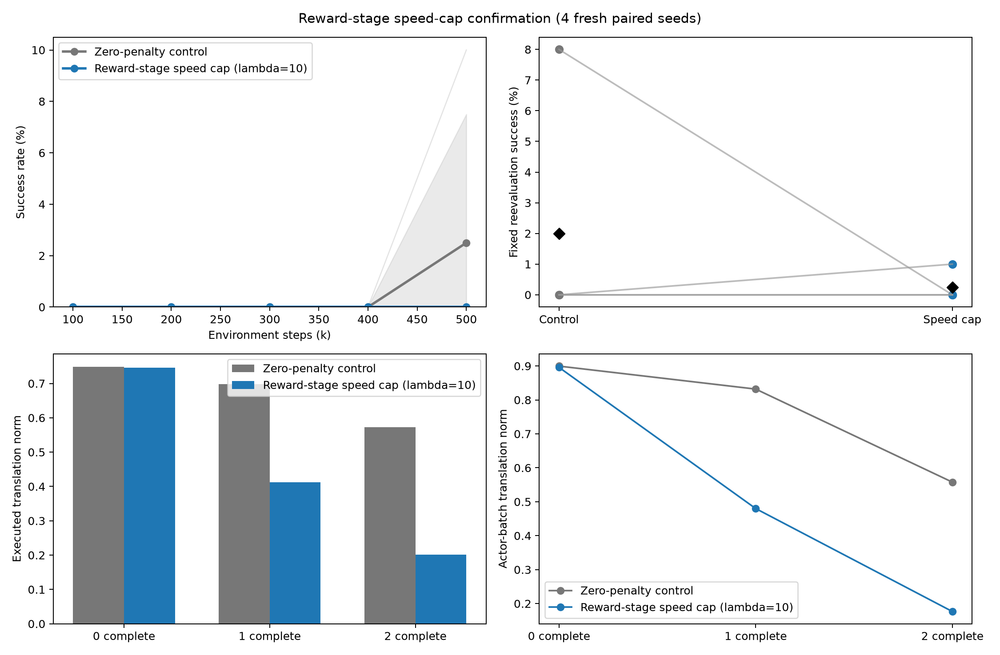

### 6.9 真实状态条件下的 matched-support pilot

为把合成实验的同支持反事实直接接入 OGBench，我们冻结了一个
task1/task2、H=1、100k 步的 discovery pilot。三个条件分别为 Cartesian
TanhNormal 加 XYZ 单位 L2 projection、球面指数映射 tangent，以及
`normalize(center + Bv)` 的 projected tangent。后两者共享状态网络、参数头、
单位球速度域、action-volume reference、单温度和五维环境动作 critic，只改变
从二维切空间到球面的 retraction。每个任务使用 fresh seeds 50/51，每 25k 步
固定评估 20 回合；所有 12 条训练均为有限值。

| Task | Cartesian projection AUC | Exp tangent AUC | Projected tangent AUC |
|---|---:|---:|---:|
| task1 | 54.719% | 53.745% | 53.927% |
| task2 | 0.440% | 1.769% | 1.011% |

按 task--seed 配对，exp tangent 相对 Cartesian 的差为
-3.548/+1.600/+0.649/+2.008 点，均值 +0.177 点；projected tangent 的差为
+0.316/-1.900/+1.342/-0.201 点，均值 -0.111 点。两者执行平移范数分别保留
Cartesian 的 94.5%/94.3%，训练指标均有限，但都没有达到预注册的 +2 点平均
AUC 门槛，因此不启动 500k confirmation。Projected 减 exp 的四配对差为
+3.864/-3.500/+0.693/-2.209 点，均值 -0.288 点且没有单对损失超过 5 点，
通过预设的实用相似性规则。共同 100 回合复评给出 Cartesian、exp、projected
四 checkpoint 成功率 `[1,0,0,0]%`、`[2,0,0,0]%`、`[0,0,0,0]%`；差异只有
0--2 次成功，Wilson 区间高度重叠。

这个结果与受控等效性结论一致，但没有把受控任务的正收益迁移到机器人任务：
球面 retraction 的选择不是主要因素，而仅有 matched support 也不足以解决状态
访问、长时序 credit assignment 和 critic 学习。它是 discovery-level 负结果，
不能被写成等效性的正式机器人确认，也不能通过延长相同 seeds 来调门槛。

固定状态诊断排除了“干预没有真正改变探索”的解释。对每个 checkpoint 在同一
512 个先验数据状态各采 32 个动作并应用真实执行后处理后，task1 的平均角偏差
为 Cartesian/exp/projected 的 0.161/0.414/0.548 rad，task2 为
0.239/0.465/0.495 rad；平均半径则从 Cartesian 的 0.981/0.979 降到两种球面
策略的 0.870--0.895，同状态径向标准差由 0.027--0.043 增至 0.101--0.124。
球面 actor 确实产生了更宽角覆盖与径向变化，但这些变化没有形成回报增益；
“增加角探索本身足够”这一简单机制再次被否定。

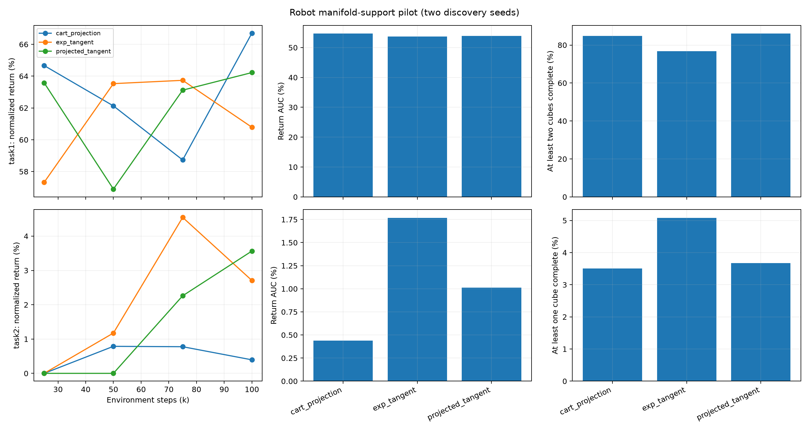

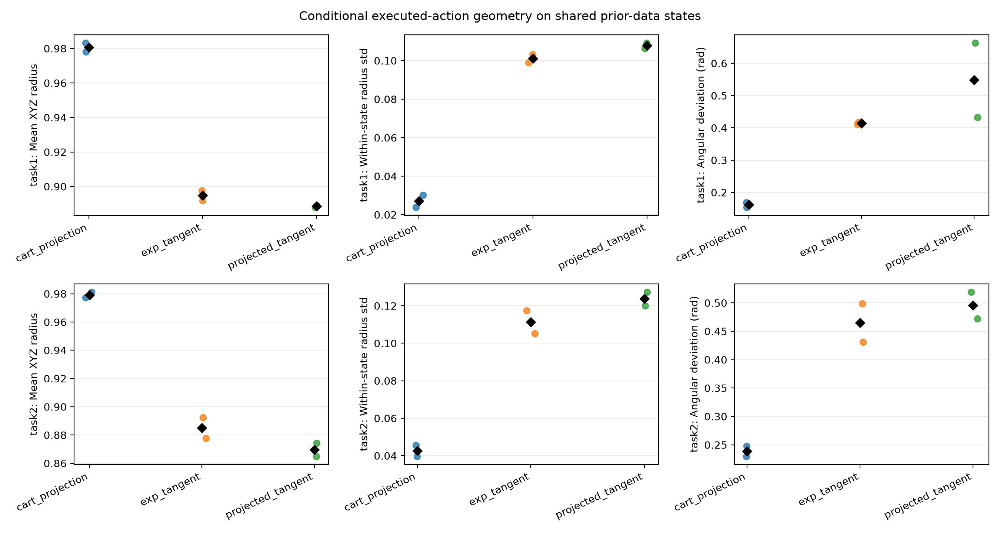

### 6.10 Task1 300k budget-adequacy discovery

100k pilot 的 task2 仍处在性能地板附近，无法区分“方法无效”和“预算不足”。因此
我们没有延长已观察过的 seeds 50/51，而是依据实验前已有的十种子历史曲线选定
在 200--300k 已出现明确学习信号的 task1，并冻结 fresh seeds 52--55、300k
预算、每 50k 的 20 回合在线评估和最终统一 100 回合复评。三个条件、网络、critic
和数据流与 6.9 节一致。主要指标为归一化回报 AUC；候选必须同时达到相对
Cartesian +2 点、至少 3/4 配对为正、动作范数保留至少 90%、有限训练和最终成功率
非劣，才进入跨任务确认。

| 条件 | 归一化回报 AUC | 300k 成功率（20 ep.） | 固定复评成功率（100 ep.） | 执行 XYZ 范数 |
|---|---:|---:|---:|---:|
| Cartesian projection | 61.88% | 28.75% | 21.75% | 0.772 |
| Exp tangent | 59.21% | 38.75% | 39.50% | 0.774 |
| Projected tangent | 58.78% | 17.50% | 20.50% | 0.779 |

Exp 相对 Cartesian 的逐 seed AUC 差为
`+3.289/-8.782/-0.302/-4.875` 点，均值 -2.668，配对 bootstrap 区间
[-6.829,+1.494]；projected 为 `+2.838/-8.801/-2.677/-3.771` 点，均值
-3.103 [-7.270,+1.186]。两者都只有 1/4 配对为正，因而主要 AUC 和符号门槛
均失败。Projected 相对 exp 的均值差仅 -0.435 点 [-1.786,+0.715]，没有单个
配对超过 5 点，仍通过冻结的 retraction 实用相似性规则。该结果在有明显学习信号
的预算上复现了“retraction 不是主要因素”，但否定了 matched support 本身能提高
当前机器人训练样本效率。

固定复评揭示了终点指标与样本效率指标的分离：exp 的逐 seed 成功率为
63/63/25/7%，Cartesian 为 24/23/11/29%，均值差 +17.75 点；但 exp 的完整
学习曲线 AUC 更低，且只有 seed 52 在 AUC 上明显获益。它更准确的描述是“部分
种子在 250--300k 后期突然学会”，不能写成更快学习。Projected 的固定成功率为
70/1/8/3%，均值相对 Cartesian -1.25 点，也显示强烈 seed 方差。

在最终 checkpoint 的同一 512 个先验状态上各采 32 个动作，Cartesian/exp/
projected 的角偏差为 0.159/0.380/0.579 rad，平均半径为
0.989/0.907/0.902，同状态径向标准差为 0.020/0.092/0.096。干预因此确实持续
扩大条件动作支持；AUC 下降不能归因于代码路径未启用。结合早中期曲线，更符合
数据的解释是：共享熵目标下流形 actor 把过多随机性分配给角向与径向搜索，延迟了
利用，而非缺少探索。这个机制解释仍是相关性诊断，下一项因果实验应直接匹配三种
策略的执行空间角方差与径向方差，而不是继续延长或挑选当前 seeds。

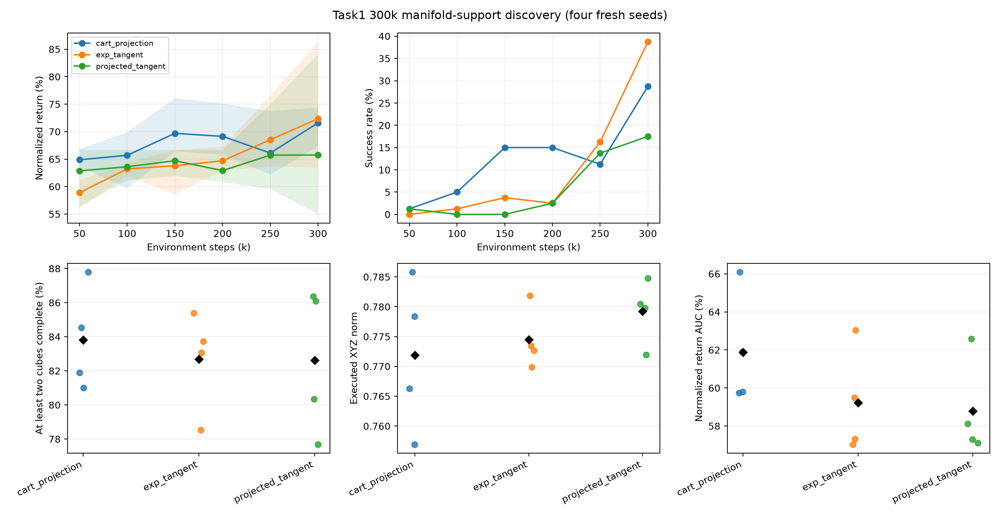

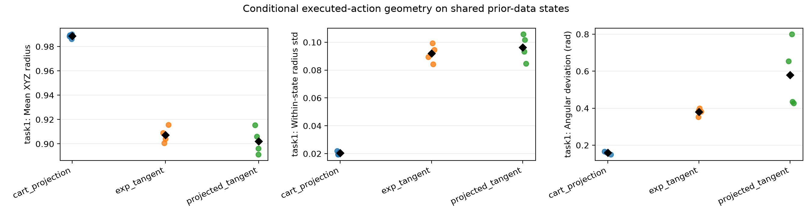

### 6.11 学习后未保持的 executed-variance matching

6.10 节提示默认 tangent 的执行空间角向和径向随机性都明显宽于 Cartesian。为检验这是否导致早期利用变慢，我们在读取新回报前冻结 seeds 56--59 和三组条件：Cartesian projection、默认 exponential tangent，以及方差匹配 tangent。匹配版只改变采样变换：角度 log-scale offset/max 为 -1.85/-1.3，速度 log-scale offset/max 为 -0.5/0，速度 raw-mean offset 为 +1.5；网络、critic、replay、熵目标、300k 预算和评估协议均相同。参数来自旧 seeds 52--55 的固定状态几何插值，没有使用其回报选择。

| 条件 | 回报 AUC | 300k 在线成功率 | 固定 100 回合成功率 | 半径 | 同状态径向 SD | 角偏差 | tail α |
|---|---:|---:|---:|---:|---:|---:|---:|
| Cartesian projection | 63.14% | 41.25% | 43.50% | 0.989 | 0.022 | 0.161 rad | 0.025 |
| 默认 exp tangent | 58.51% | 17.50% | 24.75% | 0.904 | 0.094 | 0.389 rad | 0.117 |
| 方差匹配 exp tangent | 59.63% | 21.25% | 19.50% | 0.787 | 0.147 | 0.333 rad | 1.313 |

Matched 相对默认版的逐 seed AUC 差为 `-1.802/+4.140/+2.451/-0.301` 点，均值 +1.122 点，配对 bootstrap 区间 [-1.051,+3.296]，仅 2/4 为正；固定成功率均值还低 5.25 点。因此预注册的 +2 点、3/4 同向和终点非劣门槛全部失败。相对 Cartesian 的 AUC 差为 -3.507 点 [-8.085,+0.213]、仅 1/4 为正，固定成功率低 24 点，也没有机器人效率优势。

这次实验最重要的不是回报排序，而是操纵检查。Matched 与 Cartesian 的角偏差、平均半径和径向 SD 误差分别为 0.172 rad、0.202 和 0.125，远超冻结容差 0.05/0.03/0.02。它虽把默认 tangent 的角偏差从 0.389 降至 0.333，却把半径和径向波动推得更远。共享状态下的 raw policy 诊断显示，默认/匹配版的有效速度位置为 2.793/1.566、角度 raw SD 为 0.319/0.273、速度 raw SD 为 1.159/1.000；匹配版虽然显式加入 +1.5 速度 offset，网络仍学出了更低的最终有效位置。与此同时单一自动温度 α 升至 1.313，而两版 tail entropy 都停在约 -2.5。数据因此与“actor 和自动熵控制补偿了静态 calibration”一致，但尚不能把温度单独识别为原因。

所以本实验不能被写成“方差匹配无效”：它严格支持的结论是，**对可学习 SAC actor 施加固定 log-scale/mean offset，不足以在训练后保持执行空间矩条件**。下一反事实必须在采样器输出端以不可学习方式控制角/径向噪声，或用显式约束/分量温度使这些矩不再被单一 α 抵消。继续扫描同一组 offset 会使用新 seeds 调参并重复失败的操纵，不构成新的因果检验。

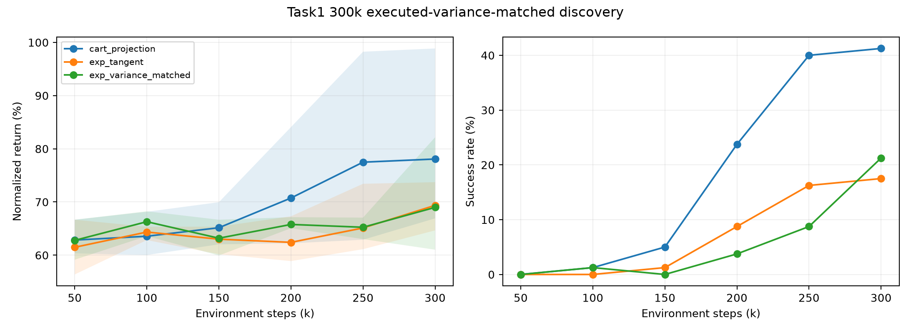

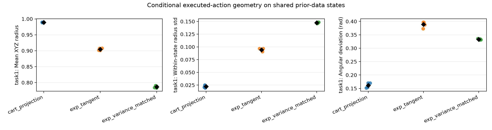

### 6.12 奖励盲 executed-moment controller：操纵成功但优势未恢复

静态 offset 失败后，我们把角向 log-SD、速度 log-SD 和全局 raw-speed mean
改成 actor 参数树中的外部控制叶子，并在前向计算中 `stop_gradient`。控制器每
5k 步只在固定 512 个先验状态上各采 32 个动作，根据执行动作的平均半径、同状态
径向 SD 和角偏差作比例更新；它不读取 reward、success、Q、advantage 或 replay
priority。控制目标冻结为 seeds 56--59 Cartesian 的
`radius/radial-SD/angle = 0.989/0.022/0.161`，操纵容差分别为
`0.03/0.02/0.05 rad`。为了阻止 actor 再学出等量反向偏置，严格因果版断开了普通
速度均值 head，因而该实验是矩匹配消融，不是容量完全公平的最终方法。

最初的加性偏置工程运行在首次 50k 评估前即被几何日志否决：偏置持续增大，但
actor 的 learned mean 反向漂移。改成绝对、不可学习 raw-speed mean 后，seeds
60--61 在 50--300k 的六个 checkpoint 均通过操纵检查。300k 平均几何为
`0.9859/0.02196/0.16110`，表明目标不是名义配置而是真正在 executed space 中
保持。所有训练量均有限，checkpoint 也精确保存 controller 状态。

| 条件 | seed60 回报 AUC | seed61 回报 AUC | 均值 AUC | success AUC | 300k 成功率 |
|---|---:|---:|---:|---:|---:|
| Cartesian projection | 66.18% | 60.14% | 63.16% | 15.21% | 37.5% |
| 默认 exp tangent | 57.49% | 63.69% | 60.59% | 8.33% | 15.0% |
| moment-controlled tangent | 60.57% | 60.30% | 60.44% | 0.00% | 0.0% |

Moment-controlled 相对 Cartesian 的配对 AUC 差为 -5.605/+0.157 点，因此
“两种子均不下降”的冻结 pilot gate 失败，不能启动原定 seeds 62--65 confirmation。
相对默认 tangent 为 +3.079/-3.393 点，均值 -0.157 点，也不是一致修复。严格可写
的结论是：**在已成功匹配执行空间一阶半径和条件角/径向离散度后，tangent 在该
机器人任务上仍未显示稳定样本效率优势；过宽探索不是此前差距的充分解释。**

这仍不是“方向--速度思想无效”的最终反例。严格控制版取消了状态相关速度中心，
可能损害完成最后子任务所需的速度调节；它事实上获得接近 2/3 的归一化回报但两
种子完整成功率均为 0。下一反事实应把速度写成“外部全局 mean + 有界的状态相关
残差”，使 actor 保留相对速度表达力却无法整体抵消 controller，并使用新 pilot
seeds。只有该版本同时通过操纵门槛和 paired AUC gate，才应扩大 seeds。

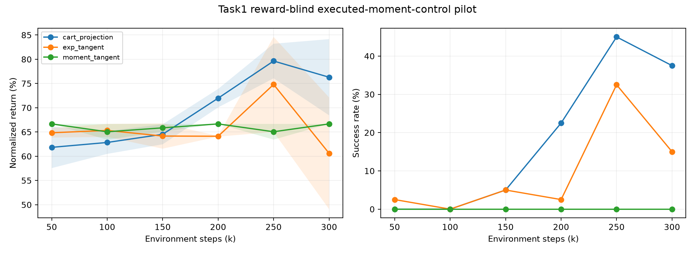

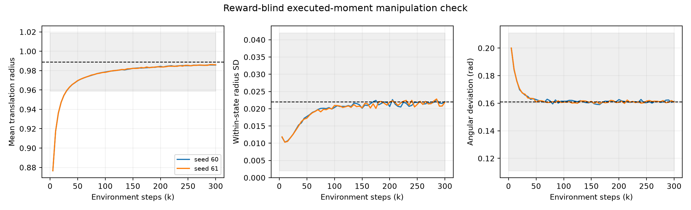

### 6.13 有界速度残差：全局矩继续命中，但 actor--controller 闭环饱和

为检验 6.12 的容量混杂，我们按预注册方案加入有界的状态相关速度残差：
`effective_raw_mean(s) = external_mean + 0.5*tanh(actor_residual(s))`。外部
mean 和两个噪声 scale 仍由同一奖励盲控制器更新，actor 只能在每个状态提供
`[-0.5,+0.5]` 的相对修正。工程 seed 998 未做性能评估；随后使用 fresh seeds
62--63 完成 Cartesian projection、默认 exp tangent 和有界残差 tangent 共六条
300k 训练。设置和门槛在读取回报前冻结。

操纵层面再次成功：有界残差版在两个种子的 50--300k 六个 checkpoint 均为
6/6 通过，300k 两种子平均 `radius/radial-SD/angle` 为
`0.9860/0.02159/0.16096`，接近目标 `0.989/0.022/0.161`。但性能门槛明确
失败：

| 条件 | seed62 回报 AUC | seed63 回报 AUC | 均值 AUC | success AUC | 300k 成功率 |
|---|---:|---:|---:|---:|---:|
| Cartesian projection | 68.66% | 65.12% | 66.89% | 26.46% | 77.5% |
| 默认 exp tangent | 57.64% | 61.84% | 59.74% | 7.71% | 32.5% |
| 有界残差 moment tangent | 59.49% | 57.76% | 58.62% | 0.00% | 0.0% |

有界残差版相对 Cartesian 的逐 seed AUC 差为 -9.179/-7.359 点，因而“两种子
均不下降”的冻结门槛失败，不启动 seeds 64--67。它相对默认 tangent 的差为
+1.843/-4.079 点，也不一致。

事后容量检查揭示了一个重要限制：最终 512 个共同状态上的 raw-speed location
标准差分别为 0 和 `4.77e-7`。两个种子的外部 controller mean 为
5.59996/5.59818，有效 location 为 5.09996/5.09818，差值恰为残差下界
-0.5。也就是说，actor 把 `tanh(residual)` 在所有状态上推到 -1，controller 再
把全局 mean 上调以重新命中半径目标。残差通道在代码和单元测试中有梯度，但闭环
训练把它饱和成常数。

进一步检查表明，坍缩不只发生在速度残差：有界控制版的执行 XYZ 中心在状态间的
平均标准差只有约 `1.4e-6/1.8e-6`，而默认 tangent 为 0.484/0.484；512 个
方向中心的 resultant 约为 1.0，而默认版为 0.450/0.428；标量 raw location 的
状态标准差也从默认版的 0.3--0.8 降到约 `1e-8`。这一近常数策略在 50k 已出现并
持续到 300k。参数树单元测试确认 controller 回写只改变四个指定叶子，训练后 MLP
权重也显著不同于初始化，因此现有证据更符合“绝对半径约束下的闭环优化坍缩”，
而不是简单的参数覆盖或 checkpoint 错误。逐层诊断又显示最后隐藏表征的跨状态
标准差从初始化的 0.022 变为 50k/300k 的 0.031/0.031，并未成为常数；真正的
坍缩发生在 location 输出映射，它把仍有差异的状态特征投影为几乎相同的动作
中心。本实验因而仍不是容量完全匹配的反事实。

这组结果同时给出两个可保留结论。第一，三个全局 executed moments 已连续两版
被精确控制，却都没有恢复机器人性能，所以“默认 tangent 仅仅因为总体角/径向
噪声过宽而失败”不是充分解释。第二，控制绝对动作半径会与 actor 学习的利用中心
发生对抗；下一实验应把估计量改成“围绕 actor 确定性中心的条件扰动”，而不是再
给全局半径 controller 增加补丁。若研究主线转向参考测度，也应直接记录每个分量
的 KL、温度和确定性中心，而不再把全局动作矩当作完整因果中介。

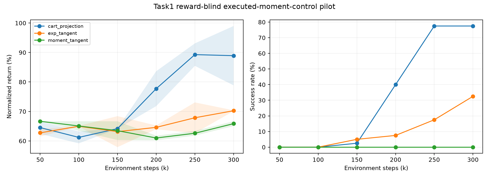

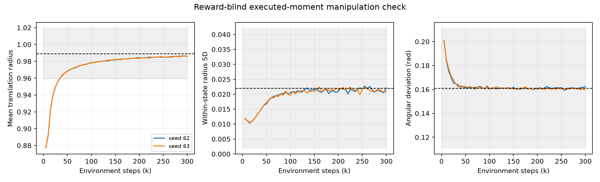

### 6.14 仅控制扰动：绝对中心已解耦，但自动温度形成第二控制环

Revision 4 完全删除外部 speed mean 对前向动作的影响，只保留共享角向 log-SD 和
速度 log-SD 两个奖励盲控制量。方向中心、raw-speed 中心和两个标量中心均由 actor
完整输出；单元测试验证这些 head 与普通 tangent 逐值一致且梯度非零。目标从 fresh
Cartesian checkpoint 重新冻结为径向 SD 0.025、角偏差 0.169 rad；平均半径只记录，
不进入控制器或操纵门。无评估 seed997 在 25k 命中两个目标并保留状态响应后，我们
才启动 fresh seeds 64--65 的六条 300k pilot。

几何操纵再次非常稳定：两个受控种子在 50--300k 都是 6/6 通过，300k 的
`radius/radial-SD/angle` 分别约为 `0.750/0.025/0.169`；平均半径与旧参考 0.989
不同是预期行为，因为 revision 4 明确不再控制它。性能门槛仍失败：

| 条件 | seed64 回报 AUC | seed65 回报 AUC | 均值 AUC | success AUC | 300k 成功率 |
|---|---:|---:|---:|---:|---:|
| Cartesian projection | 60.18% | 69.04% | 64.61% | 18.75% | 65.0% |
| 默认 exp tangent | 62.02% | 56.50% | 59.26% | 7.71% | 17.5% |
| 仅扰动控制 tangent | 57.69% | 59.44% | 58.56% | 0.00% | 0.0% |

受控相对 Cartesian 的逐 seed AUC 差为 -2.492/-9.603 点，因此冻结的“两配对均
不下降”规则失败，不启动 confirmation。更重要的是，尽管动作中心在函数类和梯度
图上已完全保留，训练行为仍在 50k 前塌缩。300k 时两个受控种子的方向 XYZ 中心
跨状态 SD 均值只有 `1.62e-6/1.24e-6`、方向 resultant 约 1，raw-speed 中心 SD
为 `0/1.19e-7`，标量中心同样接近机器精度；默认 tangent 的对应方向 SD 为
0.490/0.503，速度为 0.393/0.361，标量为 0.274--0.779。

这次塌缩的上游机制与前两版不同且可直接观测。受控 action-volume entropy 保持在
约 -5.4，而统一 target entropy 是 -2.5；由于两个 translation scale 已被外部控制器
锁定，自动温度无法用它们闭合误差。α 从 1 增至 25k 的约 2,620、50k 的
`5.95e7`，并在 115k 后饱和于约 `6e18`。分量诊断显示，受控方向/速度语义熵约为
-3.71/-2.29，默认 tangent 约为 -2.08~-2.28/-1.48~-1.62；爆炸的 α 把仍可学习的
标量熵推到接近 0，却无法改变被锁定的 translation perturbation。因而本实验主要
否定的是“外部 moment controller 可以与未修改的单一自动温度直接并联”，而不是
流形噪声假设本身。下一版必须让外部扰动控制替代相应 entropy controller，并对所有
比较条件使用共同的固定 α 或显式分量温度；继续修改 moment gain/target 没有意义。

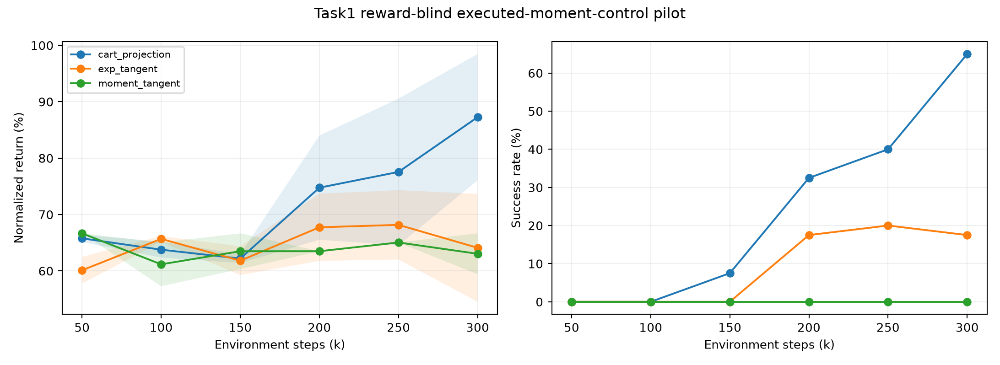

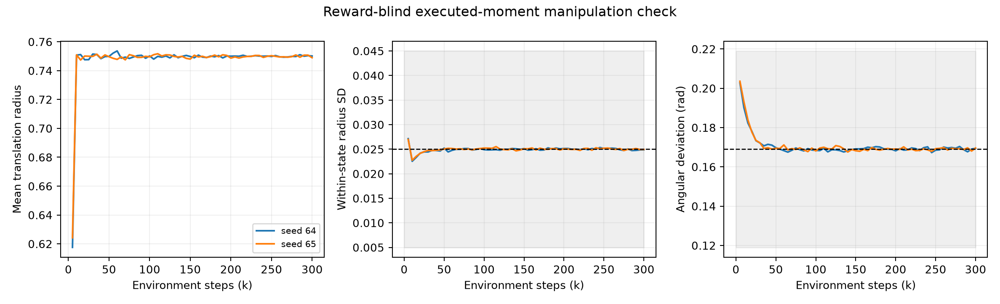

### 6.15 固定温度与扰动匹配：稠密回报 AUC 通过独立确认，但成功率未提升

为消除 6.14 中自动温度与外部尺度控制器的冲突，我们在所有比较条件中固定
SAC `alpha=0.1`。第一轮低噪声控制仍使用旧目标（径向 SD 0.025、角偏差
0.169 rad），在 fresh pilot seeds 66--67 和 confirmation seeds 68--71 上的
controlled-minus-Cartesian 回报 AUC 六配对全部为正；独立确认均值差为 +6.31 点，
最终成功率为 100% 对 72.5%。策略中心容量和固定温度检查全部通过。

但 reward-blind 终点几何审计发现，固定温度 Cartesian 的真实径向 SD/角偏差为
0.0672/0.3454，而低噪声受控组仍为 0.025/0.169。该结果因此只能说明降低并重塑
扰动有效，不能作为相同扰动强度下的流形支持反事实。进一步尝试同时控制平均半径
0.9690 时，seed995 的 raw-speed 中心跨状态 SD 降至 `2.38e-7`，且平均半径误差
0.0212 略超 0.02 冻结阈值；该全矩工程方案按协议失败，未读取性能。

最终实验只匹配随机扰动的两个条件矩，并把平均速度中心完全交还 actor。seed994
无评估工程门通过后，fresh pilot seeds 72--73 的 matched-minus-Cartesian AUC 为
+2.153/+2.840 点，6/6 操纵点和容量门均通过。随后冻结目标并使用独立 confirmation
seeds 74--77：四个 AUC 差为 +2.693/+6.452/+2.419/-3.288 点，均值 +2.069 点，
中位数 +2.556 点，3/4 为正，满足全部预注册 primary 条件。四个 seed 的六个
checkpoint 全部命中径向 SD 0.0672 和角偏差 0.3454 的容差；终点方向中心 SD 为
0.506--0.524、速度中心 SD 为 0.326--0.398，排除了中心坍缩。

该正结果必须窄化解释。confirmation 的 normalized-return AUC 为 64.08% 对
Cartesian 62.01%，但 success AUC 为 18.13% 对 21.15%，300k 成功率为 52.5%
对 78.75%。因此现有机器人证据支持“在 task1、固定温度和匹配条件扰动下，流形
方向--速度策略提高稠密归一化回报 AUC”，尚不支持成功率、最终性能、多任务或
跨算法优势。下一步必须在新任务上预注册 primary endpoint，并加入 GAC 等强方向
策略基线，不能只扩大 task1 seed 数。

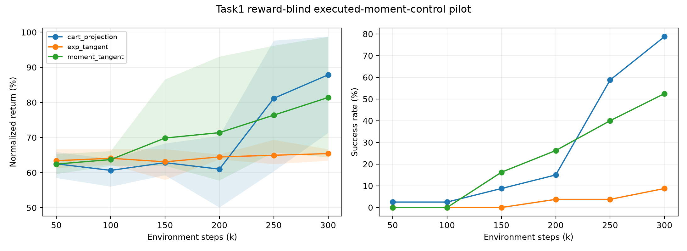

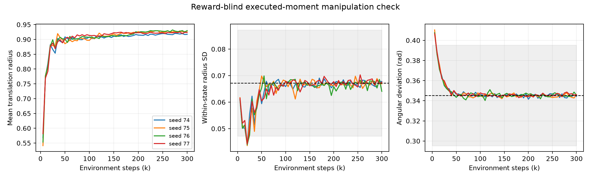

- task5 在 1M 步内所有 80 个运行均为 0%。这是 floor effect，不能用于方法排序；需要更长训练、更多先验数据或改用能产生非零梯度的任务。
- FQL 的三 seed 实验中 adapter 为 100/98/4，baseline 为 96/84/90。不能删除 4% seed 后宣称 99% 优于 90%；除非该 seed 满足预先定义的系统失败标准，否则它是算法方差的一部分。
- task2 的 H=5 方法在 10M 步才达到约 90%，说明 1M 终点同时测量“早期样本效率”和“尚未启动学习”。论文应同时报告 AUC、达到阈值所需步数和更长时域最终性能。

## 7. 当前证据与剩余混杂因素

1. **Direct 配方对 critic 接口敏感。** 2026-09-25 的 sigmoid/direct 四种子反事实中，env critic 相对 latent critic 的 cube/sphere 终点分别下降 43.0/39.0 点。该干预同时改变 critic 特征和输入维数，不能据此认定算法接口不合法，也不能解释六月 tanh/log 的旧强结果。
2. **动作冗余。** Cartesian adapter 的方向向量长度在 normalize 后被丢弃；不同 policy action 可产生同一环境动作。增加其熵可能不增加行为多样性。
3. **动作范数约束不同。** sigmoid/direct 的 sphere-bound actor 将 XYZ 范数限制为 1，cube-bound actor 可达 \(\sqrt3\)；tanh/log 的 `sphere` 仅指参考半径，不能推断同一单位球约束。历史 direct 筛选中 projection 为 30%、env-Q sphere 为 27.5%，只能在该配方和任务内讨论范数约束贡献。
4. **目标熵不同。** 当前 target entropy 与 policy action dimension 成正比。Adapter 比 baseline 多一维，温度调节目标随之改变。
5. **算法并非完整 SAC。** TD target 不含 entropy backup，理论描述必须与实现对齐。
6. **旧新配置不可直接等同。** 旧 adapter 主要对应 legacy `tanh + log speed`；当前 `sigmoid + direct speed` 已有 task2 四种子筛选，但尚无跨任务、10-seed canonical 结果。
7. **评估协议混合。** 历史实验混有 4/10 seeds、50/100 eval episodes、最后点/末段均值和两套 task1 H5 数据。
8. **环境版本未锁定。** `pyproject.toml` 使用 `ogbench>=1.1.0`。OGBench 1.2.0 改变了 single-task reward/success 的时序语义；必须锁版本并显式记录 `success_timing`。
9. **单一环境家族。** cube-triple 的五个固定目标共享动力学、观测和动作接口，不能证明跨任务或跨机器人泛化。
10. **历史 seed 未覆盖全部随机源。** 启动本轮实验时，脚本设置了 Python/NumPy/JAX seed，5k warm-up 也使用已 seed 的 JAX key，但没有显式 seed Gym 环境首次 reset；因此相同 seed 标签并非严格的 common-random-number 配对。当前四种子结果只能视为独立筛选。后续代码已固定训练 reset、评估 reset 和评估策略 RNG，并将对本轮最终 checkpoint 做统一固定种子复评。

## 8. 实验方案

### 8.1 研究问题

- RQ1：固定 Cartesian 方差时，方向扰动是否按 \(1/\|\mu\|^2\) 放大？
- RQ2：收益来自方向–速度策略族，还是来自语义参考测度？
- RQ3：独立方向/速度温度是否优于单一温度？
- RQ4：critic 使用环境动作能否保留 adapter 收益并消除潜空间 OOD？
- RQ5：方法在 H=1 与动作块 H=5/10 上是否一致有效？
- RQ6：效果能否跨 OGBench、RoboMimic、LIBERO 和不同 RL backbone 泛化？

### 8.2 第零阶段：正确性与机制单元测试

必须先完成，不能用大规模训练代替：

1. Power Spherical/vMF sample、log-prob、reparameterized gradient 的数值检查。
2. \(v\leftrightarrow(u,\rho)\) 往返误差；单独测试 \(\rho\to0\)、坐标轴、cube 对角线和边界。
3. Monte Carlo 验证方向、速度和环境动作密度归一化。
4. 检查 `Q(s,a_env)` 对所有方法输入维度相同。
5. 匹配 actor 参数量、初始化动作范数、初始环境动作熵和每步计算量。
6. 锁定 OGBench/MuJoCo/JAX 版本、数据哈希、reward timing 和评估 seed。

### 8.3 合成诊断任务

受控 action-sampling、learned sparse-reward MDP、off-policy critic bridge、contextual covariance transfer，以及高维状态下均值–协方差联合学习均已完成。前者在匹配局部协方差体积下验证切向/径向分配；中间两者分别使用 REINFORCE 与 replay/twin-Q、各 32 个正式 seeds 和 full-covariance oracle 验证早期样本效率；后两者先隔离协方差旋转迁移，再以 32 维状态和共享均值网络验证联合学习。Axis-aligned 等效反例也已完成。继续增加同类有利合成任务的边际价值已经较低，下一步应转向新的机器人 confirmation cohort，或增加具有时序 credit assignment、未知旋转结构和多方向模态的压力测试。

1. **已完成：Contextual covariance rotation**：DS 在 held-out angles 为 12.10%，Fourier full-cov 为 6.62%，rotating oracle 为 11.36%；32/32 配对和 12/12 角度同向。该层固定均值。
2. **已完成：Off-policy critic bridge**：DS 相对 oracle 的 AUC +2.63 点、到 50% 少 12.12% 交互，但终值低 12.54 点；后续只需补 critic 校准/外推误差图，不再在正式 seeds 上调参。
3. **已完成：Joint contextual mean--covariance learning**：32 维状态、共享均值 MLP 和 36 个 held-out 中间角；DS-global 为 63.03%，Cartesian full-cov state 为 46.13%，差 +16.90 点 [14.46,19.33]，32/32 seeds 和 36/36 角度为正，13/13 冻结门槛通过。该层仍是无 critic 的 contextual bandit。
4. **已完成：Cartesian mean-frame counterfactual**：容量和有效一阶局部协方差与 DS 匹配，但沿旋转切线直接采样；fresh 32 seeds 中最终成功率 34.47% 对 DS 63.24%，AUC 28.67% 对 53.03%，8/8 冻结门槛通过。
5. **已完成：Projected-tangent Cartesian flow**：归一化切向提议以匹配曲线支持，并使用完整 Jacobian；fresh 32 seeds 中 flow/DS 成功率 61.41%/61.73%，差 +0.318 点 [+0.020,+0.606]，AUC 差 +0.324 点，11/11 等效门槛通过。该反事实否定坐标专属解释，把核心机制定位为曲率和半径匹配的支持。
6. **已完成：Off-policy matched-support bridge**：projected flow 与 DS-stage 共享 replay/twin-Q/AWR；fresh 32 seeds 中 AUC 39.08%/39.03%，差 -0.051 点 [-0.271,+0.173]，终点 68.15%/69.11%，13/13 等效检查通过。

报告角覆盖、径向覆盖、状态访问熵、reward AUC，并检验理论中的角方差缩放。若 DS-FER 在 direction-only 上不提高方向覆盖，主假设应被否决或修改。

### 8.4 主方法矩阵

| ID | 方法 | Critic 输入 | 正则参考 | 温度 |
|---|---|---|---|---|
| B0 | TanhNormal | env action | Cartesian action-volume | 单一 |
| B1 | Full-covariance Gaussian | env action | Cartesian action-volume | 单一 |
| B2 | Flow/mixture policy | env action | Cartesian action-volume | 单一 |
| A0 | Legacy D+1 adapter | latent action | latent coordinate | 单一 |
| A1 | Adapter-envQ | env action | latent coordinate | 单一 |
| I0 | Integrated stereographic + full Jacobian | env action | action-volume | 单一 |
| I1 | Power Spherical × logit-normal | env action | action-volume | 单一 |
| M0 | DS-FER | env action | semantic product | 单一 |
| M1 | DS-FER | env action | semantic product | **分量化** |

这张表是论文最关键的因果识别。`I1 vs M0` 固定策略族、只改变参考测度；`M0 vs M1` 只改变温度；`A0 vs A1` 检验 latent critic 混杂；`B0 vs B1/B2` 排除“只是 Gaussian 表达力不足”。

### 8.5 Benchmark 扩展

**第一层：OGBench manipulation。** 至少覆盖 cube-single/double/triple/quadruple、scene 和 puzzle 中 12–20 个有非零学习信号的任务。所有主结果 H=1；选 6–8 个任务追加 H=5。每个主方法 10 seeds，筛选消融 4 seeds 后仅扩展预先定义的候选。

**第二层：RoboMimic。** 当前机器已有 `lift-mh-low_dim`、`can-mh-low_dim`、`square-mh-low_dim` 三套各 300 条示范的数据，分别含 31,127/62,756/80,731 个 transition；公开历史 RLPD 在线窗口 AUC 为 92.9%/55.1%/61.6%，表明 can 和 square 有明显但非地板的学习区间，lift 可作快速饱和稳定性检查。然而当前运行环境尚不能直接启动：数据 metadata 来自 robosuite 1.5.1，项目未安装 `robosuite`，而 `robomimic 0.3.0` wrapper 又无条件导入要求 MuJoCo 2.1 的旧 `mujoco_py`；机器只有现代 `mujoco 3.9.0`。官方从 robomimic v0.4 起支持 robosuite 1.5，并推荐 robosuite v1.5.1 使用 DeepMind MuJoCo bindings，因此跨域实验前应优先升级并锁定这组官方兼容版本，再做 reset/step、dataset-state replay 和 success 一致性验收；只有官方 wrapper 仍不适配本项目时才维护自定义 wrapper。不能把“数据已下载”写成“环境已可运行”。兼容后优先使用这三个任务，再视结果扩展 transport/tool-hang。7D 动作中，平移 \((x,y,z)\) 和轴角旋转 \((r_x,r_y,r_z)\) 应分别作为 direction–speed group，夹爪为 scalar。必须额外报告“只分解平移”和“平移+旋转都分解”，并以原始 7D Cartesian、full-covariance 或 flow 作为强基线。当前 LIBERO 包同样尚未装入项目环境，虽有接口和 RLDS 数据，也不能记为可运行基准。

**第三层：LIBERO。** 从 spatial/object/goal 各选择 3–5 个任务。先在 state observation 上验证，再决定是否加入视觉编码器，避免把表示学习能力与动作探索混在一起。

**Backbone 泛化。** 至少在 RLPD-style 和标准 SAC 两个 backbone 上验证；若主张 offline-to-online，再增加 QC/FQL，但不能依赖删除失败 seed 得出结论。

### 8.6 主要指标

1. 预注册 primary endpoint：环境步数归一化学习曲线 AUC。
2. Secondary：末段成功率、steps-to-50%、最终成功率、wall-clock 与样本吞吐。
3. 探索诊断：角标准差、径向标准差、方向球面覆盖、速度直方图、访问状态覆盖。
4. 稳定性：critic ensemble disagreement、actor Q 与 Monte Carlo return gap、NaN/崩溃率。
5. 动作质量：平滑度、饱和率、零速度比例、方向反转率。
6. 统计：跨任务 IQM、median、optimality gap、performance profile、probability of improvement，全部带 95% stratified bootstrap CI。

### 8.7 必要消融

- semantic-uniform speed prior vs volume-preserving radial prior；
- 单温度 vs \(\alpha_u/\alpha_\rho\) 双温度；
- Power Spherical vs stereographic vs tangent，参考测度保持相同；
- full Jacobian vs semantic KL，forward action 完全相同；
- sphere bound vs cube bound；
- env-action critic vs latent-action critic；
- D 维无冗余表示 vs D+1 adapter；
- H=5 每步独立方向 vs chunk 共享宏方向；
- 初始动作分布匹配，排除初始化优势。

## 9. 预期结果与可证伪条件

支持主张的理想结果不是“每个任务都赢”，而是：

1. DS-FER 在 direction-sensitive 和精细操作任务上显著提高 AUC；
2. 在 axis-aligned 或力矩控制任务上与 baseline 持平或呈现可解释退化；
3. 在相同 forward policy 下，semantic reference 优于 action-volume reference；
4. env-action critic 保留主要收益，说明结果不是冗余 latent Q 外推造成；
5. 分量化温度产生与任务阶段一致的角/径向探索变化。

以下结果会否定或显著削弱论文主张：

- 修正 critic 和熵目标后 adapter 收益完全消失；
- DS-FER 只在 cube-triple 有效，跨环境不复现；
- full-covariance Gaussian 或 matched initialization 即可消除全部差异；
- 方向/速度统计与成功率没有稳定关联；
- 方法只提高最终点、不提高 AUC 或 steps-to-threshold。

## 10. 论文实验部分初稿

### 10.1 实验设置

当前 action-adapter 筛选使用 OGBench Cube-Triple task2 与 Cube Double task2、四个配对训练 seed、每项 1M 步和每点 50 个评估 episodes，保留真实 step 0。Project ACRLPD 每次更新混合一半固定先验与一半在线 replay；同配方 critic 消融保持 actor、数据、预算与熵目标。另有独立外部 RLPD 配方比较，网络和 UTD 不同，须单列计算量。当前尚无这些长程运行的新性能结果。十个 fresh seed 属于后续确认设计，不得写成首批已完成的重复数；历史原版常用 100 episodes，其指标与评估协议另列。

我们报告 success-rate AUC、末段成功率和达到预设成功率所需的环境交互数。跨任务结果使用 IQM 和 95% 分层 bootstrap 置信区间，并报告 performance profile 与 probability of improvement。所有超参数、原始 CSV、环境版本和数据哈希将公开。

### 10.2 先导结果

原版 posthoc 的统一重算保留了正向信号。以 task2 H1 为例，1M endpoint 为 baseline 49.60%、posthoc 94.90%；末三次均值则为 37.30%/90.97%，两种指标不能混写。其实际观测的 100k–1M success AUC 配对差为 +32.28 点，十对均为正。task1–4、H1/H5 的八组平均 observed-AUC 差均为正；task5 两组全零仍纳入报告。这是同一任务族的回顾性结果，不能代替当前冻结批次或跨域确认，见[完整重算](../current/results.md)。

然而，坐标图选择本身不能解释全部结果。带完整 change-of-variables 的 stereographic integrated policy 的 IQM 为 27.2%，明显低于 adapter；spherical policy 的 IQM 为 16.2%，与 baseline 接近。新加入的 state-centered tangent policy 也没有稳定改善结果，并在 task2 H=5 上退化。最新的 matched-semantic discovery 虽在 seeds 0--3 得到 stereographic 相对 spherical 的 +18.5 点终点差，但 fresh seeds 4--7 的差值为 -0.5 点，固定复评也为 -0.5 点，未通过预注册确认规则。后续奖励阶段正则筛选也只在四个 seed 中的一个得到 12% 终点成功，其余三对持平为零；固定复评的 +3.25 点均值仍主要由同一 seed 驱动。这些负结果把研究问题从“哪种球面坐标最好”进一步收窄为“如何先在可控任务中识别状态相关探索预算的因果需求”。

后来的 sigmoid/direct task2 筛选检验了另一组配方。四种子 Cartesian L2-ball 反事实显示，在 500k 步终点，baseline、projection、latent-Q cube 和 latent-Q sphere 分别达到 6.0%、30.0%、49.5% 和 66.5%；对应 AUC 为 0.7、5.9、8.8 和 13.7。随后只改变 critic 接口的反事实却发现，env-Q cube/sphere 分别降至 6.5%/27.5%，AUC 降至 0.7/5.4。也就是说，去掉冗余 latent critic 后，cube 与 baseline、sphere 与 projection 的性能分别接近。最终 matched-forward 消融中，action-volume/semantic-product/separate-alpha 的终点成功率又只有 9.5%/5.5%/0.0%。这些 direct/matched-forward 实验不支持显式 semantic reference 或分量化温度带来稳定收益；它们没有检验六月 tanh/log 原版的同配方 critic 反事实，不能将原版正信号归结为单位球约束。

### 10.3 机制分析

在 matched-forward 消融中，action-volume reference 与 semantic-product reference 使用相同的方向和速度样本生成器，只在 actor regularizer 中改变 log-density ratio。解析上两者相差 \(-2\log\rho-\log3\)，因而均匀动作体积会比均匀语义速度更偏好大半径。数据与该预测一致：V1 与 S1 的平均执行平移范数分别为 0.779 和 0.592，95% 分位数为 0.979 和 0.968。这说明参考测度不是无效重参数化，而是确实改变了条件动作分布。

但是机制改变没有带来性能收益：S1 相对 V1 的终点成功率和 AUC 平均下降 4.0 和 0.5 个百分点，四 seed 区间均跨过零。独立温度也按预期分离并命中各分量熵目标，但 S3 在所有评估点均为零成功。当前归一化 target entropy -2.5 表示 KL 预算 2.5 nats，比历史原始微分熵 -2.5 更强地约束策略；动作域体积为 \(16\pi/3\)，故历史目标对应归一化 target \(-2.5-\log(16\pi/3)=-5.3187\)。然而，完成后的 V5/S5 校准只得到 9.0%/2.5% 终点成功率和 7.5%/1.75% 固定复评，semantic reference 仍更差。因此 KL 预算失配不是充分解释，继续做细密 target sweep 的优先级较低。

固定状态诊断进一步定位了这种失败。V1/S1/S3 相对于语义参考的总 KL 为 4.128/3.370/3.260，其中方向 KL 为 2.041/1.783/1.381、速度 KL 为 1.243/0.840/0.734；角偏差则单调增大到 0.614 rad。S3 的标量 KL 反而由 S1 的 0.747 增至 1.146，说明独立温度不是简单地对所有分量同时增加噪声，而是在方向、速度和夹爪/旋转标量之间重新分配 KL 预算。该分配满足预设熵约束，却未与任务阶段需求对齐。

方向图的独立确认进一步说明，四个种子的漂亮曲线不足以建立机制。Stereographic discovery 的固定状态方向 KL 为 3.021，高于 spherical 的 2.938，平均角偏差却更小；它不是靠扩大方向覆盖取得先导高值。更重要的是，完全相同设置在 fresh seeds 上没有成功率增益。因而后续若研究坐标图的优化条件，必须把 discovery/confirmation cohort 分开并增加状态条件诊断，不能只汇报 pooled 八种子均值。

奖励阶段实验则说明“状态相关”本身还不够。处理组末段采样中平均 20.9% 的状态使用了小于 1 的权重，总语义熵仍与对照匹配（-5.327 vs -5.332），因此干预并非没有执行，也没有暗中放宽全局 KL target。它主要提高了一块和两块阶段的执行动作幅度，却没有增加相应状态占比。与之对照，受控球壳诊断中的成功干预直接参数化切向标准差、径向标准差和阶段切换，而不是用一个 loss 系数间接期望策略产生小速度。新的直接 speed cap 又在 fresh seeds 上把阶段 1/2 范数稳定降低 0.285/0.370，却使固定复评成功率平均变化 -1.75 点、AUC 变化 -0.25 点，并降低后期状态占比。两次互补干预共同说明：表示能力和动作尺度接口都不是当前机器人失败的充分解释；主要瓶颈更可能位于后期状态访问、replay 不平衡或 critic 的阶段价值学习。随后完成的 off-policy 壳层桥接验证了这一诊断：直接 Q-gradient 因 critic 外推而全线坍缩，而 discovery-balanced replay 与 replay-supported AWR 恢复了学习，并让 DS 在 32/32 正式配对上提高 AUC。然而同一接口在 OGBench pilot 中没有迁移：纯 AWR 将 DS 平移范数从 SAC 的 0.71--0.83 降至约 0.55--0.62，三个温度均无阶段推进；阶段均衡本身只能把 DS-SAC 的平均阶段推进从 1.72% 提至 2.67%，未产生完整成功。这把瓶颈进一步定位为复杂状态条件下 actor 支持约束、动作幅度和共享表示的联合问题，而非仅仅 replay 类别不平衡。

进一步的方向专属 replay-support 消融保留完整 SAC 目标，只把 advantage-weighted replay likelihood 加在方向分量上，并预注册 0.1/1/10 三个系数。结果仍否定了这一路径：三个候选均未保留配对 DS-SAC 至少 90% 的平移范数，因而没有候选进入性能门槛；最弱系数 0.1 的平均阶段推进与对照几乎相同（2.685% vs 2.674%），但两个配对种子一升一降，回报 AUC 也不一致。其原因是损失按语义分量拆开并不等于参数梯度拆开：方向项仍通过共享 actor 主干改变速度头。后续若继续该路线，必须使用分离 trunk、显式 stop-gradient/梯度投影或约束优化，而不是继续扫描同一系数。

我们随后实现了参数级反事实：方向、速度和标量使用三套独立 actor trunk，自动梯度测试确认方向 replay loss 对速度/标量参数的梯度在 (10^{-10}) 容差内为零，并用相同三 trunk 的 SAC 作容量匹配对照。该版本仍未通过。系数 0.1 的回报 AUC 虽从 0.00001/0 增至 0.00154/0.00005，但一个种子的速度仅保留 88.3%，阶段推进一升一降；系数 1.0 的 AUC 为 0.00291/0.00313，远低于 +0.02 门槛，同时平均平移范数降至约 0.517，平均阶段推进从 2.322% 降至 0.539%。因此直接梯度隔离也不能隔离闭环行为：方向变化会经由 critic、SAC 速度梯度和状态访问分布间接反馈。该负结果排除了“只需拆开网络”这一简单修复。

## 11. 局限性与社会影响

方向–速度分解依赖动作的物理语义。它适合 Cartesian 位移、速度向量和轴角增量，但不应无条件用于关节力矩或缺乏旋转对称性的动作。零速度附近方向不可辨识，球面策略也可能增加实现复杂度。语义参考测度是一种 inductive bias，不保证对所有任务最优；错误的速度先验可能抑制需要大动作的探索。

本方法旨在减少机器人 RL 所需交互，有望降低真实硬件磨损和数据收集成本，但更高效探索也可能增加训练早期的动作多样性。真实机器人部署仍需独立的安全约束、碰撞检测和速率限制；DS-FER 不能替代安全控制器。

## 12. 结论

本文研究连续控制中一个常被坐标表示掩盖的问题：动作随机性究竟对应哪一种行为探索。Cartesian 高斯把方向和速度耦合在一起，而单纯的球面换元又不能自动产生新的探索原则。匹配局部协方差体积的球壳实验给出了正因果证据，32-seed 稀疏奖励 MDP 又表明该结构能穿过 on-policy 学习接口：相对参数更多的 full-covariance oracle，DS 提高 6.43 AUC 点并减少 26.65% 达阈值交互。新的 32-seed off-policy twin-Q 桥接把结论扩展到 replay/critic 接口：AUC 提高 2.63 点、到 50% 少 12.12% 交互，且 32/32 配对同向；同时终值低 12.54 点，明确限定为早期效率而非渐近支配。固定均值的 held-out rotation 显示两个 DS 尺度参数可匹配旋转 Cartesian oracle，并比 9 参数 Fourier full-cov 高 5.48 点；随后高维联合学习确认把均值也交给共享神经网络，DS 在 36 个未见角上以 63.03% 对 46.13% 超过 state-conditioned Cartesian full-cov，配对差 +16.90 点 [14.46,19.33]，32/32 seeds 为正，且匹配旋转 oracle。Axis-aligned 等效反例、state/coupled 消融和 contextual bandit 限制把结论限定为“紧凑、旋转对齐的均值局部协方差归纳偏置”，而非普遍更强的策略族。但 cube-triple 仍没有验证机器人性能优势：后来的 direct 配方对 critic 接口敏感，原版 tanh/log 完整方法的收益仍须独立复核，semantic reference、方向图和简单阶段 loss 调度也没有跨 seed 稳定改善；显式 speed cap 虽在 4/4 配对上准确缩小后期动作，固定复评成功率反而平均下降 1.75 点。进一步的 OGBench discovery pilot 显示，纯 replay AWR 在 Cartesian 与 DS 上都把阶段推进压到零，三个 DS 温度均未通过确认门槛；阶段均衡 SAC 只改善了训练访问分布。方向专属 replay-support 在共享 trunk 和参数隔离 trunk 下都未通过预注册速度保留条件；后者证明即使直接梯度严格隔离，critic 与状态分布仍会产生闭环行为耦合。本文因而把“表示能力”“受控任务的可学习性”和“复杂机器人上的可复现回报”分成三个证据层级。下一阶段优先复现完整 action-adapter、完成受控 critic 消融和扩展任务确认；已被门槛否决的 AWR 500k confirmation 不因本次主线修订而重启。

真实状态条件的 matched-support pilot 已完成这一接口接入，但没有得到机器人样本效率正收益：100k 的指数/投影切线相对 Cartesian 四配对 AUC 均值为 +0.177/-0.111 点，均未通过 +2 点门槛。随后在历史曲线已证明 300k 内可学习的 task1 上使用四个全新 seeds，二者的 AUC 反而变化 -2.67/-3.10 点且都只有 1/4 配对为正；两种 retraction 彼此仍实用相似。Exp 的固定终点成功率虽以 39.5% 高于 Cartesian 的 21.75%，但提升集中在部分种子的 250--300k，不能覆盖完整学习曲线上的效率损失。固定状态诊断又确认流形策略确实显著扩大角向与径向随机性，故下一步应匹配执行空间探索方差或引入状态/阶段条件预算，而不是延长、筛选或事后调节当前 seeds。

新的 fresh-seed 方差匹配实验进一步表明，“调小策略头的静态标准差”并不等于“学习后执行方差已匹配”。匹配版相对默认 tangent 只有 +1.12 AUC 点且 2/4 同向，相对 Cartesian 为 -3.51 点；更关键的是三项执行几何门槛全部失败。Actor 学会补偿速度均值变换，自动温度同时升到 1.313。因此这批数据只否定了静态 offset 方案，不能否定严格执行矩匹配的机制假设。后续机器人因果检验应把角/径向噪声尺度设计为不可学习控制量，或以独立约束/分量温度维持目标矩，并首先通过盲于回报的操纵检查再读取性能。

容量匹配的 mean-frame 反事实表明，一阶局部协方差旋转不足以解释收益；随后 projected-tangent Cartesian flow 又给出了更强的反事实：只要切向提议被归一化回同一半径壳，flow 与 DS 的终点和 AUC 都落在预注册的等效区间。该结论在 contextual bandit 的 ±1 点严格界和 replay/twin-Q/AWR 的预注册实用界下各通过一组 fresh 32-seed 确认。因此最窄且经得住现有证据的结论是“有限步长下的流形匹配支持改善探索”，不是“方向–速度坐标天然优于 Cartesian”。这一结论仍限于单模态二维旋转壳层；机器人主张仍需新的多任务证据；现有 SAC pilot 表明，仅把同一投影流接入真实状态网络并不够。

最新的固定温度、条件扰动匹配实验把机器人结论推进了一步但没有消除限制：task1 独立 confirmation 的 normalized-return AUC 平均提高 2.07 点、中位数提高 2.56 点且 3/4 配对为正，所有操纵与容量门均通过；然而 success AUC 和 300k 成功率都低于 Cartesian。因而当前机器人主张只能是“单任务稠密回报 AUC 的可复现改善”，不能外推为任务完成率、渐近性能或多任务优势。

## 13. 历史执行路线与本轮接续状态

1. 以当前冻结协议为准：锁版本，首批 50 eval episodes、真实 step 0–1M AUC；历史 100-episode 结果单列，并区分 endpoint、tail3 和实际观测窗口。
2. **已完成：** `TanhNormal + XYZ L2-ball projection`、sphere-direct adapter、cube-direct adapter，各 4 seeds；projection 单独提供 +24.0 点终点增益。
3. **历史 direct 配方已完成：** env-action critic 反事实，各 bound 4 seeds；cube/sphere 相对 latent-Q 分别下降 43.0/39.0 点。该结论不排除原版 posthoc 作为完整方法，新的 legacy/canonical 验证仍待完成。
4. **已完成：** matched-forward env-Q 的 V1/S1/S3 共 12 个正式运行；semantic reference 改变了动作半径但没有提高性能，separate-alpha 为全零成功。
5. **已完成（探索性）：** KL=5.3187 的 V5/S5 为 9.0%/2.5%，固定复评 7.5%/1.75%；KL 预算失配不足以解释 semantic reference 的失败。
6. **已完成且未确认：** matched-semantic stereographic 在 discovery seeds 上为 +18.5 点，但 fresh seeds 上为 -0.5 点，固定复评同样为 -0.5 点；不再把全局方向图筛选作为近期主线。
7. **已完成且未通过：** 全局 KL 与奖励阶段方向/速度权重 1/0.5/0.25 的四种子比较；终点均值 0%/3%，但仅一对为正，固定复评 0.25%/3.5% 仍由 seed 9 主导。不得在 seeds 8--11 上继续调 decay。
8. **已完成（机制层）：** 匹配局部协方差体积的两阶段球壳任务；DS stage 为 93.06%，调优 Cartesian 为 17.54%，阶段切换/径向解耦消融分别损失 21.72/45.13 点，九个难度单元全部为正。
9. **已完成（学习层）：** 32-seed sparse two-stage MDP；DS-stage AUC 73.89%，full-cov oracle 67.46%，32/32 配对为正，达到 50% 少 26.65% 交互；阶段/径向消融均通过。
10. **已完成（反例）：** axis-aligned seeds 200--231 中 DS 与 full-cov oracle 等效，AUC 差 +0.045 点且区间落在 ±1 点内。
11. **已完成（学习层，off-policy）：** 32-seed replay/twin-Q 桥接；DS-stage 相对 full-cov oracle 的 AUC +2.63 点、到 50% 少 12.12% 交互，32/32 同向，但固定终值低 12.54 点。直接 Q-gradient 的全线坍缩保留为 critic 外推负消融。
12. 依据完整 action-adapter 的冻结筛选确定候选配方，再以十个 fresh seed、开发任务之外的任务、H5、跨算法与 RoboMimic 检验收益及边界；不预先要求某种 critic 必须胜出，也不将四 seed 筛选作确认结论。
13. **已完成且未通过：** 直接 reward-stage speed cap 的 fresh seeds 14--17 确认。固定复评对照 8/0/0/0%、cap 0/1/0/0%，均值差 -1.75 点；阶段 1/2 范数虽在 4/4 配对下降，成功 AUC 与后期状态占比没有改善。不得在这些 seeds 上继续调 cap。
14. **已完成（协方差泛化层）：** contextual held-out rotations；DS 12.10%、Fourier full-cov 6.62%、rotating oracle 11.36%，全部正式判据通过。该实验固定均值，不冒充完整状态泛化。
15. **已完成（机器人 discovery，负结果）：** env-action critic、阶段平衡 replay 和 replay-supported AWR 的 2-seed/100k pilot；三个 AWR 温度的回报 AUC 与阶段推进均为零，所有确认门槛失败，因此不启动 500k 纯 AWR confirmation。
16. **已完成且未通过：** 保留 SAC、只对方向增加 replay-support 的 0.1/1/10 系数消融。三个候选均未保留配对对照 90% 的平移范数，最弱系数的阶段推进与回报 AUC 也未在两个种子上一致改善。不得继续扫描同一系数；下一版必须真正分离方向/速度参数或梯度。
17. **已完成且未通过：** 三套独立 actor trunk 的参数隔离消融。方向 replay loss 对速度/标量参数梯度严格为零，但 0.1/1.0 两候选仍未通过速度保留门槛，阶段推进无一致改善；这排除了“共享 trunk 是唯一原因”。
18. **已完成（联合泛化层）：** 32 维 context 下共享均值网络与探索协方差联合学习；正式 seeds 800--831 中 DS-global held-out 成功率 63.03%，Cartesian full-cov state 46.13%，差 +16.90 点 [14.46,19.33]，32/32 配对和 36/36 角度为正，13/13 冻结判据通过。结论限定于 contextual bandit，不冒充机器人回报证据。
19. **已完成（曲线支持反事实）：** 容量和一阶局部协方差均匹配的 Cartesian mean-frame；fresh seeds 1000--1031 中 DS 为 63.24%，mean-frame 为 34.47%，差 +28.77 点 [24.69,32.63]，31/32 配对为正，8/8 门槛通过。下一强基线应是能表示相同曲线支持的 flow/mixture。
20. **已完成（同支持等效反事实）：** 具有完整 Jacobian 的 Cartesian projected-tangent flow；fresh seeds 1200--1231 中 flow/DS 为 61.41%/61.73%，差 +0.318 点 [+0.020,+0.606]，AUC 差 +0.324 点，11/11 等效判据通过。该结果否定“DS 坐标本身是核心创新”，后续主线改为 manifold-matched exploration。
21. **已完成（off-policy 同支持确认）：** fresh seeds 1400--1431 中 projected flow/DS-stage AUC 39.08%/39.03%，差 -0.051 点 [-0.271,+0.173]；终点 68.15%/69.11%，全部达到 50%，13/13 实用等效检查通过。流形支持机制已穿过 replay、twin-Q 和 AWR 接口。
22. **已完成且未通过（机器人 matched-support discovery）：** task1/task2、fresh seeds 50/51、100k 步的 12-run SAC pilot 中，exp/projected tangent 相对 Cartesian projection 的四配对 AUC 均值为 +0.177/-0.111 点，均未达到 +2 点扩展门槛；两种 retraction 彼此差 -0.288 点并通过实用相似性规则。12 个 checkpoint 的共同 100 回合复评只得到 Cartesian/exp/projected 全任务均值 0.25%/0.50%/0%，不启动同 seeds 的 500k confirmation。
23. **已完成且未通过（task1 300k budget-adequacy discovery）：** fresh seeds 52--55 的 12 条训练中，exp/projected 相对 Cartesian 的归一化回报 AUC 为 -2.67/-3.10 点，均仅 1/4 配对为正；两种 retraction 相差 -0.44 点并通过实用相似性。100 回合固定复评均值为 21.75%/39.50%/20.50%，但 exp 的后期高终点没有转化为 AUC 提升。512×32 固定状态诊断给出角偏差 0.159/0.380/0.579 rad，证明干预已生效。下一实验应直接做执行空间角/径向方差匹配，而不是扩大当前配置。
24. **已完成且操纵未通过（task1 executed-variance matching）：** fresh seeds 56--59 的匹配版相对默认 exp 的 AUC 为 +1.12 点 [-1.05,+3.30]、2/4 为正，固定成功率低 5.25 点；相对 Cartesian 为 -3.51 点 [-8.09,+0.21]、1/4 为正。匹配版的半径/径向 SD/角偏差 0.787/0.147/0.333 未接近 Cartesian 的 0.989/0.022/0.161，三项操纵门槛全失败；α 升至 1.313 且 actor 抵消速度 offset。下一版必须用不可学习的执行空间矩控制或把目标矩移出单一自动温度回路，不能继续扫描静态 offset。
25. **已完成且性能未通过（task1 bounded-residual moment control）：** fresh seeds 62--63 的控制版在 50--300k 均为 6/6 操纵通过，300k 几何为 0.9860/0.02159/0.16096；但相对 fresh Cartesian 的 AUC 分别下降 9.179/7.359 点，300k 成功率 0% 对 77.5%，故不启动 seeds 64--67。容量审计发现状态相关残差在全部 512 个状态上饱和到 -0.5，controller 以约 +0.5 的全局 mean 补偿；方向中心、XYZ 中心和标量中心也从 50k 起近乎不随状态变化。该结果否定“仅匹配三个全局矩即可修复”，但仍不是容量公平的 DS 反例。下一步应保留完整 learned center、只控制其周围的条件扰动，不能继续修补绝对半径 controller。
26. **已完成且诊断为控制环冲突（task1 perturbation-only + auto-alpha）：** seeds 64--65 的径向 SD/角偏差均 6/6 命中目标，但 alpha 在 50k 已约 `5.95e7`、后期约 `6e18`，策略中心随之坍缩；controlled-minus-Cartesian AUC 为 -2.492/-9.603 点。该结果否定外部尺度控制与未修改自动温度直接并联，不否定流形扰动。
27. **已完成（fixed-alpha 低噪声正消融，但非匹配反事实）：** pilot seeds 66--67 与 confirmation seeds 68--71 的六个 AUC 配对全部为正；独立确认提高 6.31 点且最终成功率 100% 对 72.5%。但固定状态审计显示 Cartesian 的径向 SD/角偏差为 0.0672/0.3454，受控组为 0.025/0.169，因此主要结论只能是“降低并重塑噪声有效”。
28. **已完成且工程门失败（fixed-alpha 全矩控制）：** seed995 在 50k 的平均半径误差 0.0212 略超 0.02，raw-speed 中心 SD 又降至 `2.38e-7`；未运行任何性能实验。这证明全局速度均值 controller 即使带 actor 残差仍会产生补偿。
29. **已完成并通过独立确认（fixed-alpha 条件扰动匹配）：** 工程 seed994 通过后，pilot seeds 72--73 的 AUC 配对为 +2.153/+2.840 点；confirmation seeds 74--77 为 +2.693/+6.452/+2.419/-3.288 点，均值 +2.069、中位数 +2.556、3/4 为正。四 seed × 六 checkpoint 操纵全通过，终点中心容量 4/4 通过。反向 secondary 是 success AUC 18.13% 对 21.15%、最终成功率 52.5% 对 78.75%；下一步必须跨任务并加入 GAC/flow 强基线。
